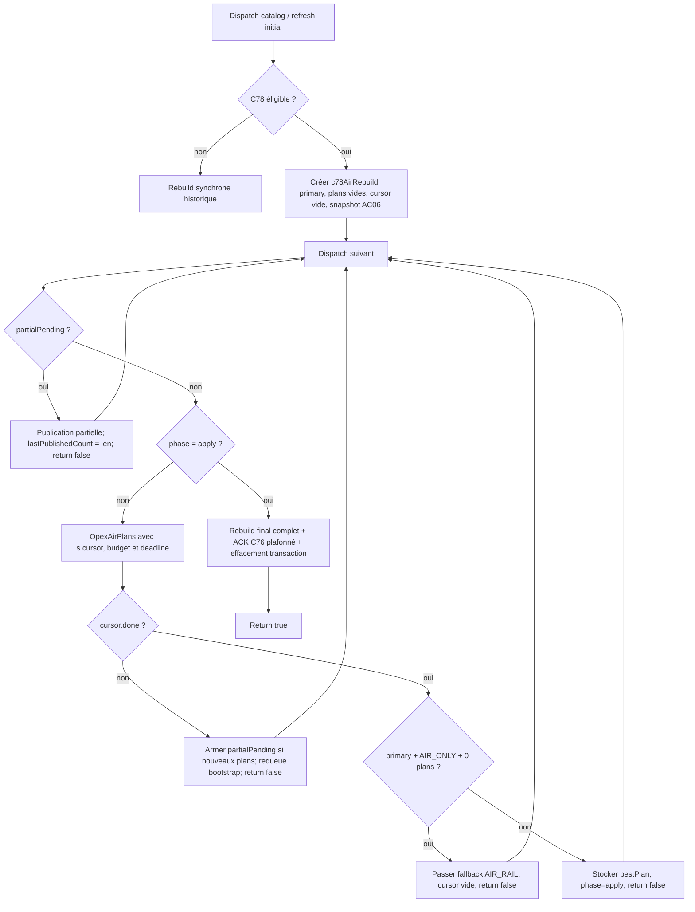

# CD‑00 — contrat de la machine à états du catalogue AIR

**Référence inspectée :** `master`, HEAD `a09a7b2` le 12/10/2026 ; arbres
de travail conservés, aucune modification `.nut` dans CD‑00.
**Étalon exécutable :** `sweeps/test_cd00_air_catalogue_state.py`.
Ce document est un contrat de **comportement actuel** pour les lots CD01–CD07,
pas une proposition de changement de politique ou une preuve de parité moteur.
Le plan de découpage fait foi dans
`docs/air_catalogue_reliquat_decoupage_20261012.md`.

## Deux niveaux, un seul ordonnanceur

Le catalogue matériel `OpexCatalog::_refreshAir` est distinct de la
**génération des projets** `OpexAirPlans`. La tâche `catalog` reste à
l'index **0** de `_taskQueue` (`main.nut:432–451`). Les anciens indices
de tâches désactivées sont conservés pour les sauvegardes ;
`_taskCursor` est un index numérique (mode `SAVE_FULL_STATE`) et
`taskDue` est restauré par **nom** (`persist.nut:773–775, 823–828,
879–905`). Pendant le bootstrap, `OpexC78RequeueInitialCatalogSlice`
reprogramme précisément `catalog` au cycle présent et remet le curseur
global à zéro si `_projects == null` (`scheduler_tasks.nut:75–84`).

Les deux états vivants sont :

1. **Transaction C78** : `task.c78AirRebuild` appartient à
   `OpexC78StartCatalogAirRebuild` et
   `OpexC78ContinueCatalogAirRebuild`, dans
   `scheduler_tasks.nut:15–247`. Elle est la seule propriétaire des
   passages `primary`, `fallback`, `apply`, des plans publiés et de
   `c76StartRevisions`.
2. **Curseur de scan AIR** : `s.cursor` est la table `resumeState`
   fournie à `OpexAirPlans` (`air_planning.nut:2341–2559`).
   Les fonctions `Prepare`, `FindSites`, `NewPairs`,
   `DiscoverHubs`, `HubToSite`, `HubToHub`, `Finalize` partagent un
   `ctx` **éphémère à chaque invocation** ; les champs à reprendre
   transitent par `resumeState`. `s.plans` est le tableau de sortie
   accumulé, transmis par référence au planificateur.

Le retour de `OpexAirPlans` est le `bestPlan` courant ; **sa valeur
non nulle ne signifie pas que le scan est fini**. C78 doit regarder
`s.cursor.done`. `s.bestPlan` devient le plan définitif seulement quand
le scan est terminé.

## Graphe des états C78

**Priorités incontournables** (`scheduler_tasks.nut:104–245`) :
`partialPending` avant `apply`, puis calcul d'une tranche. La
publication partielle se fait **à l'appel suivant**, après l'épuisement
de la tranche précédente. `partialPending` n'est armé que lorsque
`!cursor.done` et que `plans.len() > lastPublishedCount`.
La transition `primary → fallback` ne se produit que pour
`OPEX_STAGE_AIR_ONLY` avec **zéro plan dans tout le scan primary** ;
elle remplace `band` par `PAX_BAND_AIR_RAIL`, remet `cursor = {}`,
réinitialise `bestPlan`, mais conserve le tableau global des plans.
Dans tous les autres cas on programme `apply`, qui doit s'exécuter une
seule fois.

`_dispatchCatalog` reprend une transaction active **avant** de refaire
les gardes de cadence mensuelle, de capital, de C76 et de portefeuille
(`scheduler_tasks.nut:263–283`). Une mutation des lignes/villes
pendant le scan peut modifier les revalidations ou le portefeuille
partiel, mais ne remplace pas cette transaction. Quand le portefeuille
a déjà été publié, une invalidation courante peut être levée pour
continuer le scan ; l'événement C76 demeure visible via les révisions.
`_lastCatalogMonth` prend la valeur du mois **de départ** `s.ym`
à l'apply, pas le mois courant. Un premier scan peut être déclenché
en régime annuel C76, ou depuis la branche sans C76 ; s'il n'y a ni
combo AIR ni villes adéquates, le chemin historique synchrone reste actif.

## Matrice des frontières de reprise

| Entrée / phase | État propriétaire, checkpoint | Sortie / reprise et condition |
|---|---|---|
| `StartCatalogAirRebuild` | C78 : `ym, stage, phase, band, fleetPlan, plans, cursor, bestPlan, published, partialPending, partialBestPlan, lastPublishedCount, tickSlices, lastSliceTick, airOps, regenOps, refreshReason, c76Full, c76Quarter, c76Reason, c76StartRevisions` | Transaction créée après refresh matériel ; `phase=primary`. |
| `Prepare` | AIR : `done, combo, a, b, sites, bestPlan, stationLimitedTowns, perf*, totalOps, startTick, towns, combos, townLimit, scanIndex, scanSites, scanProbes, rankIndex, rankSites, c83TopTownIds`. Selon flags, `c121PlanPerf, c121EndpointCache, servedDiag, c78Year, c78Gen, airFastInit` et compteurs de sondes. | `done` renvoie le plan déjà fini ; aucun combo marque `done=true`. Réutilise les listes `towns/combos` et classement de la **première** tranche, mais reconstruit `hubIndex` d'après les lignes de l'appel. Le cache mémo C80 est remis à zéro au changement de mois. |
| `FindSites` | AIR : `scanIndex=i+1`, `scanSites`, `scanProbes` ; ensuite `rankIndex=rankIndex+1`, `rankSites`. Option ciblée `c83Repair.scan`. | `sites_yield` à budget/deadline après checkpoint. Une fois le classement fini : `sites` affecté, `a=0,b=1`, compteurs scan/rank remis à zéro ; revalidation `OpexAirSiteStillBuildable` avant admission. `resumingCombo` s'appuie sur `sites != null`. |
| `NewPairs` | AIR : `a,b` avancés vers la **paire suivante** avant les filtres et l'évaluation ; `bestPlan` et `perf*`. | `pairs_yield` possible seulement après au moins une paire traitée dans l'appel (`pairProgress`). Les paires d'une ville cible suivent le raccourci existant, avec repli si la cible n'est pas en position zéro. Au terme : `a,b=sites.len()`; une suspension reste possible avant découverte des hubs. |
| `DiscoverHubs` | AIR : `air0310HubSnap = {combo,sig,hubs,sites,orphan}`, `air0310HubSkip`, `air0310HubCounts`; `hubIndex` est local à l'appel. | `reuse` si même combo et signature topologique ; `invalidate` si signature modifiée : remettre les cinq curseurs hub à zéro, mémoriser paires hub déjà publiées, puis redécouvrir ; sinon `discover`. Un snapshot réutilisé recharge les routes dynamiques et revalide les sites. |
| `HubToSite` | AIR : `hubPhase`, `hubSiteI/J` ; comparaisons par station/anchor et politique AC04‑B. | `hub_site_yield` sur paire `(hi,sj)` *non traitée*, après au moins une visite ; à la fin `hubSiteI=hubs.len(), hubSiteJ=0`, puis `hubPhase=1`. Ne pas reclasser une ancre saturée comme orpheline (AC04‑A rejetée). |
| `HubToHub` | AIR : `hubHubI/J` sur `i < j` ; calcul AC05 de `hubAvgIncome` désactivé seulement sous C121. | `hub_hub_yield` sur paire non traitée. À la fin `hubHubI=hubs.len(), hubHubJ=0`. Garder revalidation de chaque hub et déduplication des projets publiés. |
| Fin de combo / V93 | AIR : `combo = comboIndex+1`, `a=0,b=1`, `sites=null`, scan/rank remis à zéro, cinq curseurs hub remis à zéro, snapshots de combo effacés, `bestPlan` conservé. | Un meilleur plan **grand** coupe l'itération classique. V93 peut sauter au prochain combo `kind=small` via `OpexAirV93NextSmallCombo`, au lieu de casser la boucle : `resumeState.combo=nextSmall`. **Nuance de l'ordre actuel :** après un combo petit, le premier grand suivant est encore visité ; le saut ne s'applique qu'à la sortie de ce grand. |
| `Finalize` | AIR : `bestPlan`, perf et durée accumulées ; `done=true`, `sites/towns/combos=null` et purge C80. | Plan final ; aucun passage à une autre phase une fois `done`. Les rapports/sondes de fin restent attachés à cette transition. |
| `partialPending` | C78 : `s.plans`, `partialBestPlan`, `lastPublishedCount`, `published`; `airOps`, `fleetPlan` | Première publication : `_rebuildProjects(..., false)`. Républications : `OpexAir0310PublishIncremental` si actif et portefeuille présent, sinon repli full ; invalidation/élection, puis `return false`. |
| `apply` | C78 : `plans,bestPlan,airOps,fleetPlan,c76StartRevisions` | **Toujours** `_rebuildProjects(...)` complet (qui peut avancer le bootstrap), statistiques, snapshot AC06 s'il existe, `_lastCatalogMonth=s.ym`, destruction de `c78AirRebuild`, `return true`. |

Le champ `c83Repair` est présent dans le **curseur AIR de génération
locale ciblée** (initialisé via
`projects_generation.nut:213–214` par
`OpexC83RepairSnapshot`). Il ne fait **pas** partie des champs C78
créés dans `StartCatalogAirRebuild`. Son sous-état
`scan = {combo,index,sites,partners,done,fallback,probes}` consomme au
moins une ville par tranche ; en absence de partenaire il revient au
scan de sites historique (`air_c83_repair.nut:36–124`). Un découpage
du planificateur doit préserver les deux usages, C78 global et
regénération ciblée.

## Publication, V141, AC06 et Save/Load

La publication d'un lot porte le **préfixe complet** `s.plans` et
`lastPublishedCount` indique la limite antérieure, pas le numéro d'une
autre file. `OpexAir0310PublishIncremental`
(`projects_update.nut:440–676`) conserve les projets non AIR, restaure
l'ordre relatif des clés, transforme les nouveaux plans via
`OpexProjectFromAir`, et sous V141 réécrit les champs variables des
anciens AIR sans les reconvertir (sauf sonde `V141_CHECK`).
Les clés déplacées, les priorités des modes et `OpexReselectProjects`
font partie de la transaction ; sa source peut être extraite sans
changer le **moment** de publication. Une première publication full et
l'apply final full ne sont pas équivalents à une simple insertion.

AC06 v2 capture sept compteurs (`towns,industries,lines` et
`engines.rail/road/air/water`) **après** `catalog.refresh` et **avant**
la première tranche (`scheduler_tasks.nut:68–70`,
`orchestrator.nut:1180–1240`). À `apply`, seulement pour
`c76Full`, l'acquittement des révisions et des dépendances de modes
est plafonné par cette photographie ; une modification intervenue
pendant le scan reste donc à traiter lors d'une génération suivante.
L'option désactivée garde le chemin
`_c76AcknowledgeAllLayers()`. La branche **synchrone** sans transaction
C78 utilise également cet acquittement historique
(`scheduler_tasks.nut:409–433`). La vraie course sur événement forcé
n'a pas encore de preuve VM ; les modèles hôte ne suffisent pas à la
revendiquer.

Ni `c78AirRebuild`, ni `cursor`, ni `partialPending`, ni
`c76StartRevisions` ne figurent dans `Save()`. En `SAVE_FULL_STATE=0`,
la sauvegarde courte comprend notamment les dates/étapes, les échecs
et les révisions C76 ; en mode long elle inclut aussi
`taskCycle, taskCursor, taskDue` (`persist.nut:730–846`).
`Load()` restaure d'abord les données sauvegardées ; `Start()` appelle
`_reconcileAfterLoad()` **après chargement des réglages**.
La réconciliation remet `_c76ForceReloadRegen = true`
(`persist.nut:1128`). Après un Save/Load au milieu d'un scan,
reconstruire le portefeuille et **redémarrer le scan**, sans tenter de
réhydrater des objets AIR non sérialisables ou une publication partielle
en vol. Les compteurs C76 sauvegardés restent la seule barrière des
événements.

## Cadence et budget d'opcodes

Le cap `sliceBudget` est le minimum de
`AIController.GetOpsTillSuspend()`, `AIR_PLAN_SLICE_OPS` et,
sous C121, **150 000** (`scheduler_tasks.nut:195–208`). La
deadline est `GetTick() + BUILD_TICK_MARGIN`. Les phases contrôlent
également cette deadline et le budget cumulé par
`OpexAirCalcDeltaOps`. Les boucles paires/hubs forcent au moins une
visite pour éviter le blocage sur un overhead de reprise déjà
consommateur de budget. Ce sont des **bornes de déclenchement**,
pas la garantie mathématique qu'une visite individuelle coûtera
moins de 150 000 opcodes.

La boucle interne C121 du même tick
(`main.nut:772–794`) ne se poursuit que si aucun worker/recherche
RAIL n'est actif, si le tick est inchangé et s'il reste
**plus de 2 000 opcodes** (`OpexC121CatalogCanContinue`).
Déplacer une phase vers une nouvelle entrée `_taskQueue` changerait
le partage des cycles, la fenêtre des événements et la cadence des
projets.

## Étalon et décision CD01–CD07

`python -X utf8 -m unittest sweeps/test_cd00_air_catalogue_state.py -v`
exécute deux catégories de vérifications : (a) points de reprise et
gardes présents dans la source HEAD ; (b) traces déterministes sur
deux combos et budgets de fixture 1 à 12, saut V93 (y compris
premier grand après un petit), fallback productif/improductif,
publication différée, Save/Load, sept couches d'événements tardifs.
Les quotas de ces fixtures sont des **nombres de visites**, pas des
opcodes NoAI. Une fixture n'établit aucune identité de traces dans le
moteur vivant. Les tests source évitent de figer la place des appels
de phases dans le driver, afin de rester compatibles avec son
extraction CD01–CD05.

| Lot | Séparation sans nouvelle politique | Ce qui impose une porte comportementale/opcode |
|---|---|---|
| **CD01** | Extraire `Prepare` et `FindSites` en **sous-étapes du même scan C78**, en conservant l'ordre des villes, sondes et deux indices. | Un nouveau passage scheduler entre scan/rank, la disparition de la revalidation ou le gel des classements C83 changent les décisions. |
| **CD02** | Interface `sites → NewPairs` avec `a/b`, validation des ancres à la reprise et tableau de plans partagé. | Retarder les paires, changer leur ordre, ou conserver un site sans sa revalidation peut modifier la candidature et le coût. |
| **CD03** | Isoler le code de découverte et l'objet `air0310HubSnap` dans la même invocation logique. | Figer les hubs/leurs routes à travers les événements ou réutiliser la même signature après changement topologique équivaut au comportement V143 rejeté. |
| **CD04** | Une continuation interne `hubPhase,hubSiteI/J` est déjà disponible et peut être exposée comme sous-étape. | Ajouter un yield au milieu d'une comparaison non traitée ou modifier l'identité d'ancre AC04‑B, l'admission C83 ou l'ordre de publication. |
| **CD05** | Isoler `HubToHub`, fin de combo et `Finalize` en conservant `i<j`, AC05, saut V93 et nettoyage d'état. | Changer le passage au prochain combo ou les chances de concurrence du `bestPlan` modifierait les décisions (risque V143). |
| **CD06** | Factoriser **dans C78** la branche de publication partielle et l'apply final tout en gardant leur ordre et les deux types de rebuild. | Toute publication anticipée/coalescée (V142), tout refresh autre mode pendant le scan (V143), ou acquittement au-delà du snapshot AC06. |
| **CD07** | Architecture A : sous-tâches explicites dans **l'unique** entrée `catalog`, possible après CD01–CD06. | Architecture B : nouvelles entrées `_taskQueue` et migration des curseurs/dueCycle/bootstrap/Save/Load ; changement d'ordonnancement exige une **nouvelle qualification économique et opcode**. |

Le **découpage fonctionnel interne** peut conserver la politique et la
séquence de décisions s'il n'ajoute aucun point de suspension. Cela
ne prouve pas une **égalité d'opcodes** : un nouvel appel, une table
de contexte ou une boucle de dispatch ont un coût VM mesurable. Pour
chaque patch CD, enchaîner tests de contrat, fixture VM comparative
à état figé, smoke puis A/B économique/opcodes proportionné selon
`AGENTS.md` et les décisions du chantier. Le seuil de tolérance
économique/opcode ne doit pas être inventé : l'utilisateur accepte
désormais **une légère dégradation d'opcodes compensée par un gain
économique constaté**. Ni le succès de CD‑00, ni les validations AC
antérieures ne valent adoption automatique des changements CD suivants.
