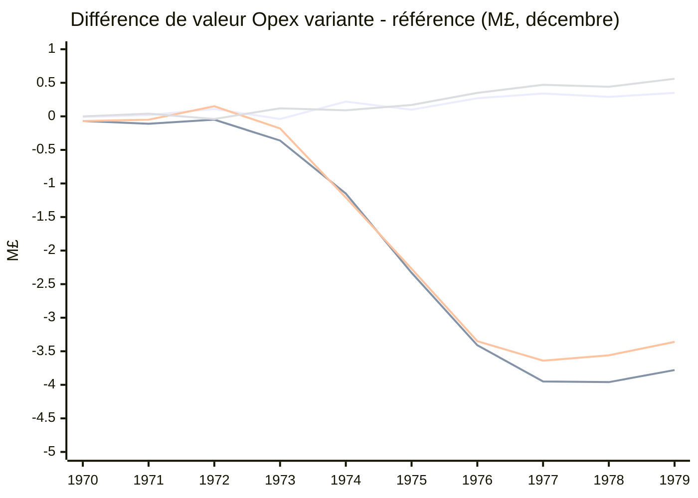

# ESTIM-1 — dynamique trimestrielle en duel contre AAAHogEx (27 octobre 2026)

**Portée.** Analyse descriptive des quatre portes B 20×10 demandées, sans nouvelle partie ni modification des sources. Toutes les valeurs de groupes ci-dessous sont des **moyennes/médianes de 20 graines**, calculées indépendamment à chaque échéance ; les différences sont calculées *graine par graine avant agrégation*. Les montants sont exprimés en **M£**, les flottes et installations en nombres moyens/médians. Les faibles variations de début de campagne ne valent pas, seules, preuve de causalité.

## Méthode et provenance

- Chaque campagne livre `results/<campagne>.json` (`games`, `policy_comparison.aggregates`, `per_pair`, `verdict`), `results/<campagne>.jsonl` (9 600 lignes = 20 graines × 2 politiques × 2 compagnies × 120 dates mensuelles), `results/<campagne>.manifest.json` et `_bundle/`. Les quatre séries ont **40 parties complètes et 9 600 clichés chacun**, tous les chunks `VEHS`/`STNN` valides. Référence : OpexAI avec `estim_unifie=0`.
- Codes : **O0** = Opex référence, **O1** = Opex variante, **A0** = AAAHogEx dans la partie de référence, **A1** = AAAHogEx dans la partie variante. `game_id` contient `policy=...:s<seed>:r0`, clé de jointure avec `run=[company,seed,0]` ; le `policy_id` de AAAHogEx vaut `AAAHogEx` dans les deux parties. `ΔO = O1−O0`, `G0 = O0−A0`, `G1 = O1−A1`, `ΔAAA = A1−A0`. **A0 et A1 sont deux trajectoires distinctes** du même code AAA, exposées à des choix Opex différents sur les mêmes cartes.
- Les 120 clichés mensuels sont le niveau de résolution **physique et de caisse**. Les champs `company_value`, `income_last_year`, `expenses_last_year`, `profit` et `profit_year` sont décodés depuis `PLYR.old_economy` par `sweeps/bench_1v1_5y_20seeds.py:1118-1165`, donc comptables **au dernier trimestre clos** et non des flux mensuels. Les changements observés de `old_economy[0]` sont aux clichés **février, mai, août, novembre** ; tables trimestrielles alignées sur ces 40 dates réelles. Au cliché de février 1970, le compte trimestriel n’est pas encore renseigné ; les tirets ne sont pas des zéros. L’état de caisse/flotte est daté du premier jour du mois indiqué ; les clôtures économiques ont un décalage temporel par rapport à la flotte présente.
- `R` = `income_last_year` (nom trompeur : recette du **dernier trimestre clos**, pas de l’année) ; `D` = `expenses_last_year` **signé**, généralement négatif ; `P` = `profit` du trimestre (`R + D`), `Y` = `profit_year`, somme glissante de 1 à 4 comptes trimestriels (couverture `profit_year_quarters_valid`). `V` est la valeur économique clôturée, `T` = `money` instantané et `L` = `current_loan` instantané. Le bilan publié utilise le cliché final **1979-12-01**, quand V/P/Y sont identiques à novembre mais T peut différer.
- La flotte provient de `physical_counters.py:118-141` par `primary_vehicles_by_mode` : **Av** aéronefs, **Tr** trains moteurs (une unité pilotable par consist), **Rt** véhicules routiers ; **Bt** bateaux non qualifiés selon `qualified_modes.water=false`. Les wagons ne figurent pas individuellement dans les `.jsonl` ; `vehicle_pool_entries` n’est pas un nombre de wagons. Installations `stations_by_facility` : **Ap** aéroports, **Gr** installations ferroviaires, **Ga** bus ; une gare multimodale a plusieurs installations, et `n_stations` compte les gares physiques.
- **Investissements observables :** variation trimestrielle *nette* de flotte/installations, éventuellement négative (retraits, remplacements), et cumul `project_builds_sign_total` des panneaux `IB|...` d’Opex. Ce dernier ne décrit ni le mode ni le capital et des panneaux peuvent manquer : source `sweeps/bench_1v1_5y_20seeds.py:584-613`. Les mêmes panneaux Opex sont visibles chez AAA sur la même carte : il serait erroné de les attribuer à AAA. `capital_quote_events=[]` et `capital_quote_by_mode={}` sur les quatre campagnes : **aucune dépense d’investissement par mode vérifiable**, ni achats/remplacements bruts à partir de la seule variation nette. Les `_engine/*.log` de ces quatre campagnes ne portent pas de journaux d’arbitrage exploitables ; pas de nombre de véhicules par ligne ni de wagons déductibles.

## Vue d’ensemble à la dernière date (1979-12-01)

| Porte B | Verdict | V0 → V1, M£ (moy./méd.) | Δ valeur apparié, M£ (moy./méd.) | Δ valeur ratio des moyennes | Δ `profit_year`, k£/an (moy./méd.) | G0 → G1 (M£ moyens) |
|---|---|---|---|---:|---|---|
| Bit 16 seul | `pass` | 20.21/21.00 → 20.56/21.77 | +0.35/+0.01 | +1.74% | -18.8/+70.7 | -6.98 → -6.61 |
| Bits 31 intégrés | `fail_value_guard` | 19.94/20.52 → 16.16/16.75 | -3.78/-4.05 | -18.93% | +60.6/+10.5 | -7.39 → -10.12 |
| Bits 15 intégrés corrigés | `fail_value_guard` | 20.41/20.67 → 17.05/17.74 | -3.36/-3.85 | -16.48% | +72.9/-37.1 | -7.00 → -10.18 |
| Réserve de caisse supprimée | `pass` | 20.45/20.39 → 21.01/21.39 | +0.56/+0.82 | +2.73% | +165.1/+211.6 | -6.17 → -6.67 |

L’échec de la valeur est indépendant du verdict de profit : la règle `non_erosion` de B accepte une borne **haute** de l’IC95 bootstrap du `profit_year` non négative, mais impose `company_value` ≥ −5 % en ratio des moyennes. Les campagnes 15/31 manquent cette dernière garde ; leur profit terminal n’établit pas un gain de modèle.

*Ordre des courbes : bit 16, bits 31, bits 15 corrigés, réserve supprimée. Les points sont les différences **moyennes appariées** au dernier cliché de décembre de chaque année.*

## Émergence de l’écart et lecture des investissements

**Bit 16 isolé.** Le profil RAIL de distance ne produit pas d’érosion durable. `ΔV` moyen est +0,11 M£ fin 1972, −0,04 fin 1973, puis +0,22 fin 1974, +0,35 fin 1979. Le 1974Q2 (cliché mai) voit simultanément +4,3 avions et +0,8 train en moyenne dans la variante, après +0,13 M£ de valeur, tandis que la caisse est plus basse de −0,27 M£ ; l’ajout apparent de flotte n’est donc pas en lui-même une preuve de mauvaise allocation. À 1979 fin, le gain de caisse (+0,41 M£) explique une part importante des +0,35 M£ de valeur. La contribution propre du bit 16 n’est pas prouvée par la porte A de gain court (`fail_primary`).

**Bits 31.** Un faible déficit existe dès 1970 (−0,07 M£ fin d’année) et 1971 (−0,11), mais la **cassure persistante** est 1973–1975 : aux clichés février/mai/août/novembre 1973, `ΔV` est −0,13/−0,10/−0,19/−0,36 M£ ; en 1974 elle atteint −0,61/−0,76/−0,94/−1,15 M£, puis −2,33 M£ fin 1975. À novembre 1973, la variante compte **+6,9 avions et −3,0 trains moteurs** par graine en moyenne, une trésorerie **−0,45 M£**, et un `profit_year` **−0,18 M£** ; la croissance aérienne coïncide avec le retard ferroviaire et de caisse. Fin 1979 : valeur −3,78 M£ (médiane −4,05), caisse −3,25 M£, dette comparable, avions **−9,05**, trains **−1,55** : la variante finit avec moins d’avions *après* une phase d’investissement aérien plus importante. Les `IB|` retenus indiquent 146,25 projets cumulés contre 156,05 en référence, sans modalité de construction observable. Le changement est une **réallocation précoce suivie d’un déficit cumulé**, plutôt qu’une simple chute de `profit_year` terminal (qui est légèrement positif en différence).

**Bits 15 corrigés.** La valeur n’est pas immédiatement perdante : +0,15 M£ fin 1972, +0,06/+0,09/+0,07 M£ aux trois premiers clichés économiques de 1973. Elle devient −0,18 M£ à **1973Q4 (novembre)**, puis −0,49/−0,61/−0,91/−1,21 M£ en 1974 ; −2,27 fin 1975 et −3,36 fin 1979 (médiane −3,85). Dès août 1973 : **+7,9 avions, −4,0 trains**, `Δcaisse` −0,27 M£ ; en novembre : +7,0/−3,8, caisse −0,30 M£ et `profit_year` −0,04 M£. À fin 1979 : caisse −3,06 M£, trains −1,85, avions −7,10 ; panneaux `IB|` 148,95 contre 157,20. Le même régime apparait sans bit 16 : **le bit 16 isolé n’est pas nécessaire à cette dérive**. Attention : bits 15 et 31 ont des bundles/protocoles différents, donc leur écart inter-campagnes n’isole aucun effet du bit 16.

**Suppression de la réserve.** Le témoin fluctue faiblement en 1970–1972 (fin 1972 −0,04 M£), puis passe durablement positif dès février 1973 (+0,03 M£), fin 1974 +0,09, fin 1976 +0,35 et fin 1979 **+0,56 M£**, médiane +0,82. La caisse est plus disponible à certains stades, mais la valeur supérieure persiste sans suraccumulation systématique de dette. Fin 1979 : **+2,4 avions, +0,75 train** par graine et `profit_year` +0,17 M£ ; panneaux `IB|` 157,6 contre 154,0. Le succès suggère qu’une petite suppression de marge de caisse peut permettre des opportunités rentables sans bouleverser le portefeuille modal.

**AAAHogEx réagit à chaque duel.** Les écarts G0/G1 sont fournis par trimestre ci-dessous, car comparer Opex à un AAA calculé dans une autre partie fabriquerait de faux effets directs. Exemple fin 1979 bits 31 : A1 a **1,05 M£ de valeur de moins** qu’A0 ; l’écart Opex−AAA se détériore pourtant de −7,39 à −10,12 M£, avec −3,78 M£ d’Opex et −1,05 M£ d’AAA. Dans le témoin réserve : AAA de la variante gagne **+1,05 M£** par rapport à AAA de référence ; les deux duels passent de G0 −6,17 à G1 −6,67 M£ malgré l’amélioration propre d’Opex (+0,56). La concurrence est endogène à chaque partie, même avec un adversaire figé en code.

## Observations de constructions et tentatives RAIL (panneaux conservés)

Dans les seules parties Opex, `project_builds_sign_by_year` comptabilise les constructions publiées dans les panneaux `IB|` encore présents au dernier cliché ; `rail_attempt_sign_by_year[année].or_signs` les **tentatives RAIL avec panneau `OR|` conservé**, et `reasons.OK` les tentatives dont le chemin a abouti. Un `OK` ne démontre pas à lui seul une ligne effectivement ouverte ; ces panels ne sont pas une télémétrie exhaustive, ni un devis capital. Les valeurs `a/b` sont moyenne/médiane sur 20 graines, campagne par campagne. Voir `bench_1v1_5y_20seeds.py:513-580,584-613`. Les gares et stocks trimestriels par mode sont détaillés dans les tableaux suivants.

**Bit 16** — `estim1_bit16_porteB_20x10_r2_20261027`

| Année | `IB` Opex 0 / Opex 1 | `OR` RAIL Opex 0 / Opex 1 | `OR.OK` Opex 0 / Opex 1 |
|---|---:|---:|---:|
| 1970 | 12.8/13.0 / 12.9/13.0 | 0.0/0.0 / 0.0/0.0 | 0.0/0.0 / 0.0/0.0 |
| 1971 | 32.8/34.5 / 34.0/36.0 | 5.9/5.0 / 5.5/4.0 | 5.4/4.5 / 5.0/4.0 |
| 1972 | 27.0/28.0 / 28.1/29.5 | 13.1/13.5 / 14.8/14.5 | 10.2/10.5 / 11.3/13.0 |
| 1973 | 20.5/22.0 / 20.4/19.0 | 11.0/11.0 / 9.5/9.0 | 5.5/5.0 / 5.6/6.0 |
| 1974 | 16.0/17.0 / 18.2/19.0 | 6.3/6.0 / 7.2/6.0 | 2.5/2.5 / 1.9/2.0 |
| 1975 | 14.4/13.5 / 10.9/11.0 | 6.2/5.5 / 5.0/5.0 | 1.1/1.0 / 1.1/1.0 |
| 1976 | 8.9/8.5 / 10.6/11.0 | 6.2/5.0 / 5.2/6.0 | 0.7/0.5 / 1.1/1.0 |
| 1977 | 9.8/8.5 / 8.2/6.5 | 4.2/4.0 / 5.0/4.0 | 0.6/0.0 / 0.5/0.0 |
| 1978 | 6.2/6.0 / 7.5/7.0 | 4.1/4.0 / 3.1/3.0 | 0.7/0.5 / 0.9/1.0 |
| 1979 | 6.7/6.0 / 5.0/4.0 | 4.3/4.0 / 3.9/3.0 | 0.8/0.5 / 0.6/0.0 |

**Bits 31** — `estim1_bit31_porteB_20x10_r2_20261027`

| Année | `IB` Opex 0 / Opex 1 | `OR` RAIL Opex 0 / Opex 1 | `OR.OK` Opex 0 / Opex 1 |
|---|---:|---:|---:|
| 1970 | 12.8/13.0 / 12.0/12.0 | 0.0/0.0 / 0.0/0.0 | 0.0/0.0 / 0.0/0.0 |
| 1971 | 32.8/34.5 / 31.4/32.0 | 5.9/5.0 / 3.4/3.0 | 5.4/4.5 / 3.2/3.0 |
| 1972 | 26.4/28.0 / 27.9/27.5 | 12.8/13.0 / 12.1/12.0 | 9.8/9.0 / 9.7/10.0 |
| 1973 | 20.2/21.5 / 24.9/26.0 | 10.9/10.5 / 7.8/7.5 | 5.7/5.0 / 5.2/5.0 |
| 1974 | 16.9/18.0 / 15.2/15.5 | 6.8/6.0 / 6.2/5.0 | 2.8/2.0 / 2.9/2.0 |
| 1975 | 14.1/13.0 / 12.1/11.5 | 6.5/6.0 / 4.8/4.5 | 1.1/1.0 / 1.5/1.5 |
| 1976 | 10.3/10.0 / 7.6/7.0 | 4.8/5.0 / 4.3/4.0 | 0.9/0.5 / 1.1/1.0 |
| 1977 | 9.0/8.0 / 6.6/6.0 | 4.0/4.0 / 4.5/4.0 | 0.4/0.0 / 0.9/0.0 |
| 1978 | 7.0/7.0 / 5.2/4.0 | 3.1/3.5 / 4.1/3.0 | 0.6/0.5 / 0.7/0.0 |
| 1979 | 6.5/6.0 / 3.4/3.0 | 4.0/4.0 / 3.8/3.0 | 0.5/0.0 / 0.7/0.0 |

**Bits 15** — `estim1_fix15_porteB_20x10_20261027`

| Année | `IB` Opex 0 / Opex 1 | `OR` RAIL Opex 0 / Opex 1 | `OR.OK` Opex 0 / Opex 1 |
|---|---:|---:|---:|
| 1970 | 12.8/13.5 / 11.9/13.0 | 0.0/0.0 / 0.0/0.0 | 0.0/0.0 / 0.0/0.0 |
| 1971 | 32.0/32.5 / 33.8/38.0 | 5.0/3.0 / 3.5/3.0 | 4.3/3.0 / 3.2/3.0 |
| 1972 | 28.6/29.5 / 27.9/29.0 | 15.6/14.5 / 12.4/12.0 | 11.4/13.0 / 10.3/11.0 |
| 1973 | 19.9/19.0 / 23.3/24.0 | 10.3/10.5 / 6.8/5.5 | 6.3/7.0 / 4.9/5.0 |
| 1974 | 17.9/18.0 / 14.2/16.0 | 6.5/5.5 / 5.3/5.5 | 2.0/2.0 / 2.5/3.0 |
| 1975 | 12.8/13.0 / 13.7/14.5 | 5.7/6.0 / 5.8/5.0 | 1.6/1.0 / 2.1/1.5 |
| 1976 | 11.2/11.5 / 8.5/7.5 | 4.8/3.5 / 4.5/4.0 | 0.6/0.0 / 1.0/1.0 |
| 1977 | 9.0/8.0 / 7.7/7.5 | 4.0/3.0 / 3.7/3.5 | 0.6/0.5 / 0.9/1.0 |
| 1978 | 7.2/7.0 / 4.5/5.0 | 4.4/3.0 / 4.0/3.5 | 0.4/0.0 / 0.8/0.5 |
| 1979 | 5.7/5.5 / 3.3/3.5 | 4.8/4.0 / 3.2/2.5 | 0.5/0.0 / 0.3/0.0 |

**Réserve supprimée** — `cash_reserve_off_porteB_20x10_20261027`

| Année | `IB` Opex 0 / Opex 1 | `OR` RAIL Opex 0 / Opex 1 | `OR.OK` Opex 0 / Opex 1 |
|---|---:|---:|---:|
| 1970 | 12.8/13.5 / 12.8/13.5 | 0.0/0.0 / 0.0/0.0 | 0.0/0.0 / 0.0/0.0 |
| 1971 | 31.8/33.0 / 33.4/35.5 | 4.6/3.0 / 5.5/3.0 | 4.3/3.0 / 4.5/3.0 |
| 1972 | 29.1/29.0 / 27.6/29.5 | 15.2/14.5 / 13.1/13.0 | 11.3/12.5 / 10.6/11.0 |
| 1973 | 20.6/21.0 / 19.1/17.5 | 9.6/10.0 / 8.7/8.5 | 6.2/6.5 / 5.2/5.0 |
| 1974 | 17.6/18.0 / 17.9/20.5 | 6.1/5.0 / 7.0/6.0 | 1.8/1.5 / 2.6/1.5 |
| 1975 | 10.4/10.0 / 11.3/11.0 | 6.7/6.0 / 6.0/5.0 | 1.2/1.0 / 1.2/1.0 |
| 1976 | 11.2/11.0 / 11.9/12.5 | 5.5/4.0 / 4.4/3.0 | 0.5/0.0 / 0.7/0.5 |
| 1977 | 6.5/6.0 / 8.7/7.5 | 3.5/3.0 / 5.1/4.5 | 0.3/0.0 / 0.8/1.0 |
| 1978 | 8.2/8.5 / 8.8/8.0 | 3.9/3.0 / 4.0/3.0 | 0.6/0.0 / 0.7/0.5 |
| 1979 | 5.8/5.0 / 6.2/6.0 | 3.5/3.0 / 4.2/4.5 | 0.8/0.5 / 1.2/1.0 |

## Mix de flotte comparé à AAAHogEx : avions, trains et wagons

| Campagne, décembre 1979 | Opex 0 Av/Tr/Rt | Opex 1 Av/Tr/Rt | AAA 0 Av/Tr/Rt | AAA 1 Av/Tr/Rt |
|---|---:|---:|---:|---:|
| Bit 16 seul | 118.2/28.6/4.2 | 117.8/29.6/4.3 | 52.7/64.7/162.1 | 53.8/60.9/171.7 |
| Bits 31 intégrés | 119.3/28.7/4.5 | 110.2/27.1/4.2 | 52.1/62.8/160.6 | 51.3/64.2/173.7 |
| Bits 15 intégrés corrigés | 119.9/29.0/3.1 | 112.8/27.1/4.2 | 52.8/61.5/179.4 | 51.5/68.8/166.3 |
| Réserve de caisse supprimée | 118.3/27.9/3.1 | 120.7/28.7/3.4 | 52.6/59.1/163.2 | 53.9/61.3/169.2 |

Opex conserve environ **110–121 avions** contre **49–54** chez AAA, seulement **27–30 trains moteurs** contre **59–69** chez AAA, et très peu de véhicules routiers par rapport à AAA (voir les nombres par campagne). Le différentiel de mix est structurel et précède ESTIM-1 : il apparaît également dans les références `estim_unifie=0`. `primary_vehicles_by_mode.rail` compte une unité par train, **pas les wagons** ; sans sauvegardes `VEHS` brutes ou télémetrie de consistes par ligne, il est impossible de calculer wagons/train, nombre de trains par ligne, nombre de lignes, longueur des trains ou tonnage à partir de ces JSONL. `capacities_by_cargo` mélange des modes et ne suffit pas à déduire les wagons.

**Rythme de développement AAA.** Dans le duel de référence des bits 31 (la comparaison interne à une même partie reste la plus sûre), AAA possède en moyenne **23,4 avions / 6,3 trains / 31,3 véhicules routiers** fin 1971, **37,8 / 19,9 / 128,0** fin 1973, **41,5 / 37,9 / 140,8** fin 1975, et **52,1 / 62,8 / 160,6** fin 1979. Opex de référence est respectivement à **37,4 / 5,2 / 3,3**, **68,3 / 20,8 / 4,1**, **94,2 / 25,5 / 4,2**, puis **119,3 / 28,7 / 4,5**. AAA industrialise très tôt le réseau routier, puis accroît fortement ses trains dès 1974–1976 ; Opex continue à multiplier les avions avec une flotte ferroviaire qui plafonne autour de 25–29 trains. Les clichés montrent **des stocks**, non le nombre de véhicules affectés à une même ligne ni le montant des chantiers de chaque période.

## Mécanismes probables par bit et corrections minimales à tester

1. **Bit 1 (`k_R`)** : applique une calibration de réalisation à la **recette** et l’apprend par mode ; les revenus d’une flotte existante et le classement d’une nouvelle ligne n’ont pas toujours la même donnée de départ. Une préférence relative AIR contre RAIL peut devenir auto-renforçante si les recettes brutes et réalisées ne sont pas homogènes. **Hypothèse**, étayée par la coïncidence +avions/−trains des intégrés ; les B ne sont pas des ablations causales isolées. Correction minimale : tracer `R_brute`, `k_R`, `P_corrigé`, rang et ligne finalement retenue pour les meilleurs candidats AIR/RAIL avec sondes équilibrées, sans modifier les priors en bloc.
2. **Bit 2 (financement commun)** : `OpexEstimFinanceCapital` applique les facteurs de financement actuels **RAIL 100 %** (`RAIL_FINANCE_BIAS_PCT=100`) et **ROUTE 121 %**, sans majoration ferroviaire selon la distance. `OpexEstimFinanceCashNeeded` et la réserve de caisse ont été supprimées au commit `b4c3babd` ; la contrainte utilise désormais `OpexAvailableCapital()` sans cette réserve. La différence entre `budgetCapital`, devis de construction, coût de score et capital finançable peut néanmoins modifier les choix entre AIR et RAIL. L’expérience « réserve supprimée » est distincte du bit 2. Correction à instruire : tracer devis, besoin exact de financement, caisse mobilisable, classement et refus observés avant d’imputer une éviction au financement.
3. **Bit 4 (renforts/remplacements marginaux)** : les scores `ΔR/ΔE/ΔA/ΔC/ΔP` décrivent l’accroissement projeté, mais V252 évalue encore une flotte homogène par appareil et certains chantiers d’ouverture gardent un score `profitAnnual` distinct des composantes publiées. Un renfort avion surévalué peut déplacer du capital RAIL vers AIR. Correction ciblée : faire le différentiel C121 **flotte mixte avant/après** pour un seul avion et vérifier l’identité `ΔP = k_R×ΔR − ΔE − ΔA` au score réellement classé, avec test de l’identité sur les trajectoires d’une ligne existante ; puis mesure d’exposition avant banc.
4. **Bit 8 (primitives physiques)** : mois de `365/12`, fréquence de visite, capacité de fret concurrent et suppression de la bande de ROI AIR `1,25` changent l’ordre relatif et la fréquence des constructions. Une estimation AIR devenue trop favorable aux dépens des trains est plausible, sans preuve de l’un des quatre sous-effets. Correction minimale : enregistrer le top‑K AIR/RAIL avant et après chaque primitive sur quelques graines représentatives, identifier les seules inversions de choix réellement construites, et ne corriger que le sous-effet exposé.
5. **Bit 16 (RAIL par distance)** : `k_R0(d)=0,5722990662+0,00258519378×d` recentré à 0,92 et `k_C(d)=1,0778667894+0,00324189259×d` sont appliqués à la recette brute et au devis RAIL **avant A*** seulement ; le devis actualisé et la garde financière n’ont pas de seconde majoration. Le **bit 16 seul passe B** sans gain A démontré. Son interaction avec les quatre autres bits demeure ouverte ; éviter de lui attribuer l’érosion intégrée sans test `31` contre `15` dans un **même bundle et mêmes autres réglages**, avec prix/devis/prior/rang exposés sur les mêmes graines.

La principale vérification suivante serait un diagnostic **lecture des décisions** avec sondes identiques dans les deux bras sur une courte liste préenregistrée de graines : reconstituer les projets AIR/RAIL construits ou refusés entre mai 1973 et février 1975, coût payé, rapport de recette réalisée, rang, marge marginale et opportunité perdue, puis comparer les profits de ligne à un âge égal. Les campagnes présentes prouvent le **moment et le mix** de la divergence ; elles ne permettent pas d’identifier causalement une fonction fautive sans cette exposition. Aucune correction ni campagne n’est déclenchée ici.

## Tableaux temporels, moyennes et médianes appariées

**Convention de lecture.** Tous les nombres `a/b` signifient **moyenne / médiane** sur les 20 graines ou 20 différences par graine. Les valeurs monétaires sont en **M£** ; pas de cumul de trimestre à trimestre pour P/R/D. Une différence affichée en millions peut s’arrondir à zéro tout en restant distincte. `V` et `G` utilisent les valeurs clôturées au checkpoint. `IBq` = variation nette du cumul des panneaux Opex entre les deux checkpoints ; sa médiane peut être négative lorsque des panneaux disparaissent. Les colonnes de finances contiennent, dans cet ordre, `T/L/P/Y/R/D` (M£) ; celles de flotte `Av/Tr/Rt/Ap/Gr/St` (comptages) ; chaque couple est moyenne/médiane. Les tableaux de flotte correspondent au stock, et la table d’évènements donne les variations nettes de ce stock par trimestre.

### Bit 16 seul — `estim1_bit16_porteB_20x10_r2_20261027`

Sources : [`estim1_bit16_porteB_20x10_r2_20261027.json`](../results/estim1_bit16_porteB_20x10_r2_20261027.json), [`estim1_bit16_porteB_20x10_r2_20261027.jsonl`](../results/estim1_bit16_porteB_20x10_r2_20261027.jsonl), [`estim1_bit16_porteB_20x10_r2_20261027.manifest.json`](../results/estim1_bit16_porteB_20x10_r2_20261027.manifest.json) ; bundle `ec515a3a68af52666bf1080da1ab313b7ccfa7906fdae99b3ecf5ace8f9851cb`. Variante politique `estim1_bit16`. Paires 20/20 ; verdict `pass`.

**Année par année (cliché du 1er décembre, valeurs et prêt en M£, flottes en unités).**
| Année | V O0 | V O1 | V A0 | V A1 | ΔO V | G0 | G1 | ΔO caisse | ΔO prêt | ΔO profit glissant Y | Av O0/O1 | Tr O0/O1 |
|---|---:|---:|---:|---:|---:|---:|---:|---:|---:|---:|---:|---:|
| 1970 | 0.37/0.41 | 0.35/0.37 | 0.30/0.31 | 0.30/0.30 | -0.01/-0.00 | +0.07/+0.06 | +0.06/+0.06 | -0.00/+0.01 | +0.00/+0.00 | -0.02/-0.01 | 12.3/14.0/12.4/13.0 | 0.0/0.0/0.0/0.0 |
| 1971 | 1.85/1.90 | 1.87/1.94 | 1.49/1.61 | 1.50/1.46 | +0.02/+0.05 | +0.35/+0.47 | +0.37/+0.23 | -0.02/-0.01 | +0.00/+0.00 | +0.05/+0.08 | 37.4/40.5/38.6/43.0 | 5.2/4.5/4.8/3.5 |
| 1972 | 3.86/4.04 | 3.97/4.33 | 2.92/2.93 | 2.97/3.02 | +0.11/+0.06 | +0.94/+1.19 | +1.00/+1.13 | +0.03/+0.03 | -0.01/+0.00 | +0.05/+0.11 | 55.0/60.5/56.0/59.0 | 15.1/15.5/15.2/16.0 |
| 1973 | 5.75/6.05 | 5.71/5.98 | 4.25/4.57 | 4.21/4.24 | -0.04/-0.07 | +1.50/+1.80 | +1.50/+1.61 | -0.14/-0.09 | -0.01/+0.00 | +0.04/+0.07 | 69.1/76.5/69.5/70.0 | 21.1/20.0/22.1/22.0 |
| 1974 | 7.62/8.10 | 7.84/8.29 | 5.70/6.11 | 5.87/6.19 | +0.22/+0.26 | +1.93/+2.58 | +1.97/+2.02 | -0.04/+0.05 | +0.00/+0.00 | +0.10/+0.09 | 81.4/83.5/85.8/88.0 | 24.0/24.0/24.5/25.0 |
| 1975 | 9.86/10.54 | 9.95/10.60 | 8.00/8.26 | 8.07/8.44 | +0.10/-0.00 | +1.85/+2.48 | +1.88/+2.29 | +0.25/+0.09 | +0.01/+0.00 | +0.05/+0.06 | 94.2/99.5/95.3/95.5 | 25.6/25.5/25.8/26.0 |
| 1976 | 11.96/12.85 | 12.23/12.97 | 11.41/12.29 | 11.36/11.86 | +0.27/+0.24 | +0.54/+1.20 | +0.87/+0.78 | +0.29/+0.57 | +0.00/+0.00 | +0.10/+0.12 | 101.2/104.0/103.2/104.5 | 26.4/27.0/27.0/26.5 |
| 1977 | 14.43/15.30 | 14.77/15.71 | 15.73/16.43 | 15.77/16.63 | +0.34/+0.36 | -1.30/-0.74 | -1.00/-1.37 | +0.46/+0.58 | +0.00/+0.00 | +0.07/+0.05 | 109.0/114.0/109.6/112.0 | 26.9/26.5/27.6/27.0 |
| 1978 | 17.13/17.87 | 17.42/18.41 | 20.96/21.82 | 20.98/22.48 | +0.29/+0.04 | -3.83/-2.88 | -3.55/-3.96 | +0.29/+0.34 | +0.00/+0.00 | +0.00/+0.05 | 113.4/117.5/114.3/115.0 | 27.5/26.5/28.9/28.0 |
| 1979 | 20.21/21.00 | 20.56/21.77 | 27.19/27.79 | 27.17/28.52 | +0.35/+0.01 | -6.98/-6.01 | -6.61/-7.37 | +0.41/+0.25 | +0.00/+0.00 | -0.02/+0.07 | 118.2/122.0/117.8/120.0 | 28.6/28.0/29.6/28.5 |

Voir les 40 trimestres : valeur Opex et AAA, différences appariées

| Trimestre / cliché | V O0 | V O1 | V A0 | V A1 | ΔO | G0 | G1 | ΔAAA |
|---|---:|---:|---:|---:|---:|---:|---:|---:|
| 1970T1 `1970-02-01` | 0.000/0.000 | 0.000/0.000 | 0.000/0.000 | 0.000/0.000 | +0.000/+0.000 | +0.000/+0.000 | +0.000/+0.000 | +0.000/+0.000 |
| 1970T2 `1970-05-01` | 0.011/0.001 | 0.011/0.001 | 0.000/0.000 | 0.000/0.000 | +0.000/+0.000 | +0.011/+0.001 | +0.011/+0.001 | +0.000/+0.000 |
| 1970T3 `1970-08-01` | 0.143/0.140 | 0.136/0.135 | 0.100/0.101 | 0.099/0.098 | -0.007/+0.000 | +0.043/+0.044 | +0.037/+0.036 | -0.001/+0.000 |
| 1970T4 `1970-11-01` | 0.367/0.408 | 0.354/0.371 | 0.296/0.308 | 0.297/0.304 | -0.013/-0.000 | +0.071/+0.056 | +0.057/+0.063 | +0.001/+0.000 |
| 1971T1 `1971-02-01` | 0.607/0.650 | 0.619/0.653 | 0.543/0.579 | 0.558/0.555 | +0.012/+0.010 | +0.064/+0.020 | +0.061/+0.045 | +0.015/+0.018 |
| 1971T2 `1971-05-01` | 0.966/0.999 | 0.963/0.949 | 0.859/0.884 | 0.855/0.856 | -0.003/+0.005 | +0.106/+0.087 | +0.108/+0.035 | -0.004/-0.011 |
| 1971T3 `1971-08-01` | 1.391/1.400 | 1.407/1.459 | 1.147/1.165 | 1.154/1.168 | +0.016/+0.039 | +0.244/+0.312 | +0.253/+0.154 | +0.007/+0.002 |
| 1971T4 `1971-11-01` | 1.849/1.901 | 1.873/1.936 | 1.494/1.605 | 1.504/1.464 | +0.024/+0.048 | +0.354/+0.471 | +0.369/+0.230 | +0.010/-0.010 |
| 1972T1 `1972-02-01` | 2.389/2.412 | 2.445/2.595 | 1.884/1.968 | 1.892/1.872 | +0.057/+0.106 | +0.504/+0.620 | +0.553/+0.378 | +0.007/+0.017 |
| 1972T2 `1972-05-01` | 2.851/3.067 | 2.943/3.161 | 2.289/2.398 | 2.286/2.346 | +0.092/+0.042 | +0.562/+0.777 | +0.657/+0.537 | -0.003/-0.007 |
| 1972T3 `1972-08-01` | 3.343/3.404 | 3.492/3.874 | 2.625/2.729 | 2.612/2.661 | +0.150/+0.142 | +0.718/+1.049 | +0.881/+1.082 | -0.013/-0.067 |
| 1972T4 `1972-11-01` | 3.860/4.040 | 3.968/4.330 | 2.919/2.932 | 2.971/3.019 | +0.108/+0.061 | +0.941/+1.193 | +0.997/+1.131 | +0.053/+0.141 |
| 1973T1 `1973-02-01` | 4.317/4.626 | 4.384/4.713 | 3.310/3.488 | 3.310/3.422 | +0.067/+0.124 | +1.007/+1.311 | +1.074/+1.240 | -0.000/-0.051 |
| 1973T2 `1973-05-01` | 4.722/5.004 | 4.776/5.122 | 3.700/3.956 | 3.665/3.904 | +0.055/+0.131 | +1.022/+1.317 | +1.111/+1.177 | -0.035/+0.068 |
| 1973T3 `1973-08-01` | 5.199/5.423 | 5.189/5.383 | 3.953/4.075 | 3.976/4.038 | -0.010/-0.014 | +1.245/+1.640 | +1.213/+1.247 | +0.023/+0.058 |
| 1973T4 `1973-11-01` | 5.750/6.055 | 5.706/5.978 | 4.254/4.568 | 4.206/4.240 | -0.044/-0.071 | +1.496/+1.801 | +1.500/+1.607 | -0.048/-0.037 |
| 1974T1 `1974-02-01` | 6.322/6.649 | 6.306/6.662 | 4.471/4.718 | 4.634/4.933 | -0.017/-0.082 | +1.851/+2.394 | +1.672/+1.874 | +0.163/+0.138 |
| 1974T2 `1974-05-01` | 6.675/7.130 | 6.806/7.141 | 4.748/4.912 | 4.931/5.240 | +0.131/+0.068 | +1.927/+2.500 | +1.875/+2.005 | +0.184/+0.400 |
| 1974T3 `1974-08-01` | 7.131/7.663 | 7.327/7.685 | 5.241/5.551 | 5.324/5.575 | +0.196/+0.144 | +1.890/+2.690 | +2.003/+2.303 | +0.083/+0.192 |
| 1974T4 `1974-11-01` | 7.623/8.100 | 7.842/8.287 | 5.695/6.111 | 5.873/6.188 | +0.219/+0.255 | +1.928/+2.578 | +1.970/+2.019 | +0.177/+0.117 |
| 1975T1 `1975-02-01` | 8.206/8.699 | 8.361/8.906 | 6.161/6.400 | 6.402/6.911 | +0.155/+0.154 | +2.045/+2.548 | +1.959/+2.246 | +0.241/+0.297 |
| 1975T2 `1975-05-01` | 8.702/9.270 | 8.853/9.353 | 6.685/7.141 | 6.843/7.282 | +0.151/+0.028 | +2.017/+2.639 | +2.010/+2.347 | +0.158/+0.267 |
| 1975T3 `1975-08-01` | 9.277/9.886 | 9.392/10.010 | 7.309/7.705 | 7.355/7.692 | +0.114/-0.080 | +1.969/+2.616 | +2.037/+2.319 | +0.046/-0.139 |
| 1975T4 `1975-11-01` | 9.857/10.536 | 9.954/10.599 | 8.003/8.263 | 8.070/8.443 | +0.097/-0.002 | +1.854/+2.482 | +1.884/+2.287 | +0.067/-0.151 |
| 1976T1 `1976-02-01` | 10.400/11.103 | 10.489/11.148 | 8.707/9.104 | 8.820/9.453 | +0.089/+0.039 | +1.693/+2.282 | +1.669/+1.987 | +0.114/-0.273 |
| 1976T2 `1976-05-01` | 10.912/11.512 | 11.049/11.883 | 9.567/9.924 | 9.612/10.082 | +0.137/+0.075 | +1.345/+2.036 | +1.437/+1.536 | +0.045/-0.084 |
| 1976T3 `1976-08-01` | 11.465/12.353 | 11.622/12.390 | 10.367/11.011 | 10.431/10.942 | +0.157/-0.041 | +1.098/+1.809 | +1.191/+1.127 | +0.064/+0.028 |
| 1976T4 `1976-11-01` | 11.956/12.845 | 12.230/12.968 | 11.411/12.293 | 11.364/11.860 | +0.274/+0.241 | +0.545/+1.205 | +0.866/+0.781 | -0.047/+0.106 |
| 1977T1 `1977-02-01` | 12.509/13.326 | 12.813/13.571 | 12.353/13.511 | 12.370/12.893 | +0.304/+0.155 | +0.156/+0.793 | +0.443/+0.287 | +0.017/+0.279 |
| 1977T2 `1977-05-01` | 13.130/13.905 | 13.429/14.274 | 13.374/14.291 | 13.376/13.876 | +0.299/+0.454 | -0.244/+0.500 | +0.053/-0.024 | +0.002/+0.104 |
| 1977T3 `1977-08-01` | 13.781/14.693 | 14.113/15.087 | 14.559/15.575 | 14.504/15.147 | +0.332/+0.353 | -0.778/-0.193 | -0.390/-0.444 | -0.055/+0.188 |
| 1977T4 `1977-11-01` | 14.430/15.299 | 14.767/15.706 | 15.728/16.429 | 15.768/16.625 | +0.336/+0.362 | -1.297/-0.738 | -1.001/-1.368 | +0.040/+0.459 |
| 1978T1 `1978-02-01` | 15.098/15.909 | 15.424/16.432 | 16.991/17.580 | 17.069/18.011 | +0.326/+0.301 | -1.893/-1.033 | -1.645/-2.062 | +0.079/+0.485 |
| 1978T2 `1978-05-01` | 15.726/16.524 | 16.070/17.142 | 18.333/19.014 | 18.398/19.567 | +0.344/+0.152 | -2.607/-1.565 | -2.328/-2.579 | +0.065/+0.427 |
| 1978T3 `1978-08-01` | 16.402/17.135 | 16.740/17.741 | 19.633/20.542 | 19.647/21.029 | +0.338/+0.058 | -3.231/-2.190 | -2.907/-3.396 | +0.014/+0.169 |
| 1978T4 `1978-11-01` | 17.128/17.867 | 17.420/18.413 | 20.958/21.819 | 20.975/22.483 | +0.292/+0.044 | -3.831/-2.878 | -3.555/-3.964 | +0.017/+0.392 |
| 1979T1 `1979-02-01` | 17.836/18.536 | 18.197/19.267 | 22.501/23.167 | 22.434/23.756 | +0.361/+0.174 | -4.665/-3.820 | -4.237/-4.721 | -0.067/+0.314 |
| 1979T2 `1979-05-01` | 18.616/19.327 | 18.941/20.052 | 24.009/24.743 | 23.985/25.201 | +0.325/+0.099 | -5.393/-4.533 | -5.044/-5.449 | -0.024/+0.589 |
| 1979T3 `1979-08-01` | 19.386/20.103 | 19.744/20.952 | 25.534/26.314 | 25.531/26.883 | +0.358/+0.021 | -6.148/-5.205 | -5.788/-6.363 | -0.002/+0.437 |
| 1979T4 `1979-11-01` | 20.209/21.004 | 20.559/21.768 | 27.186/27.787 | 27.166/28.524 | +0.351/+0.010 | -6.978/-6.012 | -6.607/-7.367 | -0.020/+0.291 |

Voir les 40 trimestres : trésorerie, prêt, profit trimestriel, profit glissant, recette et dépenses des quatre compagnies

Chaque cellule est la série **T/L/P/Y/R/D**, et chaque mesure `moyenne/médiane` en M£ ; `R` et `D` décrivent uniquement le **dernier trimestre clos**.

| Trimestre / cliché | Opex 0 : T/L/P/Y/R/D | Opex 1 : T/L/P/Y/R/D | AAA 0 : T/L/P/Y/R/D | AAA 1 : T/L/P/Y/R/D |
|---|---|---|---|---|
| 1970T1 `1970-02-01` | 0.063/0.059 / 0.300/0.300 / —/— / —/— / 0.000/0.000 / 0.000/0.000 | 0.063/0.059 / 0.300/0.300 / —/— / —/— / 0.000/0.000 / 0.000/0.000 | 0.019/0.019 / 0.020/0.020 / —/— / —/— / 0.000/0.000 / 0.000/0.000 | 0.019/0.019 / 0.020/0.020 / —/— / —/— / 0.000/0.000 / 0.000/0.000 |
| 1970T2 `1970-05-01` | 0.049/0.036 / 0.300/0.300 / 0.012/-0.004 / 0.012/-0.004 / 0.017/0.000 / -0.005/-0.004 | 0.051/0.039 / 0.300/0.300 / 0.012/-0.004 / 0.012/-0.004 / 0.017/0.000 / -0.005/-0.004 | 0.031/0.031 / 0.300/0.300 / -0.003/-0.003 / -0.003/-0.003 / 0.000/0.000 / -0.003/-0.003 | 0.030/0.029 / 0.300/0.300 / -0.003/-0.003 / -0.003/-0.003 / 0.000/0.000 / -0.003/-0.003 |
| 1970T3 `1970-08-01` | 0.055/0.050 / 0.300/0.300 / 0.151/0.150 / 0.163/0.162 / 0.159/0.158 / -0.008/-0.008 | 0.052/0.051 / 0.300/0.300 / 0.147/0.133 / 0.159/0.159 / 0.155/0.140 / -0.008/-0.008 | 0.039/0.038 / 0.300/0.300 / 0.115/0.122 / 0.112/0.119 / 0.124/0.131 / -0.009/-0.009 | 0.035/0.034 / 0.299/0.300 / 0.114/0.122 / 0.111/0.119 / 0.123/0.131 / -0.009/-0.009 |
| 1970T4 `1970-11-01` | 0.039/0.043 / 0.300/0.300 / 0.231/0.242 / 0.394/0.402 / 0.244/0.257 / -0.013/-0.013 | 0.044/0.043 / 0.300/0.300 / 0.218/0.228 / 0.377/0.374 / 0.231/0.242 / -0.012/-0.013 | 0.039/0.039 / 0.297/0.300 / 0.203/0.208 / 0.316/0.327 / 0.217/0.221 / -0.014/-0.014 | 0.038/0.034 / 0.295/0.300 / 0.206/0.206 / 0.317/0.327 / 0.219/0.221 / -0.014/-0.014 |
| 1971T1 `1971-02-01` | 0.041/0.038 / 0.300/0.300 / 0.259/0.279 / 0.653/0.682 / 0.277/0.297 / -0.018/-0.019 | 0.044/0.040 / 0.300/0.300 / 0.273/0.266 / 0.650/0.674 / 0.291/0.285 / -0.018/-0.019 | 0.032/0.032 / 0.268/0.300 / 0.268/0.286 / 0.584/0.613 / 0.287/0.306 / -0.019/-0.019 | 0.035/0.033 / 0.281/0.300 / 0.287/0.284 / 0.604/0.611 / 0.307/0.303 / -0.020/-0.020 |
| 1971T2 `1971-05-01` | 0.049/0.047 / 0.300/0.300 / 0.346/0.331 / 0.987/0.985 / 0.369/0.357 / -0.024/-0.025 | 0.049/0.047 / 0.300/0.300 / 0.332/0.332 / 0.970/0.966 / 0.356/0.357 / -0.024/-0.024 | 0.039/0.038 / 0.259/0.295 / 0.342/0.369 / 0.929/0.983 / 0.367/0.394 / -0.025/-0.025 | 0.038/0.030 / 0.253/0.280 / 0.338/0.330 / 0.945/0.988 / 0.364/0.357 / -0.026/-0.025 |
| 1971T3 `1971-08-01` | 0.039/0.032 / 0.300/0.300 / 0.430/0.448 / 1.265/1.316 / 0.463/0.484 / -0.033/-0.034 | 0.055/0.044 / 0.300/0.300 / 0.456/0.487 / 1.280/1.296 / 0.489/0.520 / -0.033/-0.034 | 0.057/0.052 / 0.221/0.220 / 0.359/0.373 / 1.172/1.203 / 0.390/0.405 / -0.031/-0.031 | 0.036/0.034 / 0.225/0.265 / 0.362/0.387 / 1.193/1.232 / 0.394/0.429 / -0.032/-0.032 |
| 1971T4 `1971-11-01` | 0.070/0.052 / 0.300/0.300 / 0.453/0.467 / 1.487/1.561 / 0.496/0.516 / -0.043/-0.045 | 0.078/0.077 / 0.300/0.300 / 0.476/0.481 / 1.537/1.580 / 0.520/0.531 / -0.044/-0.046 | 0.053/0.055 / 0.154/0.145 / 0.413/0.409 / 1.381/1.497 / 0.450/0.451 / -0.037/-0.036 | 0.069/0.062 / 0.152/0.160 / 0.412/0.397 / 1.400/1.415 / 0.450/0.435 / -0.038/-0.038 |
| 1972T1 `1972-02-01` | 0.171/0.094 / 0.270/0.300 / 0.530/0.526 / 1.758/1.835 / 0.584/0.585 / -0.054/-0.059 | 0.166/0.107 / 0.271/0.300 / 0.551/0.579 / 1.815/1.938 / 0.606/0.641 / -0.056/-0.059 | 0.131/0.091 / 0.084/0.005 / 0.453/0.462 / 1.567/1.661 / 0.495/0.502 / -0.042/-0.040 | 0.117/0.068 / 0.088/0.000 / 0.454/0.469 / 1.566/1.601 / 0.496/0.510 / -0.043/-0.041 |
| 1972T2 `1972-05-01` | 0.095/0.095 / 0.223/0.300 / 0.565/0.601 / 1.977/2.065 / 0.627/0.662 / -0.062/-0.068 | 0.120/0.061 / 0.213/0.300 / 0.572/0.607 / 2.055/2.216 / 0.637/0.677 / -0.064/-0.065 | 0.248/0.291 / 0.016/0.000 / 0.483/0.494 / 1.708/1.776 / 0.528/0.540 / -0.045/-0.043 | 0.243/0.279 / 0.024/0.000 / 0.500/0.492 / 1.728/1.790 / 0.546/0.544 / -0.046/-0.046 |
| 1972T3 `1972-08-01` | 0.118/0.078 / 0.222/0.300 / 0.579/0.566 / 2.126/2.177 / 0.649/0.645 / -0.071/-0.074 | 0.133/0.110 / 0.212/0.300 / 0.596/0.598 / 2.196/2.366 / 0.670/0.680 / -0.073/-0.076 | 0.214/0.255 / 0.053/0.000 / 0.519/0.551 / 1.868/2.014 / 0.568/0.606 / -0.049/-0.048 | 0.233/0.278 / 0.040/0.000 / 0.522/0.514 / 1.888/1.865 / 0.572/0.562 / -0.051/-0.050 |
| 1972T4 `1972-11-01` | 0.202/0.130 / 0.201/0.300 / 0.615/0.622 / 2.288/2.347 / 0.695/0.707 / -0.080/-0.085 | 0.203/0.100 / 0.190/0.290 / 0.621/0.629 / 2.341/2.425 / 0.703/0.717 / -0.082/-0.085 | 0.160/0.079 / 0.068/0.000 / 0.499/0.507 / 1.955/2.089 / 0.556/0.557 / -0.056/-0.053 | 0.273/0.274 / 0.018/0.000 / 0.545/0.566 / 2.020/2.077 / 0.602/0.632 / -0.058/-0.058 |
| 1973T1 `1973-02-01` | 0.400/0.342 / 0.162/0.190 / 0.632/0.643 / 2.390/2.466 / 0.719/0.743 / -0.087/-0.092 | 0.363/0.305 / 0.172/0.290 / 0.632/0.657 / 2.423/2.463 / 0.721/0.755 / -0.088/-0.092 | 0.241/0.221 / 0.034/0.000 / 0.578/0.581 / 2.080/2.161 / 0.642/0.655 / -0.064/-0.063 | 0.333/0.303 / 0.018/0.000 / 0.611/0.640 / 2.178/2.214 / 0.674/0.709 / -0.063/-0.065 |
| 1973T2 `1973-05-01` | 0.418/0.367 / 0.073/0.000 / 0.632/0.632 / 2.457/2.503 / 0.721/0.728 / -0.089/-0.094 | 0.405/0.383 / 0.081/0.000 / 0.652/0.680 / 2.502/2.563 / 0.743/0.779 / -0.091/-0.095 | 0.314/0.326 / 0.015/0.000 / 0.623/0.622 / 2.220/2.312 / 0.691/0.696 / -0.068/-0.071 | 0.401/0.324 / 0.020/0.000 / 0.631/0.667 / 2.309/2.379 / 0.699/0.735 / -0.068/-0.070 |
| 1973T3 `1973-08-01` | 0.498/0.412 / 0.056/0.000 / 0.645/0.648 / 2.523/2.589 / 0.741/0.748 / -0.096/-0.100 | 0.504/0.436 / 0.038/0.000 / 0.652/0.661 / 2.557/2.645 / 0.748/0.761 / -0.096/-0.099 | 0.421/0.359 / 0.007/0.000 / 0.638/0.659 / 2.338/2.313 / 0.711/0.735 / -0.073/-0.076 | 0.438/0.378 / 0.000/0.000 / 0.669/0.708 / 2.456/2.620 / 0.743/0.793 / -0.073/-0.077 |
| 1973T4 `1973-11-01` | 0.672/0.528 / 0.049/0.000 / 0.657/0.693 / 2.566/2.662 / 0.760/0.812 / -0.103/-0.111 | 0.584/0.484 / 0.030/0.000 / 0.665/0.691 / 2.601/2.699 / 0.768/0.793 / -0.103/-0.104 | 0.515/0.364 / 0.000/0.000 / 0.697/0.719 / 2.536/2.579 / 0.775/0.797 / -0.078/-0.080 | 0.635/0.550 / 0.000/0.000 / 0.684/0.693 / 2.595/2.746 / 0.761/0.786 / -0.078/-0.081 |
| 1974T1 `1974-02-01` | 0.852/0.704 / 0.029/0.000 / 0.688/0.729 / 2.622/2.740 / 0.797/0.851 / -0.109/-0.118 | 0.692/0.477 / 0.030/0.000 / 0.691/0.728 / 2.660/2.767 / 0.801/0.845 / -0.109/-0.110 | 0.618/0.442 / 0.006/0.000 / 0.730/0.765 / 2.688/2.727 / 0.812/0.847 / -0.082/-0.083 | 0.868/0.794 / 0.003/0.000 / 0.733/0.709 / 2.717/2.814 / 0.814/0.798 / -0.081/-0.085 |
| 1974T2 `1974-05-01` | 1.011/0.729 / 0.021/0.000 / 0.672/0.700 / 2.662/2.832 / 0.782/0.823 / -0.110/-0.118 | 0.746/0.590 / 0.030/0.000 / 0.712/0.753 / 2.720/2.778 / 0.824/0.864 / -0.113/-0.113 | 0.633/0.475 / 0.019/0.000 / 0.771/0.776 / 2.835/2.958 / 0.853/0.863 / -0.083/-0.083 | 0.768/0.644 / 0.000/0.000 / 0.758/0.815 / 2.844/2.919 / 0.842/0.916 / -0.083/-0.088 |
| 1974T3 `1974-08-01` | 1.352/1.171 / 0.015/0.000 / 0.699/0.731 / 2.716/2.925 / 0.814/0.861 / -0.115/-0.121 | 1.161/1.006 / 0.030/0.000 / 0.729/0.748 / 2.797/2.851 / 0.850/0.872 / -0.121/-0.124 | 0.710/0.675 / 0.013/0.000 / 0.716/0.689 / 2.914/2.977 / 0.802/0.789 / -0.085/-0.088 | 0.935/0.853 / 0.015/0.000 / 0.671/0.692 / 2.845/3.021 / 0.755/0.781 / -0.085/-0.087 |
| 1974T4 `1974-11-01` | 1.651/1.363 / 0.015/0.000 / 0.713/0.760 / 2.772/2.977 / 0.833/0.886 / -0.120/-0.124 | 1.604/1.676 / 0.030/0.000 / 0.743/0.770 / 2.875/2.942 / 0.868/0.907 / -0.126/-0.128 | 0.990/0.923 / 0.003/0.000 / 0.852/0.846 / 3.069/3.194 / 0.941/0.940 / -0.090/-0.094 | 1.074/0.921 / 0.000/0.000 / 0.793/0.781 / 2.955/3.184 / 0.881/0.889 / -0.088/-0.092 |
| 1975T1 `1975-02-01` | 2.036/1.946 / 0.015/0.000 / 0.743/0.749 / 2.827/3.025 / 0.867/0.891 / -0.124/-0.125 | 2.050/2.125 / 0.015/0.000 / 0.767/0.790 / 2.951/3.023 / 0.896/0.932 / -0.129/-0.130 | 1.100/1.147 / 0.000/0.000 / 0.915/0.888 / 3.254/3.384 / 1.009/0.983 / -0.094/-0.099 | 1.397/1.243 / 0.000/0.000 / 0.909/0.929 / 3.131/3.375 / 1.001/1.027 / -0.092/-0.096 |
| 1975T2 `1975-05-01` | 2.331/2.228 / 0.015/0.000 / 0.754/0.826 / 2.909/3.132 / 0.879/0.952 / -0.125/-0.131 | 2.308/2.607 / 0.015/0.000 / 0.755/0.792 / 2.994/3.072 / 0.883/0.931 / -0.128/-0.131 | 1.291/1.194 / 0.000/0.000 / 0.928/0.935 / 3.411/3.467 / 1.023/1.036 / -0.094/-0.100 | 1.583/1.487 / 0.000/0.000 / 0.931/1.006 / 3.304/3.532 / 1.024/1.114 / -0.094/-0.097 |
| 1975T3 `1975-08-01` | 2.705/2.728 / 0.015/0.000 / 0.757/0.776 / 2.967/3.174 / 0.887/0.912 / -0.131/-0.135 | 2.774/3.007 / 0.015/0.000 / 0.771/0.790 / 3.035/3.130 / 0.906/0.936 / -0.135/-0.137 | 1.580/1.427 / 0.000/0.000 / 1.040/1.052 / 3.735/3.755 / 1.139/1.147 / -0.098/-0.102 | 1.949/1.695 / 0.000/0.000 / 0.959/0.948 / 3.592/3.774 / 1.056/1.064 / -0.097/-0.102 |
| 1975T4 `1975-11-01` | 3.180/3.292 / 0.010/0.000 / 0.792/0.820 / 3.046/3.209 / 0.929/0.963 / -0.136/-0.141 | 3.399/3.730 / 0.015/0.000 / 0.806/0.839 / 3.098/3.167 / 0.944/0.984 / -0.138/-0.141 | 1.915/1.601 / 0.000/0.000 / 1.055/1.044 / 3.939/4.012 / 1.157/1.150 / -0.102/-0.104 | 2.452/2.209 / 0.000/0.000 / 1.021/1.051 / 3.819/4.040 / 1.120/1.168 / -0.100/-0.105 |
| 1976T1 `1976-02-01` | 3.768/4.052 / 0.010/0.000 / 0.824/0.870 / 3.127/3.294 / 0.963/1.020 / -0.139/-0.147 | 4.067/4.439 / 0.013/0.000 / 0.840/0.873 / 3.171/3.302 / 0.978/1.013 / -0.139/-0.140 | 2.470/2.244 / 0.000/0.000 / 1.150/1.176 / 4.174/4.270 / 1.253/1.276 / -0.103/-0.104 | 2.837/2.797 / 0.000/0.000 / 1.090/1.072 / 4.000/4.204 / 1.191/1.181 / -0.101/-0.102 |
| 1976T2 `1976-05-01` | 4.149/4.267 / 0.010/0.000 / 0.832/0.826 / 3.205/3.286 / 0.971/0.962 / -0.139/-0.145 | 4.403/4.675 / 0.000/0.000 / 0.844/0.876 / 3.260/3.398 / 0.982/1.020 / -0.138/-0.139 | 3.248/2.795 / 0.000/0.000 / 1.173/1.145 / 4.419/4.423 / 1.279/1.245 / -0.105/-0.105 | 3.380/3.480 / 0.000/0.000 / 1.159/1.183 / 4.229/4.432 / 1.263/1.287 / -0.104/-0.106 |
| 1976T3 `1976-08-01` | 4.683/4.751 / 0.000/0.000 / 0.818/0.819 / 3.267/3.365 / 0.961/0.976 / -0.143/-0.150 | 4.985/5.403 / 0.000/0.000 / 0.836/0.857 / 3.325/3.456 / 0.978/1.001 / -0.142/-0.142 | 3.988/3.675 / 0.000/0.000 / 1.245/1.292 / 4.624/4.696 / 1.353/1.412 / -0.108/-0.108 | 4.080/4.439 / 0.000/0.000 / 1.194/1.162 / 4.464/4.535 / 1.302/1.283 / -0.108/-0.109 |
| 1976T4 `1976-11-01` | 5.409/5.457 / 0.000/0.000 / 0.837/0.864 / 3.312/3.383 / 0.983/1.021 / -0.145/-0.153 | 5.704/6.183 / 0.000/0.000 / 0.890/0.896 / 3.409/3.516 / 1.035/1.042 / -0.146/-0.149 | 4.741/4.486 / 0.000/0.000 / 1.301/1.327 / 4.870/4.959 / 1.414/1.449 / -0.113/-0.112 | 4.918/5.184 / 0.000/0.000 / 1.269/1.294 / 4.712/4.793 / 1.381/1.418 / -0.112/-0.114 |
| 1977T1 `1977-02-01` | 6.193/6.281 / 0.000/0.000 / 0.862/0.867 / 3.349/3.373 / 1.006/1.025 / -0.145/-0.152 | 6.462/7.056 / 0.000/0.000 / 0.888/0.891 / 3.457/3.568 / 1.035/1.040 / -0.147/-0.151 | 5.703/5.642 / 0.000/0.000 / 1.326/1.344 / 5.046/5.222 / 1.442/1.461 / -0.115/-0.115 | 5.838/6.173 / 0.000/0.000 / 1.340/1.415 / 4.962/5.070 / 1.454/1.527 / -0.114/-0.114 |
| 1977T2 `1977-05-01` | 6.530/6.658 / 0.000/0.000 / 0.879/0.877 / 3.396/3.401 / 1.021/1.021 / -0.142/-0.149 | 6.953/7.459 / 0.000/0.000 / 0.904/0.939 / 3.517/3.638 / 1.048/1.093 / -0.144/-0.149 | 6.711/6.757 / 0.000/0.000 / 1.401/1.379 / 5.274/5.287 / 1.516/1.501 / -0.115/-0.115 | 6.753/7.286 / 0.000/0.000 / 1.367/1.421 / 5.170/5.307 / 1.482/1.538 / -0.115/-0.113 |
| 1977T3 `1977-08-01` | 7.269/7.326 / 0.000/0.000 / 0.894/0.927 / 3.472/3.461 / 1.043/1.083 / -0.149/-0.155 | 7.716/8.196 / 0.000/0.000 / 0.918/0.959 / 3.599/3.694 / 1.068/1.117 / -0.150/-0.156 | 7.845/8.050 / 0.000/0.000 / 1.438/1.449 / 5.467/5.385 / 1.557/1.577 / -0.119/-0.118 | 7.834/8.584 / 0.000/0.000 / 1.407/1.430 / 5.383/5.539 / 1.527/1.549 / -0.120/-0.119 |
| 1977T4 `1977-11-01` | 8.110/8.185 / 0.000/0.000 / 0.945/0.951 / 3.579/3.581 / 1.098/1.109 / -0.153/-0.160 | 8.544/9.044 / 0.000/0.000 / 0.942/0.958 / 3.652/3.713 / 1.095/1.116 / -0.153/-0.159 | 9.116/9.348 / 0.000/0.000 / 1.546/1.475 / 5.711/5.551 / 1.669/1.607 / -0.123/-0.122 | 8.903/9.700 / 0.000/0.000 / 1.510/1.579 / 5.624/5.884 / 1.635/1.719 / -0.124/-0.128 |
| 1978T1 `1978-02-01` | 8.938/8.988 / 0.000/0.000 / 0.963/0.975 / 3.681/3.690 / 1.116/1.131 / -0.154/-0.159 | 9.400/9.869 / 0.000/0.000 / 0.984/1.028 / 3.748/3.837 / 1.138/1.194 / -0.154/-0.159 | 10.389/10.661 / 0.000/0.000 / 1.555/1.461 / 5.940/5.640 / 1.681/1.579 / -0.125/-0.124 | 10.266/11.290 / 0.000/0.000 / 1.639/1.634 / 5.923/6.159 / 1.767/1.764 / -0.128/-0.127 |
| 1978T2 `1978-05-01` | 9.671/9.657 / 0.000/0.000 / 0.948/0.963 / 3.750/3.860 / 1.099/1.122 / -0.151/-0.155 | 9.965/10.349 / 0.000/0.000 / 0.953/0.978 / 3.798/3.926 / 1.104/1.140 / -0.151/-0.158 | 11.518/12.000 / 0.000/0.000 / 1.619/1.629 / 6.159/5.976 / 1.746/1.752 / -0.126/-0.125 | 11.576/12.692 / 0.000/0.000 / 1.657/1.656 / 6.213/6.323 / 1.784/1.797 / -0.127/-0.123 |
| 1978T3 `1978-08-01` | 10.490/10.723 / 0.000/0.000 / 0.968/1.004 / 3.824/3.993 / 1.123/1.160 / -0.155/-0.161 | 10.723/11.245 / 0.000/0.000 / 0.949/0.964 / 3.829/3.896 / 1.105/1.128 / -0.156/-0.161 | 12.735/13.065 / 0.000/0.000 / 1.636/1.628 / 6.357/6.157 / 1.767/1.757 / -0.131/-0.133 | 12.967/14.263 / 0.000/0.000 / 1.565/1.591 / 6.371/6.496 / 1.695/1.737 / -0.130/-0.131 |
| 1978T4 `1978-11-01` | 11.385/11.769 / 0.000/0.000 / 1.000/1.027 / 3.879/4.021 / 1.157/1.198 / -0.158/-0.164 | 11.636/12.114 / 0.000/0.000 / 0.997/0.990 / 3.883/4.033 / 1.156/1.149 / -0.159/-0.166 | 14.048/14.450 / 0.000/0.000 / 1.673/1.687 / 6.484/6.478 / 1.806/1.809 / -0.133/-0.129 | 14.271/15.640 / 0.000/0.000 / 1.611/1.659 / 6.472/6.429 / 1.741/1.795 / -0.130/-0.131 |
| 1979T1 `1979-02-01` | 12.297/12.675 / 0.000/0.000 / 1.029/1.036 / 3.945/4.041 / 1.187/1.215 / -0.158/-0.165 | 12.566/13.130 / 0.000/0.000 / 1.036/1.052 / 3.935/4.052 / 1.196/1.222 / -0.160/-0.166 | 15.571/16.241 / 0.000/0.000 / 1.814/1.783 / 6.743/6.600 / 1.951/1.913 / -0.137/-0.135 | 15.529/17.471 / 0.000/0.000 / 1.719/1.683 / 6.553/6.568 / 1.852/1.817 / -0.133/-0.135 |
| 1979T2 `1979-05-01` | 12.993/13.256 / 0.000/0.000 / 1.028/1.069 / 4.024/4.081 / 1.184/1.233 / -0.156/-0.163 | 13.350/13.982 / 0.000/0.000 / 1.014/1.003 / 3.996/4.083 / 1.172/1.165 / -0.157/-0.164 | 17.173/17.592 / 0.000/0.000 / 1.835/1.798 / 6.959/6.660 / 1.972/1.921 / -0.137/-0.133 | 16.991/19.181 / 0.000/0.000 / 1.777/1.778 / 6.672/6.754 / 1.911/1.924 / -0.134/-0.139 |
| 1979T3 `1979-08-01` | 13.930/14.363 / 0.000/0.000 / 1.050/1.099 / 4.106/4.197 / 1.212/1.271 / -0.162/-0.167 | 14.335/15.048 / 0.000/0.000 / 1.060/1.068 / 4.107/4.183 / 1.222/1.229 / -0.162/-0.169 | 18.776/18.945 / 0.000/0.000 / 1.889/1.870 / 7.213/6.879 / 2.029/2.004 / -0.140/-0.136 | 18.429/20.763 / 0.000/0.000 / 1.801/1.818 / 6.909/7.010 / 1.939/1.964 / -0.138/-0.143 |
| 1979T4 `1979-11-01` | 14.913/15.614 / 0.000/0.000 / 1.105/1.146 / 4.211/4.319 / 1.270/1.322 / -0.165/-0.169 | 15.334/16.051 / 0.000/0.000 / 1.082/1.083 / 4.193/4.320 / 1.247/1.246 / -0.164/-0.172 | 20.555/20.733 / 0.000/0.000 / 1.927/1.930 / 7.466/7.225 / 2.071/2.072 / -0.144/-0.140 | 20.044/22.352 / 0.000/0.000 / 1.931/2.077 / 7.229/7.483 / 2.073/2.213 / -0.142/-0.143 |

Voir les 40 trimestres : flotte, installations et indicateur de constructions d’Opex/AAAHogEx

Chaque cellule de flotte est la série **Av/Tr/Rt/Ap/Gr/St** en `moyenne/médiane` ; les deux dernières colonnes montrent les **variations nettes** (Δ de stock) des avions et trains pour chaque compagnie, ainsi que `IBq` Opex 0 → Opex 1 (variation des panneaux, pas un coût).

| Trimestre / cliché | O0 : Av/Tr/Rt/Ap/Gr/St | O1 : Av/Tr/Rt/Ap/Gr/St | A0 : Av/Tr/Rt/Ap/Gr/St | A1 : Av/Tr/Rt/Ap/Gr/St | Δnet Av O0/O1/A0/A1 | Δnet Tr O0/O1/A0/A1 | IBq O0/O1 |
|---|---|---|---|---|---|---|---|
| 1970T1 `1970-02-01` | 3.4/3.0 / 0.0/0.0 / 0.0/0.0 / 4.5/4.0 / 0.0/0.0 / 4.7/4.0 | 3.4/3.0 / 0.0/0.0 / 0.0/0.0 / 4.5/4.0 / 0.0/0.0 / 4.7/4.0 | 0.0/0.0 / 0.0/0.0 / 0.0/0.0 / 0.0/0.0 / 0.0/0.0 / 0.0/0.0 | 0.0/0.0 / 0.0/0.0 / 0.0/0.0 / 0.0/0.0 / 0.0/0.0 / 0.0/0.0 | +3.4/+3.0/+3.4/+3.0/+0.0/+0.0/+0.0/+0.0 | +0.0/+0.0/+0.0/+0.0/+0.0/+0.0/+0.0/+0.0 | +2.1/+2.0/+2.1/+2.0 |
| 1970T2 `1970-05-01` | 4.3/4.0 / 0.0/0.0 / 0.0/0.0 / 5.6/6.0 / 0.0/0.0 / 5.6/6.0 | 4.3/4.0 / 0.0/0.0 / 0.0/0.0 / 5.6/6.0 / 0.0/0.0 / 5.6/6.0 | 4.3/4.0 / 0.0/0.0 / 0.0/0.0 / 5.8/6.0 / 0.0/0.0 / 5.8/6.0 | 4.3/4.0 / 0.0/0.0 / 0.0/0.0 / 5.8/6.0 / 0.0/0.0 / 5.8/6.0 | +1.0/+1.0/+1.0/+1.0/+4.3/+4.0/+4.3/+4.0 | +0.0/+0.0/+0.0/+0.0/+0.0/+0.0/+0.0/+0.0 | +0.8/+1.0/+0.8/+1.0 |
| 1970T3 `1970-08-01` | 7.2/8.0 / 0.0/0.0 / 0.0/0.0 / 7.8/7.0 / 0.0/0.0 / 7.8/7.0 | 7.2/7.0 / 0.0/0.0 / 0.0/0.0 / 8.0/7.0 / 0.0/0.0 / 8.1/7.0 | 7.2/7.0 / 0.0/0.0 / 0.0/0.0 / 8.1/8.0 / 0.0/0.0 / 8.1/8.0 | 7.2/7.0 / 0.0/0.0 / 0.0/0.0 / 8.1/8.0 / 0.0/0.0 / 8.1/8.0 | +2.9/+3.0/+2.9/+3.0/+2.9/+3.0/+2.9/+3.0 | +0.0/+0.0/+0.0/+0.0/+0.0/+0.0/+0.0/+0.0 | +2.6/+3.0/+2.8/+3.0 |
| 1970T4 `1970-11-01` | 11.2/12.0 / 0.0/0.0 / 0.0/0.0 / 11.8/12.0 / 0.0/0.0 / 11.8/12.0 | 10.9/11.0 / 0.0/0.0 / 0.0/0.0 / 11.3/12.0 / 0.0/0.0 / 11.4/12.0 | 10.7/10.5 / 0.3/0.0 / 0.1/0.0 / 11.6/11.5 / 0.7/0.0 / 12.0/12.0 | 10.9/10.5 / 0.2/0.0 / 0.1/0.0 / 11.7/11.5 / 0.6/0.0 / 12.0/12.0 | +4.0/+4.0/+3.7/+4.0/+3.5/+4.0/+3.7/+4.0 | +0.0/+0.0/+0.0/+0.0/+0.3/+0.0/+0.2/+0.0 | +3.8/+3.5/+3.6/+4.0 |
| 1971T1 `1971-02-01` | 14.8/15.5 / 1.1/1.0 / 1.2/0.0 / 15.1/15.0 / 2.3/2.0 / 18.6/18.5 | 15.2/15.0 / 0.9/1.0 / 1.5/2.0 / 14.9/16.0 / 1.9/2.0 / 18.4/18.0 | 15.1/15.0 / 0.7/0.5 / 0.9/0.0 / 15.4/15.5 / 1.6/2.0 / 16.9/17.0 | 15.5/15.5 / 0.7/0.5 / 0.7/0.0 / 15.7/16.0 / 1.4/2.0 / 17.0/18.0 | +3.6/+3.5/+4.2/+4.0/+4.3/+4.0/+4.6/+4.0 | +1.1/+1.0/+0.9/+1.0/+0.3/+0.0/+0.4/+0.0 | +5.7/+6.0/+6.0/+6.0 |
| 1971T2 `1971-05-01` | 20.4/21.0 / 2.5/2.0 / 1.7/2.0 / 17.9/18.5 / 4.9/4.5 / 24.6/24.5 | 20.4/20.0 / 2.5/2.5 / 2.0/2.0 / 17.7/17.5 / 5.0/4.5 / 24.7/25.5 | 18.8/19.0 / 1.6/2.0 / 4.2/2.0 / 19.4/18.0 / 3.4/4.0 / 23.8/25.5 | 19.2/19.0 / 1.5/2.0 / 4.0/3.0 / 19.9/20.0 / 3.3/4.0 / 24.1/25.5 | +5.7/+6.0/+5.2/+5.5/+3.8/+3.0/+3.8/+4.5 | +1.3/+1.5/+1.6/+2.0/+0.9/+1.0/+0.8/+1.0 | +7.2/+7.0/+7.2/+7.0 |
| 1971T3 `1971-08-01` | 27.6/29.0 / 3.4/3.0 / 2.5/2.0 / 22.8/22.5 / 6.5/6.0 / 31.7/30.5 | 27.5/29.0 / 3.5/3.0 / 2.6/2.0 / 22.1/23.5 / 6.7/6.0 / 31.4/31.5 | 21.4/21.0 / 3.4/3.0 / 11.3/8.0 / 21.7/21.0 / 6.8/6.0 / 32.5/33.0 | 22.4/22.0 / 3.1/3.0 / 11.6/8.0 / 22.6/22.0 / 6.1/6.0 / 33.6/34.0 | +7.2/+7.5/+7.1/+7.5/+2.5/+2.0/+3.2/+3.0 | +0.9/+0.0/+0.9/+0.0/+1.8/+2.0/+1.6/+2.0 | +8.5/+9.5/+8.3/+8.0 |
| 1971T4 `1971-11-01` | 35.2/39.0 / 4.8/3.5 / 3.2/2.0 / 25.6/25.5 / 8.7/7.0 / 37.5/37.0 | 35.5/38.0 / 4.7/3.5 / 3.4/3.0 / 25.6/29.0 / 8.8/7.0 / 37.9/37.0 | 22.9/21.5 / 5.6/5.5 / 25.8/23.0 / 23.6/23.0 / 11.4/11.5 / 47.1/48.5 | 23.6/23.5 / 5.1/5.5 / 26.0/14.5 / 24.4/24.0 / 10.2/11.0 / 47.7/45.5 | +7.5/+7.0/+8.1/+10.0/+1.6/+1.5/+1.2/+2.0 | +1.4/+0.0/+1.1/+0.0/+2.2/+3.0/+2.0/+2.0 | +9.4/+9.5/+9.7/+10.0 |
| 1972T1 `1972-02-01` | 41.2/45.5 / 5.7/5.0 / 3.3/2.0 / 27.7/29.0 / 10.1/9.0 / 41.1/41.5 | 43.2/44.5 / 5.1/4.5 / 3.5/3.0 / 28.4/31.5 / 9.7/9.0 / 41.6/40.0 | 24.1/23.5 / 8.2/9.0 / 41.2/49.0 / 24.4/24.0 / 15.6/15.5 / 60.5/65.5 | 24.8/24.5 / 7.5/8.0 / 45.1/47.0 / 25.1/24.5 / 14.3/14.0 / 62.5/61.0 | +6.0/+5.0/+7.7/+8.0/+1.1/+1.0/+1.1/+1.0 | +0.9/+0.5/+0.5/+0.0/+2.5/+2.0/+2.4/+2.0 | +7.0/+7.0/+8.4/+8.5 |
| 1972T2 `1972-05-01` | 45.5/48.5 / 9.1/9.0 / 3.4/2.0 / 29.1/31.5 / 15.4/15.5 / 48.0/49.0 | 48.1/50.5 / 7.8/7.5 / 4.0/4.0 / 29.1/31.5 / 13.7/13.0 / 46.9/47.0 | 24.8/24.0 / 9.1/9.0 / 59.5/68.5 / 24.6/24.0 / 15.9/15.5 / 71.3/76.0 | 25.2/25.5 / 8.4/9.0 / 62.3/64.5 / 25.2/24.5 / 14.9/14.5 / 73.0/73.5 | +4.2/+3.0/+4.9/+3.5/+0.7/+0.0/+0.5/+0.0 | +3.5/+3.0/+2.6/+3.0/+0.9/+1.0/+0.9/+1.0 | +7.8/+7.0/+7.7/+8.0 |
| 1972T3 `1972-08-01` | 50.6/55.0 / 11.7/11.0 / 3.6/2.0 / 30.1/32.5 / 19.5/18.0 / 53.4/53.5 | 52.4/54.5 / 10.9/11.0 / 4.0/4.0 / 29.7/31.5 / 18.6/19.0 / 52.4/51.0 | 26.9/26.0 / 10.2/10.5 / 81.3/85.0 / 25.8/26.0 / 17.9/18.0 / 86.4/91.0 | 27.2/27.0 / 10.1/10.0 / 82.5/87.0 / 26.4/26.0 / 17.2/16.5 / 88.3/86.5 | +5.2/+5.0/+4.2/+3.5/+2.1/+2.0/+2.0/+2.0 | +2.6/+3.0/+3.2/+3.0/+1.2/+0.5/+1.7/+2.0 | +7.9/+8.0/+7.4/+8.0 |
| 1972T4 `1972-11-01` | 54.0/59.0 / 14.3/14.5 / 3.6/2.0 / 30.9/33.0 / 23.9/24.0 / 58.5/60.5 | 55.0/57.5 / 14.3/15.0 / 4.2/4.0 / 30.9/32.0 / 24.4/24.5 / 59.6/60.0 | 30.1/29.0 / 12.6/12.5 / 93.9/100.5 / 28.4/29.0 / 20.8/20.5 / 99.8/102.5 | 29.5/29.0 / 11.2/11.0 / 96.1/95.5 / 27.8/27.0 / 19.0/18.5 / 99.1/100.5 | +3.5/+2.0/+2.6/+2.0/+3.2/+3.0/+2.2/+2.0 | +2.6/+2.5/+3.4/+3.5/+2.3/+2.5/+1.1/+1.0 | +6.0/+6.0/+6.5/+7.0 |
| 1973T1 `1973-02-01` | 56.0/61.0 / 15.9/16.5 / 4.0/2.0 / 31.6/33.0 / 26.9/28.0 / 62.5/64.5 | 57.4/59.5 / 16.6/16.5 / 4.2/4.0 / 31.8/33.0 / 27.9/28.0 / 64.0/64.0 | 33.1/34.0 / 13.6/14.0 / 103.3/104.5 / 30.1/30.0 / 22.8/22.5 / 110.5/111.0 | 32.2/32.0 / 13.1/13.0 / 109.2/108.5 / 29.0/29.0 / 20.8/20.5 / 109.8/112.0 | +1.9/+1.0/+2.5/+2.0/+3.0/+2.5/+2.7/+3.0 | +1.6/+1.0/+2.2/+2.5/+1.0/+1.0/+1.9/+2.0 | +4.0/+4.0/+4.8/+5.0 |
| 1973T2 `1973-05-01` | 60.0/63.5 / 17.7/18.0 / 4.0/2.0 / 31.6/33.0 / 29.2/30.0 / 65.0/68.0 | 58.9/60.5 / 19.1/19.0 / 4.2/4.0 / 32.2/33.0 / 31.9/32.5 / 68.5/69.5 | 35.0/36.0 / 15.3/15.5 / 112.2/114.0 / 31.2/32.0 / 24.5/23.5 / 118.0/125.0 | 34.4/35.0 / 14.3/15.0 / 121.2/130.0 / 30.2/30.0 / 22.6/22.0 / 118.7/118.5 | +4.0/+2.5/+1.5/+0.5/+1.8/+1.0/+2.1/+0.5 | +1.8/+1.0/+2.5/+3.0/+1.8/+2.0/+1.3/+1.0 | +5.5/+5.0/+4.2/+4.0 |
| 1973T3 `1973-08-01` | 64.0/68.0 / 19.5/19.5 / 4.2/3.0 / 31.9/33.5 / 32.0/31.5 / 68.2/69.5 | 62.5/63.5 / 20.6/20.5 / 4.2/4.0 / 32.5/33.0 / 34.0/34.0 / 70.8/72.5 | 36.2/36.0 / 16.9/16.5 / 118.5/118.0 / 32.0/32.0 / 25.8/23.5 / 125.0/130.5 | 35.5/38.0 / 15.9/16.0 / 125.5/132.5 / 30.9/30.0 / 24.8/24.5 / 125.6/126.0 | +4.0/+3.0/+3.6/+2.5/+1.3/+1.0/+1.2/+1.0 | +1.8/+2.0/+1.4/+1.0/+1.6/+2.0/+1.6/+1.5 | +5.7/+5.0/+5.0/+4.0 |
| 1973T4 `1973-11-01` | 67.8/76.0 / 20.9/20.0 / 4.2/3.0 / 32.0/33.5 / 33.9/33.5 / 70.2/71.0 | 67.7/68.5 / 21.6/21.5 / 4.2/4.0 / 32.7/33.0 / 35.5/36.5 / 72.5/73.0 | 37.3/37.5 / 19.1/20.0 / 125.4/129.0 / 32.6/33.0 / 27.8/27.5 / 131.4/137.0 | 36.8/38.5 / 17.1/17.5 / 131.6/137.0 / 31.6/31.0 / 25.9/26.0 / 130.4/136.5 | +3.8/+3.5/+5.2/+4.0/+1.1/+1.0/+1.2/+1.0 | +1.4/+1.0/+1.1/+1.0/+2.2/+2.5/+1.2/+0.0 | +5.5/+5.5/+6.2/+6.0 |
| 1974T1 `1974-02-01` | 71.0/78.0 / 21.6/21.0 / 4.2/3.0 / 32.2/33.5 / 35.2/34.0 / 71.8/73.5 | 72.3/72.5 / 22.4/22.5 / 4.3/4.0 / 32.9/33.0 / 36.5/37.0 / 73.8/74.0 | 38.6/38.5 / 20.6/20.5 / 127.7/130.0 / 33.0/33.0 / 29.2/28.0 / 135.8/137.5 | 38.4/40.0 / 19.6/20.0 / 133.7/133.5 / 32.1/32.0 / 27.6/27.0 / 135.8/140.5 | +3.2/+2.5/+4.6/+5.0/+1.4/+1.0/+1.6/+1.0 | +0.7/+0.0/+0.7/+0.0/+1.4/+1.0/+2.4/+3.0 | +3.8/+3.5/+5.0/+5.0 |
| 1974T2 `1974-05-01` | 74.7/80.5 / 22.4/21.0 / 4.2/3.0 / 32.5/34.5 / 36.4/36.0 / 73.2/74.5 | 79.0/77.5 / 23.2/23.0 / 4.3/4.0 / 33.0/33.0 / 37.5/37.0 / 74.8/74.5 | 40.5/42.0 / 22.4/22.0 / 129.7/132.0 / 33.2/33.0 / 30.6/30.0 / 138.8/139.5 | 39.6/38.0 / 21.7/22.0 / 136.6/136.0 / 32.6/32.0 / 28.6/28.5 / 140.1/143.5 | +3.7/+3.0/+6.7/+6.5/+1.8/+1.5/+1.2/+1.0 | +0.8/+0.0/+0.8/+0.0/+1.9/+2.0/+2.1/+2.0 | +5.0/+4.0/+8.1/+7.5 |
| 1974T3 `1974-08-01` | 76.8/81.5 / 23.1/22.0 / 4.2/2.5 / 32.6/34.5 / 37.2/36.0 / 74.2/75.0 | 81.9/82.5 / 23.9/24.0 / 4.4/4.0 / 33.0/33.0 / 38.4/38.5 / 75.8/76.5 | 39.5/41.0 / 25.2/25.5 / 130.7/131.5 / 34.0/34.0 / 31.9/31.0 / 142.8/142.5 | 38.5/39.5 / 23.6/25.0 / 138.0/145.0 / 33.0/32.0 / 30.1/28.5 / 143.9/146.0 | +2.1/+2.5/+2.9/+2.0/-1.0/-1.0/-1.1/-1.0 | +0.8/+0.0/+0.8/+0.0/+2.8/+2.0/+1.9/+2.0 | +3.4/+3.0/+3.9/+3.0 |
| 1974T4 `1974-11-01` | 80.2/82.5 / 23.8/23.5 / 4.2/2.5 / 32.7/34.5 / 38.1/38.0 / 75.0/76.0 | 84.8/86.5 / 24.4/25.0 / 4.4/4.0 / 33.2/33.0 / 39.0/38.5 / 76.7/76.5 | 41.2/43.0 / 28.2/29.0 / 133.3/132.5 / 34.4/35.0 / 33.5/33.0 / 146.8/148.5 | 40.1/39.5 / 26.1/26.0 / 141.1/148.0 / 33.4/33.0 / 31.0/29.0 / 145.7/147.5 | +3.4/+3.0/+2.9/+1.5/+1.8/+1.0/+1.6/+1.0 | +0.7/+0.0/+0.5/+0.0/+3.0/+3.0/+2.5/+2.0 | +4.2/+4.0/+3.5/+2.5 |
| 1975T1 `1975-02-01` | 83.5/86.0 / 24.2/24.0 / 4.1/2.0 / 32.9/34.5 / 38.8/39.0 / 76.0/76.5 | 87.3/89.5 / 24.5/25.0 / 4.4/4.0 / 33.4/33.0 / 39.1/39.0 / 77.0/76.5 | 42.3/44.5 / 30.2/31.0 / 133.9/136.5 / 34.9/36.0 / 34.5/34.0 / 149.9/151.0 | 40.4/40.5 / 28.5/30.0 / 145.6/152.5 / 33.7/33.0 / 32.4/31.0 / 149.2/150.0 | +3.3/+3.0/+2.5/+1.0/+1.1/+1.5/+0.3/+0.0 | +0.5/+0.0/+0.1/+0.0/+2.0/+2.0/+2.5/+1.5 | +3.6/+4.0/+2.5/+1.0 |
| 1975T2 `1975-05-01` | 86.7/87.0 / 24.7/24.0 / 4.2/3.0 / 33.0/34.5 / 39.2/39.0 / 76.4/77.5 | 91.8/96.0 / 25.0/26.0 / 4.3/4.0 / 33.5/33.0 / 39.7/40.0 / 77.6/77.5 | 42.1/43.0 / 32.6/32.5 / 137.1/137.5 / 35.0/36.0 / 36.2/36.0 / 153.3/154.0 | 41.2/44.0 / 30.5/32.5 / 147.0/149.5 / 34.2/34.0 / 33.5/34.5 / 152.3/152.0 | +3.2/+3.0/+4.5/+4.0/-0.1/+0.0/+0.8/+1.0 | +0.5/+0.0/+0.5/+0.0/+2.5/+2.0/+2.0/+2.0 | +4.3/+5.0/+5.8/+5.5 |
| 1975T3 `1975-08-01` | 90.4/92.5 / 25.2/24.0 / 4.2/3.0 / 33.0/34.5 / 39.6/39.0 / 76.8/77.5 | 94.5/96.0 / 25.3/26.0 / 4.3/4.0 / 33.5/33.0 / 40.0/41.0 / 77.8/77.5 | 42.9/44.0 / 35.0/36.5 / 137.2/139.0 / 35.4/36.0 / 37.9/38.5 / 155.8/158.5 | 41.5/43.5 / 31.9/34.0 / 146.5/154.0 / 34.4/34.0 / 34.6/35.5 / 154.2/156.5 | +3.7/+3.5/+2.7/+1.5/+0.7/+0.5/+0.3/+0.0 | +0.6/+0.5/+0.3/+0.0/+2.4/+2.0/+1.4/+2.0 | +4.5/+4.5/+3.3/+3.0 |
| 1975T4 `1975-11-01` | 93.8/100.0 / 25.4/25.0 / 4.2/3.0 / 33.1/34.5 / 39.9/39.0 / 77.1/77.5 | 95.3/96.0 / 25.6/26.0 / 4.2/4.0 / 33.5/33.0 / 40.4/41.0 / 78.2/77.5 | 41.6/41.5 / 37.2/39.5 / 141.7/142.0 / 36.1/36.0 / 38.5/38.5 / 159.8/161.0 | 41.0/41.0 / 33.9/35.5 / 145.4/156.0 / 34.7/35.5 / 35.4/35.5 / 156.2/158.5 | +3.4/+1.5/+0.8/+0.0/-1.2/-1.0/-0.5/+0.0 | +0.1/+0.0/+0.3/+0.0/+2.2/+2.5/+1.9/+1.5 | +3.9/+2.0/+1.1/+0.0 |
| 1976T1 `1976-02-01` | 95.8/99.5 / 25.6/25.5 / 4.2/3.0 / 33.1/34.5 / 40.0/39.5 / 77.2/77.5 | 95.8/95.5 / 25.9/26.5 / 4.2/4.0 / 33.5/33.0 / 40.8/41.0 / 78.6/79.0 | 42.4/42.0 / 39.4/40.5 / 144.5/144.0 / 36.4/36.0 / 39.5/40.0 / 162.4/161.5 | 42.2/41.5 / 36.4/36.0 / 148.4/154.5 / 35.4/38.0 / 36.7/35.5 / 159.8/158.5 | +2.0/+2.0/+0.5/+0.0/+0.8/+0.5/+1.2/+1.0 | +0.1/+0.0/+0.3/+0.0/+2.1/+2.0/+2.5/+2.0 | +1.6/+0.5/+0.6/+0.0 |
| 1976T2 `1976-05-01` | 99.7/103.0 / 25.9/26.0 / 4.2/3.0 / 33.2/35.0 / 40.4/39.5 / 77.8/77.5 | 100.4/101.0 / 26.3/27.0 / 4.4/4.0 / 33.5/33.0 / 41.2/41.0 / 79.0/79.0 | 42.5/41.5 / 40.5/42.5 / 147.9/148.0 / 36.5/36.0 / 40.8/41.5 / 164.7/164.0 | 43.0/42.0 / 37.8/38.0 / 152.7/158.0 / 35.6/38.0 / 38.0/37.0 / 161.7/159.5 | +4.0/+3.5/+4.6/+5.0/+0.1/-1.0/+0.8/+1.0 | +0.3/+0.0/+0.3/+0.0/+1.1/+1.0/+1.4/+1.0 | +5.7/+6.0/+5.8/+5.5 |
| 1976T3 `1976-08-01` | 101.2/103.0 / 26.1/26.0 / 4.2/3.0 / 33.4/35.0 / 40.7/40.0 / 78.2/78.5 | 102.1/102.5 / 26.5/26.5 / 4.4/4.0 / 33.5/33.0 / 41.6/42.0 / 79.5/79.0 | 44.2/43.0 / 42.0/44.5 / 147.2/149.5 / 36.5/36.0 / 41.6/43.0 / 165.8/163.5 | 44.4/43.5 / 39.7/40.0 / 155.3/152.0 / 35.8/38.0 / 39.1/37.5 / 164.1/162.5 | +1.4/+1.0/+1.7/+0.5/+1.8/+2.0/+1.4/+1.0 | +0.3/+0.0/+0.2/+0.0/+1.5/+2.0/+1.9/+2.0 | +2.2/+1.5/+2.8/+1.5 |
| 1976T4 `1976-11-01` | 101.2/104.5 / 26.4/26.5 / 4.2/3.0 / 33.5/35.0 / 41.0/41.0 / 78.6/79.0 | 103.2/104.5 / 26.9/26.5 / 4.4/4.0 / 33.5/33.0 / 42.1/43.0 / 80.0/79.5 | 44.6/44.0 / 44.4/46.0 / 146.6/150.0 / 36.6/36.0 / 42.5/45.0 / 167.2/164.5 | 44.9/47.0 / 41.8/39.5 / 154.2/153.5 / 36.0/38.0 / 40.0/38.5 / 165.6/164.0 | +0.1/+0.0/+1.1/+0.5/+0.4/+0.5/+0.5/+0.0 | +0.2/+0.0/+0.4/+0.0/+2.3/+1.5/+2.1/+2.0 | +0.6/+0.0/+1.7/+1.0 |
| 1977T1 `1977-02-01` | 101.3/104.5 / 26.3/26.5 / 4.2/3.0 / 33.5/35.0 / 41.0/41.0 / 78.6/79.0 | 103.5/105.0 / 27.1/26.5 / 4.4/4.0 / 33.5/33.0 / 42.4/43.0 / 80.2/80.5 | 45.5/44.5 / 46.1/47.5 / 147.8/147.5 / 37.0/36.0 / 43.0/45.5 / 168.8/169.5 | 45.0/45.5 / 44.2/44.0 / 154.3/156.0 / 36.2/38.0 / 41.1/40.5 / 168.1/167.0 | +0.1/+0.0/+0.4/+0.0/+0.8/+1.0/+0.1/+0.0 | -0.1/+0.0/+0.2/+0.0/+1.8/+2.0/+2.5/+1.5 | +0.1/+0.0/+0.6/+0.0 |
| 1977T2 `1977-05-01` | 106.5/110.0 / 26.5/26.5 / 4.2/3.0 / 33.5/35.0 / 41.2/41.0 / 78.8/79.5 | 107.2/109.5 / 27.2/26.5 / 4.3/4.0 / 33.5/33.0 / 42.5/43.0 / 80.3/80.5 | 46.1/45.0 / 47.5/49.0 / 149.7/152.0 / 37.0/36.0 / 43.8/45.5 / 170.6/169.5 | 47.0/47.0 / 45.2/44.0 / 154.6/155.0 / 36.5/38.0 / 42.0/41.5 / 170.0/167.0 | +5.2/+4.5/+3.6/+3.0/+0.7/+0.0/+2.0/+2.0 | +0.2/+0.0/+0.1/+0.0/+1.4/+1.5/+1.0/+2.0 | +5.8/+5.5/+4.5/+4.0 |
| 1977T3 `1977-08-01` | 108.3/113.0 / 26.6/26.5 / 4.2/3.0 / 33.6/35.0 / 41.4/41.0 / 79.0/79.5 | 108.8/111.0 / 27.3/26.5 / 4.3/4.0 / 33.5/33.0 / 42.5/43.0 / 80.4/80.5 | 47.1/45.5 / 49.2/49.5 / 151.5/151.5 / 37.2/36.0 / 44.4/46.0 / 172.0/171.5 | 47.6/49.0 / 47.5/46.0 / 158.8/160.0 / 36.5/38.0 / 42.9/41.5 / 171.2/169.0 | +1.9/+1.0/+1.6/+0.0/+1.0/+1.0/+0.6/+0.0 | +0.1/+0.0/+0.1/+0.0/+1.7/+1.0/+2.3/+1.5 | +2.0/+1.0/+1.8/+0.0 |
| 1977T4 `1977-11-01` | 109.0/114.5 / 26.9/26.5 / 4.2/3.0 / 33.7/35.0 / 41.6/41.5 / 79.3/79.5 | 109.6/112.0 / 27.4/27.0 / 4.3/4.0 / 33.5/33.0 / 42.6/43.0 / 80.5/80.5 | 47.2/45.5 / 50.2/50.0 / 153.8/152.0 / 37.3/36.0 / 45.0/46.0 / 172.9/172.5 | 48.8/49.0 / 50.4/47.5 / 161.8/161.0 / 36.6/38.0 / 43.6/42.0 / 172.5/170.0 | +0.7/+0.0/+0.8/+0.0/+0.1/+0.0/+1.1/+1.0 | +0.2/+0.0/+0.1/+0.0/+1.0/+1.0/+2.9/+3.0 | +1.1/+0.0/+1.4/+0.0 |
| 1978T1 `1978-02-01` | 109.5/114.0 / 27.0/26.5 / 4.3/3.0 / 33.7/35.0 / 41.9/41.5 / 79.5/79.5 | 109.7/112.0 / 27.8/27.0 / 4.3/4.0 / 33.5/33.0 / 43.1/43.5 / 80.9/81.0 | 48.4/47.5 / 52.3/50.5 / 157.4/160.0 / 37.5/37.0 / 46.1/47.5 / 174.3/172.5 | 49.0/48.5 / 51.3/50.5 / 165.7/164.5 / 36.8/38.0 / 44.5/43.0 / 174.4/171.0 | +0.4/+0.0/+0.1/+0.0/+1.1/+1.0/+0.2/+0.0 | +0.1/+0.0/+0.3/+0.0/+2.0/+1.5/+0.9/+1.0 | +0.9/+0.0/+0.5/+0.0 |
| 1978T2 `1978-05-01` | 111.5/115.5 / 27.1/26.5 / 4.2/2.5 / 33.7/35.0 / 42.2/42.5 / 80.0/81.0 | 112.5/113.0 / 27.9/27.0 / 4.3/4.0 / 33.6/33.5 / 43.2/43.5 / 81.0/81.5 | 50.0/48.0 / 54.4/51.5 / 158.3/163.5 / 37.6/38.0 / 47.4/50.0 / 176.2/175.0 | 49.9/50.5 / 53.1/52.5 / 165.9/165.0 / 37.0/38.0 / 45.3/44.0 / 175.9/173.5 | +2.1/+2.0/+2.9/+2.0/+1.7/+1.0/+0.9/+1.0 | +0.1/+0.0/+0.1/+0.0/+2.0/+1.5/+1.8/+2.0 | +2.9/+3.0/+3.6/+3.0 |
| 1978T3 `1978-08-01` | 112.8/116.5 / 27.1/26.5 / 4.2/2.5 / 33.7/35.0 / 42.4/42.5 / 80.0/81.0 | 114.2/115.0 / 28.4/27.5 / 4.3/4.0 / 33.6/33.5 / 43.8/44.5 / 81.6/82.0 | 49.4/49.0 / 55.4/54.0 / 161.0/159.5 / 37.8/38.0 / 48.0/50.0 / 177.8/175.5 | 47.8/48.0 / 55.1/53.5 / 164.3/165.0 / 37.0/38.0 / 46.1/45.0 / 176.8/174.5 | +1.2/+0.0/+1.8/+0.0/-0.7/-1.0/-2.1/-2.0 | +0.1/+0.0/+0.5/+0.0/+1.1/+1.0/+2.0/+2.0 | +1.6/+0.0/+2.5/+1.5 |
| 1978T4 `1978-11-01` | 113.5/117.5 / 27.4/26.5 / 4.2/2.5 / 33.7/35.0 / 42.6/43.0 / 80.5/81.0 | 114.1/115.0 / 28.6/28.0 / 4.3/4.0 / 33.6/33.5 / 44.2/44.5 / 82.0/82.5 | 51.5/50.5 / 56.0/55.5 / 159.6/164.5 / 38.2/38.0 / 48.8/51.0 / 179.7/180.0 | 49.5/50.0 / 54.9/51.0 / 163.0/164.5 / 37.0/38.0 / 46.8/45.0 / 177.7/176.5 | +0.8/+0.0/-0.1/+0.0/+2.1/+1.5/+1.8/+2.0 | +0.2/+0.0/+0.2/+0.0/+0.6/+0.5/-0.2/+0.0 | +1.1/+0.0/+0.6/+0.0 |
| 1979T1 `1979-02-01` | 113.8/118.0 / 27.6/27.0 / 4.2/2.5 / 33.7/35.0 / 43.1/43.5 / 80.8/81.5 | 114.5/115.5 / 28.9/28.0 / 4.3/4.0 / 33.6/33.5 / 44.8/46.0 / 82.5/84.0 | 52.6/51.0 / 58.5/58.0 / 161.3/163.5 / 38.4/38.0 / 49.9/52.0 / 181.2/182.0 | 51.9/53.0 / 55.7/52.5 / 164.6/164.5 / 37.0/38.0 / 47.5/44.5 / 178.4/176.5 | +0.3/+0.0/+0.4/+0.0/+1.2/+0.5/+2.4/+3.0 | +0.3/+0.0/+0.3/+0.0/+2.5/+4.0/+0.8/+1.0 | +0.7/+0.0/+0.7/+0.0 |
| 1979T2 `1979-05-01` | 117.5/121.0 / 27.6/27.0 / 4.2/3.0 / 33.7/35.0 / 43.2/43.5 / 80.9/82.0 | 117.5/118.5 / 29.0/28.5 / 4.4/4.0 / 33.6/33.5 / 44.9/46.0 / 82.8/84.0 | 52.6/50.5 / 60.5/58.5 / 160.8/162.5 / 38.5/38.0 / 50.4/52.0 / 182.3/182.5 | 52.1/54.5 / 58.0/56.0 / 166.6/167.0 / 37.0/38.0 / 48.0/46.5 / 179.3/176.0 | +3.6/+3.5/+3.0/+3.0/+0.0/+0.0/+0.3/+0.5 | +0.0/+0.0/+0.1/+0.0/+1.9/+1.5/+2.4/+2.0 | +4.1/+4.0/+3.5/+3.0 |
| 1979T3 `1979-08-01` | 118.5/122.5 / 28.1/27.5 / 4.2/3.0 / 33.7/35.0 / 44.0/44.5 / 81.6/83.5 | 117.9/120.0 / 29.2/28.5 / 4.3/4.0 / 33.6/33.5 / 45.4/46.0 / 83.2/84.5 | 53.4/52.0 / 62.5/62.0 / 160.3/162.5 / 38.5/38.0 / 50.5/51.5 / 183.1/183.0 | 51.8/53.5 / 59.4/57.5 / 169.8/174.5 / 37.5/38.0 / 48.4/46.5 / 180.8/177.5 | +1.1/+0.0/+0.4/+0.0/+0.7/+0.5/-0.4/+0.0 | +0.4/+0.0/+0.2/+0.0/+2.1/+2.0/+1.4/+1.0 | +1.6/+1.0/+0.9/+0.0 |
| 1979T4 `1979-11-01` | 118.2/122.5 / 28.6/28.0 / 4.2/3.0 / 33.7/35.0 / 44.5/45.5 / 82.1/84.0 | 117.8/120.0 / 29.5/28.5 / 4.3/4.0 / 33.6/33.5 / 45.8/46.0 / 83.5/84.5 | 52.6/50.5 / 64.6/62.5 / 161.3/163.5 / 38.5/38.0 / 51.3/53.0 / 183.8/184.0 | 53.0/54.5 / 60.2/57.5 / 171.7/172.5 / 37.5/38.0 / 49.2/47.5 / 181.6/178.0 | -0.3/+0.0/-0.1/+0.0/-0.8/-1.0/+1.2/+1.5 | +0.5/+0.0/+0.2/+0.0/+2.0/+1.5/+0.8/+1.0 | +0.6/+0.0/+0.5/+0.0 |

### Bits 31 intégrés — `estim1_bit31_porteB_20x10_r2_20261027`

Sources : [`estim1_bit31_porteB_20x10_r2_20261027.json`](../results/estim1_bit31_porteB_20x10_r2_20261027.json), [`estim1_bit31_porteB_20x10_r2_20261027.jsonl`](../results/estim1_bit31_porteB_20x10_r2_20261027.jsonl), [`estim1_bit31_porteB_20x10_r2_20261027.manifest.json`](../results/estim1_bit31_porteB_20x10_r2_20261027.manifest.json) ; bundle `ec515a3a68af52666bf1080da1ab313b7ccfa7906fdae99b3ecf5ace8f9851cb`. Variante politique `estim1_bit31`. Paires 20/20 ; verdict `fail_value_guard`.

**Année par année (cliché du 1er décembre, valeurs et prêt en M£, flottes en unités).**
| Année | V O0 | V O1 | V A0 | V A1 | ΔO V | G0 | G1 | ΔO caisse | ΔO prêt | ΔO profit glissant Y | Av O0/O1 | Tr O0/O1 |
|---|---:|---:|---:|---:|---:|---:|---:|---:|---:|---:|---:|---:|
| 1970 | 0.37/0.41 | 0.30/0.33 | 0.30/0.31 | 0.31/0.32 | -0.07/-0.08 | +0.07/+0.06 | -0.01/+0.02 | -0.01/-0.01 | +0.00/+0.00 | -0.03/-0.03 | 12.3/14.0/11.7/12.0 | 0.0/0.0/0.0/0.0 |
| 1971 | 1.85/1.90 | 1.73/1.82 | 1.49/1.61 | 1.49/1.52 | -0.11/-0.16 | +0.35/+0.47 | +0.24/+0.31 | -0.03/-0.00 | +0.00/+0.00 | +0.02/-0.02 | 37.4/40.5/37.3/40.5 | 5.2/4.5/3.1/3.0 |
| 1972 | 3.87/4.04 | 3.82/3.98 | 2.94/2.97 | 2.98/2.99 | -0.05/-0.04 | +0.93/+1.19 | +0.84/+1.04 | -0.04/-0.01 | +0.01/+0.00 | -0.05/-0.11 | 55.0/60.5/56.2/57.0 | 14.6/15.0/11.4/11.5 |
| 1973 | 5.76/5.91 | 5.40/5.77 | 4.25/4.60 | 4.29/4.48 | -0.36/-0.28 | +1.52/+1.65 | +1.11/+1.53 | -0.42/-0.34 | +0.03/+0.00 | -0.18/-0.20 | 68.3/76.5/74.2/76.0 | 20.8/20.0/17.8/17.5 |
| 1974 | 7.65/8.09 | 6.50/6.63 | 5.62/6.09 | 6.12/6.36 | -1.15/-1.22 | +2.04/+2.70 | +0.38/+0.69 | -1.06/-0.88 | +0.01/+0.00 | -0.16/-0.15 | 81.9/83.5/86.3/89.5 | 24.1/23.0/21.1/21.5 |
| 1975 | 9.86/10.61 | 7.53/7.78 | 8.01/8.35 | 8.15/8.56 | -2.33/-2.84 | +1.85/+2.36 | -0.62/-0.12 | -2.05/-1.80 | -0.00/+0.00 | -0.11/-0.10 | 94.2/100.0/95.5/100.0 | 25.5/24.5/22.8/22.5 |
| 1976 | 11.92/12.44 | 8.51/8.75 | 11.44/11.87 | 11.35/11.98 | -3.41/-3.72 | +0.48/+0.93 | -2.84/-1.97 | -3.06/-3.27 | +0.00/+0.00 | -0.08/-0.11 | 102.0/109.5/101.5/103.5 | 26.6/26.5/24.1/24.0 |
| 1977 | 14.26/14.73 | 10.31/10.53 | 16.04/16.47 | 15.70/16.17 | -3.95/-4.35 | -1.78/-0.95 | -5.39/-4.20 | -3.52/-3.56 | +0.00/+0.00 | +0.06/-0.04 | 108.8/112.5/105.5/108.5 | 27.1/26.5/25.2/26.0 |
| 1978 | 16.97/17.31 | 13.01/13.42 | 21.33/22.01 | 20.61/20.46 | -3.96/-4.29 | -4.35/-3.57 | -7.60/-6.12 | -3.55/-3.46 | +0.00/+0.00 | +0.05/+0.05 | 114.5/119.0/108.5/111.5 | 27.9/28.0/26.1/26.5 |
| 1979 | 19.94/20.52 | 16.16/16.75 | 27.33/27.86 | 26.28/26.17 | -3.78/-4.05 | -7.39/-6.48 | -10.12/-9.38 | -3.25/-3.20 | +0.00/+0.00 | +0.06/+0.01 | 119.3/121.5/110.2/112.5 | 28.7/29.5/27.1/27.0 |

Voir les 40 trimestres : valeur Opex et AAA, différences appariées

| Trimestre / cliché | V O0 | V O1 | V A0 | V A1 | ΔO | G0 | G1 | ΔAAA |
|---|---:|---:|---:|---:|---:|---:|---:|---:|
| 1970T1 `1970-02-01` | 0.000/0.000 | 0.000/0.000 | 0.000/0.000 | 0.000/0.000 | +0.000/+0.000 | +0.000/+0.000 | +0.000/+0.000 | +0.000/+0.000 |
| 1970T2 `1970-05-01` | 0.011/0.001 | 0.005/0.000 | 0.000/0.000 | 0.000/0.000 | -0.006/+0.000 | +0.011/+0.001 | +0.005/+0.000 | +0.000/+0.000 |
| 1970T3 `1970-08-01` | 0.143/0.140 | 0.100/0.105 | 0.100/0.101 | 0.098/0.094 | -0.043/-0.035 | +0.043/+0.044 | +0.003/+0.022 | -0.003/-0.000 |
| 1970T4 `1970-11-01` | 0.367/0.408 | 0.297/0.329 | 0.296/0.308 | 0.308/0.316 | -0.070/-0.075 | +0.071/+0.056 | -0.011/+0.023 | +0.012/+0.008 |
| 1971T1 `1971-02-01` | 0.607/0.650 | 0.557/0.571 | 0.543/0.579 | 0.560/0.598 | -0.050/-0.063 | +0.064/+0.020 | -0.003/+0.002 | +0.017/+0.014 |
| 1971T2 `1971-05-01` | 0.966/0.999 | 0.873/0.935 | 0.859/0.884 | 0.851/0.851 | -0.092/-0.168 | +0.106/+0.087 | +0.022/+0.076 | -0.009/-0.009 |
| 1971T3 `1971-08-01` | 1.391/1.400 | 1.273/1.332 | 1.147/1.165 | 1.149/1.173 | -0.118/-0.183 | +0.244/+0.312 | +0.124/+0.217 | +0.002/+0.041 |
| 1971T4 `1971-11-01` | 1.849/1.901 | 1.734/1.817 | 1.494/1.605 | 1.494/1.522 | -0.115/-0.156 | +0.354/+0.471 | +0.240/+0.307 | -0.000/+0.003 |
| 1972T1 `1972-02-01` | 2.389/2.412 | 2.244/2.346 | 1.884/1.968 | 1.904/1.972 | -0.144/-0.271 | +0.504/+0.620 | +0.341/+0.412 | +0.019/+0.010 |
| 1972T2 `1972-05-01` | 2.854/3.083 | 2.865/2.902 | 2.288/2.390 | 2.289/2.334 | +0.011/-0.084 | +0.566/+0.778 | +0.576/+0.647 | +0.002/+0.015 |
| 1972T3 `1972-08-01` | 3.346/3.430 | 3.341/3.327 | 2.628/2.757 | 2.595/2.629 | -0.005/-0.018 | +0.718/+1.049 | +0.746/+0.849 | -0.033/+0.016 |
| 1972T4 `1972-11-01` | 3.869/4.040 | 3.819/3.980 | 2.940/2.970 | 2.981/2.994 | -0.050/-0.037 | +0.930/+1.193 | +0.838/+1.043 | +0.042/+0.053 |
| 1973T1 `1973-02-01` | 4.318/4.628 | 4.191/4.396 | 3.324/3.510 | 3.227/3.213 | -0.128/-0.075 | +0.995/+1.311 | +0.963/+1.326 | -0.096/-0.026 |
| 1973T2 `1973-05-01` | 4.734/5.004 | 4.638/4.944 | 3.703/3.857 | 3.635/3.672 | -0.096/-0.029 | +1.031/+1.291 | +1.003/+1.264 | -0.068/-0.206 |
| 1973T3 `1973-08-01` | 5.219/5.400 | 5.034/5.346 | 3.984/4.081 | 4.012/4.197 | -0.185/-0.163 | +1.235/+1.478 | +1.021/+1.347 | +0.028/-0.086 |
| 1973T4 `1973-11-01` | 5.763/5.912 | 5.402/5.765 | 4.248/4.598 | 4.294/4.479 | -0.362/-0.282 | +1.515/+1.648 | +1.108/+1.528 | +0.046/-0.038 |
| 1974T1 `1974-02-01` | 6.311/6.500 | 5.701/6.055 | 4.465/4.709 | 4.543/4.652 | -0.611/-0.568 | +1.846/+2.315 | +1.158/+1.538 | +0.078/+0.009 |
| 1974T2 `1974-05-01` | 6.697/7.023 | 5.939/6.085 | 4.695/4.912 | 4.945/5.200 | -0.757/-0.845 | +2.002/+2.403 | +0.994/+1.405 | +0.251/+0.265 |
| 1974T3 `1974-08-01` | 7.182/7.586 | 6.238/6.363 | 5.115/5.551 | 5.566/5.720 | -0.944/-0.992 | +2.067/+2.780 | +0.673/+1.026 | +0.451/+0.477 |
| 1974T4 `1974-11-01` | 7.653/8.094 | 6.502/6.632 | 5.615/6.092 | 6.118/6.360 | -1.151/-1.216 | +2.038/+2.701 | +0.385/+0.686 | +0.502/+0.564 |
| 1975T1 `1975-02-01` | 8.258/8.699 | 6.743/6.865 | 6.143/6.448 | 6.562/6.801 | -1.514/-1.887 | +2.115/+2.434 | +0.181/+0.626 | +0.420/+0.404 |
| 1975T2 `1975-05-01` | 8.741/9.229 | 7.038/7.073 | 6.739/7.107 | 6.935/7.421 | -1.703/-2.149 | +2.002/+2.526 | +0.103/+0.745 | +0.196/+0.394 |
| 1975T3 `1975-08-01` | 9.328/9.869 | 7.323/7.400 | 7.325/7.569 | 7.491/7.678 | -2.006/-2.479 | +2.003/+2.433 | -0.168/+0.400 | +0.165/+0.163 |
| 1975T4 `1975-11-01` | 9.860/10.608 | 7.530/7.785 | 8.012/8.351 | 8.150/8.558 | -2.330/-2.836 | +1.847/+2.362 | -0.620/-0.122 | +0.138/+0.200 |
| 1976T1 `1976-02-01` | 10.372/11.029 | 7.706/8.064 | 8.753/9.120 | 8.820/9.432 | -2.666/-3.125 | +1.620/+2.099 | -1.114/-0.658 | +0.068/+0.263 |
| 1976T2 `1976-05-01` | 10.891/11.526 | 8.020/8.345 | 9.562/9.862 | 9.523/10.159 | -2.871/-3.124 | +1.329/+1.901 | -1.503/-0.838 | -0.039/+0.249 |
| 1976T3 `1976-08-01` | 11.402/11.989 | 8.240/8.505 | 10.420/10.892 | 10.354/10.978 | -3.162/-3.688 | +0.982/+1.561 | -2.115/-1.626 | -0.066/+0.139 |
| 1976T4 `1976-11-01` | 11.924/12.438 | 8.515/8.753 | 11.442/11.867 | 11.350/11.979 | -3.409/-3.720 | +0.482/+0.928 | -2.836/-1.965 | -0.092/+0.029 |
| 1977T1 `1977-02-01` | 12.481/12.920 | 8.800/9.048 | 12.505/13.002 | 12.418/13.114 | -3.681/-3.768 | -0.024/+0.440 | -3.618/-2.760 | -0.087/+0.038 |
| 1977T2 `1977-05-01` | 13.088/13.513 | 9.285/9.577 | 13.621/14.097 | 13.439/14.036 | -3.803/-3.879 | -0.533/+0.268 | -4.154/-3.398 | -0.182/-0.146 |
| 1977T3 `1977-08-01` | 13.690/14.062 | 9.785/10.222 | 14.832/15.379 | 14.557/15.086 | -3.905/-4.053 | -1.142/-0.271 | -4.772/-3.845 | -0.275/-0.356 |
| 1977T4 `1977-11-01` | 14.258/14.731 | 10.309/10.530 | 16.041/16.467 | 15.699/16.173 | -3.949/-4.349 | -1.783/-0.948 | -5.390/-4.199 | -0.342/-0.389 |
| 1978T1 `1978-02-01` | 14.922/15.380 | 10.904/11.198 | 17.330/17.596 | 16.911/17.077 | -4.018/-4.455 | -2.407/-1.712 | -6.007/-4.541 | -0.418/-0.261 |
| 1978T2 `1978-05-01` | 15.609/16.046 | 11.616/11.911 | 18.669/19.148 | 18.086/18.362 | -3.993/-4.388 | -3.060/-2.437 | -6.470/-4.776 | -0.583/-0.742 |
| 1978T3 `1978-08-01` | 16.271/16.672 | 12.313/12.656 | 19.929/20.680 | 19.290/19.305 | -3.958/-4.324 | -3.658/-2.935 | -6.977/-5.375 | -0.639/-0.821 |
| 1978T4 `1978-11-01` | 16.974/17.310 | 13.015/13.424 | 21.329/22.014 | 20.615/20.465 | -3.959/-4.287 | -4.355/-3.570 | -7.600/-6.122 | -0.714/-0.799 |
| 1979T1 `1979-02-01` | 17.659/18.026 | 13.735/14.266 | 22.813/23.363 | 22.029/21.754 | -3.924/-4.248 | -5.155/-4.310 | -8.294/-7.013 | -0.785/-1.140 |
| 1979T2 `1979-05-01` | 18.452/18.921 | 14.516/14.955 | 24.283/24.806 | 23.357/22.893 | -3.936/-4.517 | -5.832/-4.892 | -8.841/-7.823 | -0.926/-1.147 |
| 1979T3 `1979-08-01` | 19.166/19.732 | 15.328/15.973 | 25.750/26.366 | 24.845/24.473 | -3.838/-4.148 | -6.584/-5.677 | -9.517/-8.983 | -0.905/-1.313 |
| 1979T4 `1979-11-01` | 19.940/20.515 | 16.164/16.755 | 27.333/27.859 | 26.281/26.166 | -3.775/-4.053 | -7.393/-6.477 | -10.117/-9.379 | -1.052/-1.910 |

Voir les 40 trimestres : trésorerie, prêt, profit trimestriel, profit glissant, recette et dépenses des quatre compagnies

Chaque cellule est la série **T/L/P/Y/R/D**, et chaque mesure `moyenne/médiane` en M£ ; `R` et `D` décrivent uniquement le **dernier trimestre clos**.

| Trimestre / cliché | Opex 0 : T/L/P/Y/R/D | Opex 1 : T/L/P/Y/R/D | AAA 0 : T/L/P/Y/R/D | AAA 1 : T/L/P/Y/R/D |
|---|---|---|---|---|
| 1970T1 `1970-02-01` | 0.063/0.059 / 0.300/0.300 / —/— / —/— / 0.000/0.000 / 0.000/0.000 | 0.039/0.037 / 0.300/0.300 / —/— / —/— / 0.000/0.000 / 0.000/0.000 | 0.019/0.019 / 0.020/0.020 / —/— / —/— / 0.000/0.000 / 0.000/0.000 | 0.019/0.019 / 0.020/0.020 / —/— / —/— / 0.000/0.000 / 0.000/0.000 |
| 1970T2 `1970-05-01` | 0.049/0.036 / 0.300/0.300 / 0.012/-0.004 / 0.012/-0.004 / 0.017/0.000 / -0.005/-0.004 | 0.030/0.032 / 0.300/0.300 / 0.009/-0.004 / 0.009/-0.004 / 0.014/0.000 / -0.005/-0.005 | 0.031/0.031 / 0.300/0.300 / -0.003/-0.003 / -0.003/-0.003 / 0.000/0.000 / -0.003/-0.003 | 0.025/0.027 / 0.300/0.300 / -0.003/-0.003 / -0.003/-0.003 / 0.000/0.000 / -0.003/-0.003 |
| 1970T3 `1970-08-01` | 0.055/0.050 / 0.300/0.300 / 0.151/0.150 / 0.163/0.162 / 0.159/0.158 / -0.008/-0.008 | 0.035/0.033 / 0.300/0.300 / 0.145/0.146 / 0.154/0.156 / 0.152/0.153 / -0.008/-0.008 | 0.039/0.038 / 0.300/0.300 / 0.115/0.122 / 0.112/0.119 / 0.124/0.131 / -0.009/-0.009 | 0.038/0.035 / 0.298/0.300 / 0.115/0.118 / 0.112/0.115 / 0.124/0.127 / -0.009/-0.009 |
| 1970T4 `1970-11-01` | 0.039/0.043 / 0.300/0.300 / 0.231/0.242 / 0.394/0.402 / 0.244/0.257 / -0.013/-0.013 | 0.048/0.049 / 0.300/0.300 / 0.213/0.228 / 0.366/0.362 / 0.224/0.240 / -0.011/-0.012 | 0.039/0.039 / 0.297/0.300 / 0.203/0.208 / 0.316/0.327 / 0.217/0.221 / -0.014/-0.014 | 0.031/0.027 / 0.297/0.300 / 0.210/0.220 / 0.322/0.338 / 0.224/0.234 / -0.014/-0.014 |
| 1971T1 `1971-02-01` | 0.041/0.038 / 0.300/0.300 / 0.259/0.279 / 0.653/0.682 / 0.277/0.297 / -0.018/-0.019 | 0.032/0.033 / 0.300/0.300 / 0.283/0.299 / 0.649/0.683 / 0.300/0.317 / -0.017/-0.017 | 0.032/0.032 / 0.268/0.300 / 0.268/0.286 / 0.584/0.613 / 0.287/0.306 / -0.019/-0.019 | 0.029/0.024 / 0.277/0.300 / 0.270/0.267 / 0.592/0.631 / 0.290/0.287 / -0.020/-0.020 |
| 1971T2 `1971-05-01` | 0.049/0.047 / 0.300/0.300 / 0.346/0.331 / 0.987/0.985 / 0.369/0.357 / -0.024/-0.025 | 0.033/0.032 / 0.300/0.300 / 0.337/0.361 / 0.978/1.004 / 0.360/0.385 / -0.023/-0.023 | 0.039/0.038 / 0.259/0.295 / 0.342/0.369 / 0.929/0.983 / 0.367/0.394 / -0.025/-0.025 | 0.036/0.035 / 0.255/0.295 / 0.337/0.325 / 0.932/0.970 / 0.363/0.352 / -0.026/-0.026 |
| 1971T3 `1971-08-01` | 0.039/0.032 / 0.300/0.300 / 0.430/0.448 / 1.265/1.316 / 0.463/0.484 / -0.033/-0.034 | 0.026/0.019 / 0.300/0.300 / 0.422/0.466 / 1.254/1.309 / 0.453/0.498 / -0.031/-0.032 | 0.057/0.052 / 0.221/0.220 / 0.359/0.373 / 1.172/1.203 / 0.390/0.405 / -0.031/-0.031 | 0.027/0.020 / 0.251/0.260 / 0.371/0.375 / 1.188/1.257 / 0.402/0.411 / -0.032/-0.032 |
| 1971T4 `1971-11-01` | 0.070/0.052 / 0.300/0.300 / 0.453/0.467 / 1.487/1.561 / 0.496/0.516 / -0.043/-0.045 | 0.054/0.038 / 0.300/0.300 / 0.465/0.467 / 1.507/1.635 / 0.506/0.507 / -0.041/-0.043 | 0.053/0.055 / 0.154/0.145 / 0.413/0.409 / 1.381/1.497 / 0.450/0.451 / -0.037/-0.036 | 0.058/0.047 / 0.152/0.155 / 0.415/0.422 / 1.393/1.416 / 0.454/0.466 / -0.038/-0.038 |
| 1972T1 `1972-02-01` | 0.171/0.094 / 0.270/0.300 / 0.530/0.526 / 1.758/1.835 / 0.584/0.585 / -0.054/-0.059 | 0.128/0.097 / 0.289/0.300 / 0.507/0.526 / 1.731/1.813 / 0.559/0.578 / -0.053/-0.056 | 0.131/0.091 / 0.084/0.005 / 0.453/0.462 / 1.567/1.661 / 0.495/0.502 / -0.042/-0.040 | 0.113/0.092 / 0.076/0.020 / 0.461/0.444 / 1.583/1.604 / 0.503/0.485 / -0.043/-0.041 |
| 1972T2 `1972-05-01` | 0.095/0.095 / 0.223/0.300 / 0.565/0.601 / 1.978/2.068 / 0.627/0.662 / -0.062/-0.068 | 0.103/0.050 / 0.281/0.300 / 0.580/0.586 / 1.973/2.025 / 0.642/0.654 / -0.062/-0.067 | 0.247/0.291 / 0.016/0.000 / 0.482/0.485 / 1.707/1.775 / 0.528/0.533 / -0.045/-0.043 | 0.249/0.292 / 0.014/0.000 / 0.498/0.502 / 1.744/1.787 / 0.544/0.545 / -0.046/-0.044 |
| 1972T3 `1972-08-01` | 0.118/0.078 / 0.223/0.300 / 0.580/0.566 / 2.128/2.177 / 0.651/0.645 / -0.071/-0.075 | 0.127/0.071 / 0.258/0.300 / 0.565/0.580 / 2.116/2.144 / 0.636/0.657 / -0.072/-0.076 | 0.210/0.226 / 0.050/0.000 / 0.517/0.541 / 1.865/1.985 / 0.566/0.600 / -0.049/-0.048 | 0.220/0.257 / 0.027/0.000 / 0.504/0.473 / 1.877/1.857 / 0.554/0.529 / -0.050/-0.049 |
| 1972T4 `1972-11-01` | 0.228/0.130 / 0.200/0.300 / 0.618/0.631 / 2.293/2.347 / 0.698/0.716 / -0.080/-0.085 | 0.216/0.118 / 0.209/0.300 / 0.589/0.612 / 2.240/2.292 / 0.669/0.696 / -0.081/-0.084 | 0.161/0.079 / 0.061/0.000 / 0.506/0.510 / 1.958/2.134 / 0.562/0.568 / -0.056/-0.053 | 0.259/0.273 / 0.037/0.000 / 0.536/0.573 / 1.998/1.998 / 0.594/0.637 / -0.058/-0.055 |
| 1973T1 `1973-02-01` | 0.420/0.335 / 0.147/0.135 / 0.626/0.640 / 2.389/2.466 / 0.713/0.731 / -0.087/-0.092 | 0.255/0.262 / 0.145/0.120 / 0.604/0.601 / 2.337/2.366 / 0.690/0.688 / -0.086/-0.089 | 0.252/0.236 / 0.041/0.000 / 0.568/0.587 / 2.073/2.145 / 0.632/0.660 / -0.064/-0.063 | 0.215/0.279 / 0.029/0.000 / 0.610/0.644 / 2.147/2.168 / 0.674/0.708 / -0.064/-0.061 |
| 1973T2 `1973-05-01` | 0.471/0.376 / 0.070/0.000 / 0.636/0.637 / 2.460/2.504 / 0.725/0.728 / -0.089/-0.094 | 0.149/0.128 / 0.129/0.030 / 0.586/0.620 / 2.343/2.419 / 0.675/0.722 / -0.089/-0.093 | 0.293/0.317 / 0.015/0.000 / 0.615/0.622 / 2.205/2.234 / 0.683/0.690 / -0.068/-0.071 | 0.239/0.249 / 0.023/0.000 / 0.620/0.657 / 2.270/2.331 / 0.688/0.731 / -0.069/-0.069 |
| 1973T3 `1973-08-01` | 0.528/0.337 / 0.056/0.000 / 0.640/0.654 / 2.520/2.589 / 0.736/0.757 / -0.095/-0.100 | 0.185/0.139 / 0.122/0.000 / 0.585/0.635 / 2.363/2.496 / 0.682/0.743 / -0.097/-0.101 | 0.452/0.346 / 0.007/0.000 / 0.640/0.675 / 2.328/2.311 / 0.713/0.745 / -0.073/-0.076 | 0.345/0.342 / 0.013/0.000 / 0.644/0.664 / 2.410/2.545 / 0.719/0.747 / -0.075/-0.075 |
| 1973T4 `1973-11-01` | 0.717/0.494 / 0.049/0.000 / 0.645/0.666 / 2.548/2.660 / 0.748/0.777 / -0.102/-0.111 | 0.269/0.136 / 0.093/0.000 / 0.598/0.630 / 2.372/2.535 / 0.703/0.743 / -0.105/-0.110 | 0.544/0.369 / 0.000/0.000 / 0.697/0.719 / 2.520/2.579 / 0.775/0.806 / -0.078/-0.080 | 0.472/0.417 / 0.000/0.000 / 0.682/0.684 / 2.556/2.700 / 0.762/0.766 / -0.080/-0.080 |
| 1974T1 `1974-02-01` | 0.856/0.554 / 0.029/0.000 / 0.681/0.729 / 2.603/2.740 / 0.789/0.851 / -0.108/-0.117 | 0.448/0.281 / 0.062/0.000 / 0.626/0.674 / 2.395/2.559 / 0.737/0.795 / -0.111/-0.115 | 0.617/0.409 / 0.006/0.000 / 0.727/0.763 / 2.679/2.727 / 0.809/0.847 / -0.082/-0.083 | 0.586/0.497 / 0.000/0.000 / 0.744/0.747 / 2.690/2.791 / 0.827/0.829 / -0.083/-0.084 |
| 1974T2 `1974-05-01` | 1.018/0.729 / 0.021/0.000 / 0.676/0.714 / 2.643/2.832 / 0.786/0.835 / -0.110/-0.118 | 0.487/0.268 / 0.046/0.000 / 0.653/0.683 / 2.462/2.621 / 0.765/0.795 / -0.112/-0.116 | 0.582/0.463 / 0.019/0.000 / 0.775/0.795 / 2.839/3.001 / 0.858/0.880 / -0.083/-0.083 | 0.666/0.532 / 0.024/0.000 / 0.792/0.806 / 2.862/2.962 / 0.877/0.889 / -0.085/-0.086 |
| 1974T3 `1974-08-01` | 1.373/1.143 / 0.015/0.000 / 0.706/0.741 / 2.709/2.914 / 0.822/0.871 / -0.116/-0.121 | 0.519/0.227 / 0.035/0.000 / 0.656/0.697 / 2.533/2.682 / 0.774/0.819 / -0.118/-0.121 | 0.700/0.617 / 0.000/0.000 / 0.712/0.687 / 2.912/2.963 / 0.797/0.788 / -0.085/-0.088 | 0.791/0.908 / 0.028/0.000 / 0.754/0.730 / 2.971/3.019 / 0.841/0.818 / -0.087/-0.086 |
| 1974T4 `1974-11-01` | 1.663/1.459 / 0.015/0.000 / 0.717/0.742 / 2.781/2.982 / 0.837/0.877 / -0.120/-0.124 | 0.640/0.308 / 0.026/0.000 / 0.689/0.717 / 2.625/2.749 / 0.813/0.851 / -0.124/-0.128 | 1.012/1.133 / 0.003/0.000 / 0.851/0.858 / 3.066/3.175 / 0.940/0.958 / -0.089/-0.091 | 1.087/1.007 / 0.000/0.000 / 0.864/0.918 / 3.153/3.285 / 0.956/1.015 / -0.092/-0.090 |
| 1975T1 `1975-02-01` | 2.048/1.946 / 0.015/0.000 / 0.743/0.744 / 2.842/3.029 / 0.867/0.886 / -0.125/-0.125 | 0.909/0.518 / 0.023/0.000 / 0.717/0.748 / 2.716/2.836 / 0.844/0.883 / -0.127/-0.131 | 1.048/1.028 / 0.000/0.000 / 0.945/0.900 / 3.283/3.384 / 1.038/0.995 / -0.093/-0.096 | 1.363/1.380 / 0.000/0.000 / 0.925/0.933 / 3.334/3.526 / 1.019/1.022 / -0.094/-0.091 |
| 1975T2 `1975-05-01` | 2.319/2.248 / 0.015/0.000 / 0.750/0.795 / 2.916/3.156 / 0.875/0.938 / -0.125/-0.131 | 1.021/0.649 / 0.015/0.000 / 0.709/0.729 / 2.771/2.933 / 0.835/0.864 / -0.126/-0.132 | 1.344/1.292 / 0.000/0.000 / 0.921/0.913 / 3.430/3.486 / 1.016/1.008 / -0.095/-0.097 | 1.517/1.298 / 0.000/0.000 / 0.943/0.968 / 3.486/3.566 / 1.036/1.068 / -0.093/-0.091 |
| 1975T3 `1975-08-01` | 2.681/2.696 / 0.015/0.000 / 0.761/0.795 / 2.970/3.179 / 0.891/0.942 / -0.131/-0.135 | 1.055/0.723 / 0.015/0.000 / 0.738/0.753 / 2.853/2.971 / 0.868/0.896 / -0.131/-0.137 | 1.556/1.471 / 0.000/0.000 / 1.012/1.040 / 3.730/3.650 / 1.111/1.140 / -0.099/-0.102 | 1.814/1.518 / 0.001/0.000 / 0.966/0.949 / 3.698/3.778 / 1.062/1.047 / -0.096/-0.093 |
| 1975T4 `1975-11-01` | 3.187/3.306 / 0.009/0.000 / 0.781/0.798 / 3.034/3.148 / 0.917/0.946 / -0.137/-0.141 | 1.265/1.002 / 0.012/0.000 / 0.756/0.761 / 2.919/3.022 / 0.891/0.903 / -0.136/-0.141 | 1.990/1.718 / 0.000/0.000 / 1.073/1.070 / 3.951/3.945 / 1.175/1.178 / -0.102/-0.104 | 2.241/2.141 / 0.000/0.000 / 0.998/1.024 / 3.832/3.868 / 1.097/1.116 / -0.099/-0.093 |
| 1976T1 `1976-02-01` | 3.741/4.052 / 0.009/0.000 / 0.805/0.833 / 3.096/3.242 / 0.943/0.983 / -0.138/-0.144 | 1.529/1.253 / 0.005/0.000 / 0.778/0.778 / 2.980/3.040 / 0.914/0.930 / -0.137/-0.141 | 2.654/2.606 / 0.000/0.000 / 1.153/1.147 / 4.159/4.170 / 1.255/1.253 / -0.103/-0.104 | 2.741/2.943 / 0.013/0.000 / 1.095/1.066 / 4.002/3.928 / 1.196/1.161 / -0.101/-0.094 |
| 1976T2 `1976-05-01` | 4.144/4.110 / 0.006/0.000 / 0.816/0.784 / 3.162/3.216 / 0.954/0.927 / -0.138/-0.143 | 1.674/1.394 / 0.002/0.000 / 0.780/0.778 / 3.051/3.136 / 0.917/0.926 / -0.136/-0.140 | 3.355/3.122 / 0.000/0.000 / 1.209/1.176 / 4.447/4.387 / 1.314/1.286 / -0.104/-0.105 | 3.358/3.374 / 0.000/0.000 / 1.077/1.115 / 4.136/4.199 / 1.178/1.205 / -0.101/-0.096 |
| 1976T3 `1976-08-01` | 4.598/4.640 / 0.000/0.000 / 0.809/0.815 / 3.210/3.182 / 0.951/0.961 / -0.142/-0.146 | 1.983/1.675 / 0.000/0.000 / 0.797/0.806 / 3.110/3.225 / 0.937/0.954 / -0.140/-0.144 | 4.116/4.106 / 0.000/0.000 / 1.272/1.362 / 4.706/4.725 / 1.378/1.468 / -0.107/-0.107 | 4.025/4.119 / 0.000/0.000 / 1.164/1.127 / 4.333/4.300 / 1.267/1.219 / -0.103/-0.098 |
| 1976T4 `1976-11-01` | 5.328/5.436 / 0.000/0.000 / 0.838/0.861 / 3.267/3.207 / 0.984/1.011 / -0.146/-0.151 | 2.388/2.069 / 0.000/0.000 / 0.836/0.812 / 3.190/3.203 / 0.978/0.967 / -0.142/-0.148 | 4.902/4.686 / 0.000/0.000 / 1.324/1.343 / 4.958/5.044 / 1.436/1.458 / -0.112/-0.111 | 4.846/5.176 / 0.000/0.000 / 1.253/1.218 / 4.588/4.543 / 1.362/1.312 / -0.109/-0.104 |
| 1977T1 `1977-02-01` | 6.073/6.190 / 0.000/0.000 / 0.860/0.886 / 3.323/3.264 / 1.006/1.042 / -0.146/-0.151 | 2.905/2.644 / 0.000/0.000 / 0.854/0.887 / 3.267/3.297 / 0.996/1.041 / -0.142/-0.148 | 5.902/5.988 / 0.000/0.000 / 1.366/1.371 / 5.171/5.256 / 1.480/1.483 / -0.114/-0.114 | 5.744/5.935 / 0.000/0.000 / 1.339/1.289 / 4.832/4.684 / 1.451/1.387 / -0.112/-0.109 |
| 1977T2 `1977-05-01` | 6.444/6.627 / 0.000/0.000 / 0.851/0.852 / 3.358/3.353 / 0.994/1.006 / -0.143/-0.148 | 3.293/3.184 / 0.000/0.000 / 0.880/0.907 / 3.366/3.459 / 1.019/1.058 / -0.139/-0.145 | 6.924/7.050 / 0.000/0.000 / 1.453/1.435 / 5.414/5.420 / 1.566/1.563 / -0.114/-0.115 | 6.594/6.962 / 0.000/0.000 / 1.342/1.331 / 5.098/4.816 / 1.455/1.438 / -0.113/-0.109 |
| 1977T3 `1977-08-01` | 7.132/7.350 / 0.000/0.000 / 0.881/0.888 / 3.429/3.430 / 1.030/1.049 / -0.150/-0.153 | 3.805/3.616 / 0.000/0.000 / 0.913/0.960 / 3.482/3.602 / 1.055/1.120 / -0.143/-0.150 | 8.165/8.485 / 0.000/0.000 / 1.483/1.522 / 5.626/5.593 / 1.602/1.649 / -0.118/-0.119 | 7.637/8.016 / 0.000/0.000 / 1.402/1.462 / 5.336/5.261 / 1.520/1.572 / -0.118/-0.114 |
| 1977T4 `1977-11-01` | 7.948/8.174 / 0.000/0.000 / 0.911/0.929 / 3.502/3.547 / 1.064/1.089 / -0.153/-0.158 | 4.500/4.361 / 0.000/0.000 / 0.916/0.921 / 3.563/3.674 / 1.062/1.083 / -0.145/-0.151 | 9.375/9.839 / 0.000/0.000 / 1.541/1.551 / 5.843/5.899 / 1.662/1.678 / -0.121/-0.121 | 8.714/9.019 / 0.000/0.000 / 1.450/1.391 / 5.534/5.380 / 1.572/1.499 / -0.121/-0.113 |
| 1978T1 `1978-02-01` | 8.804/8.871 / 0.000/0.000 / 0.948/0.994 / 3.591/3.621 / 1.102/1.155 / -0.153/-0.159 | 5.287/5.081 / 0.000/0.000 / 0.945/0.950 / 3.654/3.750 / 1.091/1.105 / -0.146/-0.153 | 10.725/10.860 / 0.000/0.000 / 1.592/1.633 / 6.069/6.208 / 1.715/1.758 / -0.123/-0.123 | 9.981/10.370 / 0.000/0.000 / 1.564/1.512 / 5.759/5.707 / 1.689/1.638 / -0.124/-0.118 |
| 1978T2 `1978-05-01` | 9.508/9.469 / 0.000/0.000 / 0.926/0.930 / 3.666/3.710 / 1.077/1.086 / -0.151/-0.157 | 5.964/5.845 / 0.000/0.000 / 0.965/0.970 / 3.739/3.791 / 1.109/1.130 / -0.144/-0.149 | 11.897/12.321 / 0.000/0.000 / 1.607/1.651 / 6.224/6.474 / 1.731/1.778 / -0.123/-0.124 | 11.306/11.409 / 0.000/0.000 / 1.544/1.522 / 5.961/5.893 / 1.667/1.637 / -0.123/-0.117 |
| 1978T3 `1978-08-01` | 10.306/10.407 / 0.000/0.000 / 0.964/0.986 / 3.749/3.864 / 1.120/1.152 / -0.156/-0.160 | 6.821/6.549 / 0.000/0.000 / 0.987/1.026 / 3.813/3.897 / 1.134/1.179 / -0.148/-0.156 | 13.130/13.521 / 0.000/0.000 / 1.591/1.625 / 6.331/6.482 / 1.719/1.761 / -0.128/-0.129 | 12.560/12.950 / 0.000/0.000 / 1.510/1.438 / 6.068/5.971 / 1.636/1.563 / -0.126/-0.121 |
| 1978T4 `1978-11-01` | 11.216/11.386 / 0.000/0.000 / 0.992/1.028 / 3.831/3.869 / 1.152/1.189 / -0.159/-0.165 | 7.664/7.316 / 0.000/0.000 / 0.986/1.029 / 3.883/3.976 / 1.136/1.186 / -0.150/-0.158 | 14.439/15.110 / 0.000/0.000 / 1.672/1.679 / 6.462/6.609 / 1.802/1.808 / -0.130/-0.128 | 13.831/13.866 / 0.000/0.000 / 1.633/1.643 / 6.251/6.127 / 1.761/1.767 / -0.129/-0.124 |
| 1979T1 `1979-02-01` | 12.116/12.383 / 0.000/0.000 / 1.000/1.012 / 3.882/3.876 / 1.159/1.179 / -0.160/-0.169 | 8.544/8.106 / 0.000/0.000 / 1.018/1.078 / 3.956/4.110 / 1.168/1.236 / -0.150/-0.158 | 15.869/16.664 / 0.000/0.000 / 1.788/1.801 / 6.659/6.772 / 1.922/1.949 / -0.133/-0.129 | 15.174/15.011 / 0.000/0.000 / 1.749/1.796 / 6.436/6.302 / 1.882/1.925 / -0.133/-0.131 |
| 1979T2 `1979-05-01` | 12.806/13.181 / 0.000/0.000 / 1.012/1.017 / 3.969/4.005 / 1.170/1.188 / -0.158/-0.166 | 9.348/9.011 / 0.000/0.000 / 1.021/1.065 / 4.012/4.182 / 1.169/1.217 / -0.148/-0.154 | 17.428/18.256 / 0.000/0.000 / 1.783/1.738 / 6.834/6.865 / 1.916/1.862 / -0.134/-0.131 | 16.577/16.678 / 0.000/0.000 / 1.672/1.620 / 6.564/6.509 / 1.805/1.746 / -0.133/-0.135 |
| 1979T3 `1979-08-01` | 13.672/14.121 / 0.000/0.000 / 1.007/1.024 / 4.011/4.105 / 1.170/1.191 / -0.163/-0.170 | 10.314/10.042 / 0.000/0.000 / 1.023/1.058 / 4.048/4.191 / 1.174/1.221 / -0.151/-0.158 | 18.962/19.019 / 0.000/0.000 / 1.798/1.801 / 7.042/6.999 / 1.934/1.936 / -0.136/-0.134 | 18.050/17.862 / 0.000/0.000 / 1.786/1.773 / 6.840/6.896 / 1.922/1.907 / -0.137/-0.138 |
| 1979T4 `1979-11-01` | 14.653/15.143 / 0.000/0.000 / 1.055/1.110 / 4.074/4.180 / 1.221/1.273 / -0.166/-0.172 | 11.343/11.069 / 0.000/0.000 / 1.073/1.095 / 4.135/4.241 / 1.226/1.253 / -0.153/-0.161 | 20.512/20.648 / 0.000/0.000 / 1.911/1.851 / 7.280/7.213 / 2.052/1.997 / -0.140/-0.139 | 19.432/19.197 / 0.000/0.000 / 1.767/1.797 / 6.974/6.952 / 1.906/1.947 / -0.139/-0.142 |

Voir les 40 trimestres : flotte, installations et indicateur de constructions d’Opex/AAAHogEx

Chaque cellule de flotte est la série **Av/Tr/Rt/Ap/Gr/St** en `moyenne/médiane` ; les deux dernières colonnes montrent les **variations nettes** (Δ de stock) des avions et trains pour chaque compagnie, ainsi que `IBq` Opex 0 → Opex 1 (variation des panneaux, pas un coût).

| Trimestre / cliché | O0 : Av/Tr/Rt/Ap/Gr/St | O1 : Av/Tr/Rt/Ap/Gr/St | A0 : Av/Tr/Rt/Ap/Gr/St | A1 : Av/Tr/Rt/Ap/Gr/St | Δnet Av O0/O1/A0/A1 | Δnet Tr O0/O1/A0/A1 | IBq O0/O1 |
|---|---|---|---|---|---|---|---|
| 1970T1 `1970-02-01` | 3.4/3.0 / 0.0/0.0 / 0.0/0.0 / 4.5/4.0 / 0.0/0.0 / 4.7/4.0 | 3.5/4.0 / 0.0/0.0 / 0.0/0.0 / 5.2/6.0 / 0.0/0.0 / 5.5/6.0 | 0.0/0.0 / 0.0/0.0 / 0.0/0.0 / 0.0/0.0 / 0.0/0.0 / 0.0/0.0 | 0.0/0.0 / 0.0/0.0 / 0.0/0.0 / 0.0/0.0 / 0.0/0.0 / 0.0/0.0 | +3.4/+3.0/+3.5/+4.0/+0.0/+0.0/+0.0/+0.0 | +0.0/+0.0/+0.0/+0.0/+0.0/+0.0/+0.0/+0.0 | +2.1/+2.0/+2.5/+3.0 |
| 1970T2 `1970-05-01` | 4.3/4.0 / 0.0/0.0 / 0.0/0.0 / 5.6/6.0 / 0.0/0.0 / 5.6/6.0 | 4.2/4.0 / 0.0/0.0 / 0.0/0.0 / 6.3/7.0 / 0.0/0.0 / 6.4/7.0 | 4.3/4.0 / 0.0/0.0 / 0.0/0.0 / 5.8/6.0 / 0.0/0.0 / 5.8/6.0 | 4.3/4.0 / 0.0/0.0 / 0.0/0.0 / 5.8/6.0 / 0.0/0.0 / 5.8/6.0 | +1.0/+1.0/+0.8/+1.0/+4.3/+4.0/+4.3/+4.0 | +0.0/+0.0/+0.0/+0.0/+0.0/+0.0/+0.0/+0.0 | +0.8/+1.0/+0.7/+1.0 |
| 1970T3 `1970-08-01` | 7.2/8.0 / 0.0/0.0 / 0.0/0.0 / 7.8/7.0 / 0.0/0.0 / 7.8/7.0 | 6.6/7.0 / 0.0/0.0 / 0.0/0.0 / 8.4/8.0 / 0.0/0.0 / 8.7/8.5 | 7.2/7.0 / 0.0/0.0 / 0.0/0.0 / 8.1/8.0 / 0.0/0.0 / 8.1/8.0 | 7.2/7.0 / 0.1/0.0 / 0.0/0.0 / 8.1/8.0 / 0.1/0.0 / 8.2/8.0 | +2.9/+3.0/+2.4/+2.5/+2.9/+3.0/+2.9/+3.0 | +0.0/+0.0/+0.0/+0.0/+0.0/+0.0/+0.1/+0.0 | +2.6/+3.0/+2.1/+2.0 |
| 1970T4 `1970-11-01` | 11.2/12.0 / 0.0/0.0 / 0.0/0.0 / 11.8/12.0 / 0.0/0.0 / 11.8/12.0 | 10.0/11.0 / 0.0/0.0 / 0.0/0.0 / 11.1/11.0 / 0.0/0.0 / 11.3/11.0 | 10.7/10.5 / 0.3/0.0 / 0.1/0.0 / 11.6/11.5 / 0.7/0.0 / 12.0/12.0 | 11.1/11.5 / 0.2/0.0 / 0.0/0.0 / 11.6/12.0 / 0.5/0.0 / 11.8/12.0 | +4.0/+4.0/+3.4/+3.5/+3.5/+4.0/+3.9/+4.0 | +0.0/+0.0/+0.0/+0.0/+0.3/+0.0/+0.2/+0.0 | +3.8/+3.5/+3.5/+3.5 |
| 1971T1 `1971-02-01` | 14.8/15.5 / 1.1/1.0 / 1.2/0.0 / 15.1/15.0 / 2.3/2.0 / 18.6/18.5 | 14.2/14.5 / 0.7/1.0 / 1.0/0.0 / 15.1/15.5 / 1.3/2.0 / 17.7/18.5 | 15.1/15.0 / 0.7/0.5 / 0.9/0.0 / 15.4/15.5 / 1.6/2.0 / 16.9/17.0 | 15.5/16.0 / 0.6/0.0 / 1.4/2.0 / 15.7/16.0 / 1.2/0.0 / 17.2/18.0 | +3.6/+3.5/+4.2/+5.0/+4.3/+4.0/+4.5/+4.0 | +1.1/+1.0/+0.7/+1.0/+0.3/+0.0/+0.3/+0.0 | +5.7/+6.0/+5.2/+5.5 |
| 1971T2 `1971-05-01` | 20.4/21.0 / 2.5/2.0 / 1.7/2.0 / 17.9/18.5 / 4.9/4.5 / 24.6/24.5 | 19.2/20.5 / 2.0/2.0 / 1.7/2.0 / 18.8/19.5 / 4.0/4.0 / 24.6/25.5 | 18.8/19.0 / 1.6/2.0 / 4.2/2.0 / 19.4/18.0 / 3.4/4.0 / 23.8/25.5 | 19.0/19.0 / 1.6/1.5 / 3.9/4.0 / 19.7/20.0 / 3.4/3.5 / 23.6/24.5 | +5.7/+6.0/+5.0/+5.0/+3.8/+3.0/+3.5/+4.5 | +1.3/+1.5/+1.4/+1.5/+0.9/+1.0/+0.9/+1.0 | +7.2/+7.0/+6.8/+7.0 |
| 1971T3 `1971-08-01` | 27.6/29.0 / 3.4/3.0 / 2.5/2.0 / 22.8/22.5 / 6.5/6.0 / 31.7/30.5 | 26.1/27.5 / 2.8/3.0 / 2.1/2.0 / 23.1/25.0 / 5.2/5.5 / 30.6/30.5 | 21.4/21.0 / 3.4/3.0 / 11.3/8.0 / 21.7/21.0 / 6.8/6.0 / 32.5/33.0 | 22.5/22.0 / 3.4/3.0 / 11.1/11.0 / 22.8/22.0 / 6.5/6.0 / 32.5/33.0 | +7.2/+7.5/+6.9/+7.0/+2.5/+2.0/+3.5/+4.0 | +0.9/+0.0/+0.7/+0.0/+1.8/+2.0/+1.8/+2.0 | +8.5/+9.5/+7.8/+8.0 |
| 1971T4 `1971-11-01` | 35.2/39.0 / 4.8/3.5 / 3.2/2.0 / 25.6/25.5 / 8.7/7.0 / 37.5/37.0 | 34.4/37.5 / 3.0/3.0 / 2.2/2.0 / 27.4/30.0 / 5.5/5.5 / 35.2/37.0 | 22.9/21.5 / 5.6/5.5 / 25.8/23.0 / 23.6/23.0 / 11.4/11.5 / 47.1/48.5 | 24.4/23.0 / 5.3/5.5 / 19.6/16.0 / 24.3/23.5 / 10.8/10.5 / 42.5/42.5 | +7.5/+7.0/+8.3/+9.0/+1.6/+1.5/+1.9/+1.0 | +1.4/+0.0/+0.2/+0.0/+2.2/+3.0/+2.0/+2.0 | +9.4/+9.5/+8.8/+9.5 |
| 1972T1 `1972-02-01` | 41.2/45.5 / 5.7/5.0 / 3.3/2.0 / 27.7/29.0 / 10.1/9.0 / 41.1/41.5 | 41.2/46.0 / 3.5/3.0 / 2.7/2.0 / 29.0/31.0 / 6.3/6.0 / 38.2/39.5 | 24.1/23.5 / 8.2/9.0 / 41.2/49.0 / 24.4/24.0 / 15.6/15.5 / 60.5/65.5 | 24.6/22.5 / 7.8/8.0 / 41.5/49.0 / 25.1/24.5 / 15.0/14.0 / 59.1/62.5 | +6.0/+5.0/+6.8/+7.5/+1.1/+1.0/+0.2/+0.0 | +0.9/+0.5/+0.5/+0.0/+2.5/+2.0/+2.4/+2.5 | +7.0/+7.0/+7.8/+8.5 |
| 1972T2 `1972-05-01` | 45.5/49.0 / 9.1/9.0 / 3.4/2.0 / 29.1/31.5 / 15.4/15.5 / 48.0/49.0 | 47.2/50.0 / 6.0/5.5 / 3.1/4.0 / 30.1/32.0 / 10.4/10.5 / 44.1/46.5 | 24.8/24.0 / 9.1/9.0 / 59.5/68.5 / 24.6/24.0 / 15.9/15.5 / 71.3/76.0 | 25.0/24.0 / 8.8/8.0 / 59.5/67.5 / 25.1/24.5 / 15.4/15.0 / 69.5/72.5 | +4.2/+3.0/+6.0/+6.0/+0.7/+0.0/+0.3/+0.0 | +3.5/+3.0/+2.5/+2.0/+0.9/+1.0/+1.0/+1.0 | +7.8/+7.0/+9.1/+9.0 |
| 1972T3 `1972-08-01` | 50.6/55.5 / 11.7/11.0 / 3.6/2.0 / 30.1/32.5 / 19.5/18.0 / 53.4/53.5 | 52.4/55.5 / 8.2/9.0 / 3.5/4.0 / 31.2/32.5 / 13.6/13.5 / 48.7/51.5 | 26.8/26.0 / 10.2/10.5 / 81.2/85.0 / 25.8/26.0 / 17.9/18.0 / 86.2/91.0 | 28.0/26.5 / 10.4/10.0 / 80.5/86.0 / 26.6/26.0 / 17.6/17.0 / 84.5/86.5 | +5.2/+5.0/+5.2/+5.0/+2.0/+2.0/+3.0/+3.5 | +2.6/+3.0/+2.2/+1.5/+1.1/+0.0/+1.6/+2.0 | +7.9/+8.0/+7.5/+8.5 |
| 1972T4 `1972-11-01` | 54.0/59.0 / 13.9/14.0 / 3.6/2.0 / 30.9/33.0 / 23.1/24.0 / 57.7/60.0 | 55.4/56.5 / 10.4/10.5 / 3.6/4.0 / 31.9/32.5 / 17.4/17.0 / 53.5/55.0 | 30.1/29.0 / 12.6/12.5 / 94.3/100.5 / 28.3/29.0 / 20.9/20.5 / 99.6/102.5 | 30.1/29.0 / 12.1/12.0 / 94.8/97.5 / 27.6/27.5 / 20.1/19.5 / 96.2/97.0 | +3.4/+2.0/+3.0/+2.5/+3.3/+3.0/+2.1/+2.0 | +2.2/+2.0/+2.2/+2.0/+2.4/+2.5/+1.6/+2.0 | +5.7/+6.0/+5.5/+6.0 |
| 1973T1 `1973-02-01` | 56.0/61.0 / 15.6/15.5 / 4.0/2.0 / 31.6/33.0 / 26.0/26.5 / 61.7/63.5 | 56.9/57.0 / 13.1/14.5 / 3.6/4.0 / 32.1/33.5 / 21.9/24.0 / 58.0/62.0 | 32.9/32.5 / 13.8/14.5 / 104.1/104.0 / 30.0/30.0 / 23.1/22.5 / 110.2/111.0 | 32.6/31.5 / 14.1/15.0 / 107.1/109.5 / 29.3/30.0 / 21.9/22.0 / 107.3/109.0 | +1.9/+1.0/+1.5/+1.0/+2.8/+2.5/+2.5/+2.0 | +1.6/+1.0/+2.6/+3.0/+1.2/+1.0/+2.0/+2.0 | +3.8/+3.5/+4.3/+4.5 |
| 1973T2 `1973-05-01` | 59.5/63.5 / 17.4/18.0 / 4.0/2.0 / 31.6/33.0 / 28.7/29.0 / 64.5/67.5 | 62.7/65.0 / 14.3/15.0 / 3.8/4.0 / 32.4/33.5 / 23.9/26.5 / 60.5/63.0 | 34.9/36.0 / 15.7/16.5 / 113.0/114.0 / 31.2/32.0 / 24.6/23.5 / 117.8/123.0 | 34.2/33.5 / 16.4/18.0 / 119.7/124.5 / 30.6/30.0 / 24.2/24.0 / 117.0/114.5 | +3.5/+2.5/+5.8/+5.0/+2.0/+1.5/+1.6/+0.5 | +1.9/+1.0/+1.2/+1.0/+1.9/+2.0/+2.2/+2.0 | +5.0/+5.0/+7.5/+7.5 |
| 1973T3 `1973-08-01` | 63.6/68.0 / 19.1/18.5 / 4.1/2.0 / 31.9/33.5 / 31.4/31.0 / 67.5/68.5 | 68.0/70.0 / 16.2/16.5 / 3.9/4.0 / 32.5/33.5 / 26.8/28.5 / 63.5/66.5 | 36.2/36.0 / 16.9/17.0 / 118.7/118.0 / 31.8/32.0 / 26.0/25.5 / 124.2/129.5 | 36.0/35.5 / 18.1/19.5 / 129.4/128.0 / 31.7/30.0 / 26.4/26.0 / 125.2/123.5 | +4.2/+3.0/+5.2/+6.0/+1.4/+1.0/+1.7/+1.0 | +1.8/+2.0/+1.9/+2.0/+1.2/+1.0/+1.8/+2.0 | +5.9/+5.5/+7.1/+7.0 |
| 1973T4 `1973-11-01` | 66.7/74.0 / 20.4/20.0 / 4.1/2.0 / 32.0/33.5 / 33.2/33.0 / 69.4/70.0 | 73.5/76.0 / 17.4/17.0 / 3.9/4.0 / 32.7/33.5 / 28.4/30.0 / 65.5/70.0 | 36.9/37.5 / 19.1/20.0 / 125.5/129.0 / 32.3/32.0 / 27.8/27.5 / 130.0/132.5 | 36.8/37.5 / 20.2/19.5 / 133.2/139.0 / 31.9/30.0 / 27.6/27.5 / 129.1/129.0 | +3.0/+2.5/+5.6/+4.5/+0.7/+0.0/+0.8/+0.5 | +1.2/+1.0/+1.1/+1.0/+2.2/+2.5/+2.1/+1.5 | +4.8/+4.5/+7.0/+6.0 |
| 1974T1 `1974-02-01` | 70.5/78.0 / 21.3/21.0 / 4.1/2.0 / 32.2/33.5 / 34.8/34.0 / 71.2/71.5 | 75.5/77.5 / 18.4/18.0 / 4.0/4.0 / 32.8/33.5 / 30.0/31.5 / 67.0/70.5 | 38.4/38.5 / 20.6/21.5 / 128.1/130.0 / 33.0/33.0 / 29.4/28.0 / 134.8/137.5 | 38.4/38.0 / 23.1/22.0 / 138.8/139.5 / 32.4/32.0 / 29.2/29.0 / 134.6/134.5 | +3.9/+3.0/+1.9/+1.0/+1.6/+1.0/+1.6/+1.0 | +0.9/+0.5/+1.1/+1.0/+1.4/+1.0/+2.8/+2.0 | +4.5/+4.0/+3.0/+2.0 |
| 1974T2 `1974-05-01` | 74.7/79.0 / 22.1/21.0 / 4.1/2.0 / 32.4/33.5 / 35.9/35.0 / 72.5/74.5 | 79.8/82.0 / 19.3/19.0 / 4.1/4.0 / 32.9/33.5 / 31.4/33.0 / 68.7/71.0 | 39.7/41.5 / 22.9/22.5 / 130.8/132.0 / 33.2/33.0 / 31.0/30.5 / 138.0/139.5 | 39.6/39.5 / 24.9/23.0 / 140.3/141.0 / 32.5/32.0 / 30.6/30.0 / 137.3/137.0 | +4.2/+4.0/+4.3/+3.0/+1.3/+1.0/+1.3/+1.0 | +0.8/+0.0/+0.9/+1.0/+2.4/+2.5/+1.9/+1.0 | +5.5/+5.0/+5.8/+5.0 |
| 1974T3 `1974-08-01` | 77.3/80.0 / 23.0/22.0 / 4.0/2.0 / 32.5/33.5 / 37.1/36.0 / 73.8/75.0 | 83.7/88.0 / 20.2/20.5 / 4.1/4.0 / 33.0/34.0 / 32.5/34.0 / 69.9/71.0 | 38.7/41.0 / 25.8/26.5 / 130.3/131.5 / 33.8/34.0 / 32.5/33.0 / 142.2/141.5 | 39.5/39.5 / 26.6/26.0 / 139.6/140.0 / 33.0/33.0 / 31.5/31.5 / 140.6/140.5 | +2.6/+2.5/+3.9/+2.5/-1.0/-1.0/-0.2/+0.0 | +0.9/+1.0/+0.9/+1.0/+2.9/+2.0/+1.7/+2.0 | +3.6/+3.5/+4.8/+3.0 |
| 1974T4 `1974-11-01` | 80.8/82.0 / 23.8/22.5 / 4.0/2.0 / 32.8/34.5 / 38.2/37.5 / 75.2/75.5 | 85.9/87.5 / 20.9/21.5 / 4.1/4.0 / 33.2/34.0 / 33.5/35.0 / 71.1/72.0 | 40.3/41.5 / 28.4/29.0 / 133.7/133.5 / 34.1/34.0 / 34.1/34.0 / 146.1/145.5 | 39.9/39.0 / 28.4/28.0 / 138.6/138.0 / 33.4/33.0 / 32.3/32.5 / 143.1/144.5 | +3.5/+3.0/+2.2/+2.0/+1.6/+1.0/+0.5/+0.5 | +0.8/+1.0/+0.7/+0.0/+2.6/+3.0/+1.7/+1.0 | +4.3/+4.0/+3.0/+2.0 |
| 1975T1 `1975-02-01` | 84.0/86.0 / 24.2/23.0 / 4.1/2.0 / 33.0/34.5 / 38.8/38.5 / 76.0/76.0 | 87.0/89.5 / 21.4/21.5 / 4.1/4.0 / 33.3/34.0 / 34.2/35.5 / 71.8/72.5 | 41.9/42.5 / 30.9/32.0 / 134.0/135.0 / 34.6/34.0 / 35.5/35.5 / 149.7/148.0 | 39.9/40.0 / 30.6/29.0 / 140.9/135.5 / 33.6/34.0 / 33.6/33.5 / 145.6/145.5 | +3.2/+3.0/+1.1/+1.0/+1.6/+1.5/-0.1/+0.0 | +0.5/+0.0/+0.6/+0.0/+2.5/+2.5/+2.2/+2.5 | +3.5/+3.0/+1.7/+1.0 |
| 1975T2 `1975-05-01` | 87.0/88.0 / 24.8/24.0 / 4.2/3.0 / 33.0/34.5 / 39.3/38.5 / 76.5/77.5 | 90.0/91.5 / 21.5/21.5 / 4.1/4.0 / 33.3/34.0 / 34.5/35.5 / 72.0/72.5 | 42.0/43.0 / 33.1/32.5 / 135.9/135.5 / 34.7/34.0 / 36.7/37.5 / 152.3/152.5 | 40.6/40.0 / 32.8/31.0 / 138.5/138.5 / 33.8/34.0 / 34.1/34.0 / 146.6/146.0 | +3.0/+3.0/+2.9/+3.0/+0.1/+0.0/+0.8/+0.0 | +0.5/+0.0/+0.1/+0.0/+2.1/+1.5/+2.2/+2.0 | +4.3/+5.0/+3.5/+4.0 |
| 1975T3 `1975-08-01` | 91.4/94.5 / 25.1/24.0 / 4.2/3.0 / 33.0/34.5 / 39.8/39.0 / 77.1/77.5 | 94.0/97.5 / 21.9/21.5 / 4.0/4.0 / 33.5/34.5 / 35.0/35.5 / 72.8/72.5 | 42.8/44.0 / 35.6/36.0 / 136.3/137.5 / 35.0/34.0 / 38.2/39.0 / 154.7/154.0 | 40.7/39.0 / 34.5/31.5 / 142.4/139.5 / 34.3/34.0 / 36.0/34.5 / 150.8/148.0 | +4.5/+5.0/+4.0/+4.0/+0.8/+1.0/+0.1/-1.0 | +0.4/+0.0/+0.4/+0.0/+2.5/+2.5/+1.6/+1.0 | +5.4/+6.0/+4.8/+5.0 |
| 1975T4 `1975-11-01` | 93.5/99.5 / 25.3/24.0 / 4.2/3.0 / 33.1/34.5 / 40.1/39.0 / 77.5/78.0 | 94.9/99.0 / 22.6/22.5 / 4.1/4.0 / 33.6/35.0 / 35.8/36.5 / 73.9/76.0 | 41.8/41.5 / 37.2/38.0 / 140.2/141.5 / 35.5/34.0 / 39.1/40.0 / 157.9/157.0 | 40.0/39.0 / 36.8/35.5 / 146.1/139.5 / 34.4/34.0 / 37.2/37.5 / 153.2/152.0 | +2.1/+1.5/+0.9/+0.0/-1.0/-1.0/-0.8/+0.0 | +0.1/+0.0/+0.7/+0.0/+1.6/+1.5/+2.3/+2.0 | +3.0/+1.0/+2.0/+1.0 |
| 1976T1 `1976-02-01` | 95.5/100.5 / 25.6/24.5 / 4.2/3.0 / 33.1/34.5 / 40.2/39.5 / 77.6/78.0 | 96.4/100.5 / 22.9/22.5 / 4.1/4.0 / 33.6/35.0 / 36.4/37.0 / 74.5/76.5 | 41.2/40.5 / 39.6/40.5 / 142.9/140.5 / 35.6/34.0 / 39.9/41.0 / 159.9/160.5 | 40.0/39.5 / 38.4/38.5 / 146.8/143.5 / 34.6/34.0 / 38.5/38.5 / 155.8/152.5 | +2.0/+2.0/+1.5/+0.5/-0.6/-0.5/+0.0/+0.0 | +0.2/+0.0/+0.3/+0.0/+2.4/+2.0/+1.6/+2.0 | +1.3/+0.0/+1.7/+1.0 |
| 1976T2 `1976-05-01` | 99.1/104.5 / 25.8/25.0 / 4.2/3.0 / 33.2/35.0 / 40.5/39.5 / 78.2/78.0 | 100.3/102.5 / 23.0/22.5 / 4.2/4.0 / 33.8/35.0 / 36.6/37.0 / 74.8/76.5 | 41.5/41.0 / 41.0/43.5 / 145.1/144.0 / 35.8/35.0 / 41.4/42.5 / 162.3/162.5 | 40.0/40.0 / 40.1/39.0 / 147.1/140.5 / 34.7/34.0 / 39.5/39.5 / 157.5/155.0 | +3.5/+3.5/+3.9/+4.0/+0.3/+0.0/+0.1/+0.0 | +0.2/+0.0/+0.1/+0.0/+1.4/+1.0/+1.8/+2.0 | +5.5/+5.5/+4.7/+4.5 |
| 1976T3 `1976-08-01` | 101.6/109.5 / 26.4/25.5 / 4.3/3.0 / 33.5/35.0 / 41.4/40.0 / 79.1/78.5 | 101.3/103.5 / 23.3/23.5 / 4.2/4.0 / 33.8/35.0 / 37.0/37.5 / 75.2/77.0 | 43.1/42.0 / 43.4/46.5 / 145.6/144.0 / 36.0/36.0 / 42.4/44.0 / 165.1/163.5 | 42.0/40.5 / 42.2/38.5 / 150.7/150.5 / 34.9/35.0 / 40.5/40.5 / 159.8/156.0 | +2.5/+2.0/+1.0/+0.0/+1.6/+1.0/+1.9/+2.0 | +0.6/+0.0/+0.3/+0.0/+2.4/+2.0/+2.1/+2.0 | +3.2/+2.5/+1.6/+0.0 |
| 1976T4 `1976-11-01` | 102.0/110.0 / 26.4/25.5 / 4.3/3.0 / 33.6/35.0 / 41.6/41.0 / 79.5/79.5 | 101.5/103.5 / 23.7/24.0 / 4.2/4.0 / 33.8/35.0 / 37.6/40.0 / 75.9/78.0 | 43.5/44.0 / 45.8/48.0 / 146.2/146.5 / 36.1/36.0 / 43.2/44.0 / 166.8/164.5 | 42.6/41.5 / 43.9/40.0 / 154.2/154.0 / 34.9/35.0 / 40.8/41.0 / 160.8/158.5 | +0.4/+0.0/+0.1/+0.0/+0.4/+1.0/+0.7/+1.0 | +0.1/+0.0/+0.4/+0.0/+2.4/+2.0/+1.6/+1.0 | +1.1/+0.5/+0.9/+0.5 |
| 1977T1 `1977-02-01` | 102.3/110.0 / 26.6/26.0 / 4.3/3.0 / 33.8/35.0 / 41.8/41.0 / 79.8/80.0 | 101.7/104.5 / 24.1/24.0 / 4.2/4.0 / 33.9/35.0 / 38.1/40.0 / 76.4/78.0 | 43.8/43.0 / 47.5/50.0 / 144.8/143.0 / 36.2/36.0 / 44.0/44.5 / 167.9/165.0 | 43.6/43.5 / 45.8/43.0 / 153.8/153.0 / 35.0/35.0 / 41.9/42.0 / 161.8/159.5 | +0.3/+0.0/+0.2/+0.0/+0.3/+0.5/+1.0/+0.5 | +0.1/+0.0/+0.5/+0.0/+1.7/+1.0/+1.9/+1.5 | +0.5/+0.0/+0.5/+0.0 |
| 1977T2 `1977-05-01` | 107.0/113.0 / 26.6/26.0 / 4.3/3.0 / 33.8/35.0 / 41.8/41.0 / 79.9/80.0 | 103.8/107.5 / 24.2/24.0 / 4.2/4.0 / 33.9/35.0 / 38.1/40.0 / 76.5/78.0 | 44.7/45.0 / 49.5/51.0 / 145.6/147.0 / 36.2/36.0 / 45.0/46.0 / 169.2/169.0 | 45.1/44.5 / 48.6/46.0 / 153.4/150.5 / 35.2/35.0 / 43.1/43.0 / 163.7/160.5 | +4.7/+4.5/+2.1/+1.5/+0.9/+1.0/+1.4/+1.5 | +0.1/+0.0/+0.1/+0.0/+2.1/+2.0/+2.9/+4.0 | +5.8/+5.5/+2.6/+2.5 |
| 1977T3 `1977-08-01` | 108.5/114.0 / 26.9/26.5 / 4.3/3.0 / 33.9/35.0 / 42.2/41.0 / 80.3/81.5 | 104.8/107.5 / 24.6/24.5 / 4.2/4.0 / 33.9/35.0 / 38.9/40.0 / 77.2/78.0 | 45.3/45.5 / 51.0/52.0 / 144.9/144.0 / 36.4/36.0 / 45.6/46.0 / 170.2/170.0 | 45.3/44.0 / 50.6/47.5 / 153.3/154.5 / 35.4/36.0 / 44.0/45.0 / 165.7/166.5 | +1.5/+1.0/+1.1/+0.0/+0.6/+0.0/+0.2/+0.0 | +0.2/+0.0/+0.4/+0.0/+1.5/+1.0/+2.0/+2.0 | +1.8/+1.0/+1.9/+0.0 |
| 1977T4 `1977-11-01` | 108.9/113.0 / 27.1/26.5 / 4.2/2.5 / 33.9/35.0 / 42.4/41.0 / 80.5/81.5 | 105.5/107.0 / 24.9/24.5 / 4.2/4.0 / 33.9/35.0 / 39.2/40.5 / 77.6/78.0 | 45.5/45.5 / 52.3/53.0 / 146.3/147.5 / 36.4/36.0 / 46.7/47.0 / 171.5/172.0 | 46.1/45.0 / 52.0/50.0 / 154.6/156.0 / 35.5/36.0 / 44.9/44.5 / 167.2/169.0 | +0.4/+0.0/+0.7/+0.0/+0.2/+0.0/+0.8/+1.0 | +0.2/+0.0/+0.2/+0.0/+1.2/+1.5/+1.4/+1.5 | +1.0/+0.0/+1.1/+0.0 |
| 1978T1 `1978-02-01` | 109.6/114.0 / 27.1/27.0 / 4.3/2.5 / 33.9/35.0 / 42.4/41.0 / 80.5/81.5 | 105.8/109.0 / 25.2/26.0 / 4.2/4.0 / 33.9/35.0 / 39.6/41.0 / 78.0/78.0 | 46.3/45.0 / 54.0/54.5 / 150.6/149.5 / 36.6/36.0 / 47.6/48.5 / 172.4/172.0 | 47.0/46.0 / 53.5/48.5 / 155.2/152.0 / 35.7/36.0 / 46.0/45.5 / 169.1/172.5 | +0.7/+0.5/+0.3/+0.0/+0.8/+1.0/+0.8/+1.5 | +0.0/+0.0/+0.4/+0.0/+1.7/+1.5/+1.4/+1.5 | +0.7/+0.0/+0.8/+0.0 |
| 1978T2 `1978-05-01` | 112.3/119.0 / 27.2/27.0 / 4.4/3.0 / 33.9/35.0 / 42.5/42.0 / 80.7/81.5 | 108.0/111.5 / 25.4/26.0 / 4.2/4.0 / 33.9/35.0 / 39.8/41.0 / 78.1/78.0 | 47.8/46.5 / 56.5/57.5 / 152.7/153.5 / 37.3/37.0 / 48.4/49.0 / 175.6/173.5 | 47.0/46.5 / 54.1/49.0 / 156.9/152.0 / 35.7/36.0 / 46.7/45.5 / 170.0/173.5 | +2.8/+3.0/+2.2/+2.5/+1.5/+1.0/+0.0/+0.0 | +0.1/+0.0/+0.1/+0.0/+2.5/+1.0/+0.7/+1.0 | +3.5/+3.5/+2.7/+2.5 |
| 1978T3 `1978-08-01` | 114.3/118.5 / 27.4/27.5 / 4.3/3.0 / 33.9/35.0 / 42.8/42.0 / 80.8/81.5 | 108.3/112.0 / 25.7/26.5 / 4.2/4.0 / 34.0/35.0 / 40.4/42.0 / 78.8/80.0 | 47.0/46.0 / 57.1/57.0 / 155.6/154.0 / 37.5/37.0 / 48.9/50.0 / 177.0/173.5 | 47.0/45.0 / 54.6/51.0 / 156.9/154.5 / 36.1/37.0 / 47.4/47.0 / 171.4/174.0 | +2.0/+1.5/+0.3/+0.0/-0.8/-1.5/+0.0/+0.0 | +0.2/+0.0/+0.3/+0.0/+0.6/+0.5/+0.5/+0.0 | +2.1/+2.0/+1.2/+0.5 |
| 1978T4 `1978-11-01` | 114.8/119.0 / 27.6/28.0 / 4.3/3.0 / 33.9/35.0 / 43.0/43.0 / 81.2/81.5 | 108.4/111.5 / 25.9/26.5 / 4.2/4.0 / 34.0/35.0 / 40.7/42.0 / 79.1/81.0 | 49.0/46.5 / 57.9/56.5 / 157.6/160.0 / 37.7/38.0 / 49.5/51.0 / 178.5/175.5 | 48.9/47.5 / 57.1/55.0 / 158.2/155.5 / 36.2/37.0 / 48.1/48.0 / 172.3/174.0 | +0.5/+0.0/+0.1/+0.0/+2.0/+2.0/+1.9/+1.5 | +0.1/+0.0/+0.2/+0.0/+0.8/+1.0/+2.5/+2.0 | +0.8/+0.0/+0.6/+0.0 |
| 1979T1 `1979-02-01` | 114.8/118.5 / 27.9/28.0 / 4.3/3.0 / 33.9/35.0 / 43.4/43.5 / 81.4/81.5 | 108.7/112.0 / 26.2/26.5 / 4.2/4.0 / 34.0/35.0 / 41.0/42.5 / 79.4/81.5 | 50.0/49.0 / 59.1/56.5 / 159.4/162.0 / 37.8/38.0 / 50.5/51.5 / 180.2/179.0 | 50.1/50.5 / 59.0/57.5 / 160.1/160.0 / 36.4/37.0 / 48.6/48.5 / 173.9/175.0 | +0.0/+0.0/+0.2/+0.0/+1.1/+0.5/+1.2/+1.0 | +0.3/+0.0/+0.2/+0.0/+1.2/+1.0/+1.9/+1.0 | +0.7/+0.5/+0.8/+0.0 |
| 1979T2 `1979-05-01` | 118.3/121.5 / 28.1/28.0 / 4.3/3.0 / 33.9/35.0 / 43.5/43.5 / 81.5/82.0 | 109.9/113.0 / 26.6/26.0 / 4.2/4.0 / 34.0/35.0 / 41.6/43.0 / 80.0/81.5 | 50.2/47.5 / 60.3/60.0 / 156.7/155.5 / 38.0/38.0 / 50.8/51.5 / 180.7/180.5 | 50.6/50.5 / 60.5/59.0 / 165.2/170.0 / 36.5/37.0 / 49.1/50.0 / 175.2/176.0 | +3.5/+3.0/+1.2/+0.5/+0.1/+0.0/+0.6/+0.0 | +0.1/+0.0/+0.3/+0.0/+1.1/+0.5/+1.4/+2.0 | +4.0/+4.0/+2.0/+2.0 |
| 1979T3 `1979-08-01` | 119.3/121.0 / 28.2/28.5 / 4.3/3.0 / 33.9/35.0 / 43.8/44.0 / 81.8/82.0 | 110.2/113.0 / 26.8/26.0 / 4.2/4.0 / 34.0/35.0 / 41.9/44.0 / 80.2/82.0 | 51.1/50.0 / 61.3/61.5 / 158.7/158.0 / 38.0/38.0 / 51.2/51.5 / 181.4/181.0 | 50.4/50.5 / 61.8/61.0 / 167.0/172.0 / 36.7/37.0 / 50.1/51.0 / 177.2/176.0 | +0.9/+0.0/+0.3/+0.0/+0.9/+0.5/-0.3/+0.0 | +0.2/+0.0/+0.2/+0.0/+1.0/+1.0/+1.3/+1.0 | +1.6/+1.0/+0.8/+0.0 |
| 1979T4 `1979-11-01` | 119.3/121.0 / 28.6/29.5 / 4.5/4.0 / 33.9/35.0 / 44.1/44.0 / 82.2/83.0 | 110.2/113.0 / 27.1/26.5 / 4.2/4.0 / 34.0/35.0 / 42.0/44.0 / 80.4/82.0 | 52.0/50.5 / 62.5/61.0 / 161.3/161.5 / 38.1/38.0 / 52.0/53.0 / 182.8/182.0 | 51.2/53.5 / 64.0/62.5 / 171.6/180.0 / 37.0/38.0 / 50.5/51.0 / 178.4/175.5 | +0.0/+0.0/+0.0/+0.0/+0.9/+1.0/+0.8/+1.0 | +0.3/+0.0/+0.2/+0.0/+1.1/+1.0/+2.2/+1.0 | +0.6/+0.0/+0.2/+0.0 |

### Bits 15 intégrés corrigés — `estim1_fix15_porteB_20x10_20261027`

Sources : [`estim1_fix15_porteB_20x10_20261027.json`](../results/estim1_fix15_porteB_20x10_20261027.json), [`estim1_fix15_porteB_20x10_20261027.jsonl`](../results/estim1_fix15_porteB_20x10_20261027.jsonl), [`estim1_fix15_porteB_20x10_20261027.manifest.json`](../results/estim1_fix15_porteB_20x10_20261027.manifest.json) ; bundle `4aec43f69a6774c480c837f96071117ec3a8a3cf2db1de76ad83eb199a5972c7`. Variante politique `estim1_integ15_fix`. Paires 20/20 ; verdict `fail_value_guard`.

**Année par année (cliché du 1er décembre, valeurs et prêt en M£, flottes en unités).**
| Année | V O0 | V O1 | V A0 | V A1 | ΔO V | G0 | G1 | ΔO caisse | ΔO prêt | ΔO profit glissant Y | Av O0/O1 | Tr O0/O1 |
|---|---:|---:|---:|---:|---:|---:|---:|---:|---:|---:|---:|---:|
| 1970 | 0.36/0.38 | 0.29/0.31 | 0.30/0.31 | 0.30/0.31 | -0.07/-0.07 | +0.06/+0.04 | -0.02/+0.01 | -0.01/-0.02 | +0.00/+0.00 | -0.03/-0.02 | 12.4/13.0/11.4/12.0 | 0.0/0.0/0.0/0.0 |
| 1971 | 1.85/1.88 | 1.80/1.99 | 1.46/1.45 | 1.52/1.58 | -0.05/-0.07 | +0.39/+0.46 | +0.28/+0.28 | -0.00/+0.02 | +0.00/+0.00 | +0.03/-0.03 | 38.2/39.5/39.4/44.0 | 4.2/3.0/3.1/3.0 |
| 1972 | 3.98/4.29 | 4.13/4.60 | 3.09/3.23 | 3.08/3.06 | +0.15/+0.03 | +0.89/+0.99 | +1.05/+1.18 | -0.01/-0.01 | -0.00/+0.00 | +0.04/+0.04 | 56.4/60.5/58.5/61.5 | 14.4/14.5/11.9/12.0 |
| 1973 | 5.70/5.89 | 5.53/5.75 | 4.45/4.38 | 4.29/4.46 | -0.18/-0.01 | +1.25/+1.35 | +1.23/+1.46 | -0.34/-0.20 | +0.02/+0.00 | -0.04/+0.05 | 68.5/74.0/75.4/77.5 | 21.8/22.0/17.9/18.0 |
| 1974 | 7.68/7.87 | 6.47/6.62 | 5.97/6.04 | 5.50/5.73 | -1.21/-1.01 | +1.71/+1.94 | +0.97/+1.43 | -0.85/-0.82 | +0.01/+0.00 | -0.08/-0.14 | 84.0/86.5/86.3/89.5 | 24.6/25.0/20.9/20.5 |
| 1975 | 9.72/10.05 | 7.45/7.60 | 8.28/9.10 | 8.11/8.21 | -2.27/-2.11 | +1.44/+1.60 | -0.66/-0.46 | -2.26/-2.22 | -0.01/+0.00 | -0.12/-0.17 | 94.3/96.0/96.9/100.0 | 26.6/26.0/23.1/24.0 |
| 1976 | 12.07/12.35 | 8.71/8.79 | 11.74/13.16 | 11.55/11.87 | -3.35/-3.36 | +0.32/+1.19 | -2.84/-2.53 | -3.21/-3.25 | +0.00/+0.00 | -0.07/-0.19 | 104.1/105.0/103.3/108.0 | 27.4/27.0/24.6/24.5 |
| 1977 | 14.53/14.81 | 10.89/11.01 | 16.22/18.24 | 15.94/16.94 | -3.64/-3.68 | -1.69/-0.77 | -5.05/-5.13 | -3.56/-3.51 | +0.00/+0.00 | +0.13/+0.13 | 110.0/111.5/109.1/113.5 | 28.1/28.0/25.6/26.0 |
| 1978 | 17.30/17.52 | 13.74/14.23 | 21.38/23.42 | 21.20/22.33 | -3.56/-3.59 | -4.08/-3.25 | -7.47/-8.00 | -3.47/-3.36 | +0.00/+0.00 | +0.08/-0.02 | 115.6/117.0/110.8/116.5 | 28.6/28.0/26.6/26.5 |
| 1979 | 20.41/20.67 | 17.05/17.74 | 27.41/29.38 | 27.23/29.17 | -3.36/-3.85 | -7.00/-5.68 | -10.18/-10.59 | -3.06/-2.81 | +0.00/+0.00 | +0.07/-0.04 | 119.9/120.5/112.8/119.5 | 29.0/28.5/27.1/27.5 |

Voir les 40 trimestres : valeur Opex et AAA, différences appariées

| Trimestre / cliché | V O0 | V O1 | V A0 | V A1 | ΔO | G0 | G1 | ΔAAA |
|---|---:|---:|---:|---:|---:|---:|---:|---:|
| 1970T1 `1970-02-01` | 0.000/0.000 | 0.000/0.000 | 0.000/0.000 | 0.000/0.000 | +0.000/+0.000 | +0.000/+0.000 | +0.000/+0.000 | +0.000/+0.000 |
| 1970T2 `1970-05-01` | 0.012/0.001 | 0.007/0.000 | 0.000/0.000 | 0.000/0.000 | -0.005/+0.000 | +0.012/+0.001 | +0.007/+0.000 | +0.000/+0.000 |
| 1970T3 `1970-08-01` | 0.149/0.163 | 0.107/0.110 | 0.098/0.092 | 0.099/0.094 | -0.041/-0.039 | +0.051/+0.059 | +0.008/+0.020 | +0.001/+0.000 |
| 1970T4 `1970-11-01` | 0.361/0.381 | 0.286/0.306 | 0.301/0.312 | 0.303/0.312 | -0.075/-0.072 | +0.061/+0.043 | -0.017/+0.006 | +0.003/+0.002 |
| 1971T1 `1971-02-01` | 0.636/0.651 | 0.559/0.582 | 0.552/0.554 | 0.568/0.613 | -0.078/-0.082 | +0.084/+0.111 | -0.010/+0.017 | +0.016/+0.005 |
| 1971T2 `1971-05-01` | 0.987/0.996 | 0.921/1.011 | 0.835/0.872 | 0.848/0.875 | -0.066/-0.025 | +0.152/+0.240 | +0.073/+0.086 | +0.014/+0.036 |
| 1971T3 `1971-08-01` | 1.406/1.476 | 1.329/1.478 | 1.137/1.130 | 1.150/1.206 | -0.077/-0.098 | +0.269/+0.411 | +0.178/+0.193 | +0.013/+0.028 |
| 1971T4 `1971-11-01` | 1.854/1.884 | 1.802/1.989 | 1.464/1.446 | 1.517/1.578 | -0.053/-0.070 | +0.391/+0.458 | +0.285/+0.281 | +0.053/+0.105 |
| 1972T1 `1972-02-01` | 2.413/2.349 | 2.415/2.600 | 1.871/1.854 | 1.963/1.992 | +0.002/-0.097 | +0.542/+0.816 | +0.452/+0.488 | +0.092/+0.161 |
| 1972T2 `1972-05-01` | 2.930/2.873 | 3.048/3.353 | 2.311/2.288 | 2.381/2.434 | +0.118/-0.043 | +0.619/+0.841 | +0.667/+0.703 | +0.070/+0.100 |
| 1972T3 `1972-08-01` | 3.541/3.617 | 3.655/4.106 | 2.661/2.734 | 2.710/2.736 | +0.114/+0.003 | +0.880/+1.108 | +0.945/+1.145 | +0.049/+0.027 |
| 1972T4 `1972-11-01` | 3.976/4.294 | 4.126/4.597 | 3.090/3.232 | 3.077/3.057 | +0.150/+0.033 | +0.886/+0.987 | +1.049/+1.184 | -0.013/+0.076 |
| 1973T1 `1973-02-01` | 4.395/4.714 | 4.455/4.817 | 3.418/3.328 | 3.333/3.367 | +0.060/+0.073 | +0.976/+1.037 | +1.121/+1.197 | -0.085/-0.068 |
| 1973T2 `1973-05-01` | 4.786/5.059 | 4.872/5.150 | 3.753/3.620 | 3.658/3.657 | +0.086/+0.232 | +1.032/+0.933 | +1.214/+1.521 | -0.095/-0.188 |
| 1973T3 `1973-08-01` | 5.168/5.374 | 5.240/5.560 | 4.093/4.127 | 3.966/4.102 | +0.071/+0.264 | +1.076/+0.979 | +1.273/+1.478 | -0.126/-0.302 |
| 1973T4 `1973-11-01` | 5.704/5.888 | 5.526/5.751 | 4.455/4.378 | 4.293/4.465 | -0.178/-0.006 | +1.249/+1.349 | +1.233/+1.465 | -0.162/+0.002 |
| 1974T1 `1974-02-01` | 6.235/6.455 | 5.744/5.825 | 4.679/4.616 | 4.535/4.471 | -0.491/-0.324 | +1.556/+1.667 | +1.209/+1.552 | -0.144/-0.005 |
| 1974T2 `1974-05-01` | 6.634/6.989 | 6.026/6.165 | 5.004/4.987 | 4.716/4.653 | -0.608/-0.432 | +1.631/+1.894 | +1.310/+1.562 | -0.287/-0.090 |
| 1974T3 `1974-08-01` | 7.153/7.349 | 6.246/6.476 | 5.426/5.408 | 5.015/5.230 | -0.907/-0.598 | +1.727/+1.868 | +1.230/+1.731 | -0.411/-0.357 |
| 1974T4 `1974-11-01` | 7.680/7.869 | 6.468/6.621 | 5.970/6.036 | 5.500/5.732 | -1.213/-1.011 | +1.711/+1.942 | +0.968/+1.427 | -0.470/-0.377 |
| 1975T1 `1975-02-01` | 8.218/8.452 | 6.713/6.989 | 6.519/6.486 | 6.038/6.274 | -1.505/-1.362 | +1.699/+1.977 | +0.675/+1.102 | -0.481/-0.397 |
| 1975T2 `1975-05-01` | 8.675/8.974 | 6.896/7.201 | 7.075/7.035 | 6.726/6.833 | -1.779/-1.727 | +1.600/+1.427 | +0.170/+0.585 | -0.350/-0.388 |
| 1975T3 `1975-08-01` | 9.162/9.411 | 7.125/7.337 | 7.722/8.073 | 7.424/7.407 | -2.037/-1.969 | +1.439/+1.387 | -0.299/-0.184 | -0.298/-0.258 |
| 1975T4 `1975-11-01` | 9.719/10.055 | 7.446/7.602 | 8.277/9.097 | 8.111/8.205 | -2.272/-2.113 | +1.442/+1.595 | -0.665/-0.458 | -0.166/-0.211 |
| 1976T1 `1976-02-01` | 10.272/10.637 | 7.711/7.765 | 9.084/10.021 | 8.868/8.910 | -2.562/-2.475 | +1.189/+1.519 | -1.158/-1.045 | -0.215/-0.290 |
| 1976T2 `1976-05-01` | 10.844/11.144 | 8.055/8.224 | 9.927/10.978 | 9.715/9.991 | -2.789/-2.884 | +0.917/+1.610 | -1.660/-1.636 | -0.212/-0.217 |
| 1976T3 `1976-08-01` | 11.440/11.802 | 8.352/8.476 | 10.805/11.931 | 10.599/10.914 | -3.088/-3.045 | +0.634/+1.256 | -2.247/-1.843 | -0.207/-0.271 |
| 1976T4 `1976-11-01` | 12.066/12.353 | 8.713/8.790 | 11.742/13.165 | 11.549/11.875 | -3.353/-3.357 | +0.324/+1.189 | -2.836/-2.526 | -0.193/-0.204 |
| 1977T1 `1977-02-01` | 12.666/12.902 | 9.170/9.204 | 12.757/14.386 | 12.510/13.039 | -3.496/-3.627 | -0.092/+0.726 | -3.340/-3.141 | -0.247/-0.402 |
| 1977T2 `1977-05-01` | 13.273/13.448 | 9.726/9.745 | 13.941/15.575 | 13.557/14.138 | -3.547/-3.719 | -0.668/+0.089 | -3.831/-3.536 | -0.384/-0.105 |
| 1977T3 `1977-08-01` | 13.885/14.121 | 10.324/10.436 | 15.077/16.681 | 14.700/15.515 | -3.561/-3.586 | -1.192/-0.278 | -4.376/-4.392 | -0.377/-0.095 |
| 1977T4 `1977-11-01` | 14.526/14.814 | 10.888/11.013 | 16.218/18.244 | 15.943/16.936 | -3.638/-3.682 | -1.692/-0.768 | -5.055/-5.130 | -0.275/-0.064 |
| 1978T1 `1978-02-01` | 15.196/15.499 | 11.535/11.783 | 17.400/19.610 | 17.255/18.260 | -3.661/-3.748 | -2.204/-1.359 | -5.720/-5.542 | -0.145/-0.030 |
| 1978T2 `1978-05-01` | 15.863/16.112 | 12.260/12.583 | 18.672/20.701 | 18.476/19.395 | -3.603/-3.601 | -2.808/-1.907 | -6.216/-6.065 | -0.195/-0.047 |
| 1978T3 `1978-08-01` | 16.595/16.821 | 12.970/13.374 | 19.958/21.916 | 19.709/20.718 | -3.625/-3.533 | -3.363/-2.417 | -6.739/-6.936 | -0.249/-0.100 |
| 1978T4 `1978-11-01` | 17.302/17.519 | 13.737/14.229 | 21.380/23.425 | 21.203/22.333 | -3.565/-3.594 | -4.078/-3.251 | -7.466/-8.002 | -0.177/-0.105 |
| 1979T1 `1979-02-01` | 18.073/18.331 | 14.495/15.045 | 22.802/24.922 | 22.730/24.124 | -3.578/-3.740 | -4.729/-3.802 | -8.235/-8.700 | -0.072/+0.105 |
| 1979T2 `1979-05-01` | 18.836/19.072 | 15.295/15.933 | 24.268/26.350 | 24.119/25.726 | -3.541/-3.743 | -5.433/-4.594 | -8.824/-8.947 | -0.150/+0.191 |
| 1979T3 `1979-08-01` | 19.561/19.790 | 16.140/16.802 | 25.801/27.784 | 25.595/27.536 | -3.421/-3.753 | -6.240/-5.196 | -9.455/-9.692 | -0.206/-0.220 |
| 1979T4 `1979-11-01` | 20.414/20.671 | 17.049/17.743 | 27.410/29.382 | 27.225/29.171 | -3.365/-3.851 | -6.997/-5.677 | -10.176/-10.594 | -0.185/-0.147 |

Voir les 40 trimestres : trésorerie, prêt, profit trimestriel, profit glissant, recette et dépenses des quatre compagnies

Chaque cellule est la série **T/L/P/Y/R/D**, et chaque mesure `moyenne/médiane` en M£ ; `R` et `D` décrivent uniquement le **dernier trimestre clos**.

| Trimestre / cliché | Opex 0 : T/L/P/Y/R/D | Opex 1 : T/L/P/Y/R/D | AAA 0 : T/L/P/Y/R/D | AAA 1 : T/L/P/Y/R/D |
|---|---|---|---|---|
| 1970T1 `1970-02-01` | 0.071/0.064 / 0.300/0.300 / —/— / —/— / 0.000/0.000 / 0.000/0.000 | 0.043/0.043 / 0.300/0.300 / —/— / —/— / 0.000/0.000 / 0.000/0.000 | 0.019/0.019 / 0.020/0.020 / —/— / —/— / 0.000/0.000 / 0.000/0.000 | 0.019/0.019 / 0.020/0.020 / —/— / —/— / 0.000/0.000 / 0.000/0.000 |
| 1970T2 `1970-05-01` | 0.055/0.055 / 0.300/0.300 / 0.012/-0.004 / 0.012/-0.004 / 0.017/0.000 / -0.005/-0.004 | 0.031/0.032 / 0.300/0.300 / 0.009/-0.004 / 0.009/-0.004 / 0.014/0.000 / -0.005/-0.005 | 0.030/0.029 / 0.300/0.300 / -0.003/-0.003 / -0.003/-0.003 / 0.000/0.000 / -0.003/-0.003 | 0.026/0.028 / 0.300/0.300 / -0.003/-0.003 / -0.003/-0.003 / 0.000/0.000 / -0.003/-0.003 |
| 1970T3 `1970-08-01` | 0.061/0.057 / 0.300/0.300 / 0.154/0.153 / 0.166/0.159 / 0.162/0.161 / -0.008/-0.008 | 0.049/0.045 / 0.300/0.300 / 0.144/0.145 / 0.153/0.156 / 0.152/0.153 / -0.008/-0.008 | 0.041/0.040 / 0.297/0.300 / 0.115/0.123 / 0.112/0.120 / 0.124/0.133 / -0.009/-0.009 | 0.042/0.037 / 0.298/0.300 / 0.116/0.121 / 0.113/0.118 / 0.125/0.130 / -0.009/-0.009 |
| 1970T4 `1970-11-01` | 0.050/0.044 / 0.300/0.300 / 0.218/0.226 / 0.384/0.374 / 0.231/0.240 / -0.012/-0.013 | 0.044/0.042 / 0.300/0.300 / 0.199/0.211 / 0.352/0.353 / 0.210/0.222 / -0.011/-0.011 | 0.036/0.035 / 0.295/0.300 / 0.206/0.197 / 0.319/0.320 / 0.220/0.210 / -0.014/-0.014 | 0.036/0.029 / 0.294/0.300 / 0.202/0.198 / 0.315/0.333 / 0.216/0.211 / -0.014/-0.014 |
| 1971T1 `1971-02-01` | 0.058/0.055 / 0.300/0.300 / 0.272/0.283 / 0.657/0.666 / 0.290/0.301 / -0.018/-0.019 | 0.059/0.055 / 0.300/0.300 / 0.272/0.288 / 0.624/0.608 / 0.289/0.304 / -0.016/-0.017 | 0.034/0.031 / 0.284/0.300 / 0.272/0.274 / 0.590/0.617 / 0.291/0.292 / -0.020/-0.019 | 0.040/0.027 / 0.290/0.300 / 0.280/0.271 / 0.595/0.617 / 0.300/0.292 / -0.020/-0.020 |
| 1971T2 `1971-05-01` | 0.067/0.062 / 0.300/0.300 / 0.351/0.331 / 0.995/0.970 / 0.375/0.355 / -0.024/-0.025 | 0.052/0.056 / 0.300/0.300 / 0.363/0.390 / 0.978/1.046 / 0.385/0.415 / -0.023/-0.025 | 0.048/0.049 / 0.287/0.300 / 0.324/0.341 / 0.918/0.987 / 0.350/0.367 / -0.026/-0.025 | 0.036/0.034 / 0.266/0.300 / 0.326/0.340 / 0.924/0.982 / 0.352/0.364 / -0.026/-0.027 |
| 1971T3 `1971-08-01` | 0.064/0.047 / 0.300/0.300 / 0.425/0.427 / 1.267/1.259 / 0.458/0.460 / -0.033/-0.033 | 0.057/0.060 / 0.300/0.300 / 0.430/0.462 / 1.263/1.399 / 0.461/0.498 / -0.031/-0.034 | 0.047/0.041 / 0.237/0.285 / 0.367/0.356 / 1.170/1.218 / 0.399/0.393 / -0.032/-0.032 | 0.050/0.051 / 0.222/0.255 / 0.372/0.399 / 1.180/1.247 / 0.405/0.438 / -0.033/-0.033 |
| 1971T4 `1971-11-01` | 0.094/0.087 / 0.300/0.300 / 0.466/0.495 / 1.514/1.482 / 0.509/0.539 / -0.043/-0.045 | 0.071/0.067 / 0.300/0.300 / 0.475/0.509 / 1.540/1.703 / 0.518/0.556 / -0.042/-0.047 | 0.049/0.034 / 0.169/0.210 / 0.412/0.427 / 1.375/1.456 / 0.450/0.468 / -0.038/-0.036 | 0.038/0.030 / 0.134/0.095 / 0.426/0.420 / 1.404/1.438 / 0.465/0.459 / -0.039/-0.039 |
| 1972T1 `1972-02-01` | 0.210/0.138 / 0.256/0.300 / 0.537/0.586 / 1.779/1.812 / 0.592/0.647 / -0.055/-0.055 | 0.115/0.068 / 0.272/0.300 / 0.553/0.604 / 1.821/2.054 / 0.608/0.664 / -0.055/-0.061 | 0.093/0.078 / 0.081/0.030 / 0.465/0.481 / 1.569/1.651 / 0.508/0.525 / -0.043/-0.040 | 0.104/0.064 / 0.059/0.000 / 0.497/0.504 / 1.621/1.638 / 0.541/0.546 / -0.044/-0.043 |
| 1972T2 `1972-05-01` | 0.112/0.076 / 0.225/0.300 / 0.572/0.572 / 2.000/2.078 / 0.635/0.634 / -0.063/-0.064 | 0.090/0.075 / 0.263/0.300 / 0.586/0.601 / 2.044/2.217 / 0.651/0.676 / -0.066/-0.071 | 0.219/0.256 / 0.018/0.000 / 0.525/0.528 / 1.769/1.832 / 0.572/0.570 / -0.048/-0.045 | 0.242/0.275 / 0.009/0.000 / 0.507/0.495 / 1.802/1.837 / 0.556/0.545 / -0.049/-0.050 |
| 1972T3 `1972-08-01` | 0.150/0.111 / 0.204/0.280 / 0.596/0.622 / 2.171/2.219 / 0.670/0.691 / -0.074/-0.076 | 0.196/0.182 / 0.258/0.300 / 0.599/0.616 / 2.213/2.390 / 0.674/0.698 / -0.076/-0.079 | 0.214/0.221 / 0.036/0.000 / 0.511/0.516 / 1.912/2.028 / 0.562/0.561 / -0.051/-0.048 | 0.263/0.277 / 0.015/0.000 / 0.509/0.506 / 1.939/1.928 / 0.562/0.561 / -0.053/-0.054 |
| 1972T4 `1972-11-01` | 0.222/0.197 / 0.176/0.220 / 0.600/0.649 / 2.306/2.375 / 0.683/0.739 / -0.082/-0.089 | 0.206/0.175 / 0.175/0.300 / 0.612/0.624 / 2.349/2.524 / 0.696/0.718 / -0.084/-0.090 | 0.211/0.261 / 0.032/0.000 / 0.564/0.585 / 2.064/2.134 / 0.624/0.641 / -0.060/-0.058 | 0.281/0.334 / 0.021/0.000 / 0.543/0.560 / 2.056/2.042 / 0.602/0.621 / -0.059/-0.057 |
| 1973T1 `1973-02-01` | 0.388/0.380 / 0.152/0.195 / 0.627/0.661 / 2.395/2.520 / 0.715/0.755 / -0.088/-0.094 | 0.279/0.281 / 0.140/0.085 / 0.614/0.647 / 2.409/2.570 / 0.703/0.745 / -0.090/-0.095 | 0.294/0.337 / 0.014/0.000 / 0.629/0.613 / 2.228/2.274 / 0.696/0.670 / -0.067/-0.065 | 0.290/0.300 / 0.018/0.000 / 0.593/0.583 / 2.152/2.141 / 0.658/0.647 / -0.065/-0.064 |
| 1973T2 `1973-05-01` | 0.417/0.366 / 0.040/0.000 / 0.632/0.647 / 2.456/2.653 / 0.723/0.746 / -0.090/-0.096 | 0.234/0.236 / 0.108/0.020 / 0.624/0.660 / 2.448/2.592 / 0.716/0.763 / -0.092/-0.098 | 0.383/0.329 / 0.025/0.000 / 0.644/0.642 / 2.347/2.447 / 0.715/0.714 / -0.071/-0.068 | 0.320/0.329 / 0.024/0.000 / 0.626/0.623 / 2.271/2.340 / 0.695/0.699 / -0.069/-0.071 |
| 1973T3 `1973-08-01` | 0.500/0.424 / 0.034/0.000 / 0.636/0.632 / 2.496/2.638 / 0.731/0.731 / -0.095/-0.103 | 0.225/0.193 / 0.083/0.000 / 0.631/0.666 / 2.480/2.670 / 0.731/0.774 / -0.100/-0.107 | 0.465/0.391 / 0.005/0.000 / 0.689/0.696 / 2.525/2.613 / 0.766/0.781 / -0.077/-0.076 | 0.477/0.415 / 0.015/0.000 / 0.656/0.699 / 2.418/2.469 / 0.731/0.776 / -0.075/-0.076 |
| 1973T4 `1973-11-01` | 0.553/0.424 / 0.030/0.000 / 0.638/0.646 / 2.534/2.595 / 0.740/0.763 / -0.102/-0.108 | 0.249/0.281 / 0.060/0.000 / 0.630/0.656 / 2.499/2.691 / 0.738/0.766 / -0.108/-0.113 | 0.578/0.403 / 0.015/0.000 / 0.716/0.733 / 2.677/2.714 / 0.798/0.826 / -0.082/-0.080 | 0.669/0.525 / 0.005/0.000 / 0.701/0.748 / 2.577/2.658 / 0.780/0.827 / -0.079/-0.080 |
| 1974T1 `1974-02-01` | 0.760/0.565 / 0.017/0.000 / 0.671/0.686 / 2.578/2.638 / 0.779/0.813 / -0.108/-0.115 | 0.374/0.366 / 0.046/0.000 / 0.656/0.657 / 2.541/2.665 / 0.768/0.776 / -0.112/-0.116 | 0.671/0.592 / 0.000/0.000 / 0.746/0.738 / 2.795/2.852 / 0.832/0.828 / -0.086/-0.082 | 0.790/0.749 / 0.000/0.000 / 0.732/0.726 / 2.715/2.715 / 0.814/0.813 / -0.082/-0.082 |
| 1974T2 `1974-05-01` | 0.883/0.758 / 0.015/0.000 / 0.694/0.730 / 2.640/2.724 / 0.804/0.846 / -0.110/-0.115 | 0.389/0.353 / 0.030/0.000 / 0.676/0.702 / 2.593/2.708 / 0.789/0.821 / -0.113/-0.117 | 0.788/0.779 / 0.015/0.000 / 0.752/0.769 / 2.903/2.970 / 0.839/0.858 / -0.086/-0.086 | 0.872/1.011 / 0.015/0.000 / 0.736/0.780 / 2.825/2.952 / 0.819/0.859 / -0.083/-0.081 |
| 1974T3 `1974-08-01` | 1.085/0.967 / 0.015/0.000 / 0.707/0.720 / 2.711/2.810 / 0.823/0.838 / -0.116/-0.122 | 0.576/0.381 / 0.030/0.000 / 0.682/0.674 / 2.644/2.714 / 0.799/0.801 / -0.117/-0.122 | 0.971/0.994 / 0.002/0.000 / 0.737/0.725 / 2.951/3.024 / 0.825/0.831 / -0.088/-0.086 | 0.893/1.067 / 0.022/0.000 / 0.714/0.747 / 2.883/3.009 / 0.797/0.833 / -0.084/-0.082 |
| 1974T4 `1974-11-01` | 1.481/1.509 / 0.015/0.000 / 0.728/0.725 / 2.800/2.849 / 0.850/0.845 / -0.123/-0.130 | 0.677/0.473 / 0.022/0.000 / 0.707/0.731 / 2.720/2.788 / 0.828/0.871 / -0.121/-0.125 | 1.203/1.243 / 0.006/0.000 / 0.847/0.873 / 3.082/3.204 / 0.938/0.958 / -0.091/-0.089 | 1.147/1.141 / 0.000/0.000 / 0.832/0.854 / 3.013/3.101 / 0.919/0.942 / -0.087/-0.088 |
| 1975T1 `1975-02-01` | 1.931/1.985 / 0.015/0.000 / 0.768/0.776 / 2.897/2.974 / 0.895/0.904 / -0.127/-0.132 | 0.846/0.570 / 0.013/0.000 / 0.729/0.746 / 2.794/2.892 / 0.854/0.878 / -0.125/-0.131 | 1.482/1.481 / 0.000/0.000 / 0.936/1.009 / 3.271/3.440 / 1.031/1.114 / -0.095/-0.095 | 1.366/1.195 / 0.000/0.000 / 0.897/0.925 / 3.178/3.318 / 0.987/1.012 / -0.090/-0.090 |
| 1975T2 `1975-05-01` | 2.234/2.402 / 0.015/0.000 / 0.774/0.786 / 2.976/3.054 / 0.900/0.919 / -0.126/-0.131 | 0.953/0.737 / 0.013/0.000 / 0.726/0.771 / 2.843/2.982 / 0.850/0.908 / -0.124/-0.129 | 1.724/1.306 / 0.000/0.000 / 0.949/0.983 / 3.468/3.756 / 1.044/1.079 / -0.095/-0.095 | 1.555/1.399 / 0.000/0.000 / 0.955/0.948 / 3.397/3.538 / 1.046/1.036 / -0.091/-0.089 |
| 1975T3 `1975-08-01` | 2.673/2.851 / 0.015/0.000 / 0.762/0.762 / 3.031/3.072 / 0.893/0.890 / -0.131/-0.136 | 0.987/0.713 / 0.013/0.000 / 0.748/0.785 / 2.910/3.109 / 0.877/0.928 / -0.129/-0.135 | 2.133/1.910 / 0.000/0.000 / 0.981/1.028 / 3.713/3.917 / 1.079/1.127 / -0.097/-0.096 | 1.982/1.752 / 0.000/0.000 / 1.005/0.982 / 3.688/3.766 / 1.100/1.084 / -0.095/-0.095 |
| 1975T4 `1975-11-01` | 3.273/3.400 / 0.015/0.000 / 0.796/0.810 / 3.099/3.130 / 0.932/0.948 / -0.136/-0.141 | 1.162/0.932 / 0.013/0.000 / 0.774/0.808 / 2.977/3.160 / 0.909/0.958 / -0.134/-0.141 | 2.539/2.147 / 0.000/0.000 / 1.022/1.058 / 3.888/4.102 / 1.120/1.153 / -0.098/-0.098 | 2.375/2.172 / 0.000/0.000 / 1.026/0.993 / 3.883/3.852 / 1.124/1.096 / -0.098/-0.096 |
| 1976T1 `1976-02-01` | 3.930/4.036 / 0.002/0.000 / 0.850/0.864 / 3.181/3.205 / 0.987/1.003 / -0.137/-0.143 | 1.511/1.456 / 0.000/0.000 / 0.811/0.818 / 3.060/3.189 / 0.948/0.965 / -0.137/-0.141 | 3.091/2.773 / 0.000/0.000 / 1.073/1.113 / 4.025/4.139 / 1.173/1.209 / -0.099/-0.100 | 2.878/2.649 / 0.000/0.000 / 1.095/1.112 / 4.081/4.021 / 1.195/1.203 / -0.100/-0.094 |
| 1976T2 `1976-05-01` | 4.330/4.685 / 0.000/0.000 / 0.845/0.837 / 3.252/3.240 / 0.982/0.973 / -0.137/-0.141 | 1.710/1.654 / 0.000/0.000 / 0.845/0.865 / 3.179/3.291 / 0.982/1.008 / -0.136/-0.140 | 3.666/3.604 / 0.000/0.000 / 1.144/1.197 / 4.221/4.337 / 1.246/1.302 / -0.101/-0.102 | 3.529/3.590 / 0.000/0.000 / 1.172/1.210 / 4.299/4.334 / 1.275/1.326 / -0.103/-0.096 |
| 1976T3 `1976-08-01` | 4.911/5.267 / 0.000/0.000 / 0.847/0.841 / 3.337/3.313 / 0.988/0.983 / -0.141/-0.143 | 2.011/1.911 / 0.000/0.000 / 0.841/0.867 / 3.272/3.310 / 0.980/1.015 / -0.139/-0.145 | 4.456/4.486 / 0.000/0.000 / 1.200/1.261 / 4.440/4.567 / 1.305/1.372 / -0.105/-0.106 | 4.321/4.473 / 0.000/0.000 / 1.211/1.245 / 4.505/4.714 / 1.318/1.347 / -0.107/-0.101 |
| 1976T4 `1976-11-01` | 5.661/6.000 / 0.000/0.000 / 0.898/0.930 / 3.440/3.417 / 1.044/1.067 / -0.146/-0.148 | 2.501/2.298 / 0.000/0.000 / 0.874/0.898 / 3.372/3.410 / 1.017/1.048 / -0.143/-0.149 | 5.259/5.296 / 0.000/0.000 / 1.291/1.332 / 4.709/4.886 / 1.401/1.457 / -0.110/-0.111 | 5.313/5.474 / 0.000/0.000 / 1.270/1.291 / 4.749/4.897 / 1.382/1.418 / -0.111/-0.110 |
| 1977T1 `1977-02-01` | 6.445/6.779 / 0.000/0.000 / 0.880/0.883 / 3.470/3.459 / 1.026/1.041 / -0.146/-0.149 | 3.174/2.933 / 0.000/0.000 / 0.927/0.965 / 3.488/3.524 / 1.071/1.122 / -0.143/-0.151 | 6.231/6.516 / 0.000/0.000 / 1.352/1.398 / 4.988/5.112 / 1.465/1.508 / -0.113/-0.112 | 6.141/6.584 / 0.000/0.000 / 1.351/1.304 / 5.006/5.046 / 1.463/1.406 / -0.112/-0.109 |
| 1977T2 `1977-05-01` | 7.004/7.352 / 0.000/0.000 / 0.897/0.920 / 3.522/3.567 / 1.040/1.066 / -0.143/-0.146 | 3.608/3.413 / 0.000/0.000 / 0.910/0.927 / 3.553/3.675 / 1.051/1.083 / -0.140/-0.148 | 7.124/7.504 / 0.000/0.000 / 1.380/1.389 / 5.224/5.377 / 1.494/1.519 / -0.114/-0.111 | 7.120/7.609 / 0.000/0.000 / 1.381/1.388 / 5.215/5.253 / 1.493/1.491 / -0.112/-0.109 |
| 1977T3 `1977-08-01` | 7.674/7.970 / 0.000/0.000 / 0.902/0.909 / 3.577/3.630 / 1.050/1.063 / -0.148/-0.149 | 4.243/4.144 / 0.000/0.000 / 0.919/0.957 / 3.631/3.779 / 1.064/1.116 / -0.145/-0.155 | 8.310/8.779 / 0.000/0.000 / 1.443/1.496 / 5.467/5.700 / 1.563/1.612 / -0.119/-0.119 | 8.266/8.802 / 0.000/0.000 / 1.440/1.476 / 5.443/5.648 / 1.556/1.596 / -0.116/-0.114 |
| 1977T4 `1977-11-01` | 8.518/8.829 / 0.000/0.000 / 0.900/0.923 / 3.579/3.652 / 1.052/1.075 / -0.152/-0.154 | 4.966/4.989 / 0.000/0.000 / 0.951/0.998 / 3.708/3.856 / 1.100/1.154 / -0.149/-0.158 | 9.565/10.408 / 0.000/0.000 / 1.530/1.578 / 5.706/5.927 / 1.652/1.708 / -0.121/-0.124 | 9.527/10.003 / 0.000/0.000 / 1.517/1.583 / 5.689/5.805 / 1.637/1.711 / -0.120/-0.117 |
| 1978T1 `1978-02-01` | 9.367/9.677 / 0.000/0.000 / 0.953/0.958 / 3.652/3.741 / 1.105/1.106 / -0.153/-0.154 | 5.811/5.810 / 0.000/0.000 / 1.001/1.011 / 3.782/3.848 / 1.151/1.177 / -0.150/-0.158 | 10.891/12.021 / 0.000/0.000 / 1.539/1.701 / 5.893/6.209 / 1.661/1.841 / -0.122/-0.124 | 10.720/11.183 / 0.000/0.000 / 1.605/1.586 / 5.943/6.134 / 1.729/1.713 / -0.124/-0.122 |
| 1978T2 `1978-05-01` | 10.015/10.405 / 0.000/0.000 / 0.968/0.976 / 3.723/3.771 / 1.119/1.128 / -0.151/-0.151 | 6.600/6.772 / 0.000/0.000 / 0.987/1.007 / 3.859/3.947 / 1.134/1.162 / -0.146/-0.154 | 12.160/13.373 / 0.000/0.000 / 1.592/1.692 / 6.105/6.544 / 1.713/1.826 / -0.121/-0.125 | 11.875/12.042 / 0.000/0.000 / 1.555/1.589 / 6.117/6.230 / 1.679/1.704 / -0.124/-0.123 |
| 1978T3 `1978-08-01` | 10.874/11.262 / 0.000/0.000 / 0.989/1.003 / 3.810/3.822 / 1.145/1.157 / -0.156/-0.155 | 7.460/7.694 / 0.000/0.000 / 0.994/1.047 / 3.934/4.051 / 1.144/1.205 / -0.150/-0.159 | 13.320/14.608 / 0.000/0.000 / 1.581/1.538 / 6.242/6.665 / 1.706/1.683 / -0.126/-0.126 | 13.051/13.552 / 0.000/0.000 / 1.608/1.577 / 6.285/6.494 / 1.736/1.703 / -0.128/-0.126 |
| 1978T4 `1978-11-01` | 11.792/12.077 / 0.000/0.000 / 1.015/1.011 / 3.925/3.922 / 1.174/1.179 / -0.159/-0.158 | 8.329/8.582 / 0.000/0.000 / 1.020/1.080 / 4.003/4.132 / 1.172/1.252 / -0.152/-0.163 | 14.505/16.267 / 0.000/0.000 / 1.688/1.845 / 6.400/6.942 / 1.817/1.971 / -0.130/-0.128 | 14.223/15.022 / 0.000/0.000 / 1.641/1.684 / 6.410/6.505 / 1.771/1.808 / -0.129/-0.127 |
| 1979T1 `1979-02-01` | 12.756/12.948 / 0.000/0.000 / 1.039/1.039 / 4.011/4.086 / 1.198/1.196 / -0.159/-0.157 | 9.327/9.640 / 0.000/0.000 / 1.052/1.064 / 4.053/4.179 / 1.204/1.230 / -0.152/-0.163 | 15.956/17.870 / 0.000/0.000 / 1.758/1.879 / 6.619/7.103 / 1.893/2.025 / -0.135/-0.137 | 15.640/16.771 / 0.000/0.000 / 1.822/1.870 / 6.626/6.818 / 1.957/2.001 / -0.135/-0.135 |
| 1979T2 `1979-05-01` | 13.487/13.794 / 0.000/0.000 / 1.024/1.026 / 4.066/4.161 / 1.181/1.180 / -0.157/-0.154 | 10.231/10.406 / 0.000/0.000 / 1.042/1.091 / 4.108/4.311 / 1.191/1.248 / -0.149/-0.159 | 17.437/19.624 / 0.000/0.000 / 1.785/1.846 / 6.812/7.130 / 1.919/1.989 / -0.134/-0.134 | 17.095/18.245 / 0.000/0.000 / 1.783/1.869 / 6.854/6.989 / 1.917/2.006 / -0.134/-0.134 |
| 1979T3 `1979-08-01` | 14.380/14.672 / 0.000/0.000 / 1.033/1.035 / 4.110/4.184 / 1.194/1.200 / -0.161/-0.159 | 11.263/11.502 / 0.000/0.000 / 1.057/1.080 / 4.170/4.349 / 1.209/1.244 / -0.152/-0.162 | 19.027/21.085 / 0.000/0.000 / 1.847/1.885 / 7.078/7.453 / 1.985/2.040 / -0.139/-0.138 | 18.622/20.124 / 0.000/0.000 / 1.830/1.844 / 7.076/7.295 / 1.967/1.982 / -0.137/-0.139 |
| 1979T4 `1979-11-01` | 15.400/15.645 / 0.000/0.000 / 1.107/1.149 / 4.203/4.234 / 1.271/1.307 / -0.164/-0.161 | 12.327/12.596 / 0.000/0.000 / 1.126/1.140 / 4.276/4.386 / 1.280/1.305 / -0.155/-0.166 | 20.654/22.663 / 0.000/0.000 / 1.900/1.888 / 7.290/7.407 / 2.043/2.046 / -0.143/-0.143 | 20.274/21.836 / 0.000/0.000 / 1.918/1.905 / 7.352/7.390 / 2.060/2.041 / -0.142/-0.141 |

Voir les 40 trimestres : flotte, installations et indicateur de constructions d’Opex/AAAHogEx

Chaque cellule de flotte est la série **Av/Tr/Rt/Ap/Gr/St** en `moyenne/médiane` ; les deux dernières colonnes montrent les **variations nettes** (Δ de stock) des avions et trains pour chaque compagnie, ainsi que `IBq` Opex 0 → Opex 1 (variation des panneaux, pas un coût).

| Trimestre / cliché | O0 : Av/Tr/Rt/Ap/Gr/St | O1 : Av/Tr/Rt/Ap/Gr/St | A0 : Av/Tr/Rt/Ap/Gr/St | A1 : Av/Tr/Rt/Ap/Gr/St | Δnet Av O0/O1/A0/A1 | Δnet Tr O0/O1/A0/A1 | IBq O0/O1 |
|---|---|---|---|---|---|---|---|
| 1970T1 `1970-02-01` | 3.3/3.0 / 0.0/0.0 / 0.0/0.0 / 4.4/4.0 / 0.0/0.0 / 4.5/4.0 | 3.5/3.5 / 0.0/0.0 / 0.0/0.0 / 5.1/5.5 / 0.0/0.0 / 5.4/6.0 | 0.0/0.0 / 0.0/0.0 / 0.0/0.0 / 0.0/0.0 / 0.0/0.0 / 0.0/0.0 | 0.0/0.0 / 0.0/0.0 / 0.0/0.0 / 0.0/0.0 / 0.0/0.0 / 0.0/0.0 | +3.3/+3.0/+3.5/+3.5/+0.0/+0.0/+0.0/+0.0 | +0.0/+0.0/+0.0/+0.0/+0.0/+0.0/+0.0/+0.0 | +2.1/+2.0/+2.5/+2.5 |
| 1970T2 `1970-05-01` | 4.3/4.0 / 0.0/0.0 / 0.0/0.0 / 5.5/6.0 / 0.0/0.0 / 5.5/6.0 | 4.3/4.0 / 0.0/0.0 / 0.0/0.0 / 6.3/6.5 / 0.0/0.0 / 6.4/7.0 | 4.3/4.0 / 0.0/0.0 / 0.0/0.0 / 5.8/6.0 / 0.0/0.0 / 5.8/6.0 | 4.3/4.0 / 0.0/0.0 / 0.0/0.0 / 5.8/6.0 / 0.0/0.0 / 5.8/6.0 | +1.1/+1.0/+0.8/+1.0/+4.3/+4.0/+4.3/+4.0 | +0.0/+0.0/+0.0/+0.0/+0.0/+0.0/+0.0/+0.0 | +0.9/+1.0/+0.8/+1.0 |
| 1970T3 `1970-08-01` | 7.2/8.0 / 0.0/0.0 / 0.0/0.0 / 7.9/7.5 / 0.0/0.0 / 7.9/7.5 | 6.5/7.0 / 0.0/0.0 / 0.0/0.0 / 8.6/9.0 / 0.0/0.0 / 8.6/9.0 | 7.1/7.0 / 0.0/0.0 / 0.0/0.0 / 8.1/8.0 / 0.0/0.0 / 8.1/8.0 | 7.1/7.0 / 0.0/0.0 / 0.0/0.0 / 8.1/8.0 / 0.0/0.0 / 8.1/8.0 | +2.9/+3.0/+2.2/+2.0/+2.8/+3.0/+2.8/+3.0 | +0.0/+0.0/+0.0/+0.0/+0.0/+0.0/+0.0/+0.0 | +2.8/+3.0/+2.1/+2.0 |
| 1970T4 `1970-11-01` | 11.2/12.0 / 0.0/0.0 / 0.0/0.0 / 11.3/12.0 / 0.0/0.0 / 11.3/12.0 | 10.0/11.0 / 0.0/0.0 / 0.0/0.0 / 12.2/13.0 / 0.0/0.0 / 12.2/13.0 | 10.9/11.0 / 0.3/0.0 / 0.1/0.0 / 11.4/12.0 / 0.6/0.0 / 11.8/12.0 | 11.1/11.0 / 0.1/0.0 / 0.3/0.0 / 11.4/12.0 / 0.4/0.0 / 11.8/12.0 | +4.0/+4.0/+3.5/+4.0/+3.9/+4.0/+4.0/+4.0 | +0.0/+0.0/+0.0/+0.0/+0.3/+0.0/+0.1/+0.0 | +3.9/+4.0/+3.5/+3.5 |
| 1971T1 `1971-02-01` | 15.1/16.0 / 1.2/1.5 / 0.8/0.0 / 14.4/14.0 / 2.5/2.5 / 17.9/17.5 | 14.2/15.0 / 0.6/0.0 / 0.8/0.0 / 15.7/16.0 / 1.1/0.0 / 17.7/18.5 | 15.2/15.0 / 0.8/0.5 / 1.0/0.0 / 15.8/15.5 / 1.5/1.0 / 17.2/17.5 | 15.6/15.0 / 0.7/0.0 / 1.3/2.0 / 15.8/16.0 / 1.3/1.0 / 17.3/18.0 | +3.9/+4.0/+4.2/+4.0/+4.2/+4.0/+4.5/+4.0 | +1.2/+1.5/+0.6/+0.0/+0.5/+0.0/+0.5/+0.0 | +5.4/+5.0/+5.0/+5.0 |
| 1971T2 `1971-05-01` | 20.1/21.0 / 2.6/2.5 / 1.0/0.0 / 17.9/18.5 / 5.1/4.5 / 24.1/24.0 | 19.8/21.5 / 1.9/2.0 / 1.9/2.0 / 20.2/21.5 / 3.8/4.0 / 26.0/27.5 | 19.2/18.0 / 1.6/1.5 / 4.2/4.0 / 19.2/18.0 / 3.4/3.0 / 23.6/24.0 | 19.5/19.5 / 1.5/2.0 / 4.3/2.5 / 19.6/19.0 / 3.1/4.0 / 23.9/25.0 | +5.0/+5.0/+5.5/+6.0/+4.0/+4.0/+4.0/+4.0 | +1.4/+1.0/+1.4/+1.0/+0.8/+1.0/+0.8/+1.0 | +6.6/+6.5/+7.2/+7.5 |
| 1971T3 `1971-08-01` | 27.1/29.0 / 3.5/3.0 / 1.5/1.0 / 22.9/22.5 / 6.8/6.0 / 31.2/31.5 | 26.9/29.5 / 2.7/3.0 / 2.5/2.0 / 25.1/26.5 / 5.3/5.5 / 32.9/35.0 | 22.5/22.5 / 3.0/3.0 / 8.1/8.0 / 22.4/22.0 / 6.2/6.0 / 30.8/33.5 | 22.9/23.0 / 2.9/3.0 / 8.6/6.5 / 23.0/23.0 / 5.5/5.0 / 31.4/32.5 | +7.0/+7.5/+7.2/+7.5/+3.2/+3.0/+3.5/+3.5 | +0.9/+0.0/+0.8/+0.0/+1.4/+2.0/+1.4/+1.0 | +8.2/+8.0/+8.6/+9.0 |
| 1971T4 `1971-11-01` | 35.2/36.5 / 4.2/3.0 / 1.8/2.0 / 26.8/27.5 / 7.9/6.0 / 36.5/36.5 | 36.0/40.5 / 3.0/3.0 / 2.5/2.0 / 29.1/29.5 / 5.8/6.0 / 37.6/39.0 | 24.4/23.5 / 4.9/4.5 / 20.9/17.5 / 24.4/24.0 / 9.8/8.0 / 42.5/46.0 | 24.9/24.5 / 5.0/5.5 / 25.2/17.0 / 24.7/24.0 / 10.1/10.0 / 46.3/48.0 | +8.1/+8.5/+9.1/+10.0/+1.9/+1.0/+2.0/+1.5 | +0.6/+0.0/+0.3/+0.0/+1.9/+2.0/+2.1/+2.0 | +8.8/+9.5/+9.5/+10.5 |
| 1972T1 `1972-02-01` | 42.1/44.5 / 4.6/4.0 / 2.2/2.0 / 29.1/31.5 / 8.6/7.0 / 39.9/40.0 | 44.4/49.0 / 3.2/3.0 / 2.6/2.0 / 30.5/32.0 / 6.1/6.0 / 39.3/40.0 | 25.2/24.0 / 7.9/7.5 / 39.8/45.0 / 25.4/24.0 / 15.2/14.0 / 58.1/61.5 | 25.7/25.0 / 7.2/7.0 / 47.5/48.5 / 25.2/24.0 / 13.9/14.0 / 61.9/64.0 | +7.0/+6.5/+8.3/+8.0/+0.8/+0.0/+0.8/+0.0 | +0.5/+0.0/+0.2/+0.0/+3.0/+3.0/+2.2/+2.0 | +7.7/+7.0/+8.6/+8.5 |
| 1972T2 `1972-05-01` | 48.5/50.0 / 7.3/7.0 / 2.5/2.0 / 30.2/32.5 / 13.1/13.0 / 46.3/46.5 | 50.8/54.5 / 5.8/6.0 / 3.1/2.0 / 31.2/33.0 / 10.2/10.5 / 44.7/45.0 | 25.6/25.5 / 8.8/9.0 / 60.8/61.5 / 25.6/26.0 / 15.5/14.5 / 70.6/71.5 | 26.2/25.5 / 8.2/8.0 / 68.7/73.0 / 25.3/24.0 / 14.2/14.0 / 73.4/73.5 | +6.3/+7.0/+6.5/+6.0/+0.4/+0.0/+0.5/+0.5 | +2.8/+3.0/+2.5/+2.5/+0.9/+1.0/+0.9/+1.0 | +9.2/+10.0/+9.5/+10.0 |
| 1972T3 `1972-08-01` | 53.2/58.0 / 9.9/10.0 / 2.5/2.5 / 30.9/33.0 / 17.4/18.0 / 51.1/51.0 | 55.2/59.0 / 7.8/7.5 / 3.2/2.0 / 32.2/33.5 / 13.2/12.5 / 48.8/48.5 | 28.1/28.5 / 10.6/10.5 / 85.0/90.5 / 26.6/27.0 / 18.4/17.5 / 86.6/85.0 | 27.9/27.0 / 9.3/10.0 / 89.3/94.0 / 26.7/26.0 / 16.9/17.0 / 88.5/92.0 | +4.8/+4.0/+4.5/+4.0/+2.5/+2.0/+1.7/+1.0 | +2.5/+2.0/+1.9/+1.0/+1.8/+2.0/+1.2/+1.0 | +7.3/+8.0/+6.5/+7.0 |
| 1972T4 `1972-11-01` | 55.6/60.5 / 13.2/14.0 / 2.8/3.0 / 31.4/33.0 / 22.8/23.0 / 57.1/57.5 | 57.9/61.0 / 10.8/10.5 / 3.2/2.0 / 32.7/33.5 / 18.5/18.0 / 54.5/53.5 | 31.3/32.0 / 12.6/12.5 / 97.7/103.0 / 28.2/28.0 / 21.4/20.5 / 99.8/100.0 | 30.1/28.5 / 11.2/12.0 / 106.0/104.5 / 27.8/27.0 / 19.1/20.0 / 102.3/105.5 | +2.4/+1.5/+2.6/+1.0/+3.2/+2.0/+2.2/+2.5 | +3.2/+3.0/+3.0/+2.0/+2.0/+2.0/+1.9/+2.0 | +6.3/+5.5/+5.7/+6.0 |
| 1973T1 `1973-02-01` | 57.0/60.0 / 16.1/17.0 / 3.0/3.0 / 31.9/33.0 / 27.6/29.0 / 62.8/65.0 | 59.4/61.0 / 13.7/14.0 / 3.2/2.0 / 32.8/33.5 / 23.1/23.0 / 59.1/61.0 | 33.6/34.0 / 14.1/13.5 / 103.0/109.5 / 29.4/30.0 / 22.9/21.5 / 108.2/107.0 | 31.8/31.0 / 12.9/13.0 / 112.4/117.0 / 28.9/28.0 / 21.4/21.5 / 111.0/114.5 | +1.4/+1.0/+1.5/+2.0/+2.3/+2.0/+1.6/+2.0 | +3.0/+3.0/+2.9/+3.0/+1.5/+1.0/+1.6/+2.0 | +4.6/+5.0/+4.7/+5.0 |
| 1973T2 `1973-05-01` | 59.5/63.5 / 18.6/19.0 / 3.1/3.0 / 32.1/33.0 / 31.1/30.5 / 66.5/68.0 | 65.0/69.0 / 14.9/15.5 / 3.6/2.0 / 33.1/33.5 / 24.9/24.5 / 61.6/62.5 | 36.5/36.5 / 15.3/15.5 / 110.0/114.5 / 30.9/31.0 / 24.6/23.5 / 116.8/119.5 | 34.2/35.0 / 14.9/14.5 / 122.8/133.0 / 30.4/30.0 / 23.8/23.5 / 120.3/125.0 | +2.5/+2.0/+5.6/+6.0/+2.9/+2.0/+2.5/+2.5 | +2.4/+3.0/+1.2/+1.0/+1.3/+1.0/+2.0/+2.0 | +4.8/+4.0/+7.2/+7.0 |
| 1973T3 `1973-08-01` | 62.8/64.5 / 20.1/20.5 / 3.0/3.0 / 32.4/33.0 / 33.4/34.0 / 69.0/70.0 | 70.7/71.5 / 16.1/16.0 / 3.6/3.0 / 33.4/34.0 / 26.6/26.0 / 63.9/64.0 | 38.1/37.0 / 17.1/16.0 / 119.0/125.0 / 32.4/31.0 / 26.5/26.5 / 125.4/125.5 | 35.9/36.0 / 16.9/17.0 / 125.2/128.5 / 31.0/31.0 / 25.9/26.0 / 125.8/129.0 | +3.2/+3.0/+5.8/+5.5/+1.6/+1.0/+1.6/+1.0 | +1.6/+1.5/+1.2/+1.0/+1.7/+2.0/+1.9/+1.5 | +5.2/+5.5/+7.1/+7.0 |
| 1973T4 `1973-11-01` | 67.3/71.5 / 21.3/21.5 / 3.0/3.0 / 32.5/33.0 / 35.1/35.5 / 70.9/71.5 | 74.3/75.5 / 17.5/17.0 / 3.6/3.0 / 33.5/34.0 / 28.9/28.5 / 66.2/67.0 | 39.1/38.0 / 19.9/19.0 / 126.7/132.5 / 33.1/31.0 / 28.6/27.5 / 132.7/135.5 | 37.1/36.5 / 20.2/20.0 / 127.6/130.5 / 31.4/31.0 / 28.4/28.0 / 131.7/132.0 | +4.5/+3.5/+3.6/+2.5/+0.9/+0.0/+1.2/+0.5 | +1.2/+1.0/+1.4/+1.0/+2.9/+2.5/+3.4/+2.0 | +5.8/+5.0/+5.2/+5.0 |
| 1974T1 `1974-02-01` | 69.9/75.5 / 22.5/22.5 / 3.0/3.0 / 32.5/33.0 / 36.6/36.5 / 72.3/73.0 | 76.7/80.0 / 18.6/18.5 / 3.9/4.0 / 33.8/34.0 / 30.6/31.0 / 68.4/70.0 | 39.5/38.0 / 21.9/20.5 / 132.4/135.5 / 33.4/32.0 / 30.4/29.5 / 137.4/141.0 | 37.7/36.5 / 22.1/22.0 / 131.7/134.0 / 31.6/31.0 / 30.1/30.5 / 135.9/139.0 | +2.5/+3.0/+2.4/+1.5/+0.4/+0.0/+0.6/+0.5 | +1.2/+1.0/+1.1/+0.5/+1.9/+1.0/+1.9/+2.0 | +3.8/+3.0/+3.5/+3.5 |
| 1974T2 `1974-05-01` | 74.1/77.5 / 23.3/23.0 / 3.1/3.0 / 32.5/33.0 / 38.0/38.0 / 73.7/74.0 | 79.5/82.5 / 19.4/19.0 / 4.0/4.0 / 33.8/34.0 / 32.1/32.5 / 70.0/71.0 | 40.1/40.0 / 22.9/22.0 / 135.4/142.0 / 33.8/33.5 / 31.2/30.0 / 141.4/144.0 | 38.0/39.0 / 23.2/23.0 / 131.7/131.5 / 31.8/31.0 / 31.2/31.5 / 138.8/142.5 | +4.2/+4.0/+2.8/+2.5/+0.6/+0.0/+0.3/+1.0 | +0.8/+0.0/+0.8/+1.0/+1.1/+1.0/+1.1/+1.0 | +5.3/+5.0/+4.1/+4.5 |
| 1974T3 `1974-08-01` | 78.7/83.0 / 24.1/24.5 / 3.1/3.0 / 32.6/33.0 / 39.0/39.5 / 74.9/76.5 | 82.5/85.5 / 20.1/19.5 / 3.9/4.0 / 33.9/34.0 / 33.0/32.5 / 70.8/71.0 | 39.3/39.5 / 24.9/25.5 / 135.3/136.5 / 33.9/33.5 / 32.3/30.0 / 143.7/146.0 | 37.8/38.0 / 25.4/25.5 / 132.2/133.5 / 31.9/31.0 / 32.1/32.0 / 141.7/144.0 | +4.5/+5.0/+3.0/+2.5/-0.8/-1.0/-0.3/-1.0 | +0.8/+0.0/+0.7/+0.5/+2.0/+1.0/+2.1/+2.0 | +5.5/+5.5/+3.6/+3.5 |
| 1974T4 `1974-11-01` | 82.6/86.0 / 24.6/25.0 / 3.1/3.0 / 32.9/33.0 / 39.5/40.0 / 75.7/77.0 | 85.6/89.0 / 20.8/20.0 / 4.0/4.0 / 34.0/34.0 / 34.0/33.0 / 72.0/71.0 | 41.0/41.0 / 27.3/26.5 / 139.1/140.5 / 34.4/34.0 / 33.5/31.0 / 148.1/147.0 | 39.0/39.0 / 27.8/29.0 / 133.0/128.5 / 32.5/33.0 / 33.1/34.0 / 144.9/144.5 | +4.0/+3.0/+3.1/+3.0/+1.7/+1.0/+1.3/+2.0 | +0.5/+0.0/+0.7/+0.0/+2.4/+1.5/+2.4/+1.5 | +4.7/+4.0/+4.2/+3.5 |
| 1975T1 `1975-02-01` | 85.4/88.5 / 24.8/25.0 / 3.1/3.0 / 33.1/33.0 / 39.6/40.0 / 75.8/77.0 | 87.8/90.5 / 21.1/21.0 / 4.0/4.0 / 34.1/34.0 / 34.5/34.0 / 72.8/72.5 | 41.1/41.5 / 29.9/28.5 / 137.5/139.0 / 34.4/34.0 / 34.8/32.0 / 149.7/150.0 | 38.1/38.5 / 32.0/33.5 / 135.6/132.5 / 32.7/34.0 / 34.5/34.0 / 147.8/147.0 | +2.8/+3.0/+2.2/+2.0/+0.1/+0.0/-0.9/-0.5 | +0.1/+0.0/+0.4/+0.0/+2.5/+2.0/+4.2/+4.5 | +2.6/+2.0/+2.3/+2.0 |
| 1975T2 `1975-05-01` | 88.8/91.0 / 25.5/25.0 / 3.1/3.0 / 33.1/33.0 / 40.6/40.0 / 76.7/77.0 | 90.0/93.0 / 21.7/22.0 / 4.0/4.0 / 34.2/34.0 / 35.4/35.5 / 73.8/74.0 | 41.2/41.0 / 30.9/29.5 / 138.7/138.5 / 34.5/34.0 / 35.5/33.5 / 151.1/150.5 | 39.5/39.0 / 34.6/35.0 / 135.1/135.5 / 33.0/34.0 / 35.6/36.0 / 149.6/149.5 | +3.4/+4.0/+2.1/+2.0/+0.1/+0.0/+1.4/+1.0 | +0.8/+0.0/+0.6/+0.0/+1.1/+1.0/+2.5/+2.5 | +5.0/+5.0/+3.7/+4.5 |
| 1975T3 `1975-08-01` | 92.2/94.5 / 26.2/25.5 / 3.1/3.0 / 33.1/33.0 / 41.6/42.0 / 77.7/78.0 | 93.5/100.5 / 22.3/22.5 / 4.0/4.0 / 34.4/34.0 / 36.1/35.5 / 74.7/74.5 | 40.8/40.0 / 32.6/30.5 / 140.9/137.0 / 34.7/35.5 / 36.6/35.0 / 153.0/153.0 | 39.0/37.5 / 36.8/36.0 / 137.8/136.5 / 33.5/34.0 / 37.3/37.0 / 152.7/152.0 | +3.5/+4.0/+3.6/+3.0/-0.5/-1.0/-0.5/-0.5 | +0.8/+1.0/+0.6/+0.0/+1.7/+1.0/+2.1/+2.5 | +4.3/+4.0/+4.5/+4.0 |
| 1975T4 `1975-11-01` | 94.0/96.0 / 26.6/26.0 / 3.1/3.0 / 33.1/33.0 / 42.0/42.0 / 78.0/78.0 | 96.2/100.0 / 23.1/24.0 / 4.0/4.0 / 34.5/34.5 / 37.3/38.5 / 76.0/76.5 | 40.1/40.5 / 34.4/32.5 / 140.8/136.5 / 34.9/35.5 / 37.2/35.0 / 154.6/156.5 | 39.5/38.0 / 38.3/38.5 / 139.3/135.5 / 34.0/34.0 / 38.5/38.0 / 155.6/153.5 | +1.8/+1.0/+2.6/+2.0/-0.7/-1.0/+0.5/+0.5 | +0.3/+0.0/+0.8/+1.0/+1.7/+1.0/+1.6/+2.0 | +2.4/+1.5/+3.6/+4.0 |
| 1976T1 `1976-02-01` | 95.0/97.0 / 26.8/26.0 / 3.1/3.0 / 33.1/33.0 / 42.1/42.0 / 78.2/78.0 | 97.8/100.5 / 23.4/24.0 / 4.0/4.0 / 34.5/35.0 / 37.8/39.0 / 76.5/77.0 | 40.6/39.5 / 35.8/32.5 / 144.1/137.5 / 35.2/36.0 / 38.2/37.0 / 157.0/158.0 | 40.6/38.0 / 40.4/37.5 / 142.7/139.0 / 34.2/34.0 / 40.0/39.5 / 158.1/156.0 | +0.9/+0.0/+1.6/+1.5/+0.6/+1.0/+1.1/+1.5 | +0.2/+0.0/+0.2/+0.0/+1.4/+1.0/+2.0/+2.0 | +0.9/+0.0/+1.8/+1.0 |
| 1976T2 `1976-05-01` | 99.2/100.5 / 26.9/26.0 / 3.1/3.0 / 33.1/33.0 / 42.4/42.0 / 78.2/78.0 | 100.5/105.0 / 23.7/24.0 / 4.0/4.0 / 34.5/35.0 / 38.3/39.0 / 77.0/77.0 | 41.6/41.5 / 38.0/34.0 / 144.1/142.5 / 35.4/36.0 / 39.4/37.5 / 158.7/158.5 | 41.5/41.0 / 42.7/40.0 / 144.0/142.0 / 34.4/34.0 / 40.9/40.0 / 159.9/156.5 | +4.2/+3.5/+2.7/+2.5/+0.9/+1.0/+0.9/+1.0 | +0.2/+0.0/+0.3/+0.0/+2.2/+1.5/+2.4/+2.0 | +5.0/+4.0/+3.4/+3.0 |
| 1976T3 `1976-08-01` | 102.8/103.0 / 27.4/27.0 / 3.1/2.5 / 33.1/33.0 / 42.6/43.0 / 78.5/78.0 | 102.2/106.5 / 24.1/24.0 / 4.0/4.0 / 34.8/35.0 / 38.8/39.5 / 77.7/79.0 | 43.6/43.5 / 39.2/37.5 / 146.8/144.5 / 35.6/36.0 / 40.5/38.5 / 160.7/162.0 | 43.1/43.5 / 44.9/41.5 / 143.6/143.0 / 34.7/34.0 / 42.2/42.0 / 162.3/158.0 | +3.5/+2.5/+1.8/+1.5/+2.0/+2.0/+1.6/+1.5 | +0.4/+0.0/+0.4/+0.0/+1.2/+2.0/+2.1/+2.0 | +4.2/+3.5/+2.7/+2.0 |
| 1976T4 `1976-11-01` | 103.8/105.0 / 27.4/27.0 / 3.1/2.5 / 33.2/33.0 / 42.8/43.5 / 78.8/78.0 | 103.2/107.5 / 24.6/24.5 / 4.1/4.0 / 34.8/35.0 / 39.2/40.5 / 78.2/80.5 | 44.5/44.0 / 41.8/39.0 / 148.7/145.5 / 35.7/36.0 / 41.5/39.5 / 163.4/165.5 | 43.0/43.0 / 45.8/43.5 / 141.8/143.0 / 34.8/34.0 / 42.6/42.0 / 163.7/158.5 | +1.0/+0.0/+0.9/+0.0/+0.8/+1.0/-0.1/+0.0 | +0.1/+0.0/+0.5/+0.0/+2.6/+2.5/+0.9/+1.0 | +1.6/+0.0/+1.8/+1.0 |
| 1977T1 `1977-02-01` | 104.2/105.5 / 27.5/27.0 / 3.1/2.5 / 33.2/33.0 / 43.0/44.0 / 79.0/79.0 | 103.8/108.5 / 24.6/24.5 / 4.1/4.0 / 34.8/35.0 / 39.2/40.5 / 78.2/80.5 | 45.4/46.0 / 43.0/39.5 / 151.8/149.0 / 35.9/36.0 / 42.0/39.5 / 164.8/167.0 | 43.1/44.0 / 48.5/47.5 / 141.6/150.0 / 35.2/35.0 / 43.1/42.5 / 165.2/163.0 | +0.5/+0.5/+0.7/+0.0/+0.8/+0.0/+0.1/+0.0 | +0.1/+0.0/+0.0/+0.0/+1.1/+1.0/+2.8/+3.0 | +0.5/+0.0/+0.6/+0.0 |
| 1977T2 `1977-05-01` | 107.5/109.0 / 27.5/27.0 / 3.1/3.0 / 33.2/33.0 / 43.0/44.0 / 79.0/79.0 | 106.5/112.0 / 24.9/25.0 / 4.2/4.0 / 34.8/35.0 / 39.8/41.0 / 78.7/81.0 | 47.1/47.0 / 44.9/40.0 / 153.1/149.0 / 36.2/36.5 / 42.7/39.5 / 166.8/167.0 | 43.6/43.5 / 51.8/51.0 / 142.7/148.5 / 35.2/35.0 / 44.0/43.5 / 166.9/165.5 | +3.4/+3.5/+2.6/+2.5/+1.8/+2.0/+0.6/+0.0 | +0.0/+0.0/+0.3/+0.0/+1.9/+1.5/+3.2/+2.0 | +4.2/+4.5/+3.6/+3.0 |
| 1977T3 `1977-08-01` | 109.3/111.0 / 27.8/27.5 / 3.1/3.0 / 33.4/33.0 / 43.5/44.0 / 79.7/80.5 | 108.3/113.0 / 25.1/25.0 / 4.2/4.0 / 34.9/35.0 / 40.0/41.0 / 79.0/81.0 | 46.9/46.5 / 45.5/41.5 / 155.9/150.0 / 36.2/36.5 / 43.1/40.5 / 167.5/167.0 | 44.4/44.5 / 53.3/54.5 / 142.4/142.0 / 35.2/35.0 / 44.9/44.5 / 167.6/165.5 | +1.8/+2.0/+1.9/+1.0/-0.2/+0.0/+0.8/+0.0 | +0.3/+0.0/+0.1/+0.0/+0.6/+0.0/+1.5/+2.0 | +3.2/+3.5/+2.3/+1.5 |
| 1977T4 `1977-11-01` | 109.9/111.5 / 28.1/27.5 / 3.1/3.0 / 33.4/33.0 / 44.0/44.0 / 80.1/81.5 | 108.9/113.5 / 25.6/26.0 / 4.2/4.0 / 34.9/35.0 / 40.5/41.5 / 79.6/81.5 | 46.8/46.5 / 47.5/43.0 / 155.8/154.0 / 36.5/37.0 / 44.1/41.5 / 169.1/168.5 | 45.9/44.5 / 54.0/54.0 / 144.4/145.5 / 35.2/35.0 / 45.0/44.5 / 168.7/167.5 | +0.6/+0.0/+0.6/+0.0/-0.1/+0.0/+1.5/+1.0 | +0.2/+0.0/+0.6/+0.0/+2.1/+1.0/+0.7/+0.5 | +1.2/+0.5/+1.2/+1.0 |
| 1978T1 `1978-02-01` | 110.5/112.0 / 28.1/28.0 / 3.1/3.0 / 33.4/33.0 / 44.0/44.5 / 80.2/81.5 | 109.0/114.0 / 25.8/26.0 / 4.2/4.0 / 34.9/35.0 / 40.9/42.5 / 79.8/81.5 | 47.3/47.0 / 49.0/47.5 / 156.1/157.0 / 36.5/37.0 / 45.0/42.0 / 170.6/172.0 | 46.9/46.0 / 56.2/55.0 / 146.3/148.0 / 35.5/36.0 / 46.1/45.5 / 170.2/170.0 | +0.6/+0.0/+0.1/+0.0/+0.6/+0.0/+1.0/+1.0 | +0.0/+0.0/+0.1/+0.0/+1.4/+1.5/+2.3/+2.0 | +0.6/+0.0/+0.5/+0.0 |
| 1978T2 `1978-05-01` | 114.2/115.0 / 28.1/28.0 / 3.1/3.0 / 33.4/33.0 / 44.2/44.5 / 80.3/81.5 | 110.3/117.0 / 25.9/26.0 / 4.2/4.0 / 34.9/35.0 / 41.0/42.5 / 80.0/81.5 | 47.8/47.0 / 50.5/48.0 / 160.4/162.5 / 36.5/37.0 / 45.9/43.5 / 171.4/172.5 | 48.6/48.0 / 58.2/57.5 / 148.2/152.0 / 36.0/36.0 / 47.7/47.5 / 173.1/174.5 | +3.8/+4.0/+1.4/+1.0/+0.5/+0.0/+1.8/+0.5 | +0.1/+0.0/+0.1/+0.0/+1.5/+1.5/+2.0/+2.0 | +4.2/+4.5/+2.3/+2.0 |
| 1978T3 `1978-08-01` | 115.7/117.0 / 28.4/28.0 / 3.1/2.5 / 33.4/33.0 / 44.4/45.5 / 80.5/81.5 | 110.7/116.5 / 26.2/26.0 / 4.2/4.0 / 34.9/35.0 / 41.4/42.5 / 80.5/82.5 | 47.5/47.0 / 53.2/51.5 / 168.1/162.0 / 36.9/37.0 / 46.6/43.5 / 174.3/174.5 | 46.4/45.0 / 58.9/56.0 / 151.2/154.0 / 36.0/36.0 / 48.9/49.5 / 174.3/174.5 | +1.4/+0.5/+0.3/+0.0/-0.3/+0.0/-2.2/-3.0 | +0.2/+0.0/+0.3/+0.0/+2.8/+2.0/+0.7/+1.0 | +2.0/+1.5/+1.1/+0.5 |
| 1978T4 `1978-11-01` | 115.4/117.0 / 28.6/28.0 / 3.1/2.5 / 33.4/33.0 / 44.6/45.5 / 80.7/81.5 | 111.0/116.5 / 26.6/26.5 / 4.2/4.0 / 34.9/35.0 / 41.9/43.0 / 81.0/82.5 | 50.0/48.5 / 55.0/53.0 / 173.9/165.5 / 37.0/37.0 / 47.8/45.0 / 176.1/175.5 | 49.6/49.0 / 61.4/62.0 / 153.1/148.5 / 36.5/36.0 / 49.4/50.0 / 176.4/179.0 | -0.2/+0.0/+0.3/+0.0/+2.5/+2.5/+3.2/+3.0 | +0.2/+0.0/+0.3/+0.0/+1.8/+1.0/+2.5/+1.0 | +0.2/+0.0/+0.9/+0.0 |
| 1979T1 `1979-02-01` | 115.6/116.5 / 28.6/28.0 / 3.1/2.5 / 33.4/33.0 / 44.8/45.5 / 80.8/81.5 | 110.8/116.5 / 26.6/26.5 / 4.2/4.0 / 34.9/35.0 / 42.0/44.0 / 81.1/83.0 | 51.3/50.0 / 55.6/53.0 / 173.2/166.5 / 37.3/38.0 / 48.7/46.0 / 178.1/177.5 | 50.0/49.5 / 64.0/64.5 / 158.0/153.5 / 36.5/36.0 / 50.0/50.0 / 178.1/179.0 | +0.2/+0.0/-0.1/+0.0/+1.2/+1.0/+0.4/+0.0 | +0.1/+0.0/+0.1/+0.0/+0.7/+0.0/+2.6/+2.5 | +0.5/+0.0/+0.1/+0.0 |
| 1979T2 `1979-05-01` | 118.5/118.5 / 28.7/28.0 / 3.1/3.0 / 33.4/33.0 / 45.0/45.5 / 81.0/81.5 | 112.0/119.5 / 26.8/26.5 / 4.2/4.0 / 34.9/35.0 / 42.3/44.0 / 81.3/83.0 | 51.7/51.0 / 57.6/57.5 / 172.8/164.0 / 37.3/38.0 / 49.2/46.5 / 178.9/179.5 | 50.6/50.5 / 65.2/65.0 / 158.6/163.5 / 36.6/37.0 / 51.0/51.5 / 179.8/178.5 | +2.9/+2.5/+1.1/+1.0/+0.4/+1.0/+0.6/+1.0 | +0.1/+0.0/+0.1/+0.0/+2.0/+2.0/+1.1/+1.0 | +3.0/+2.0/+1.8/+1.5 |
| 1979T3 `1979-08-01` | 119.5/120.5 / 28.8/28.5 / 3.1/3.0 / 33.4/33.0 / 45.1/45.5 / 81.3/81.5 | 112.6/120.0 / 26.9/26.5 / 4.2/4.0 / 34.9/35.0 / 42.3/44.0 / 81.5/84.0 | 52.0/52.0 / 60.2/57.5 / 173.2/162.5 / 37.3/38.0 / 49.8/47.5 / 179.4/180.0 | 51.1/50.0 / 66.1/64.5 / 164.5/164.0 / 36.8/37.0 / 51.7/51.5 / 180.9/178.5 | +1.0/+0.0/+0.6/+0.0/+0.2/+0.0/+0.6/+0.0 | +0.1/+0.0/+0.1/+0.0/+2.5/+2.0/+0.9/+1.5 | +1.4/+1.0/+0.8/+0.0 |
| 1979T4 `1979-11-01` | 119.8/120.5 / 29.1/29.0 / 3.1/3.0 / 33.4/33.0 / 45.6/45.5 / 81.6/81.5 | 112.7/119.5 / 27.1/27.5 / 4.2/4.0 / 34.9/35.0 / 42.5/44.5 / 81.6/83.5 | 52.3/54.0 / 61.0/58.0 / 180.1/176.0 / 37.4/38.0 / 50.0/47.5 / 180.2/181.0 | 51.6/49.5 / 68.0/69.5 / 166.9/167.0 / 36.8/37.0 / 52.2/51.5 / 182.0/182.0 | +0.3/+0.0/+0.1/+0.0/+0.3/+0.0/+0.5/+0.5 | +0.2/+0.0/+0.2/+0.0/+0.8/+0.5/+1.9/+2.0 | +1.1/+0.0/+0.5/+0.0 |

### Réserve de caisse supprimée — `cash_reserve_off_porteB_20x10_20261027`

Sources : [`cash_reserve_off_porteB_20x10_20261027.json`](../results/cash_reserve_off_porteB_20x10_20261027.json), [`cash_reserve_off_porteB_20x10_20261027.jsonl`](../results/cash_reserve_off_porteB_20x10_20261027.jsonl), [`cash_reserve_off_porteB_20x10_20261027.manifest.json`](../results/cash_reserve_off_porteB_20x10_20261027.manifest.json) ; bundle `48a8213fbdd768302891974b70df1efa3a429353515a76e5c640bf4438c20641`. Variante politique `cash_reserve_off`. Paires 20/20 ; verdict `pass`.

**Année par année (cliché du 1er décembre, valeurs et prêt en M£, flottes en unités).**
| Année | V O0 | V O1 | V A0 | V A1 | ΔO V | G0 | G1 | ΔO caisse | ΔO prêt | ΔO profit glissant Y | Av O0/O1 | Tr O0/O1 |
|---|---:|---:|---:|---:|---:|---:|---:|---:|---:|---:|---:|---:|
| 1970 | 0.36/0.38 | 0.36/0.41 | 0.30/0.31 | 0.30/0.31 | +0.00/+0.01 | +0.06/+0.04 | +0.07/+0.06 | -0.02/-0.02 | +0.00/+0.00 | +0.01/+0.01 | 12.4/13.0/12.5/13.0 | 0.0/0.0/0.0/0.0 |
| 1971 | 1.85/1.83 | 1.89/1.95 | 1.48/1.43 | 1.51/1.56 | +0.04/+0.04 | +0.38/+0.43 | +0.38/+0.42 | -0.02/-0.02 | +0.00/+0.00 | -0.01/-0.01 | 38.1/42.0/38.7/40.5 | 4.2/3.0/4.1/3.0 |
| 1972 | 3.98/4.48 | 3.94/4.00 | 3.05/3.18 | 2.94/3.00 | -0.04/-0.01 | +0.94/+1.18 | +1.00/+1.23 | +0.03/-0.05 | +0.01/+0.00 | +0.03/+0.03 | 56.7/61.0/57.5/60.5 | 14.3/14.0/14.3/15.0 |
| 1973 | 5.72/5.98 | 5.84/5.86 | 4.36/4.47 | 4.47/4.79 | +0.12/-0.03 | +1.36/+1.48 | +1.37/+1.43 | +0.19/+0.10 | -0.01/+0.00 | +0.05/+0.04 | 70.0/72.5/70.0/70.0 | 21.6/22.0/20.1/21.0 |
| 1974 | 7.77/8.18 | 7.86/8.04 | 5.86/5.56 | 6.07/6.35 | +0.09/+0.00 | +1.91/+1.89 | +1.79/+1.83 | +0.21/+0.07 | +0.00/+0.00 | -0.02/-0.02 | 85.7/86.0/85.7/91.0 | 23.8/24.0/23.1/22.5 |
| 1975 | 9.82/10.19 | 10.00/9.94 | 8.07/8.42 | 8.53/8.44 | +0.17/+0.01 | +1.76/+1.95 | +1.46/+1.56 | +0.06/-0.11 | -0.00/+0.00 | +0.06/+0.07 | 94.3/97.0/94.3/93.5 | 25.2/24.5/24.6/24.0 |
| 1976 | 12.14/12.43 | 12.49/12.55 | 11.28/12.06 | 11.94/12.43 | +0.35/+0.14 | +0.86/+1.74 | +0.55/+0.30 | +0.08/-0.03 | +0.00/+0.00 | +0.09/+0.20 | 103.7/107.0/104.1/106.5 | 25.9/26.0/25.2/25.0 |
| 1977 | 14.57/14.78 | 15.04/15.21 | 15.59/16.48 | 16.24/16.57 | +0.47/+0.67 | -1.02/-0.12 | -1.21/-1.71 | -0.10/-0.16 | +0.00/+0.00 | +0.12/+0.09 | 108.2/113.5/110.7/114.5 | 26.4/26.0/26.2/26.0 |
| 1978 | 17.35/17.34 | 17.79/18.09 | 20.63/21.95 | 21.55/22.32 | +0.44/+0.73 | -3.28/-2.16 | -3.76/-4.27 | -0.13/-0.15 | +0.00/+0.00 | +0.14/+0.23 | 114.4/121.0/117.2/121.0 | 26.9/26.0/27.4/27.0 |
| 1979 | 20.45/20.39 | 21.01/21.39 | 26.63/28.51 | 27.68/28.18 | +0.56/+0.82 | -6.17/-4.67 | -6.67/-6.96 | +0.04/+0.23 | +0.00/+0.00 | +0.17/+0.21 | 118.3/124.0/120.7/130.5 | 27.9/27.5/28.7/29.0 |

Voir les 40 trimestres : valeur Opex et AAA, différences appariées

| Trimestre / cliché | V O0 | V O1 | V A0 | V A1 | ΔO | G0 | G1 | ΔAAA |
|---|---:|---:|---:|---:|---:|---:|---:|---:|
| 1970T1 `1970-02-01` | 0.000/0.000 | 0.000/0.000 | 0.000/0.000 | 0.000/0.000 | +0.000/+0.000 | +0.000/+0.000 | +0.000/+0.000 | +0.000/+0.000 |
| 1970T2 `1970-05-01` | 0.012/0.001 | 0.011/0.001 | 0.000/0.000 | 0.000/0.000 | -0.000/+0.000 | +0.012/+0.001 | +0.011/+0.001 | +0.000/+0.000 |
| 1970T3 `1970-08-01` | 0.149/0.163 | 0.143/0.148 | 0.098/0.092 | 0.100/0.101 | -0.006/-0.000 | +0.051/+0.059 | +0.043/+0.044 | +0.002/+0.000 |
| 1970T4 `1970-11-01` | 0.360/0.381 | 0.363/0.413 | 0.300/0.312 | 0.296/0.309 | +0.003/+0.005 | +0.060/+0.041 | +0.067/+0.055 | -0.004/-0.003 |
| 1971T1 `1971-02-01` | 0.639/0.655 | 0.616/0.660 | 0.556/0.562 | 0.547/0.584 | -0.023/-0.019 | +0.084/+0.096 | +0.069/+0.012 | -0.009/-0.019 |
| 1971T2 `1971-05-01` | 0.992/0.996 | 0.973/1.029 | 0.832/0.873 | 0.848/0.893 | -0.018/-0.001 | +0.159/+0.240 | +0.126/+0.103 | +0.015/+0.015 |
| 1971T3 `1971-08-01` | 1.390/1.394 | 1.401/1.491 | 1.137/1.125 | 1.160/1.169 | +0.011/+0.000 | +0.253/+0.313 | +0.241/+0.240 | +0.023/+0.007 |
| 1971T4 `1971-11-01` | 1.853/1.834 | 1.888/1.951 | 1.478/1.432 | 1.506/1.564 | +0.036/+0.040 | +0.375/+0.433 | +0.383/+0.423 | +0.028/+0.032 |
| 1972T1 `1972-02-01` | 2.400/2.438 | 2.458/2.520 | 1.878/1.879 | 1.898/1.958 | +0.059/+0.055 | +0.521/+0.736 | +0.560/+0.453 | +0.020/+0.056 |
| 1972T2 `1972-05-01` | 2.900/3.087 | 2.906/2.912 | 2.342/2.372 | 2.308/2.410 | +0.006/-0.014 | +0.558/+0.806 | +0.598/+0.671 | -0.034/-0.043 |
| 1972T3 `1972-08-01` | 3.449/3.669 | 3.391/3.505 | 2.692/2.856 | 2.602/2.739 | -0.058/-0.112 | +0.757/+1.062 | +0.789/+0.947 | -0.090/-0.058 |
| 1972T4 `1972-11-01` | 3.984/4.481 | 3.942/4.004 | 3.049/3.179 | 2.943/2.995 | -0.042/-0.006 | +0.936/+1.180 | +0.999/+1.225 | -0.106/-0.029 |
| 1973T1 `1973-02-01` | 4.401/4.798 | 4.427/4.529 | 3.462/3.606 | 3.290/3.360 | +0.026/+0.041 | +0.939/+1.050 | +1.137/+1.279 | -0.172/-0.146 |
| 1973T2 `1973-05-01` | 4.794/5.115 | 4.857/5.030 | 3.785/3.896 | 3.693/3.824 | +0.063/+0.126 | +1.009/+0.808 | +1.165/+1.354 | -0.092/-0.188 |
| 1973T3 `1973-08-01` | 5.189/5.529 | 5.258/5.372 | 4.093/4.159 | 4.094/4.308 | +0.069/-0.007 | +1.097/+1.018 | +1.164/+1.346 | +0.002/-0.002 |
| 1973T4 `1973-11-01` | 5.718/5.978 | 5.838/5.855 | 4.360/4.471 | 4.471/4.786 | +0.120/-0.031 | +1.358/+1.478 | +1.368/+1.433 | +0.111/+0.101 |
| 1974T1 `1974-02-01` | 6.259/6.616 | 6.368/6.374 | 4.687/4.916 | 4.808/5.104 | +0.109/-0.092 | +1.573/+1.751 | +1.560/+1.491 | +0.121/+0.119 |
| 1974T2 `1974-05-01` | 6.688/7.067 | 6.823/6.873 | 5.033/5.172 | 5.135/5.479 | +0.136/+0.011 | +1.655/+2.082 | +1.688/+1.744 | +0.102/+0.083 |
| 1974T3 `1974-08-01` | 7.231/7.607 | 7.291/7.462 | 5.393/5.515 | 5.568/5.894 | +0.060/-0.027 | +1.838/+1.936 | +1.723/+1.679 | +0.175/+0.223 |
| 1974T4 `1974-11-01` | 7.774/8.185 | 7.861/8.044 | 5.864/5.560 | 6.068/6.354 | +0.087/+0.001 | +1.910/+1.890 | +1.793/+1.827 | +0.204/-0.114 |
| 1975T1 `1975-02-01` | 8.286/8.669 | 8.379/8.554 | 6.231/5.971 | 6.461/6.616 | +0.093/+0.013 | +2.055/+2.031 | +1.918/+2.088 | +0.229/+0.041 |
| 1975T2 `1975-05-01` | 8.727/9.216 | 8.873/8.915 | 6.727/6.327 | 7.059/7.180 | +0.145/+0.101 | +2.000/+1.938 | +1.814/+1.759 | +0.332/+0.423 |
| 1975T3 `1975-08-01` | 9.279/9.725 | 9.451/9.365 | 7.350/7.571 | 7.784/7.570 | +0.172/+0.052 | +1.929/+2.126 | +1.667/+1.539 | +0.434/+0.478 |
| 1975T4 `1975-11-01` | 9.822/10.189 | 9.996/9.941 | 8.067/8.417 | 8.534/8.442 | +0.174/+0.009 | +1.755/+1.947 | +1.462/+1.564 | +0.467/+0.291 |
| 1976T1 `1976-02-01` | 10.361/10.626 | 10.557/10.524 | 8.829/9.214 | 9.291/9.139 | +0.195/+0.038 | +1.532/+1.971 | +1.266/+1.534 | +0.462/+0.403 |
| 1976T2 `1976-05-01` | 10.985/11.276 | 11.198/11.218 | 9.586/9.749 | 10.048/10.174 | +0.212/+0.047 | +1.399/+2.020 | +1.150/+1.401 | +0.462/+0.201 |
| 1976T3 `1976-08-01` | 11.581/11.891 | 11.853/11.887 | 10.384/10.907 | 10.955/11.338 | +0.272/+0.010 | +1.197/+1.931 | +0.898/+0.886 | +0.571/+0.647 |
| 1976T4 `1976-11-01` | 12.137/12.431 | 12.491/12.545 | 11.281/12.055 | 11.943/12.427 | +0.354/+0.144 | +0.856/+1.740 | +0.549/+0.300 | +0.662/+0.613 |
| 1977T1 `1977-02-01` | 12.734/13.015 | 13.131/13.242 | 12.325/13.149 | 12.925/13.488 | +0.397/+0.322 | +0.409/+1.314 | +0.206/-0.056 | +0.600/+0.685 |
| 1977T2 `1977-05-01` | 13.351/13.634 | 13.768/13.910 | 13.404/14.109 | 13.957/14.498 | +0.417/+0.530 | -0.053/+0.813 | -0.189/-0.558 | +0.553/+0.419 |
| 1977T3 `1977-08-01` | 13.938/14.095 | 14.377/14.476 | 14.449/15.164 | 15.061/15.514 | +0.438/+0.499 | -0.511/+0.334 | -0.684/-1.132 | +0.612/+0.461 |
| 1977T4 `1977-11-01` | 14.570/14.783 | 15.036/15.205 | 15.591/16.483 | 16.241/16.570 | +0.465/+0.669 | -1.021/-0.123 | -1.205/-1.711 | +0.650/+0.601 |
| 1978T1 `1978-02-01` | 15.246/15.407 | 15.739/15.957 | 16.790/17.640 | 17.500/17.957 | +0.494/+0.862 | -1.544/-0.546 | -1.761/-2.491 | +0.710/+0.893 |
| 1978T2 `1978-05-01` | 15.915/16.001 | 16.392/16.664 | 18.022/19.141 | 18.802/19.345 | +0.477/+0.889 | -2.107/-1.120 | -2.409/-2.969 | +0.779/+0.782 |
| 1978T3 `1978-08-01` | 16.646/16.690 | 17.096/17.313 | 19.189/20.493 | 20.180/20.742 | +0.450/+0.759 | -2.542/-1.654 | -3.084/-3.610 | +0.992/+1.180 |
| 1978T4 `1978-11-01` | 17.349/17.340 | 17.787/18.089 | 20.629/21.954 | 21.549/22.316 | +0.438/+0.734 | -3.280/-2.165 | -3.762/-4.272 | +0.920/+1.243 |
| 1979T1 `1979-02-01` | 18.121/18.122 | 18.580/18.841 | 22.147/23.749 | 23.038/23.895 | +0.460/+0.711 | -4.026/-3.068 | -4.458/-4.875 | +0.891/+0.904 |
| 1979T2 `1979-05-01` | 18.850/18.780 | 19.348/19.542 | 23.532/25.270 | 24.494/25.199 | +0.498/+0.772 | -4.682/-3.650 | -5.146/-5.352 | +0.962/+0.974 |
| 1979T3 `1979-08-01` | 19.621/19.520 | 20.160/20.480 | 25.084/26.843 | 26.084/26.719 | +0.538/+0.806 | -5.463/-4.045 | -5.924/-6.294 | +0.999/+0.913 |
| 1979T4 `1979-11-01` | 20.455/20.393 | 21.012/21.389 | 26.629/28.509 | 27.680/28.180 | +0.558/+0.819 | -6.174/-4.667 | -6.668/-6.961 | +1.052/+1.041 |

Voir les 40 trimestres : trésorerie, prêt, profit trimestriel, profit glissant, recette et dépenses des quatre compagnies

Chaque cellule est la série **T/L/P/Y/R/D**, et chaque mesure `moyenne/médiane` en M£ ; `R` et `D` décrivent uniquement le **dernier trimestre clos**.

| Trimestre / cliché | Opex 0 : T/L/P/Y/R/D | Opex 1 : T/L/P/Y/R/D | AAA 0 : T/L/P/Y/R/D | AAA 1 : T/L/P/Y/R/D |
|---|---|---|---|---|
| 1970T1 `1970-02-01` | 0.071/0.064 / 0.300/0.300 / —/— / —/— / 0.000/0.000 / 0.000/0.000 | 0.063/0.059 / 0.300/0.300 / —/— / —/— / 0.000/0.000 / 0.000/0.000 | 0.019/0.019 / 0.020/0.020 / —/— / —/— / 0.000/0.000 / 0.000/0.000 | 0.019/0.019 / 0.020/0.020 / —/— / —/— / 0.000/0.000 / 0.000/0.000 |
| 1970T2 `1970-05-01` | 0.055/0.055 / 0.300/0.300 / 0.012/-0.004 / 0.012/-0.004 / 0.017/0.000 / -0.005/-0.004 | 0.051/0.039 / 0.300/0.300 / 0.012/-0.004 / 0.012/-0.004 / 0.017/0.000 / -0.005/-0.004 | 0.030/0.029 / 0.300/0.300 / -0.003/-0.003 / -0.003/-0.003 / 0.000/0.000 / -0.003/-0.003 | 0.030/0.029 / 0.300/0.300 / -0.003/-0.003 / -0.003/-0.003 / 0.000/0.000 / -0.003/-0.003 |
| 1970T3 `1970-08-01` | 0.060/0.057 / 0.300/0.300 / 0.154/0.153 / 0.166/0.159 / 0.162/0.161 / -0.008/-0.008 | 0.060/0.061 / 0.300/0.300 / 0.154/0.150 / 0.166/0.162 / 0.163/0.158 / -0.008/-0.008 | 0.041/0.040 / 0.297/0.300 / 0.115/0.123 / 0.112/0.120 / 0.124/0.133 / -0.009/-0.009 | 0.039/0.040 / 0.300/0.300 / 0.115/0.122 / 0.112/0.119 / 0.124/0.131 / -0.009/-0.009 |
| 1970T4 `1970-11-01` | 0.051/0.048 / 0.300/0.300 / 0.217/0.223 / 0.383/0.374 / 0.230/0.235 / -0.012/-0.013 | 0.046/0.044 / 0.300/0.300 / 0.230/0.242 / 0.396/0.410 / 0.242/0.256 / -0.013/-0.013 | 0.037/0.037 / 0.296/0.300 / 0.206/0.197 / 0.319/0.320 / 0.220/0.210 / -0.014/-0.014 | 0.033/0.028 / 0.297/0.300 / 0.202/0.207 / 0.315/0.327 / 0.216/0.221 / -0.014/-0.014 |
| 1971T1 `1971-02-01` | 0.059/0.054 / 0.300/0.300 / 0.274/0.283 / 0.657/0.671 / 0.292/0.301 / -0.018/-0.019 | 0.034/0.033 / 0.300/0.300 / 0.260/0.285 / 0.656/0.687 / 0.278/0.305 / -0.018/-0.019 | 0.032/0.033 / 0.289/0.300 / 0.273/0.282 / 0.592/0.620 / 0.293/0.302 / -0.020/-0.019 | 0.042/0.035 / 0.277/0.300 / 0.276/0.285 / 0.590/0.632 / 0.295/0.306 / -0.020/-0.020 |
| 1971T2 `1971-05-01` | 0.071/0.065 / 0.300/0.300 / 0.351/0.322 / 0.996/0.956 / 0.375/0.347 / -0.024/-0.025 | 0.037/0.035 / 0.300/0.300 / 0.352/0.365 / 0.996/1.028 / 0.376/0.389 / -0.024/-0.026 | 0.049/0.048 / 0.288/0.300 / 0.322/0.341 / 0.917/0.987 / 0.348/0.367 / -0.026/-0.025 | 0.036/0.032 / 0.249/0.270 / 0.335/0.360 / 0.928/0.983 / 0.361/0.388 / -0.025/-0.025 |
| 1971T3 `1971-08-01` | 0.063/0.046 / 0.300/0.300 / 0.418/0.416 / 1.261/1.233 / 0.451/0.448 / -0.033/-0.033 | 0.039/0.033 / 0.300/0.300 / 0.424/0.419 / 1.265/1.309 / 0.458/0.455 / -0.033/-0.036 | 0.047/0.049 / 0.237/0.265 / 0.367/0.366 / 1.169/1.218 / 0.399/0.404 / -0.032/-0.032 | 0.040/0.032 / 0.214/0.235 / 0.370/0.382 / 1.183/1.225 / 0.401/0.415 / -0.031/-0.031 |
| 1971T4 `1971-11-01` | 0.101/0.082 / 0.300/0.300 / 0.476/0.499 / 1.520/1.487 / 0.519/0.543 / -0.043/-0.044 | 0.085/0.068 / 0.300/0.300 / 0.479/0.521 / 1.515/1.598 / 0.523/0.571 / -0.044/-0.047 | 0.051/0.030 / 0.185/0.205 / 0.412/0.415 / 1.375/1.435 / 0.450/0.455 / -0.038/-0.036 | 0.048/0.036 / 0.152/0.130 / 0.404/0.405 / 1.385/1.428 / 0.441/0.449 / -0.037/-0.037 |
| 1972T1 `1972-02-01` | 0.203/0.087 / 0.247/0.300 / 0.531/0.584 / 1.776/1.807 / 0.585/0.647 / -0.054/-0.058 | 0.193/0.166 / 0.291/0.300 / 0.551/0.561 / 1.806/1.944 / 0.607/0.612 / -0.056/-0.058 | 0.098/0.093 / 0.076/0.000 / 0.460/0.476 / 1.562/1.660 / 0.504/0.518 / -0.044/-0.040 | 0.118/0.069 / 0.076/0.045 / 0.455/0.492 / 1.564/1.696 / 0.497/0.534 / -0.042/-0.041 |
| 1972T2 `1972-05-01` | 0.134/0.079 / 0.197/0.300 / 0.571/0.595 / 1.997/2.086 / 0.634/0.658 / -0.063/-0.069 | 0.155/0.089 / 0.234/0.300 / 0.569/0.567 / 2.024/2.121 / 0.633/0.636 / -0.064/-0.065 | 0.231/0.289 / 0.005/0.000 / 0.533/0.528 / 1.773/1.822 / 0.581/0.571 / -0.048/-0.045 | 0.224/0.267 / 0.011/0.000 / 0.496/0.481 / 1.725/1.796 / 0.543/0.524 / -0.046/-0.046 |
| 1972T3 `1972-08-01` | 0.128/0.108 / 0.193/0.295 / 0.574/0.608 / 2.152/2.243 / 0.645/0.680 / -0.072/-0.080 | 0.198/0.108 / 0.213/0.300 / 0.577/0.594 / 2.176/2.247 / 0.648/0.679 / -0.072/-0.075 | 0.241/0.244 / 0.018/0.000 / 0.520/0.534 / 1.925/1.958 / 0.572/0.590 / -0.052/-0.051 | 0.221/0.225 / 0.058/0.000 / 0.525/0.563 / 1.880/1.961 / 0.575/0.609 / -0.051/-0.049 |
| 1972T4 `1972-11-01` | 0.175/0.171 / 0.175/0.265 / 0.617/0.647 / 2.293/2.413 / 0.699/0.739 / -0.082/-0.090 | 0.207/0.146 / 0.198/0.300 / 0.625/0.624 / 2.322/2.370 / 0.706/0.711 / -0.082/-0.085 | 0.213/0.241 / 0.035/0.000 / 0.551/0.530 / 2.064/2.094 / 0.611/0.589 / -0.060/-0.060 | 0.202/0.190 / 0.059/0.000 / 0.538/0.530 / 2.013/2.017 / 0.595/0.593 / -0.058/-0.055 |
| 1973T1 `1973-02-01` | 0.413/0.416 / 0.163/0.260 / 0.632/0.666 / 2.394/2.566 / 0.721/0.760 / -0.088/-0.095 | 0.390/0.341 / 0.146/0.140 / 0.656/0.670 / 2.427/2.467 / 0.746/0.765 / -0.090/-0.094 | 0.308/0.319 / 0.022/0.000 / 0.638/0.643 / 2.242/2.333 / 0.706/0.718 / -0.068/-0.069 | 0.280/0.343 / 0.026/0.000 / 0.612/0.630 / 2.170/2.166 / 0.675/0.688 / -0.064/-0.059 |
| 1973T2 `1973-05-01` | 0.385/0.343 / 0.045/0.000 / 0.652/0.653 / 2.475/2.663 / 0.743/0.757 / -0.091/-0.096 | 0.492/0.407 / 0.051/0.000 / 0.666/0.678 / 2.524/2.570 / 0.758/0.775 / -0.092/-0.096 | 0.408/0.358 / 0.000/0.000 / 0.635/0.616 / 2.344/2.476 / 0.707/0.693 / -0.072/-0.075 | 0.315/0.321 / 0.011/0.000 / 0.662/0.668 / 2.335/2.554 / 0.730/0.742 / -0.068/-0.068 |
| 1973T3 `1973-08-01` | 0.397/0.266 / 0.035/0.000 / 0.648/0.614 / 2.550/2.636 / 0.744/0.717 / -0.097/-0.101 | 0.623/0.462 / 0.021/0.000 / 0.659/0.679 / 2.606/2.665 / 0.756/0.779 / -0.097/-0.101 | 0.435/0.348 / 0.005/0.000 / 0.674/0.700 / 2.498/2.634 / 0.751/0.766 / -0.077/-0.081 | 0.406/0.366 / 0.006/0.000 / 0.708/0.725 / 2.519/2.744 / 0.783/0.805 / -0.075/-0.076 |
| 1973T4 `1973-11-01` | 0.484/0.341 / 0.033/0.000 / 0.666/0.673 / 2.599/2.608 / 0.770/0.787 / -0.104/-0.108 | 0.660/0.554 / 0.021/0.000 / 0.664/0.689 / 2.644/2.699 / 0.767/0.797 / -0.104/-0.105 | 0.539/0.384 / 0.004/0.000 / 0.705/0.710 / 2.652/2.788 / 0.787/0.776 / -0.082/-0.084 | 0.480/0.396 / 0.014/0.000 / 0.741/0.726 / 2.722/2.812 / 0.821/0.808 / -0.081/-0.081 |
| 1974T1 `1974-02-01` | 0.645/0.492 / 0.017/0.000 / 0.706/0.704 / 2.672/2.638 / 0.816/0.811 / -0.110/-0.114 | 0.782/0.737 / 0.015/0.000 / 0.688/0.713 / 2.676/2.706 / 0.798/0.828 / -0.110/-0.111 | 0.780/0.652 / 0.015/0.000 / 0.759/0.784 / 2.773/2.922 / 0.845/0.865 / -0.086/-0.087 | 0.681/0.500 / 0.011/0.000 / 0.747/0.720 / 2.857/2.817 / 0.832/0.801 / -0.085/-0.084 |
| 1974T2 `1974-05-01` | 0.794/0.569 / 0.015/0.000 / 0.703/0.713 / 2.722/2.635 / 0.815/0.824 / -0.112/-0.115 | 1.008/0.879 / 0.015/0.000 / 0.723/0.765 / 2.733/2.821 / 0.835/0.884 / -0.112/-0.114 | 0.763/0.800 / 0.015/0.000 / 0.756/0.796 / 2.894/2.958 / 0.844/0.883 / -0.088/-0.088 | 0.723/0.699 / 0.048/0.000 / 0.831/0.832 / 3.027/3.010 / 0.917/0.921 / -0.086/-0.088 |
| 1974T3 `1974-08-01` | 1.031/0.985 / 0.015/0.000 / 0.725/0.741 / 2.800/2.765 / 0.845/0.871 / -0.119/-0.126 | 1.313/1.463 / 0.015/0.000 / 0.698/0.728 / 2.772/2.879 / 0.815/0.845 / -0.118/-0.122 | 0.816/0.892 / 0.000/0.000 / 0.692/0.726 / 2.911/3.042 / 0.780/0.824 / -0.088/-0.089 | 0.879/1.049 / 0.018/0.000 / 0.734/0.735 / 3.053/3.140 / 0.823/0.823 / -0.088/-0.090 |
| 1974T4 `1974-11-01` | 1.433/1.387 / 0.015/0.000 / 0.730/0.751 / 2.864/2.873 / 0.856/0.887 / -0.125/-0.131 | 1.669/1.948 / 0.015/0.000 / 0.738/0.765 / 2.846/2.962 / 0.862/0.896 / -0.124/-0.129 | 0.995/1.159 / 0.000/0.000 / 0.819/0.837 / 3.026/3.124 / 0.911/0.939 / -0.092/-0.091 | 1.070/1.236 / 0.000/0.000 / 0.903/0.862 / 3.215/3.297 / 0.995/0.953 / -0.092/-0.092 |
| 1975T1 `1975-02-01` | 1.946/1.895 / 0.015/0.000 / 0.757/0.754 / 2.915/2.958 / 0.885/0.893 / -0.128/-0.131 | 2.165/2.469 / 0.015/0.000 / 0.778/0.801 / 2.937/3.076 / 0.907/0.934 / -0.129/-0.135 | 1.216/1.325 / 0.000/0.000 / 0.893/0.908 / 3.160/3.317 / 0.987/1.003 / -0.094/-0.090 | 1.293/1.298 / 0.009/0.000 / 0.955/0.925 / 3.423/3.407 / 1.050/1.024 / -0.095/-0.094 |
| 1975T2 `1975-05-01` | 2.371/2.433 / 0.015/0.000 / 0.772/0.799 / 2.985/3.074 / 0.900/0.930 / -0.127/-0.130 | 2.566/2.836 / 0.015/0.000 / 0.783/0.802 / 2.998/3.104 / 0.911/0.934 / -0.128/-0.133 | 1.511/1.697 / 0.001/0.000 / 0.912/0.960 / 3.316/3.486 / 1.006/1.057 / -0.094/-0.095 | 1.714/1.514 / 0.000/0.000 / 0.949/0.930 / 3.541/3.534 / 1.046/1.031 / -0.097/-0.095 |
| 1975T3 `1975-08-01` | 2.879/2.992 / 0.015/0.000 / 0.773/0.778 / 3.033/3.079 / 0.905/0.920 / -0.132/-0.134 | 2.973/3.146 / 0.015/0.000 / 0.785/0.809 / 3.085/3.117 / 0.917/0.953 / -0.133/-0.137 | 1.805/1.747 / 0.000/0.000 / 0.960/1.028 / 3.584/3.747 / 1.057/1.129 / -0.097/-0.099 | 2.243/2.237 / 0.000/0.000 / 1.001/0.974 / 3.807/3.758 / 1.101/1.059 / -0.099/-0.097 |
| 1975T4 `1975-11-01` | 3.460/3.599 / 0.014/0.000 / 0.796/0.779 / 3.099/3.118 / 0.931/0.906 / -0.135/-0.136 | 3.515/3.628 / 0.011/0.000 / 0.810/0.820 / 3.157/3.187 / 0.947/0.966 / -0.137/-0.140 | 2.286/2.263 / 0.000/0.000 / 1.012/0.994 / 3.777/4.084 / 1.112/1.099 / -0.100/-0.101 | 2.769/2.757 / 0.000/0.000 / 1.038/1.063 / 3.943/4.007 / 1.139/1.164 / -0.101/-0.100 |
| 1976T1 `1976-02-01` | 4.108/4.293 / 0.009/0.000 / 0.820/0.825 / 3.162/3.164 / 0.956/0.957 / -0.136/-0.141 | 4.102/4.304 / 0.001/0.000 / 0.818/0.825 / 3.196/3.213 / 0.956/0.963 / -0.138/-0.139 | 2.738/2.875 / 0.000/0.000 / 1.092/1.133 / 3.976/4.314 / 1.194/1.244 / -0.102/-0.103 | 3.244/3.244 / 0.000/0.000 / 1.111/1.103 / 4.099/4.188 / 1.213/1.205 / -0.102/-0.103 |
| 1976T2 `1976-05-01` | 4.448/4.439 / 0.003/0.000 / 0.821/0.815 / 3.211/3.198 / 0.957/0.961 / -0.136/-0.141 | 4.508/4.792 / 0.000/0.000 / 0.848/0.889 / 3.260/3.289 / 0.986/1.027 / -0.138/-0.140 | 3.401/3.484 / 0.000/0.000 / 1.141/1.178 / 4.205/4.488 / 1.244/1.289 / -0.104/-0.105 | 3.932/4.035 / 0.000/0.000 / 1.173/1.175 / 4.323/4.313 / 1.277/1.278 / -0.104/-0.104 |
| 1976T3 `1976-08-01` | 5.039/4.999 / 0.000/0.000 / 0.834/0.828 / 3.271/3.262 / 0.975/0.971 / -0.141/-0.146 | 5.123/5.388 / 0.000/0.000 / 0.866/0.884 / 3.342/3.388 / 1.009/1.027 / -0.143/-0.144 | 4.005/4.044 / 0.000/0.000 / 1.156/1.165 / 4.401/4.627 / 1.263/1.274 / -0.107/-0.108 | 4.710/4.828 / 0.000/0.000 / 1.223/1.234 / 4.544/4.650 / 1.329/1.341 / -0.107/-0.108 |
| 1976T4 `1976-11-01` | 5.762/5.733 / 0.000/0.000 / 0.865/0.885 / 3.340/3.368 / 1.010/1.031 / -0.145/-0.151 | 5.862/5.961 / 0.000/0.000 / 0.899/0.910 / 3.431/3.543 / 1.046/1.054 / -0.147/-0.150 | 4.858/5.112 / 0.000/0.000 / 1.249/1.300 / 4.638/4.952 / 1.362/1.416 / -0.113/-0.113 | 5.497/5.365 / 0.000/0.000 / 1.278/1.317 / 4.784/4.853 / 1.389/1.429 / -0.111/-0.112 |
| 1977T1 `1977-02-01` | 6.487/6.393 / 0.000/0.000 / 0.872/0.884 / 3.392/3.442 / 1.017/1.025 / -0.145/-0.152 | 6.571/6.570 / 0.000/0.000 / 0.920/0.909 / 3.532/3.635 / 1.067/1.069 / -0.147/-0.155 | 5.790/6.355 / 0.000/0.000 / 1.334/1.308 / 4.880/5.088 / 1.450/1.431 / -0.116/-0.118 | 6.489/6.403 / 0.000/0.000 / 1.340/1.291 / 5.013/5.349 / 1.454/1.397 / -0.115/-0.117 |
| 1977T2 `1977-05-01` | 7.058/7.122 / 0.000/0.000 / 0.898/0.899 / 3.469/3.520 / 1.041/1.054 / -0.143/-0.150 | 7.032/7.177 / 0.000/0.000 / 0.914/0.948 / 3.599/3.703 / 1.060/1.106 / -0.146/-0.153 | 6.819/7.604 / 0.000/0.000 / 1.332/1.220 / 5.071/5.034 / 1.448/1.337 / -0.116/-0.117 | 7.481/7.406 / 0.000/0.000 / 1.369/1.386 / 5.210/5.511 / 1.483/1.490 / -0.114/-0.117 |
| 1977T3 `1977-08-01` | 7.870/7.914 / 0.000/0.000 / 0.903/0.893 / 3.538/3.567 / 1.050/1.054 / -0.147/-0.154 | 7.748/7.980 / 0.000/0.000 / 0.941/0.974 / 3.674/3.766 / 1.092/1.134 / -0.151/-0.157 | 7.867/8.614 / 0.000/0.000 / 1.379/1.375 / 5.293/5.249 / 1.497/1.493 / -0.118/-0.120 | 8.536/8.416 / 0.000/0.000 / 1.425/1.348 / 5.412/5.604 / 1.543/1.474 / -0.119/-0.120 |
| 1977T4 `1977-11-01` | 8.718/8.743 / 0.000/0.000 / 0.951/0.967 / 3.624/3.613 / 1.100/1.115 / -0.149/-0.155 | 8.618/8.774 / 0.000/0.000 / 0.969/0.954 / 3.744/3.823 / 1.124/1.118 / -0.154/-0.160 | 8.982/9.814 / 0.000/0.000 / 1.478/1.624 / 5.523/5.511 / 1.601/1.753 / -0.122/-0.125 | 9.776/10.137 / 0.000/0.000 / 1.478/1.484 / 5.612/5.660 / 1.601/1.604 / -0.123/-0.126 |
| 1978T1 `1978-02-01` | 9.577/9.736 / 0.000/0.000 / 0.963/0.963 / 3.715/3.698 / 1.112/1.109 / -0.149/-0.156 | 9.467/9.749 / 0.000/0.000 / 1.000/1.044 / 3.825/3.989 / 1.156/1.208 / -0.155/-0.160 | 10.252/11.376 / 0.000/0.000 / 1.509/1.579 / 5.698/5.832 / 1.634/1.725 / -0.125/-0.127 | 11.007/11.154 / 0.000/0.000 / 1.566/1.567 / 5.838/5.888 / 1.691/1.691 / -0.124/-0.127 |
| 1978T2 `1978-05-01` | 10.199/10.482 / 0.000/0.000 / 0.960/0.957 / 3.777/3.781 / 1.106/1.112 / -0.147/-0.153 | 10.071/10.150 / 0.000/0.000 / 1.008/1.033 / 3.918/4.014 / 1.161/1.192 / -0.153/-0.157 | 11.514/12.731 / 0.000/0.000 / 1.537/1.610 / 5.903/6.198 / 1.660/1.734 / -0.124/-0.125 | 12.294/12.302 / 0.000/0.000 / 1.610/1.633 / 6.079/6.171 / 1.735/1.750 / -0.125/-0.128 |
| 1978T3 `1978-08-01` | 11.041/11.129 / 0.000/0.000 / 1.001/0.993 / 3.875/3.907 / 1.154/1.151 / -0.152/-0.157 | 10.902/11.053 / 0.000/0.000 / 1.029/1.084 / 4.007/4.112 / 1.188/1.251 / -0.159/-0.164 | 12.670/14.019 / 0.000/0.000 / 1.512/1.557 / 6.036/6.420 / 1.638/1.687 / -0.126/-0.129 | 13.470/14.138 / 0.000/0.000 / 1.614/1.503 / 6.269/6.343 / 1.743/1.616 / -0.128/-0.128 |
| 1978T4 `1978-11-01` | 11.936/11.760 / 0.000/0.000 / 1.002/0.998 / 3.926/3.949 / 1.158/1.158 / -0.155/-0.161 | 11.802/12.039 / 0.000/0.000 / 1.030/1.077 / 4.068/4.223 / 1.192/1.249 / -0.162/-0.168 | 13.868/15.542 / 0.000/0.000 / 1.643/1.712 / 6.201/6.503 / 1.771/1.852 / -0.128/-0.133 | 14.690/15.688 / 0.000/0.000 / 1.653/1.639 / 6.444/6.401 / 1.785/1.759 / -0.132/-0.130 |
| 1979T1 `1979-02-01` | 12.828/12.619 / 0.000/0.000 / 1.025/1.021 / 3.988/4.003 / 1.181/1.190 / -0.156/-0.163 | 12.718/13.102 / 0.000/0.000 / 1.069/1.161 / 4.136/4.282 / 1.231/1.331 / -0.163/-0.170 | 15.378/17.214 / 0.000/0.000 / 1.795/1.909 / 6.487/6.842 / 1.929/2.052 / -0.134/-0.141 | 16.125/17.344 / 0.000/0.000 / 1.820/1.788 / 6.698/6.504 / 1.956/1.917 / -0.136/-0.136 |
| 1979T2 `1979-05-01` | 13.532/13.347 / 0.000/0.000 / 1.019/1.058 / 4.047/4.030 / 1.172/1.205 / -0.153/-0.161 | 13.553/13.827 / 0.000/0.000 / 1.051/1.076 / 4.179/4.395 / 1.211/1.242 / -0.160/-0.168 | 16.820/18.684 / 0.000/0.000 / 1.719/1.762 / 6.669/7.048 / 1.850/1.888 / -0.131/-0.139 | 17.551/19.185 / 0.000/0.000 / 1.783/1.732 / 6.870/6.574 / 1.919/1.859 / -0.136/-0.140 |
| 1979T3 `1979-08-01` | 14.497/14.294 / 0.000/0.000 / 1.040/1.004 / 4.086/4.049 / 1.198/1.168 / -0.158/-0.165 | 14.509/14.712 / 0.000/0.000 / 1.079/1.110 / 4.229/4.475 / 1.243/1.279 / -0.164/-0.172 | 18.244/20.188 / 0.000/0.000 / 1.819/1.799 / 6.976/7.197 / 1.954/1.930 / -0.134/-0.140 | 19.160/20.453 / 0.000/0.000 / 1.853/1.787 / 7.109/6.822 / 1.994/1.915 / -0.141/-0.146 |
| 1979T4 `1979-11-01` | 15.491/15.240 / 0.000/0.000 / 1.083/1.052 / 4.167/4.165 / 1.244/1.216 / -0.160/-0.167 | 15.535/15.589 / 0.000/0.000 / 1.134/1.141 / 4.332/4.438 / 1.301/1.311 / -0.167/-0.175 | 19.900/21.973 / 0.000/0.000 / 1.862/1.883 / 7.195/7.315 / 2.001/2.021 / -0.139/-0.141 | 20.746/22.085 / 0.000/0.000 / 1.918/1.828 / 7.375/7.059 / 2.063/1.961 / -0.145/-0.147 |

Voir les 40 trimestres : flotte, installations et indicateur de constructions d’Opex/AAAHogEx

Chaque cellule de flotte est la série **Av/Tr/Rt/Ap/Gr/St** en `moyenne/médiane` ; les deux dernières colonnes montrent les **variations nettes** (Δ de stock) des avions et trains pour chaque compagnie, ainsi que `IBq` Opex 0 → Opex 1 (variation des panneaux, pas un coût).

| Trimestre / cliché | O0 : Av/Tr/Rt/Ap/Gr/St | O1 : Av/Tr/Rt/Ap/Gr/St | A0 : Av/Tr/Rt/Ap/Gr/St | A1 : Av/Tr/Rt/Ap/Gr/St | Δnet Av O0/O1/A0/A1 | Δnet Tr O0/O1/A0/A1 | IBq O0/O1 |
|---|---|---|---|---|---|---|---|
| 1970T1 `1970-02-01` | 3.3/3.0 / 0.0/0.0 / 0.0/0.0 / 4.4/4.0 / 0.0/0.0 / 4.5/4.0 | 3.4/3.0 / 0.0/0.0 / 0.0/0.0 / 4.5/4.0 / 0.0/0.0 / 4.7/4.0 | 0.0/0.0 / 0.0/0.0 / 0.0/0.0 / 0.0/0.0 / 0.0/0.0 / 0.0/0.0 | 0.0/0.0 / 0.0/0.0 / 0.0/0.0 / 0.0/0.0 / 0.0/0.0 / 0.0/0.0 | +3.3/+3.0/+3.4/+3.0/+0.0/+0.0/+0.0/+0.0 | +0.0/+0.0/+0.0/+0.0/+0.0/+0.0/+0.0/+0.0 | +2.1/+2.0/+2.1/+2.0 |
| 1970T2 `1970-05-01` | 4.3/4.0 / 0.0/0.0 / 0.0/0.0 / 5.5/6.0 / 0.0/0.0 / 5.5/6.0 | 4.3/4.0 / 0.0/0.0 / 0.0/0.0 / 5.6/6.0 / 0.0/0.0 / 5.6/6.0 | 4.3/4.0 / 0.0/0.0 / 0.0/0.0 / 5.8/6.0 / 0.0/0.0 / 5.8/6.0 | 4.3/4.0 / 0.0/0.0 / 0.0/0.0 / 5.8/6.0 / 0.0/0.0 / 5.8/6.0 | +1.1/+1.0/+1.0/+1.0/+4.3/+4.0/+4.3/+4.0 | +0.0/+0.0/+0.0/+0.0/+0.0/+0.0/+0.0/+0.0 | +0.9/+1.0/+0.8/+1.0 |
| 1970T3 `1970-08-01` | 7.2/8.0 / 0.0/0.0 / 0.0/0.0 / 7.9/7.5 / 0.0/0.0 / 7.9/7.5 | 7.2/8.0 / 0.0/0.0 / 0.0/0.0 / 7.9/7.5 / 0.0/0.0 / 7.9/7.5 | 7.1/7.0 / 0.0/0.0 / 0.0/0.0 / 8.1/8.0 / 0.0/0.0 / 8.1/8.0 | 7.2/7.0 / 0.0/0.0 / 0.0/0.0 / 8.1/8.0 / 0.0/0.0 / 8.1/8.0 | +2.9/+3.0/+2.9/+3.0/+2.8/+3.0/+2.9/+3.0 | +0.0/+0.0/+0.0/+0.0/+0.0/+0.0/+0.0/+0.0 | +2.8/+3.0/+2.7/+3.0 |
| 1970T4 `1970-11-01` | 11.2/12.0 / 0.0/0.0 / 0.0/0.0 / 11.3/11.5 / 0.0/0.0 / 11.3/11.5 | 11.3/12.0 / 0.0/0.0 / 0.0/0.0 / 11.6/11.5 / 0.0/0.0 / 11.6/11.5 | 10.9/11.0 / 0.3/0.0 / 0.1/0.0 / 11.4/12.0 / 0.6/0.0 / 11.8/12.0 | 10.9/10.5 / 0.2/0.0 / 0.0/0.0 / 11.7/12.0 / 0.5/0.0 / 11.9/12.0 | +4.0/+4.0/+4.0/+4.0/+3.9/+4.0/+3.8/+4.0 | +0.0/+0.0/+0.0/+0.0/+0.3/+0.0/+0.2/+0.0 | +3.9/+4.0/+4.0/+4.0 |
| 1971T1 `1971-02-01` | 15.1/16.0 / 1.3/1.5 / 0.8/0.0 / 14.4/14.0 / 2.6/2.5 / 17.9/18.0 | 15.4/16.5 / 0.9/1.0 / 0.5/0.0 / 15.3/16.0 / 2.3/2.0 / 18.1/19.5 | 15.3/15.5 / 0.9/1.0 / 1.0/0.0 / 15.8/15.5 / 1.7/2.0 / 17.3/17.5 | 14.9/15.0 / 0.7/0.0 / 1.0/0.0 / 15.2/14.5 / 1.7/0.0 / 16.8/17.5 | +3.9/+4.0/+4.1/+4.0/+4.4/+4.5/+4.0/+4.0 | +1.3/+1.5/+0.9/+1.0/+0.6/+0.0/+0.5/+0.0 | +5.5/+5.0/+5.3/+5.0 |
| 1971T2 `1971-05-01` | 20.0/21.0 / 2.6/2.5 / 1.1/0.0 / 18.0/19.0 / 5.2/4.5 / 24.3/24.5 | 20.9/22.5 / 2.5/2.0 / 1.3/2.0 / 18.4/18.5 / 4.8/4.0 / 24.6/24.0 | 19.1/18.0 / 1.8/1.5 / 4.0/3.5 / 19.1/18.0 / 3.5/3.0 / 23.5/24.0 | 18.7/19.0 / 1.8/1.0 / 5.2/2.0 / 18.9/18.0 / 3.8/3.5 / 24.1/24.5 | +4.9/+5.0/+5.5/+6.0/+3.8/+3.0/+3.8/+4.5 | +1.4/+1.0/+1.5/+1.5/+0.8/+1.0/+1.1/+1.0 | +6.5/+6.5/+7.3/+7.0 |
| 1971T3 `1971-08-01` | 26.9/28.0 / 3.5/3.0 / 1.4/1.0 / 23.0/24.0 / 6.8/6.0 / 31.3/32.0 | 28.3/31.0 / 3.0/2.5 / 1.7/2.0 / 23.1/23.5 / 5.8/4.5 / 30.6/29.5 | 22.5/22.5 / 3.2/3.0 / 7.0/6.0 / 22.1/22.0 / 6.3/6.0 / 30.2/32.5 | 21.4/21.0 / 3.2/3.0 / 15.2/9.0 / 21.8/20.0 / 6.5/6.0 / 34.5/34.0 | +6.9/+7.5/+7.4/+8.5/+3.4/+3.0/+2.6/+2.0 | +0.9/+0.0/+0.6/+0.0/+1.5/+2.0/+1.4/+1.0 | +7.9/+8.0/+8.2/+8.5 |
| 1971T4 `1971-11-01` | 35.1/38.0 / 4.2/3.0 / 1.7/2.0 / 26.9/28.0 / 8.0/6.0 / 36.5/36.5 | 35.9/37.0 / 3.9/3.0 / 2.3/2.0 / 26.4/27.0 / 7.2/6.0 / 36.0/35.0 | 24.8/22.5 / 5.2/5.0 / 21.4/18.0 / 24.4/23.0 / 10.1/8.5 / 42.9/47.0 | 22.9/22.0 / 5.2/4.5 / 30.6/18.5 / 23.8/23.0 / 10.8/10.0 / 49.0/45.0 | +8.2/+9.0/+7.6/+8.5/+2.2/+2.5/+1.6/+1.0 | +0.6/+0.0/+0.9/+0.0/+1.9/+2.0/+2.0/+2.0 | +9.2/+9.5/+8.8/+10.0 |
| 1972T1 `1972-02-01` | 42.4/48.5 / 4.5/3.0 / 1.8/2.0 / 29.1/32.0 / 8.2/6.0 / 39.1/39.0 | 42.9/45.0 / 4.8/4.0 / 2.3/2.0 / 28.5/30.0 / 8.7/7.0 / 39.5/41.0 | 25.6/24.5 / 8.1/7.5 / 39.0/44.0 / 25.3/25.0 / 15.3/15.0 / 58.4/64.0 | 23.9/22.5 / 7.6/7.0 / 48.0/42.5 / 24.4/24.0 / 14.6/14.0 / 64.0/60.5 | +7.2/+6.0/+7.0/+7.0/+0.8/+0.0/+0.9/+0.5 | +0.3/+0.0/+0.8/+0.0/+2.9/+3.0/+2.4/+2.0 | +7.8/+7.0/+7.8/+7.5 |
| 1972T2 `1972-05-01` | 46.8/52.5 / 7.9/8.0 / 2.2/2.0 / 29.8/32.0 / 13.9/13.5 / 46.5/46.5 | 46.4/47.0 / 8.4/8.0 / 2.4/2.0 / 29.4/31.5 / 14.8/14.0 / 47.0/47.5 | 25.8/26.0 / 8.9/8.0 / 61.9/65.5 / 25.3/25.0 / 15.8/15.5 / 71.3/76.0 | 24.7/23.0 / 8.4/8.0 / 65.5/64.0 / 24.4/24.0 / 14.8/14.5 / 74.1/75.5 | +4.4/+5.0/+3.5/+3.0/+0.2/+0.0/+0.8/+1.0 | +3.5/+3.0/+3.7/+4.0/+0.8/+1.0/+0.8/+1.0 | +8.1/+9.0/+7.1/+6.5 |
| 1972T3 `1972-08-01` | 53.0/58.5 / 9.9/10.0 / 2.4/2.0 / 30.6/33.0 / 17.4/16.5 / 50.6/51.5 | 51.6/56.0 / 11.1/11.5 / 2.7/2.0 / 30.8/32.5 / 18.9/20.0 / 52.6/52.0 | 27.9/28.0 / 10.5/10.0 / 85.7/90.5 / 26.2/26.0 / 19.0/19.0 / 87.5/91.5 | 27.2/26.0 / 10.2/10.0 / 83.1/88.5 / 26.2/26.0 / 17.8/17.0 / 88.8/94.5 | +6.2/+6.0/+5.3/+4.0/+2.2/+2.0/+2.5/+2.5 | +2.0/+2.0/+2.6/+2.0/+1.6/+1.5/+1.8/+2.0 | +8.3/+8.5/+8.2/+9.0 |
| 1972T4 `1972-11-01` | 56.0/60.5 / 12.9/12.5 / 2.8/2.0 / 31.1/33.0 / 22.1/22.5 / 56.1/56.5 | 56.3/58.5 / 13.4/14.0 / 2.7/2.0 / 31.9/33.5 / 22.8/23.5 / 57.5/56.5 | 31.6/32.0 / 12.5/11.0 / 102.0/106.0 / 28.1/29.0 / 21.4/19.5 / 101.5/102.0 | 30.4/30.0 / 11.6/12.5 / 93.1/102.5 / 27.8/26.5 / 19.8/19.0 / 98.8/107.5 | +3.0/+2.0/+4.7/+5.0/+3.6/+3.0/+3.1/+3.5 | +3.0/+2.5/+2.4/+1.5/+2.0/+1.5/+1.4/+1.0 | +6.5/+6.0/+7.2/+6.5 |
| 1973T1 `1973-02-01` | 57.6/61.5 / 15.7/17.0 / 2.9/2.0 / 31.3/33.0 / 26.4/28.0 / 60.8/63.0 | 58.8/63.0 / 15.4/16.5 / 2.7/2.0 / 32.2/33.5 / 26.1/27.0 / 61.2/60.5 | 34.4/34.5 / 14.2/13.0 / 111.0/114.5 / 29.9/30.0 / 23.4/22.0 / 112.3/117.5 | 32.0/31.0 / 13.5/14.5 / 101.2/109.0 / 28.6/28.0 / 21.6/21.0 / 106.2/114.0 | +1.6/+2.0/+2.5/+2.0/+2.8/+3.0/+1.6/+2.0 | +2.8/+3.0/+2.0/+2.0/+1.8/+1.5/+1.9/+2.0 | +4.7/+5.0/+4.2/+4.0 |
| 1973T2 `1973-05-01` | 60.3/63.0 / 17.9/18.5 / 2.9/2.0 / 31.6/33.5 / 29.9/31.0 / 64.5/66.0 | 60.9/64.0 / 17.5/19.0 / 2.9/2.0 / 32.4/34.0 / 29.1/31.0 / 64.5/64.5 | 35.8/36.5 / 15.4/14.5 / 119.0/119.0 / 30.6/30.0 / 25.1/23.5 / 120.3/121.0 | 34.9/34.0 / 15.1/15.0 / 116.8/118.0 / 30.4/30.0 / 23.6/22.5 / 117.2/122.0 | +2.7/+2.0/+2.1/+1.0/+1.4/+1.5/+2.9/+3.0 | +2.2/+2.0/+2.0/+2.0/+1.2/+1.0/+1.6/+2.0 | +4.7/+4.0/+4.3/+3.5 |
| 1973T3 `1973-08-01` | 64.3/68.5 / 19.7/20.5 / 3.0/2.0 / 32.3/33.5 / 32.5/33.0 / 67.8/69.0 | 63.6/65.0 / 19.1/20.0 / 3.0/2.0 / 32.4/34.0 / 31.6/32.5 / 67.2/68.0 | 37.0/36.0 / 17.6/17.5 / 127.0/132.5 / 31.8/32.0 / 27.6/26.5 / 128.9/132.5 | 36.4/36.0 / 17.1/17.0 / 124.2/129.5 / 31.4/31.5 / 25.7/25.0 / 124.7/132.0 | +4.0/+3.0/+2.7/+2.0/+1.2/+0.5/+1.5/+1.0 | +1.8/+2.0/+1.6/+2.0/+2.2/+2.0/+2.0/+2.0 | +6.0/+5.0/+4.6/+4.0 |
| 1973T4 `1973-11-01` | 68.5/71.0 / 21.1/21.5 / 3.0/2.0 / 32.5/33.5 / 34.5/35.0 / 70.0/71.0 | 68.8/69.5 / 19.8/20.5 / 3.1/2.0 / 32.9/34.0 / 32.6/33.0 / 68.8/70.0 | 38.6/37.5 / 19.8/19.5 / 131.4/135.0 / 32.2/32.0 / 29.7/29.0 / 134.4/138.0 | 37.9/37.5 / 19.1/18.0 / 133.2/134.0 / 32.4/32.0 / 27.6/27.0 / 132.1/137.5 | +4.2/+4.0/+5.2/+5.0/+1.6/+1.0/+1.5/+1.0 | +1.4/+1.0/+0.7/+0.5/+2.1/+2.0/+2.0/+2.0 | +5.6/+5.0/+5.8/+5.0 |
| 1974T1 `1974-02-01` | 72.0/74.0 / 22.1/22.0 / 3.2/3.0 / 32.6/33.5 / 36.0/37.0 / 72.0/72.5 | 71.9/74.5 / 20.9/21.0 / 3.4/2.0 / 33.1/34.0 / 34.2/34.5 / 70.9/71.5 | 40.2/39.0 / 21.9/21.0 / 135.2/127.5 / 33.0/32.0 / 30.9/31.0 / 139.5/144.0 | 38.3/38.0 / 22.5/21.0 / 136.2/143.0 / 32.6/32.0 / 29.6/30.5 / 136.7/143.0 | +3.5/+3.0/+3.1/+3.0/+1.6/+1.0/+0.4/+0.0 | +1.0/+1.0/+1.1/+0.5/+2.1/+2.0/+3.4/+3.5 | +4.3/+5.0/+4.4/+4.5 |
| 1974T2 `1974-05-01` | 76.4/80.5 / 23.0/23.0 / 3.1/2.5 / 32.6/33.5 / 37.3/37.5 / 73.2/74.0 | 75.4/77.5 / 21.7/22.0 / 3.4/2.0 / 33.4/34.0 / 35.6/36.5 / 72.7/72.5 | 40.4/41.0 / 23.1/23.5 / 134.7/127.5 / 33.2/32.0 / 31.8/31.5 / 142.6/148.5 | 38.6/37.5 / 24.8/26.5 / 140.8/141.5 / 33.0/32.0 / 31.1/32.5 / 141.3/145.0 | +4.5/+4.5/+3.5/+3.5/+0.1/-1.0/+0.3/+0.0 | +0.8/+1.0/+0.8/+0.0/+1.1/+1.0/+2.3/+2.0 | +5.6/+5.0/+4.5/+5.0 |
| 1974T3 `1974-08-01` | 81.7/84.0 / 23.4/23.0 / 3.1/2.5 / 32.6/33.5 / 37.9/38.0 / 73.8/74.0 | 79.3/82.5 / 22.2/22.0 / 3.4/2.0 / 33.6/34.5 / 36.4/37.0 / 73.7/72.5 | 40.6/40.0 / 23.7/24.0 / 133.7/122.5 / 33.5/32.0 / 32.4/32.5 / 145.0/149.0 | 38.9/38.0 / 27.1/28.0 / 139.7/138.0 / 33.0/32.0 / 32.0/32.5 / 143.4/147.0 | +5.2/+5.0/+4.0/+5.0/+0.3/+1.0/+0.2/+0.0 | +0.3/+0.0/+0.5/+0.0/+0.7/+1.0/+2.3/+2.0 | +5.9/+5.5/+5.1/+6.0 |
| 1974T4 `1974-11-01` | 84.7/85.5 / 23.8/24.5 / 3.1/2.5 / 32.6/33.5 / 38.5/38.5 / 74.4/75.5 | 85.2/90.0 / 22.8/22.0 / 3.4/2.0 / 33.8/34.5 / 37.2/37.0 / 74.6/74.0 | 40.8/39.0 / 24.6/26.0 / 135.3/125.5 / 33.8/33.0 / 33.3/33.5 / 147.2/150.5 | 39.9/38.5 / 28.9/27.0 / 142.1/140.0 / 33.4/32.0 / 33.2/34.0 / 146.9/147.5 | +3.0/+2.0/+5.8/+4.5/+0.1/+0.0/+0.9/+1.0 | +0.5/+0.0/+0.6/+0.0/+0.9/+1.0/+1.8/+3.0 | +3.4/+2.0/+6.3/+6.0 |
| 1975T1 `1975-02-01` | 87.1/89.5 / 23.9/24.0 / 3.1/2.5 / 32.9/33.5 / 38.7/38.5 / 74.8/75.5 | 86.4/91.5 / 23.4/23.0 / 3.4/2.0 / 33.9/34.5 / 38.1/37.0 / 75.6/74.5 | 41.1/44.0 / 27.1/28.5 / 137.9/129.0 / 34.2/35.0 / 34.9/34.0 / 150.8/151.5 | 41.2/40.0 / 30.9/29.5 / 143.8/145.5 / 33.6/32.0 / 34.5/35.0 / 149.5/148.5 | +2.5/+2.0/+1.2/+1.0/+0.3/+0.0/+1.4/+1.0 | +0.1/+0.0/+0.6/+0.0/+2.5/+2.5/+2.0/+2.0 | +2.4/+1.0/+1.7/+1.5 |
| 1975T2 `1975-05-01` | 90.0/91.0 / 24.2/24.0 / 3.1/2.5 / 32.9/33.5 / 39.1/40.0 / 75.2/76.5 | 89.7/93.0 / 23.6/22.5 / 3.4/2.0 / 34.0/34.5 / 38.3/37.0 / 75.8/74.5 | 41.6/42.5 / 28.8/28.5 / 141.4/134.5 / 34.5/36.0 / 36.0/34.5 / 152.8/155.0 | 42.0/40.5 / 32.8/32.5 / 143.5/142.5 / 34.0/33.0 / 34.8/35.0 / 151.4/152.5 | +2.9/+2.0/+3.2/+2.5/+0.5/+0.0/+0.8/+1.0 | +0.3/+0.0/+0.1/+0.0/+1.6/+2.0/+1.9/+1.0 | +3.9/+4.0/+4.3/+4.5 |
| 1975T3 `1975-08-01` | 92.7/93.5 / 24.6/25.0 / 3.0/2.5 / 33.0/33.5 / 39.7/40.5 / 75.9/77.0 | 92.8/94.5 / 23.9/23.5 / 3.4/2.0 / 34.0/34.5 / 38.9/39.5 / 76.4/76.0 | 42.0/43.0 / 30.7/30.0 / 141.3/137.0 / 34.8/36.0 / 37.2/36.0 / 155.2/157.0 | 41.9/41.0 / 34.0/34.0 / 143.4/146.0 / 34.3/33.0 / 35.1/34.0 / 152.7/155.0 | +2.8/+2.5/+3.2/+2.5/+0.3/+0.0/-0.1/-0.5 | +0.5/+0.0/+0.3/+0.0/+1.9/+1.5/+1.2/+1.5 | +3.5/+3.0/+3.8/+4.0 |
| 1975T4 `1975-11-01` | 94.2/96.5 / 25.0/24.5 / 3.0/2.5 / 33.0/33.5 / 40.2/40.5 / 76.5/77.0 | 94.1/94.0 / 24.4/24.5 / 3.3/2.0 / 34.0/35.0 / 39.5/41.0 / 77.1/77.0 | 41.7/43.0 / 33.0/31.5 / 144.1/140.5 / 35.4/36.0 / 38.5/37.5 / 158.8/163.5 | 41.6/42.5 / 35.4/35.0 / 144.5/151.5 / 34.8/34.0 / 36.8/37.0 / 155.2/158.5 | +1.5/+1.0/+1.2/+0.0/-0.2/-0.5/-0.3/+0.0 | +0.3/+0.0/+0.5/+0.0/+2.3/+2.0/+1.4/+1.5 | +1.9/+1.0/+2.0/+1.5 |
| 1976T1 `1976-02-01` | 95.5/98.5 / 25.2/24.5 / 3.0/2.5 / 33.0/33.5 / 40.5/40.5 / 76.6/77.0 | 95.3/94.0 / 24.6/24.5 / 3.4/2.0 / 34.0/35.0 / 39.9/41.0 / 77.5/77.0 | 42.6/42.5 / 34.8/32.0 / 144.7/138.0 / 35.5/36.0 / 39.1/39.0 / 160.8/165.5 | 41.9/42.5 / 36.5/34.0 / 147.6/153.0 / 34.9/34.0 / 37.9/38.0 / 156.9/159.0 | +1.4/+1.0/+1.2/+1.0/+0.9/+0.0/+0.2/-0.5 | +0.2/+0.0/+0.1/+0.0/+1.8/+0.5/+1.1/+1.0 | +1.3/+1.0/+1.4/+1.0 |
| 1976T2 `1976-05-01` | 99.9/104.0 / 25.6/25.0 / 3.1/2.5 / 33.0/33.5 / 40.7/41.0 / 76.8/77.0 | 100.0/99.0 / 24.9/24.5 / 3.3/2.0 / 34.1/35.0 / 40.5/41.0 / 78.2/79.0 | 43.4/42.5 / 35.5/34.0 / 144.9/141.0 / 35.6/36.0 / 40.1/39.5 / 162.8/166.5 | 42.8/44.0 / 38.2/35.5 / 147.9/148.5 / 35.1/34.0 / 39.1/38.5 / 159.8/160.5 | +4.3/+4.0/+4.7/+4.5/+0.8/+1.0/+0.9/+0.0 | +0.3/+0.0/+0.3/+0.0/+0.8/+2.0/+1.7/+1.5 | +5.8/+6.0/+6.1/+6.0 |
| 1976T3 `1976-08-01` | 102.8/106.0 / 25.6/25.0 / 3.1/2.5 / 33.0/33.5 / 40.8/41.0 / 77.0/77.0 | 102.7/103.0 / 25.1/25.0 / 3.2/2.0 / 34.1/35.0 / 40.8/41.0 / 78.5/79.0 | 45.1/44.5 / 38.0/38.0 / 150.4/148.0 / 35.9/36.0 / 41.2/40.5 / 165.6/168.5 | 44.1/46.0 / 39.9/38.5 / 146.7/147.5 / 35.1/34.0 / 39.6/38.0 / 160.8/160.5 | +3.0/+2.0/+2.6/+1.0/+1.8/+2.0/+1.4/+1.5 | +0.0/+0.0/+0.2/+0.0/+2.5/+3.0/+1.6/+2.0 | +3.4/+3.0/+3.2/+2.0 |
| 1976T4 `1976-11-01` | 103.7/106.0 / 25.8/25.0 / 3.1/2.5 / 33.1/33.5 / 40.9/41.0 / 77.2/77.0 | 103.7/106.0 / 25.2/25.0 / 3.4/3.0 / 34.1/35.0 / 40.9/41.0 / 78.7/79.0 | 45.7/46.0 / 40.4/41.5 / 154.8/153.0 / 36.2/37.0 / 42.3/41.5 / 167.6/172.0 | 45.0/47.0 / 42.0/40.5 / 150.4/151.0 / 35.3/34.0 / 40.4/39.5 / 162.2/162.0 | +0.8/+0.5/+0.9/+0.5/+0.6/+1.0/+0.9/+0.0 | +0.2/+0.0/+0.1/+0.0/+2.5/+2.0/+2.1/+2.0 | +1.3/+0.5/+1.6/+1.0 |
| 1977T1 `1977-02-01` | 104.2/109.0 / 26.0/26.0 / 3.1/2.5 / 33.2/33.5 / 41.0/41.5 / 77.5/77.0 | 104.2/106.5 / 25.4/25.0 / 3.4/3.0 / 34.1/35.0 / 41.0/41.0 / 78.7/79.0 | 46.5/46.0 / 42.0/42.5 / 158.1/164.5 / 36.4/37.0 / 43.0/43.0 / 168.9/173.5 | 45.1/46.0 / 43.3/41.5 / 148.8/151.0 / 35.3/34.0 / 41.8/41.5 / 164.0/162.5 | +0.6/+0.5/+0.6/+0.0/+0.8/+1.0/+0.1/+0.0 | +0.2/+0.0/+0.1/+0.0/+1.6/+1.5/+1.4/+1.0 | +0.8/+0.0/+0.9/+0.0 |
| 1977T2 `1977-05-01` | 107.5/112.0 / 26.1/26.0 / 3.1/3.0 / 33.2/33.5 / 41.3/42.5 / 77.8/77.0 | 108.5/109.0 / 25.4/25.0 / 3.4/3.0 / 34.1/35.0 / 41.0/41.0 / 78.9/79.5 | 46.5/45.0 / 42.8/43.5 / 154.2/163.0 / 36.5/37.0 / 43.0/43.0 / 169.5/174.0 | 46.1/46.0 / 45.6/43.0 / 149.9/152.0 / 35.6/34.5 / 42.1/42.0 / 165.3/163.5 | +3.3/+4.0/+4.2/+4.0/+0.0/+0.0/+1.1/+0.5 | +0.1/+0.0/+0.1/+0.0/+0.8/+1.0/+2.3/+2.5 | +4.2/+4.0/+4.4/+3.0 |
| 1977T3 `1977-08-01` | 108.0/114.0 / 26.2/26.0 / 3.1/3.0 / 33.2/33.5 / 41.4/42.5 / 77.8/77.0 | 109.8/112.5 / 26.0/25.5 / 3.4/3.0 / 34.1/35.0 / 41.5/41.5 / 79.2/79.5 | 47.5/45.5 / 44.8/44.0 / 152.1/152.0 / 36.6/37.0 / 43.9/43.0 / 170.4/175.0 | 46.8/45.5 / 48.0/46.0 / 152.1/152.0 / 35.7/34.5 / 43.3/43.5 / 167.1/166.5 | +0.4/+0.0/+1.4/+0.0/+1.0/+1.0/+0.7/+0.0 | +0.1/+0.0/+0.6/+0.0/+1.9/+2.0/+2.4/+3.5 | +1.2/+0.0/+2.4/+1.0 |
| 1977T4 `1977-11-01` | 108.4/113.5 / 26.4/26.0 / 3.1/3.0 / 33.3/33.5 / 41.4/42.5 / 78.0/77.5 | 110.8/114.5 / 26.1/25.0 / 3.4/3.0 / 34.1/35.0 / 41.7/41.5 / 79.2/79.5 | 48.4/48.0 / 46.5/46.0 / 154.4/159.5 / 36.7/37.0 / 44.8/43.5 / 172.1/176.5 | 47.8/46.5 / 48.2/46.5 / 151.8/150.0 / 35.7/34.5 / 44.0/44.0 / 168.5/168.0 | +0.5/+0.0/+0.9/+0.0/+0.9/+0.5/+0.9/+1.0 | +0.2/+0.0/+0.1/+0.0/+1.8/+1.5/+0.2/+0.5 | +0.8/+0.0/+1.2/+0.0 |
| 1978T1 `1978-02-01` | 108.4/114.0 / 26.5/26.0 / 3.1/3.0 / 33.3/33.5 / 41.5/42.5 / 78.1/77.5 | 111.0/115.0 / 26.5/26.0 / 3.4/3.0 / 34.1/35.0 / 42.0/42.0 / 79.5/80.0 | 49.2/50.0 / 47.2/44.5 / 154.0/151.5 / 37.0/37.0 / 45.6/44.5 / 173.9/177.5 | 48.5/48.5 / 50.5/47.0 / 151.9/152.0 / 35.9/35.0 / 44.5/44.0 / 169.4/169.5 | +0.0/+0.0/+0.2/+0.0/+0.9/+1.0/+0.8/+0.0 | +0.1/+0.0/+0.4/+0.0/+0.7/+0.0/+2.4/+2.0 | +0.2/+0.0/+0.7/+0.0 |
| 1978T2 `1978-05-01` | 112.2/115.0 / 26.5/26.0 / 3.1/3.0 / 33.4/33.5 / 41.8/42.5 / 78.3/78.5 | 115.2/118.0 / 26.6/26.0 / 3.4/2.5 / 34.1/35.0 / 42.1/42.5 / 79.6/80.0 | 50.1/50.5 / 48.1/44.5 / 152.9/151.0 / 37.1/38.0 / 46.4/45.0 / 174.6/177.0 | 49.4/49.5 / 52.4/50.0 / 154.8/156.5 / 36.0/35.0 / 45.4/44.5 / 170.6/169.5 | +3.8/+3.5/+4.2/+4.5/+0.9/+1.0/+0.8/+1.0 | +0.0/+0.0/+0.1/+0.0/+0.9/+0.5/+1.8/+2.0 | +4.3/+5.0/+4.8/+5.5 |
| 1978T3 `1978-08-01` | 113.7/118.5 / 26.7/26.0 / 3.1/3.0 / 33.4/33.5 / 42.2/42.5 / 78.8/79.0 | 116.5/118.5 / 27.1/26.5 / 3.4/2.5 / 34.1/35.0 / 42.7/42.5 / 80.2/81.0 | 48.8/49.5 / 50.4/47.5 / 154.2/152.0 / 37.3/38.0 / 47.4/46.5 / 176.1/178.5 | 49.0/49.0 / 53.9/50.0 / 157.1/155.5 / 36.6/36.0 / 46.6/46.5 / 173.4/173.5 | +1.5/+1.5/+1.3/+1.0/-1.4/-2.0/-0.4/+0.0 | +0.2/+0.0/+0.5/+0.0/+2.2/+2.5/+1.5/+1.0 | +2.3/+2.0/+2.0/+1.5 |
| 1978T4 `1978-11-01` | 114.5/121.5 / 26.8/26.0 / 3.1/3.0 / 33.4/33.5 / 42.2/42.5 / 78.8/79.0 | 117.2/120.0 / 27.2/27.0 / 3.4/2.5 / 34.1/35.0 / 43.0/43.0 / 80.5/81.0 | 51.9/53.0 / 52.7/47.5 / 156.2/158.0 / 37.4/38.0 / 48.4/48.0 / 177.1/179.0 | 51.5/52.0 / 56.0/53.5 / 158.2/154.5 / 37.0/36.0 / 47.2/47.0 / 175.4/178.0 | +0.8/+0.0/+0.7/+0.0/+3.0/+2.5/+2.6/+2.5 | +0.1/+0.0/+0.2/+0.0/+2.4/+2.5/+2.1/+2.0 | +1.1/+0.0/+1.2/+0.0 |
| 1979T1 `1979-02-01` | 114.5/120.5 / 26.9/26.0 / 3.1/3.0 / 33.4/33.5 / 42.5/43.0 / 79.2/79.5 | 117.7/122.5 / 27.4/27.5 / 3.4/2.5 / 34.1/35.0 / 43.2/43.5 / 80.7/81.0 | 51.9/52.0 / 53.1/48.0 / 160.8/159.0 / 37.6/38.0 / 49.0/49.5 / 178.9/183.5 | 52.2/53.0 / 56.8/55.5 / 165.2/159.5 / 37.4/36.0 / 48.1/47.5 / 177.7/180.0 | -0.1/+0.0/+0.5/+0.0/+0.1/+0.0/+0.7/+0.5 | +0.2/+0.0/+0.2/+0.0/+0.4/+0.0/+0.8/+1.5 | +0.5/+0.0/+0.7/+0.0 |
| 1979T2 `1979-05-01` | 117.7/124.0 / 27.1/26.5 / 3.1/3.0 / 33.4/33.5 / 42.9/43.0 / 79.5/79.5 | 119.8/124.5 / 27.4/27.0 / 3.4/4.0 / 34.1/35.0 / 43.5/44.0 / 81.0/81.0 | 51.6/52.0 / 54.5/49.0 / 161.3/152.5 / 37.6/38.0 / 49.5/49.0 / 179.4/184.5 | 53.3/53.5 / 58.5/56.0 / 165.7/155.5 / 37.4/36.0 / 48.7/47.0 / 178.8/181.5 | +3.1/+3.0/+2.2/+2.5/-0.3/+0.0/+1.1/+1.0 | +0.1/+0.0/+0.0/+0.0/+1.4/+1.0/+1.8/+1.5 | +3.3/+3.0/+3.1/+3.5 |
| 1979T3 `1979-08-01` | 117.9/125.0 / 27.5/27.0 / 3.1/3.0 / 33.4/33.5 / 43.5/43.5 / 80.0/80.0 | 120.7/129.0 / 28.1/28.0 / 3.4/4.0 / 34.1/35.0 / 44.4/44.5 / 81.9/83.0 | 52.5/51.5 / 57.0/51.5 / 165.2/153.0 / 37.8/38.0 / 50.4/50.0 / 181.2/185.0 | 54.0/55.0 / 60.5/57.5 / 168.9/161.0 / 37.4/36.0 / 49.1/47.5 / 179.8/183.0 | +0.2/+0.0/+0.8/+0.0/+0.9/+0.5/+0.8/+0.5 | +0.4/+0.0/+0.6/+0.5/+2.4/+3.0/+2.0/+2.0 | +1.1/+0.0/+1.7/+1.0 |
| 1979T4 `1979-11-01` | 118.3/124.5 / 27.9/27.0 / 3.1/3.0 / 33.4/33.5 / 44.0/44.5 / 80.7/81.0 | 120.9/130.5 / 28.5/29.0 / 3.4/4.0 / 34.1/35.0 / 45.1/45.0 / 82.5/83.0 | 52.0/52.5 / 58.1/52.5 / 165.1/154.0 / 37.8/38.0 / 50.6/50.5 / 181.7/186.0 | 53.9/56.0 / 61.4/62.5 / 169.2/165.5 / 37.5/36.0 / 49.6/48.0 / 180.9/183.5 | +0.5/+0.0/+0.2/+0.0/-0.5/+0.0/-0.2/+0.0 | +0.4/+0.0/+0.5/+0.0/+1.2/+0.0/+0.9/+0.0 | +1.1/+0.5/+1.1/+0.5 |

## Sources de vérification complémentaires

- Définitions et limites des mécanismes : `docs/estim1_modele_unifie_20261027.md` §§7–10, 16–17 ; a priori RAIL, intervalles et limitations : `docs/estim1_bit16_calibration_20261027.md` §§« Étude », « coût pré-A* » ; code exécuté gelé par les `_bundle/` respectifs (les `.nut` courants du dépôt peuvent être modifiés simultanément par d’autres travaux).
- Pour valider la comparabilité des quatre bras par graine : fichiers `<campagne>.json`, `games[].companies`, `policy_comparison.per_pair[].statuses`, `aggregates` et `decision_rule` ; pour reproduire n’importe quelle cellule temporelle : `<campagne>.jsonl` filtré par `game_id`, `run`, `date`, puis moyenne/médiane des 20 graines ou des écarts appariés.
- Les portes A 40×3 du gel bit 16 et 31 sont `results/estim1_bit16_porteA_40x3_r2_20261027.json` et `results/estim1_bit31_porteA_40x3_r3_20261027.json` ; `estim1_fix15_porteA_40x3_20261027.json` est distinct. Les portes A courtes ne permettent pas de déduire les trajectoires de 1973–1979. Aucun contrefactuel par bit 1/2/4/8 isolé sur dix ans n’est présent dans ces quatre B.
