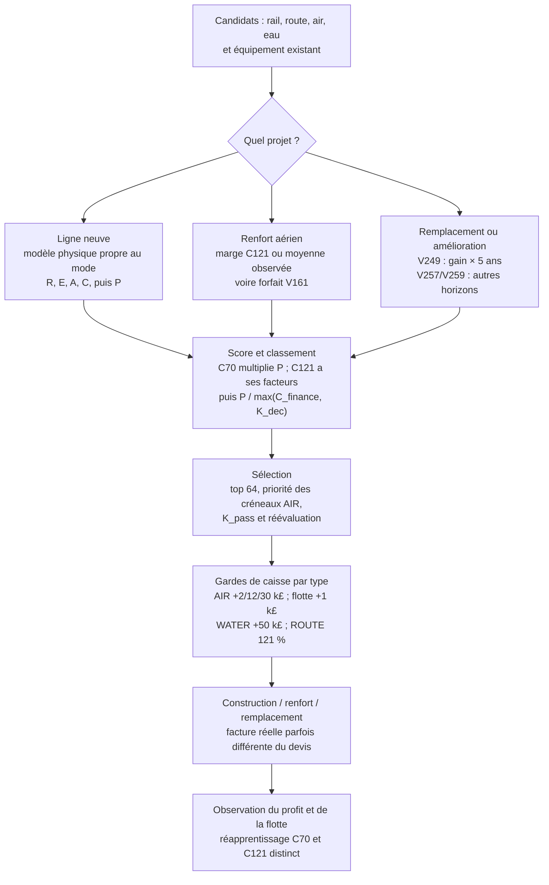
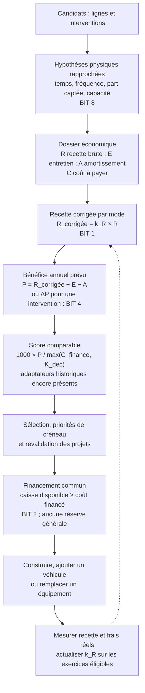

# ESTIM-1 — des estimations disparates à un contrat commun (27 octobre 2026)

## En cinq lignes

1. **Avant**, OpexAI évaluait lignes neuves, renforts et remplacements avec plusieurs modèles, facteurs et seuils de caisse difficiles à comparer.
2. **Après, sous `estim_unifie`**, quatre bits rapprochent la recette calibrée, le financement, les gains marginaux et les hypothèses physiques ; `15` active les quatre.
3. Le principe économique est **`P = R − E − A`** : recette annuelle, frais d'exploitation et amortissement ; le choix confronte ensuite ce profit au capital mobilisé.
4. **Indépendamment des bits**, le commit `b4c3babd` a supprimé la réserve générale de caisse de **5–25 k£** ; le réglage `estim_unifie` demeure **à `0` par défaut**.
5. **État mesuré : ESTIM-1 non qualifié** (portes A en échec, portes B intégrées en échec sur la valeur) ; la suppression de réserve a, séparément, passé sa porte B.

> **Lecture des sources.** Le [topo des estimations du matin](topo_estimations_20261027.md) décrit l'**AVANT** (notamment §§1–2 et 6–7) ; il mentionne encore une réserve que `master` a supprimée ensuite. Le [plan et la revue ESTIM-1](estim1_modele_unifie_20261027.md) (§§7–16) décrivent les mécanismes, mais s'arrêtent avant les verdicts définitifs des dernières portes B. L'**APRÈS** présenté ici est le code `master` aux commits `c680b7b4` et `b4c3babd`, complété par les journaux des campagnes du 27/10.

## 1. Le chemin d'une décision : AVANT

La difficulté vient des **échelles incompatibles** : C70 corrigeait le *profit* par une pseudo-observation à `1`, C121 disposait de facteurs propres aux hubs, les renforts pouvaient réutiliser une marge ancienne, et une statue ou un pont utilisait son propre horizon de retour. Au financement s'ajoutaient plusieurs tampons. Les constantes utiles de la mécanique (tarifs OpenTTD, temps de trajet, capacité) ne sont pas en elles-mêmes des erreurs. [Sources : carte de l'AVANT](topo_estimations_20261027.md#11-incohérences-doublons-coûts-cachés-et-limites-encore-ouverts), [diagnostic ESTIM-1 §1](estim1_modele_unifie_20261027.md#1-ce-que-les-mesures-disent-déjà).

## 2. Le chemin d'une décision : APRÈS sous les bits 1 + 2 + 4 + 8

**Exemple simple.** Une ouverture prédit `R = 100 k£/an`, `E = 30 k£/an` et `A = 10 k£/an` : l'ancienne estimation brute donne `P = 60 k£/an`. Avec le prior AIR `k_R = 0,40`, le modèle unifié donne `P = 40 − 30 − 10 = 0 k£/an` : la correction porte sur **la recette**, pas sur `60 × 0,40 = 24`. Les montants sont illustratifs ; le facteur évolue au cours d'une partie. [Code : `projects_models.nut`](../ai/OpexAI/projects_models.nut), [§6 du plan](estim1_modele_unifie_20261027.md#6-lot-1-livré-2710-non-commité).

Le schéma indique le **contrat visé et les entrées réellement partagées** ; l'intégration n'est pas complète. Les ouvertures possèdent des composantes `deltaR/E/A/C`, mais leur score peut encore passer par `profitAnnual` et des adaptateurs C70/C121. `K_dec`, `K_pass` et les priorités C77 restent actifs. [Revue finale §16](estim1_modele_unifie_20261027.md#16-revue-finale-de-code-pendant-la-porte-b--2710), [`projects_builders.nut`](../ai/OpexAI/projects_builders.nut), [`projects_selection.nut`](../ai/OpexAI/projects_selection.nut).

## 3. Les quatre interrupteurs et la caisse

| Changement | AVANT / chemin `estim_unifie=0` | APRÈS, bit activé | Limite actuelle |
|---|---|---|---|
| **Bit 1 — réaliser la recette** | C70 applique un facteur **sur `P`** avec pseudo-ligne à 1 ; C121 AIR dispose de calibrations différentes pour paires/hubs. | **Un `k_R` par mode sur `R`** : RAIL **0,92**, ROUTE **0,57**, AIR **0,40**, EAU **1,00** au départ ; `w0 = 10` années-lignes. Mise à jour `k_R = (n × ρ + 10 × k0)/(n + 10)` avec `ρ = ΣR_réel/ΣR_prédit`, sur années mûres (`âge ≥ 2`) à flotte initiale constante. | EAU reste au prior faute de données exploitables ; AIR sans recette brute C121 est exclu de l'apprentissage. |
| **Bit 2 — financer une dépense** | AIR ajoute **2/12/30 k£** selon les aéroports neufs, flotte **1 k£**, EAU **50 k£**, ROUTE marge et financement **121 %**, RAIL financement **100 %** ; sélection et chantier peuvent différer. | `OpexEstimFinanceCapital` fournit le coût de financement aux deux étapes ; suppression des marges forfaitaires sous ce bit. Coefficient de financement courant **RAIL 100 %**, **ROUTE 121 %**, **AIR/EAU 100 %** ; devis déjà réel non remultiplié, immobilisation comptée séparément. | Le facteur RAIL `1,063 + 0,003 × distance` du *plan initial* **n'est pas injecté dans la garde actuelle** : le code garde 100 % pour ne pas réintroduire cette majoration. |
| **Bit 4 — raisonner en marge** | Renfort AIR : quatre voies de calcul (marge C121, observé, profit/avion, forfait V161) ; statues V249, avions V252, trains V257, ponts V259 et croissance V284 utilisent des horizons différents. | **`ΔP = k_R × ΔR − ΔE − ΔA`**, `ΔC` net décaissé ; `OpexEstimVProject` fournit un score `1000 × ΔP / max(ΔC, K_dec)`. Un renfort C121 utilise **un seul palier `n → n+1`**, puis requiert un nouveau calcul. | **V252** compare toujours des flottes homogènes dans l'ancien modèle AIR et divise leur différence par `n` : un remplacement réel d'un seul avion dans une flotte mixte reste imparfaitement modélisé. |
| **Bit 8 — mêmes primitives physiques** | Débit mensuel calculé avec **30 ou 30,4 jours** ; note RAIL/ROUTE parfois fondée sur **50 %** forfaitaires ; partage de demande rivale incomplet ; moteur AIR favorisé dans une bande de ROI **1,25**. | **`365/12` jours/mois**, note liée aux visites/capacités, baisse de la demande disponible selon le taux déjà transporté, comparaison de moteurs AIR au score du portefeuille. | Le plafond RAIL reste **2 trains** : contrainte physique du constructeur. Il n'existe pas encore de modèle physique entièrement identique pour tous les modes. |
| **Suppression globale de la réserve** (`b4c3babd`) | `OpexCashReserve = clamp(Σ frais courants des véhicules / 4, 5 000, 25 000 £)` ; caisse mobilisable `max(0, cash − réserve)`. | Fonction et réglage supprimés ; **`OpexAvailableCapital = max(0, cash)`**, pour **toutes** les valeurs de `estim_unifie`. Aucun supplément de réserve avant paiement. | Sous **bit 0**, des marges propres à certains projets subsistent : « sans réserve » ne signifie donc pas « toutes les marges supprimées ». |

**R, E, A, C :** `R` est une prévision de recette, `E` les frais courants, `A` l'amortissement prédit des véhicules, `C` le capital engagé. Dans une amélioration, le signe `Δ` veut dire « **après − avant** ». `K_dec` est le plancher intermodal issu du rythme historique des investissements ; **les opcodes** représentent un budget de calcul distinct de l'argent. [Plan §§8–10](estim1_modele_unifie_20261027.md#8-lot-2--garde-de-caisse-m5-bit-2), [code financement](../ai/OpexAI/projects_finance.nut), [renfort C121](../ai/OpexAI/projects_builders.nut), [modèle physique](../ai/OpexAI/economy.nut), [caisse](../ai/OpexAI/capital.nut).

## 4. Ce qu'ont montré les portes A/B

Chaque chiffre compare **Opex variante − Opex référence** dans deux parties appariées contre le même AAAHogEx. `profit_year` est le profit annuel terminal, **pas** un profit cumulé ; « valeur » est la variation du **ratio des moyennes** de `company_value`. Porte A : **40 graines × 3 ans**, demande +4 % de profit moyen, Wilcoxon `p < 0,05`, borne basse d'IC95 positive, valeur ≥ −5 %. Porte B : **20 graines × 10 ans**, IC95 dont la borne haute n'est pas négative et valeur ≥ −5 %. [Règles du dépôt](../AGENTS.md#4-validation-proportionnée-puis-adoption).

| Campagne (bits ON) | Porte / paires | Δ `profit_year` moyen | Δ valeur | Verdict publié |
|---|---|---:|---:|---|
| [Lot 1](../results/estim1_lot1_porteA_40x3_20261027.json) (`1`, gel antérieur) | A, 40/40 | **+12,3 k£/an** | **+0,02 %** | `fail_primary` |
| [Lot 2](../results/estim1_review_2_porteA_40x3_20261027.log) (`2`) | A, 40/40 | **−20,1 k£/an** | **+1,22 %** | `fail_primary` |
| [Lot 3](../results/estim1_review_4_porteA_40x3_20261027.log) (`4`) | A, 40/40 | **−48,0 k£/an** | **+0,96 %** | `fail_primary` |
| [Lot 4](../results/estim1_review_8_porteA_40x3_20261027.log) (`8`) | A, 40/40 | **−20,4 k£/an** | **+0,25 %** | `fail_primary` |
| [Intégré initial](../results/estim1_review_15_porteA_40x3_20261027.log) (`15`) | A, 40/40 | **+40,1 k£/an** | **+4,57 %** | `fail_primary` |
| [Ablations](../results/estim1_review_ablation_14_porteA_40x3_20261027.log) (`14 / 13 / 11 / 7`) | A, 40/40 chacune | **+36,9 / −40,3 / −18,3 / +36,1 k£/an** | **+5,88 / −0,92 / +2,20 / +2,81 %** | `fail_primary` (4/4) |
| [Intégré corrigé](../results/estim1_fix15_porteA_40x3_20261027.log) (`15`) | A, 40/40 | **+56,2 k£/an** | **+4,95 %** | `fail_primary` |
| [Intégré initial](../results/estim1_integ15_porteB_20x10_r2_20261027.log) (`15`) | B, 20/20 | **−66,9 k£/an** | **−14,87 %** | `fail_value_guard` |
| [Intégré corrigé](../results/estim1_fix15_porteB_20x10_20261027.log) (`15`) | B, 20/20 | **+72,9 k£/an** | **−16,48 %** | `fail_value_guard` |
| [Réserve supprimée seule](../results/cash_reserve_off_porteA_40x3_20261027.log) | A, 40/40 | **+70,8 k£/an** | **+0,17 %** | `fail_primary` |
| [Réserve supprimée seule](../results/cash_reserve_off_porteB_20x10_20261027.log) | B, 20/20 | **+165,1 k£/an** | **+2,73 %** | **`pass`** |

Les intégrations à 15 ont été soumises à B **sur décision ultérieure de rechercher la non-érosion**, bien que leurs portes A n'aient pas passé le seuil. La porte A corrigée fait **+56,2 k£/an** face à un seuil de **+90,8 k£/an**, avec **p = 0,50** et IC95 **[−42,0 ; +159,8] k£** : elle ne démontre pas le gain requis. En B corrigée, l'IC95 du profit **[−181,0 ; +326,0] k£** couvre zéro, mais la valeur **−16,48 %** viole la limite −5 %. Les différentes campagnes utilisent des **bundles sources distincts** : les changements entre deux portes ne constituent pas une comparaison causale appariée entre versions. [Log A corrigée](../results/estim1_fix15_porteA_40x3_20261027.log), [log B corrigée](../results/estim1_fix15_porteB_20x10_20261027.log).

### Pourquoi le nombre d'avions s'est rétabli sans sauver la valeur

Les compteurs physiques et les soldes à **fin 1979** sont des moyennes sur les **20 parties Opex de chaque politique** (champs `summary[].primary_vehicles_by_mode.air`, `money`, `company_value` des JSON) :

| Porte B | Avions témoin → variante | Écart avions | Caisse témoin → variante | Valeur témoin → variante |
|---|---:|---:|---:|---:|
| [Intégré avant correctif](../results/estim1_integ15_porteB_20x10_r2_20261027.json) | **119,65 → 83,65** | **−36,0** | **15,59 → 14,45 M£** | **20,51 → 17,46 M£** |
| [Intégré après correctif](../results/estim1_fix15_porteB_20x10_20261027.json) | **119,90 → 112,80** | **−7,1** | **15,74 → 12,68 M£** | **20,41 → 17,05 M£** |

La correction de la branche AIR réduit le manque d'avions de **36 à environ 7** et restaure le profit final, mais la valeur reste en déficit. Dans la seconde B, la variante a **3,06 M£ de caisse en moins** et **3,36 M£ de valeur en moins** : l'écart de trésorerie représente **environ 91 %** de l'écart de valeur en montant. **C'est une explication comptable majeure du −16,5 %, pas une preuve que garder davantage de cash ferait mieux jouer l'IA.** Il faut distinguer l'argent non réinvesti, les investissements réalisés et leurs effets futurs. À l'inverse, la [B « réserve supprimée seule »](../results/cash_reserve_off_porteB_20x10_20261027.log) augmente profit (+165,1 k£/an) **et** valeur (+2,73 %) ; son `pass` ne qualifie pas automatiquement ESTIM-1.

## 5. État ouvert et décision

**ESTIM-1 reste expérimental : `estim_unifie=0`** pour les quatre difficultés (`info.nut`). La propreté des contrats et l'unicité des points d'entrée progressent, mais les portes A et les gardes de valeur B ne permettent pas d'adopter l'intégré 15. Restent à vérifier l'égalité effective « composantes `Δ` ↔ profit de décision » des ouvertures et la marge d'un **seul avion remplacé** par V252 en flotte hétérogène. [Plan, §16](estim1_modele_unifie_20261027.md#16-revue-finale-de-code-pendant-la-porte-b--2710), [réglage](../ai/OpexAI/info.nut), [V252](../ai/OpexAI/task_v252.nut).

**FLOTTE-EQUILIBRE reste un chantier séparé** : trop d'avions sur certaines lignes, manque de trains ou de wagons ailleurs. Il faudra confronter le supplément de profit *réel* par avion et les volumes RAIL non transportés aux marges du modèle, avant tout changement de défaut. [Tâches ouvertes](taches.md) (entrées **ESTIM-1** et **FLOTTE-EQUILIBRE**).
