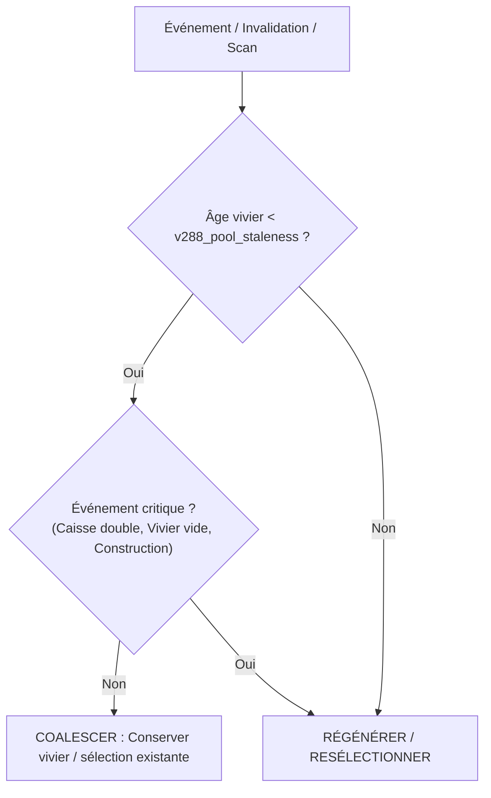

# Diagnostic V288 : Obsolescence et Fréquence de Régénération des Viviers, Candidats et Portefeuille

**Date :** 20 octobre 2026  
**Branche :** `v288` (dépôt `/home/deploy/projects/wt-v288`, aligné sur `master` @ `e25c764`)  
**Contexte :** Décision utilisateur du 20/10/2026 :  
> *« Il faut arrêter de régénérer le vivier si le dernier vivier est récent, mettre en place un paramètre d'obsolescence. Idem pour les candidats. Seul un événement ou une période significative devrait régénérer un vivier. »*  
**Objet :** Diagnostic technique, architectural et quantitatif exhaustif préparant l'implémentation de `v288_pool_staleness` (âge d'obsolescence en jours).

---

## 1. Inventaire exhaustif des chemins de régénération et de sélection

Dans l'architecture d'OpexAI, la gestion du vivier de projets s'articule autour de trois structures principales :
1. `this._catalog` : le catalogue brut des objets physiques (villes, industries, moteurs, aéroports, types de voies).
2. `this._projects.candidateGroups` : le dictionnaire de vivier indexé par slot/paire portant les listes de projets alternatifs générés pour chaque mode (`rail`, `road`, `air`, `water`, `fleet`, `subsidy`).
3. `this._projects.best` : la sélection ordonnée des projets finançables sous le capital disponible courant (`capitalBudget`).

L'inventaire ci-dessous recense l'ensemble des chemins exécutables dans `ai/OpexAI/` qui régénèrent tout ou partie de ces structures, avec leurs déclencheurs exacts, leurs fichiers et lignes vérifiés par `grep -n`, et leur périmètre (complet ou par mode).

### 1.1. Tableau synthétique des chemins d'invalidation, régénération et sélection

| Chemin / Fonction | Fichier:Ligne vérifiés | Déclencheur exact | Périmètre | Mécanisme et dépendances |
|---|---|---|---|---|
| **1. Reconstruction réactive complète (`_c76DoFullRegen`)** | [orchestrator.nut:1226](file:///home/deploy/projects/wt-v288/ai/OpexAI/orchestrator.nut#L1226) | Intention réactive `regen` dépilée par `_dispatchReactiveIntention` ([orchestrator.nut:612](file:///home/deploy/projects/wt-v288/ai/OpexAI/orchestrator.nut#L612)) lorsque `_c80ModeRegenModes()` renvoie `null` | **Complet (tous modes)** | Rafraîchit le catalogue complet, redimensionne les flottes, appelle `_rebuildProjects(fleetPlan)` en synchrone bloquant, puis acquitte toutes les couches C76. |
| **2. Régénération réactive par mode (`_c80DoModeRegen`)** | [orchestrator.nut:1322](file:///home/deploy/projects/wt-v288/ai/OpexAI/orchestrator.nut#L1322) | Intention réactive `regen` dépilée lorsque `_c80ModeRegenModes()` ([orchestrator.nut:614](file:///home/deploy/projects/wt-v288/ai/OpexAI/orchestrator.nut#L614)) renvoie une liste non vide de modes | **Par mode (`rail`, `road`, `water`)** | Rafraîchit le sous-catalogue du mode (`_c77RefreshModeCatalog`), appelle `OpexRegenerateModeProjects`, acquitte les couches `industries` et `engines.*` non-air. |
| **3. Filtre d'orientation C80 (`_c80ModeRegenModes`)** | [orchestrator.nut:1302](file:///home/deploy/projects/wt-v288/ai/OpexAI/orchestrator.nut#L1302) | Appelé par `_dispatchReactiveIntention` ([L610](file:///home/deploy/projects/wt-v288/ai/OpexAI/orchestrator.nut#L610)) et `_dispatchCatalog` ([scheduler_tasks.nut:435](file:///home/deploy/projects/wt-v288/ai/OpexAI/scheduler_tasks.nut#L435)) | **Décision d'aiguillage** | Renvoie `null` si `towns`, `lines` ou `engines.air` ont changé de révision ; renvoie la liste des modes si seules `industries` ou moteurs non-air ont changé. |
| **4. Dispatch des intentions réactives (`_dispatchReactiveIntention`)** | [orchestrator.nut:595](file:///home/deploy/projects/wt-v288/ai/OpexAI/orchestrator.nut#L595) | Boucle principale `_runOrchestratorTick` ([orchestrator.nut:943](file:///home/deploy/projects/wt-v288/ai/OpexAI/orchestrator.nut#L943)) à chaque tick moteur | **Variable selon l'intention** | Dépile `regen`, `c77_entity`, `c77_subsidy`, `c77_build`, `v259_bridge`. Gère le différé si un worker est actif. |
| **5. Reconstruction post-build bootstrap (`BOOTSTRAP_STAGE`)** | [task_projects.nut:1901-1910](file:///home/deploy/projects/wt-v288/ai/OpexAI/task_projects.nut#L1901-L1910) | Succès ou abandon de construction tant que `_generationStage < OPEX_STAGE_COMPLETE` | **Complet (staged)** | Court-circuite la mise à jour incrémentale. Appelle inconditionnellement `_rebuildProjects(fleetPlan)` avec motif `"staged"`. |
| **6. Mise à jour incrémentale post-build (`_tryIncrementalAfterBuild`)** | [task_projects.nut:1911-1934](file:///home/deploy/projects/wt-v288/ai/OpexAI/task_projects.nut#L1911-L1934) | Succès de construction en régime de croisière (`_generationStage >= OPEX_STAGE_COMPLETE`) | **Incrémental ciblé** | Appelle `OpexIncrementalUpdateProjects` ([projects_update.nut:1](file:///home/deploy/projects/wt-v288/ai/OpexAI/projects_update.nut#L1)), recalcule les alternatives touchées et acquitte la couche `lines` si aucune ville air n'est différée. |
| **7. Repli complet post-build (`_onPostBuildProject` fallback)** | [task_projects.nut:1936-1945](file:///home/deploy/projects/wt-v288/ai/OpexAI/task_projects.nut#L1936-L1945) | Échec ou indisponibilité de `candidateGroups` après construction | **Complet** | Appelle `_rebuildProjects(fleetPlan)` avec motif `"post_build"`. |
| **8. Recharge rail fret oisif V217 (`_v217RailRefill`)** | [orchestrator.nut:762](file:///home/deploy/projects/wt-v288/ai/OpexAI/orchestrator.nut#L762) | Tête de tour d'ordonnanceur ([scheduler.nut:18](file:///home/deploy/projects/wt-v288/ai/OpexAI/scheduler.nut#L18)) si `year >= 1972`, caisse > 100 k£, candidats rail démarrables < 2 | **Mode `rail` seul (fret tournant)** | Fait tourner `freightCargo` au cargo suivant, active `V217_REGEN_NO_PAX=1` (sans pax), appelle `OpexRegenerateModeProjects(..., "rail", ...)`. |
| **9. Ancienne rotation C76 (`_c76RotateFreight`)** | *(retiré, absent du code)* | Tâche catalogue mensuelle hors régénération complète sous `c76_freight_rotation=1` | **Modes `rail` et `road`** | **Retiré le 20/10/2026 dans V263b (`89e1239`)**. Remplacé par V217 ci-dessus. Régénérait rail et route sur le cargo suivant. |
| **10. Worker opportuniste C77 (`regen_candidates`)** | [orchestrator.nut:470-520](file:///home/deploy/projects/wt-v288/ai/OpexAI/orchestrator.nut#L470-L520) | Intention `c77_entity` enfilée sur événement (`IndustryOpen`, etc.), exécutée par tranches de worker C80 | **Modes spécifiés dans l'intention** | Appelle `OpexRegenerateAirProjectsSlice` pour l'air, et `OpexRegenerateModeProjects` pour les autres modes ciblés par entité. |
| **11. Première publication partielle AIR C78/V147** | [scheduler_tasks.nut:170](file:///home/deploy/projects/wt-v288/ai/OpexAI/scheduler_tasks.nut#L170) | Tâche ordonnanceur `air_cat_publish` ([scheduler.nut:237](file:///home/deploy/projects/wt-v288/ai/OpexAI/scheduler.nut#L237)) quand `lastPublishedCount == 0` | **Complet avec override AIR partiel** | La première publication d'un nouveau scan C78 passe par `_rebuildProjects(fleetPlan, partialAir, false)` car les groupes de candidats air n'existent pas encore. |
| **12. Publications partielles AIR ultérieures (AIR 03/10)** | [scheduler_tasks.nut:166](file:///home/deploy/projects/wt-v288/ai/OpexAI/scheduler_tasks.nut#L166) | Tâche `air_cat_publish` quand `lastPublishedCount > 0` | **Mode `air` inséré** | Appelle `OpexAir0310PublishIncremental` ([projects_update.nut:367](file:///home/deploy/projects/wt-v288/ai/OpexAI/projects_update.nut#L367)), insère les plans dans `candidateGroups`, et arme `projects.selectionStale = true` ([L464, L667](file:///home/deploy/projects/wt-v288/ai/OpexAI/projects_update.nut#L464)). |
| **13. Application finale du scan AIR C78/V147** | [scheduler_tasks.nut:209-239](file:///home/deploy/projects/wt-v288/ai/OpexAI/scheduler_tasks.nut#L209-L239) | Tâche `air_cat_apply` lorsque le scan C78 a terminé toutes ses villes et paires | **Complet avec override AIR total** | Appelle `_rebuildProjects(s.fleetPlan, airOverride)`, enregistre `_c76RecordRegen("full", ...)` et acquitte les révisions du snapshot initial (AC06 v2). |
| **14. Filet annuel de sécurité / Tâche `catalog`** | [scheduler_tasks.nut:430-471](file:///home/deploy/projects/wt-v288/ai/OpexAI/scheduler_tasks.nut#L430-L471) | Tâche de fond `catalog` (~tous les 30-45 j) si nouvelle année civile (`c76PeriodicDue`), reload, caisse doublée (`budgetStale`), ou révisions | **Complet ou mode C80** | Déclenche C78 si air disponible ([L452](file:///home/deploy/projects/wt-v288/ai/OpexAI/scheduler_tasks.nut#L452)), ou `_c80DoModeRegen` ([L440](file:///home/deploy/projects/wt-v288/ai/OpexAI/scheduler_tasks.nut#L440)), ou synchrone `_rebuildProjects` ([L460](file:///home/deploy/projects/wt-v288/ai/OpexAI/scheduler_tasks.nut#L460)). |
| **15. Régénération évitée dans `_dispatchCatalog`** | [scheduler_tasks.nut:472-480](file:///home/deploy/projects/wt-v288/ai/OpexAI/scheduler_tasks.nut#L472-L480) | Tâche de fond `catalog` si aucune invalidation majeure n'est constatée | **Re-sélection seule (aucun vivier touché)** | Appelle `OpexReselectProjects` sous le capital courant et logue `_c76RecordAvoided(year)`. |
| **16. Matérialisation paresseuse de sélection (`_ensureSelection`)** | [task_projects.nut:1294](file:///home/deploy/projects/wt-v288/ai/OpexAI/task_projects.nut#L1294) | Avant construction `_tryBuildProjects` ([L1307](file:///home/deploy/projects/wt-v288/ai/OpexAI/task_projects.nut#L1307)), passe `projects` ([scheduler_tasks.nut:806, 963](file:///home/deploy/projects/wt-v288/ai/OpexAI/scheduler_tasks.nut#L806)), etc. | **Re-sélection du portefeuille** | Si `projects.selectionStale == true` (posé par V158/AIR0310), exécute `OpexReselectProjects` et réinitialise `selectionStale = false`. |
| **17. Injection de subvention (`_c77InjectSubsidy`)** | [orchestrator.nut:900-935](file:///home/deploy/projects/wt-v288/ai/OpexAI/orchestrator.nut#L900-L935) | Événement NoAI `ET_SUBSIDY_OFFER` -> intention `c77_subsidy` | **Candidat subvention injecté** | Génère les candidats du mode de subvention, les insère dans `candidateGroups`, appelle `OpexReselectProjects` ([L921](file:///home/deploy/projects/wt-v288/ai/OpexAI/orchestrator.nut#L921)), et enfile `c77_build`. |
| **18. Expiration / Purge de subvention (`_c77RemoveSubsidy`)** | [event_handlers.nut:187-198](file:///home/deploy/projects/wt-v288/ai/OpexAI/event_handlers.nut#L187-L198) | Événement NoAI `ET_SUBSIDY_OFFER_EXPIRED` | **Suppression de candidat subvention** | Supprime `subsidy|<id>` de `candidateGroups` et appelle `OpexReselectProjects` ([L195](file:///home/deploy/projects/wt-v288/ai/OpexAI/event_handlers.nut#L195)). |
| **19. Injection de renforts de flotte (`OpexInjectFleetProjects`)** | [scheduler_tasks.nut:951](file:///home/deploy/projects/wt-v288/ai/OpexAI/scheduler_tasks.nut#L951) | Tâche `projects` périodique dans l'ordonnanceur | **Projets `fleet` injectés** | Évalue le besoin en véhicules des lignes vivantes, met à jour les projets flotte dans `candidateGroups`, puis appelle `_ensureSelection()` ([L963](file:///home/deploy/projects/wt-v288/ai/OpexAI/scheduler_tasks.nut#L963)). |
| **20. Greffes fret marchandises V233 (`_v233Publish`)** | [goods_v233.nut:474-508](file:///home/deploy/projects/wt-v288/ai/OpexAI/goods_v233.nut#L474-L508) | En tête de passe `projects.pass` si une offre de marchandises a été découverte | **Mode rail fret (greffe)** | Insère les branches d'usines dans `candidateGroups` et appelle `OpexReselectProjects` ([L504](file:///home/deploy/projects/wt-v288/ai/OpexAI/goods_v233.nut#L504)). |
| **21. Rechargement de sauvegarde (Load / `_reconcileAfterLoad`)** | [persist.nut:1080](file:///home/deploy/projects/wt-v288/ai/OpexAI/persist.nut#L1080) | Immédiatement après chargement d'une sauvegarde | **Complet de sûreté** | Positionne `_c76ForceReloadRegen = true` et `_projects = null`, forçant le premier passage catalogue à tout reconstruire de zéro. |

---

## 2. Tableau chiffré par graine et par année (1970–1972)

Les chiffres ci-dessous sont extraits des journaux d'exécution du banc `po01b_expo_3x3_20261020_engine` (bras référence = `master` pur avec `decision_log=1` et `probes=10`, 3 ans, graines 42, 7 et 1234). Les mesures d'opcodes proviennent directement des champs `ops=` des lignes `C76_REGEN` et des chronométrages de spans exclusifs `OPEX SPAN` de la compagnie 0.

### 2.1. Fréquence et coût en opcodes par chemin et par graine

| Graine | Année | Nombre d'occurrences `C76_REGEN` | Décomposition par chemin | Coût `ops` cumulé (`C76_REGEN`) | Opcodes exclusifs SPAN Sélection & Vivier |
|:---:|:---:|:---:|---|:---:|---|
| **42** | **1970** | **11** | `incremental:post_build` = 11 | **1 824 363** ops | `select.full` = 11,04 M, `pub.select.filter` = 4,79 M, `select.incremental` = 1,43 M, `select.reselect` = 0,36 M |
| **42** | **1971** | **20** | `incremental:post_build` = 20 | **2 949 588** ops | `select.full` = 9,27 M, `pub.select.filter` = 3,43 M, `select.incremental` = 2,38 M, `select.reselect` = 0,42 M |
| **42** | **1972** | **27** | `full:reactive` = 1 (9 097 491 ops)<br>`incremental:post_build` = 26 (7 883 595 ops) | **16 981 086** ops | `select.full` = 14,80 M, `loop.orch.reactive.regen` = 9,49 M (incl), `select.incremental` = 2,81 M, `pub.select.filter` = 0,67 M |
| **7** | **1970** | **13** | `incremental:post_build` = 13 | **1 861 972** ops | `select.full` = 8,54 M, `pub.select.filter` = 3,47 M, `select.incremental` = 1,59 M, `select.reselect` = 0,39 M |
| **7** | **1971** | **39** | `incremental:post_build` = 39 | **2 766 004** ops | `select.full` = 4,84 M, `select.incremental` = 2,18 M, `pub.select.filter` = 1,48 M, `select.reselect` = 0,42 M |
| **7** | **1972** | **22** | `full:reactive` = 1 (6 062 762 ops)<br>`incremental:post_build` = 21 (3 342 168 ops) | **9 404 930** ops | `loop.orch.reactive.regen` = 6,46 M (incl), `select.full` = 5,00 M, `select.incremental` = 1,32 M, `pub.select.filter` = 0,10 M |
| **1234** | **1970** | **10** | `incremental:post_build` = 10 | **1 347 765** ops | `select.full` = 9,17 M, `pub.select.filter` = 4,17 M, `select.incremental` = 1,08 M, `select.reselect` = 0,36 M |
| **1234** | **1971** | **20** | `full:reactive` = 1 (10 566 751 ops)<br>`incremental:post_build` = 19 (7 378 149 ops) | **17 944 900** ops | `select.full` = 14,06 M, `loop.orch.reactive.regen` = 10,96 M (incl), `select.incremental` = 4,03 M, `pub.select.filter` = 2,01 M |
| **1234** | **1972** | **26** | `incremental:post_build` = 25 (2 203 530 ops)<br>`mode:reactive_water` = 1 (431 359 ops) | **2 634 889** ops | `select.full` = 4,94 M, `select.incremental` = 1,84 M, `pub.select.filter` = 1,42 M, `select.reselect` = 0,42 M |

### 2.2. Analyse d'utilité : Clés identiques (`same_keys_pct`) et Économie identique (`same_econ_pct`)

Chaque ligne `C76_REGEN` consigne la comparaison entre le vivier généré et le vivier immédiatement antérieur pour chaque mode :
- `cand_<mode>_same_keys_pct` : ratio des projets communs sur le maximum d'alternatives.
- `cand_<mode>_same_econ_pct` : proportion des projets communs dont le profit annuel reste identique à ±1 %.
- `best_same_keys_pct` : proportion des projets retenus dans le portefeuille `best` inchangés.

#### Détail par graine et par année :

| Graine | Année | Mode Rail (`keys` / `econ`) | Mode Route (`keys` / `econ`) | Mode Air (`keys` / `econ`) | Mode Flotte (`keys` / `econ`) | Mode Eau (`keys` / `econ`) | Portefeuille `best` (`same_keys`) |
|:---:|:---:|:---:|:---:|:---:|:---:|:---:|:---:|
| **42** | **1970** | 100,0 % / 100,0 % | 100,0 % / 100,0 % | 80,0 % (méd 88,8) / 90,9 % | 68,2 % (méd 100) / 72,7 % | 100,0 % / 100,0 % | 81,8 % (méd 100,0 %) |
| **42** | **1971** | 100,0 % / 100,0 % | 100,0 % / 100,0 % | 74,3 % (méd 76,6) / 100,0 % | 90,0 % (méd 100) / 80,0 % | 100,0 % / 100,0 % | 90,0 % (méd 100,0 %) |
| **42** | **1972** | 90,3 % (méd 100) / 96,3 % | 86,0 % (méd 100) / 92,6 % | 77,2 % (méd 85,2) / 93,3 % | 90,3 % (méd 100) / 93,6 % | 100,0 % / 100,0 % | 74,1 % (méd 78,1 %) |
| **7** | **1970** | 100,0 % / 100,0 % | 100,0 % / 100,0 % | 57,1 % (méd 57,5) / 84,6 % | 84,6 % (méd 100) / 84,6 % | 100,0 % / 100,0 % | 84,6 % (méd 100,0 %) |
| **7** | **1971** | 100,0 % / 100,0 % | 94,9 % (méd 100) / 94,9 % | 74,8 % (méd 86,1) / 87,2 % | 85,3 % (méd 100) / 87,6 % | 100,0 % / 100,0 % | 74,4 % (méd 100,0 %) |
| **7** | **1972** | 75,2 % (méd 100) / 81,8 % | 86,8 % (méd 100) / 90,9 % | 76,6 % (méd 100) / 90,9 % | 78,5 % (méd 86,1) / 90,4 % | 100,0 % / 100,0 % | 66,3 % (méd 78,0 %) |
| **1234** | **1970** | 100,0 % / 100,0 % | 100,0 % / 100,0 % | 73,6 % (méd 76,8) / 90,0 % | 80,0 % (méd 100) / 80,0 % | 100,0 % / 100,0 % | 100,0 % (méd 100,0 %) |
| **1234** | **1971** | 88,1 % (méd 100) / 90,0 % | 77,2 % (méd 100) / 80,0 % | 80,3 % (méd 81,4) / 97,1 % | 72,5 % (méd 100) / 67,5 % | 100,0 % / 100,0 % | 32,2 % (méd 0,0 %) |
| **1234** | **1972** | 96,2 % (méd 100) / 96,2 % | 92,3 % (méd 100) / 92,3 % | 73,6 % (méd 88,5) / 88,4 % | 79,9 % (méd 100) / 93,6 % | 100,0 % / 100,0 % | 79,2 % (méd 100,0 %) |

*(Note : Lorsque `cand_<mode>_n == 0`, le ratio mathématique de clés identiques est conventionnellement fixé à 100,00 % par OpexAI, signifiant l'absence d'apparition de nouveaux projets).*

### 2.3. Classification en régénérations « Inutiles » (≥ 95 % clés identiques) vs « Utiles »

Une régénération est qualifiée d'**inutile** lorsqu'elle consomme du calcul pour produire un vivier strictement ou quasi-identique au précédent (stabilité ≥ 95 %). Deux lectures objectives sont présentées :
1. **Au niveau du portefeuille final (`best_same_keys_pct ≥ 95 %`)** : mesure si l'opération a modifié la tête du vivier finançable.
2. **Au niveau des viviers de candidats actifs** : mesure si l'ensemble des modes actifs comportant des candidats conserve ≥ 95 % de clés identiques.

| Graine | Année | Total régénérations | Inutiles selon Portefeuille (`best ≥ 95 %`) | Utiles selon Portefeuille (`best < 95 %`) | Inutiles selon Candidats actifs (`≥ 95 %`) | Utiles selon Candidats actifs (`< 95 %`) |
|:---:|:---:|:---:|:---:|:---:|:---:|:---:|
| **42** | **1970** | 11 | **9 (81,8 %)** | 2 (18,2 %) | **4 (36,4 %)** | 7 (63,6 %) |
| **42** | **1971** | 20 | **18 (90,0 %)** | 2 (10,0 %) | **2 (10,0 %)** | 18 (90,0 %) |
| **42** | **1972** | 27 | **4 (14,8 %)** | 23 (85,2 %) | **2 (7,4 %)** | 25 (92,6 %) |
| **7** | **1970** | 13 | **11 (84,6 %)** | 2 (15,4 %) | **2 (15,4 %)** | 11 (84,6 %) |
| **7** | **1971** | 39 | **29 (74,4 %)** | 10 (25,6 %) | **14 (35,9 %)** | 25 (64,1 %) |
| **7** | **1972** | 22 | **1 (4,5 %)** | 21 (95,5 %) | **1 (4,5 %)** | 21 (95,5 %) |
| **1234** | **1970** | 10 | **10 (100,0 %)** | 0 (0,0 %) | **4 (40,0 %)** | 6 (60,0 %) |
| **1234** | **1971** | 20 | **4 (20,0 %)** | 16 (80,0 %) | **3 (15,0 %)** | 17 (85,0 %) |
| **1234** | **1972** | 26 | **20 (76,9 %)** | 6 (23,1 %) | **8 (30,8 %)** | 18 (69,2 %) |
| **TOTAL** | **Cumul** | **188** | **106 (56,4 %)** | **82 (43,6 %)** | **40 (21,3 %)** | **148 (78,7 %)** |

**Enseignements majeurs :**
- En 1970 et 1971, **75 % à 100 % des régénérations post-construction ne changent pas la sélection du portefeuille finançable** (`best_same_keys_pct ≥ 95 %`). L'IA recalcule l'ensemble des candidats alors que le projet prioritaire en tête de file reste strictement le même.
- En 1970-1971, les modes rail, route et eau restent à **100 % de clés identiques** lors de toutes les passes post-construction, car seules des lignes aériennes sont posées.

---

## 3. Le cas précis de la reconstruction complète de janvier 1972

La fiche `PO-01b` de `docs/taches.md` indique qu'au 1ᵉʳ janvier 1972, une révision `engines.water` déclenche une reconstruction complète de l'ensemble du portefeuille.

### 3.1. Confirmation dans le code et dans les journaux

L'audit approfondi du code et des journaux **confirme et précise** la cause exacte :

1. **L'événement déclencheur premier :**  
   Le 1ᵉʳ janvier 1972, OpenTTD introduit un nouveau navire (moteur id 207). Le moteur NoAI émet `AIEvent.ET_ENGINE_AVAILABLE` ([events.nut:363](file:///home/deploy/projects/wt-v288/ai/OpexAI/events.nut#L363)).  
   Le gestionnaire `_onEngineAvailable` ([event_handlers.nut:440](file:///home/deploy/projects/wt-v288/ai/OpexAI/event_handlers.nut#L440)) appelle :
   ```squirrel
   this._c76BumpLayer("engines.water", true);
   ```
   Comme `notify = true`, `_c76BumpLayer` enfile immédiatement l'intention réactive `regen` ([orchestrator.nut:1069](file:///home/deploy/projects/wt-v288/ai/OpexAI/orchestrator.nut#L1069)).

2. **Le piège de la couche `lines` dans `_c80ModeRegenModes()` :**  
   Au tick suivant, `_dispatchReactiveIntention` ([orchestrator.nut:605](file:///home/deploy/projects/wt-v288/ai/OpexAI/orchestrator.nut#L605)) dépile `regen` et interroge `this._c80ModeRegenModes()`.  
   Dans [orchestrator.nut:1307](file:///home/deploy/projects/wt-v288/ai/OpexAI/orchestrator.nut#L1307) :
   ```squirrel
   if (r.towns > a.towns || r.lines > a.lines || r.engines.air > a.engines.air) return null;
   ```
   Or, dans les graines 42 et 7, des suppressions ou abandons de lignes en décembre 1971 ont incrémenté la révision `lines` (`_c76BumpLayer("lines", false)`) sans que celle-ci n'ait été acquittée dans `_c76AckRevisions.lines` !  
   Par conséquent, `r.lines > a.lines` est **vrai**. `_c80ModeRegenModes()` renvoie `null` !  
   L'orchestrateur retombe alors sur la reconstruction complète synchrone :
   ```squirrel
   this._c76DoFullRegen("reactive", year); // orchestrator.nut:612
   ```

3. **Preuve directe dans les journaux :**
   - **Graine 42 (`reference_seed42_r0.log`) :**
     ```text
     [2026-10-20 10:36:01] dbg: [script:4] [0] [I] OPEX 1972-1-1 PO01_REACTIVE batch=1 cause=lines,engines.water modes=air,rail,road,water,fleet
     ...
     [2026-10-20 10:36:02] dbg: [script:4] [0] [I] OPEX 1972-2-21 C76_REGEN phase=regen kind=full reason=reactive year=1972 days=49 days_since_prev=59 ops=9097491 towns_n=42 towns_pop_delta_pct=-4.49 industries_n=47 industries_changed=0 ind_prod_delta_pct=8.49 engines_changed_rail=0 engines_changed_road=0 engines_changed_air=0 engines_changed_water=1 lines_n=23 lines_delta=0 cash_budget_delta_pct=1445.06 events_since_prev=2(engine:1,subsidy:1) freight_cargo=COAL cand_rail_n=19 cand_rail_same_keys_pct=0.00 cand_rail_same_econ_pct=0.00 cand_road_n=14 cand_road_same_keys_pct=0.00 cand_road_same_econ_pct=0.00 cand_air_n=305 cand_air_same_keys_pct=4.92 cand_air_same_econ_pct=20.00 cand_water_n=0 cand_water_same_keys_pct=100.00 cand_water_same_econ_pct=100.00 cand_fleet_n=6 cand_fleet_same_keys_pct=16.67 cand_fleet_same_econ_pct=100.00 best_same_top1=0 best_same_keys_pct=0.00
     ```
     La ligne PO01 trace formellement : `cause=lines,engines.water`.
   - **Graine 7 (`reference_seed7_r0.log`) :**
     ```text
     [2026-10-20 10:37:06] dbg: [script:4] [0] [I] OPEX 1972-1-1 PO01_REACTIVE batch=1 cause=lines,engines.water modes=air,rail,road,water,fleet
     ...
     [2026-10-20 10:37:07] dbg: [script:4] [0] [I] OPEX 1972-2-4 C76_REGEN phase=regen kind=full reason=reactive year=1972 days=33 days_since_prev=56 ops=6062762 towns_n=46 towns_pop_delta_pct=-6.68 industries_n=52 industries_changed=0 ind_prod_delta_pct=7.66 engines_changed_rail=0 engines_changed_road=0 engines_changed_air=0 engines_changed_water=1 lines_n=44 lines_delta=0 cash_budget_delta_pct=996.03 events_since_prev=2(engine:1,subsidy:1) freight_cargo=COAL cand_rail_n=22 cand_rail_same_keys_pct=0.00 cand_rail_same_econ_pct=0.00 cand_road_n=17 cand_road_same_keys_pct=0.00 cand_road_same_econ_pct=0.00 cand_air_n=120 cand_air_same_keys_pct=0.00 cand_air_same_econ_pct=0.00 cand_water_n=0 cand_water_same_keys_pct=100.00 cand_water_same_econ_pct=100.00 cand_fleet_n=5 cand_fleet_same_keys_pct=0.00 cand_fleet_same_econ_pct=0.00 best_same_top1=0 best_same_keys_pct=0.00
     ```
   - **Contre-épreuve décisive sur la graine 1234 (`reference_seed1234_r0.log`) :**  
     Dans la graine 1234, la révision `lines` était déjà acquittée au 1/1/1972 (car une reconstruction complète avait eu lieu le 29/08/1971). Seul `engines.water` était en attente.  
     `_c80ModeRegenModes()` a donc renvoyé `["water"]` ! L'IA a exécuté `_c80DoModeRegen(["water"])` :
     ```text
     [2026-10-20 10:38:12] dbg: [script:4] [0] [I] OPEX 1972-1-4 C76_REGEN phase=regen kind=mode reason=reactive_water year=1972 days=2 days_since_prev=3 ops=431359 towns_n=45 towns_pop_delta_pct=-1.27 industries_n=49 industries_changed=0 ind_prod_delta_pct=0.00 engines_changed_rail=0 engines_changed_road=0 engines_changed_air=0 engines_changed_water=0 lines_n=23 lines_delta=0 cash_budget_delta_pct=10.40 events_since_prev=1(engine:1) freight_cargo=COAL cand_rail_n=0 cand_rail_same_keys_pct=100.00 cand_rail_same_econ_pct=100.00 cand_road_n=0 cand_road_same_keys_pct=100.00 cand_road_same_econ_pct=100.00 cand_air_n=63 cand_air_same_keys_pct=100.00 cand_air_same_econ_pct=100.00 cand_water_n=0 cand_water_same_keys_pct=100.00 cand_water_same_econ_pct=100.00 cand_fleet_n=2 cand_fleet_same_keys_pct=100.00 cand_fleet_same_econ_pct=100.00 best_same_top1=0 best_same_keys_pct=33.33
     ```
     **Le coût n'a été que de 431 359 opcodes, au lieu de 6 à 9 millions !**

### 3.2. Ce que change cette reconstruction dans le vivier de chaque mode

Lors du rebuild complet de janvier/février 1972 :
- **Mode Eau (`water`) : 0 candidat** (`cand_water_n = 0`, `same_keys = 100 %`). L'IA ne trouve aucun plan d'eau navigable viable sur la carte. L'arrivée du nouveau navire n'a créé **aucun** nouveau projet eau.
- **Mode Flotte (`fleet`) : 5 à 6 projets**. La ré-évaluation des renforts est exécutée, produisant 0 à 17 % de clés identiques (renforts ré-évalués sous le capital gonflé de 1972).
- **Modes Rail et Route (`rail`, `road`) : 0 % de clés identiques**. Une génération complète à froid écrase le vivier et change de cargo fret (`freightCargo = COAL`), produisant ~15-20 projets rail/route qui n'étaient pas demandés.
- **Mode Air (`air`) : 0 à 5 % de clés identiques**. L'intégralité du vivier aérien (120 à 305 projets) est recalculée de force, alors qu'**aucun nouvel avion ni aucune nouvelle ville n'est apparu** (`engines_changed_air = 0`, `towns_delta = 0`).

### 3.3. Une régénération limitée aux modes touchés suffirait-elle ?

**OUI, incontestablement.**
1. **Dans le catalogue :** la méthode `this._catalog.refresh(budget, year)` n'altère pour `engines.water` que la table `this.ships` (`_refreshWater`) ([catalog.nut:716](file:///home/deploy/projects/wt-v288/ai/OpexAI/catalog.nut#L716)). Les tables de locomotives, wagons, véhicules routiers, avions, aéroports, villes et industries demeurent strictement inchangées.
2. **Matrice des dépendances C76 :** [orchestrator.nut:1094-1095](file:///home/deploy/projects/wt-v288/ai/OpexAI/orchestrator.nut#L1094-L1095) spécifie expressément que seuls `water` et `fleet` dépendent de `engines.water`. Ni `air`, ni `rail`, ni `road` n'en dépendent.
3. **Preuve par le bras PO-01b :** Dans PO-01b, le simple fait de retarder de 30 jours ce recalcul massif du 1/1/1972 a rapporté **+338,3 k£/an** (médiane +209,9 k£, 3V/0D, IC95 [+77 k ; +728 k]), démontrant qu'interrompre le jeu par 9 millions d'opcodes pour recalculer des modes non touchés nuit gravement à la performance économique.

---

## 4. Mesure quantitative de la re-sélection du portefeuille (`OpexReselectProjects`)

La re-sélection du portefeuille (`OpexReselectProjects`, instrumentée par le span `select.reselect` et la sonde `B6_PORTFOLIO path=reselect`) classe les projets de `candidateGroups` pour constituer `projects.best`.

### 4.1. Fréquence annuelle, stabilité du choix et coût en opcodes

| Graine | Année | Nombre total de re-sélections | Choix consécutif strictly identique | Choix modifié | Coût inclusif `select.reselect` | Coût exclusif `select.reselect` | Projets construits dans l'année (`PROJECT_CHOSEN`) |
|:---:|:---:|:---:|:---:|:---:|:---:|:---:|:---:|
| **42** | **1970** | **215** | **197 (91,6 %)** | 17 (7,9 %) | 20,17 M ops | 0,36 M ops | 11 |
| **42** | **1971** | **247** | **198 (80,2 %)** | 48 (19,4 %) | 16,50 M ops | 0,42 M ops | 20 |
| **42** | **1972** | **56** | **43 (76,8 %)** | 12 (21,4 %) | 10,69 M ops | 0,09 M ops | 17 |
| **7** | **1970** | **235** | **211 (89,8 %)** | 23 (9,8 %) | 15,68 M ops | 0,39 M ops | 13 |
| **7** | **1971** | **254** | **172 (67,7 %)** | 81 (31,9 %) | 9,27 M ops | 0,42 M ops | 39 |
| **7** | **1972** | **31** | **22 (71,0 %)** | 8 (25,8 %) | 3,30 M ops | 0,05 M ops | 22 |
| **1234** | **1970** | **220** | **200 (90,9 %)** | 19 (8,6 %) | 17,41 M ops | 0,36 M ops | 10 |
| **1234** | **1971** | **82** | **56 (68,3 %)** | 25 (30,5 %) | 13,69 M ops | 0,13 M ops | 19 |
| **1234** | **1972** | **248** | **188 (75,8 %)** | 59 (23,8 %) | 9,40 M ops | 0,42 M ops | 27 |
| **TOTAL** | **3 ans** | **1 588** | **1 287 (81,0 %)** | **292 (18,4 %)** | **116,1 M ops** | **2,65 M ops** | **178** |

### 4.2. Analyse causale du gaspillage en re-sélection

1. **Sur-fréquence démesurée :** Sur 3 ans et 3 parties, OpexAI exécute **1 588 re-sélections complètes** pour poser seulement **178 lignes**, soit **8,9 re-sélections par ligne effectivement construite**.
2. **Inutilité dominante (81 % sans effet) :** Dans **81,0 % des cas** (et plus de **90 % en première année**), la re-sélection produit exactement le même projet de tête (`actual_mode`, `actual_profit`, `actual_cap`).
3. **Sous-composants les plus coûteux dans `select.reselect` :**
   - `pub.select.log` : **4,5 à 6,6 M ops/an** (génération des sondes B6 sous `DECISION_LOG`).
   - `pub.select.score` / `select.full` : **4,5 à 5,6 M ops/an** (redimensionnement et classement `OpexProjectSelectAffordable`).
   - `pub.select.filter` : **1,5 à 4,8 M ops/an** (filtrage des alternatives aériennes, `OpexFilterAirAlternativesStillValid`).
   - `pub.select.vivier` : **0,5 à 1,4 M ops/an** (parcours passif du vivier sous `DECISION_LOG`).
4. **Cause principale du déclenchement :**  
   Dans [projects_update.nut:464, 667](file:///home/deploy/projects/wt-v288/ai/OpexAI/projects_update.nut#L464), chaque micro-lot de scan C78 (1 ou 2 plans air insérés) pose `projects.selectionStale = true`. Lors de chaque tour de boucle `projects.pass` ([task_projects.nut:1307](file:///home/deploy/projects/wt-v288/ai/OpexAI/task_projects.nut#L1307)), `_ensureSelection()` constate ce drapeau et relance un re-score complet de l'ensemble du vivier multimodal, même si le plan inséré est très en dessous du projet prioritaire ou non finançable.

---

## 5. Liste des « Candidats à coalescer » classée par opcodes économisables

Cette liste classe par ordre décroissant de potentiel de gain en opcodes les mécanismes à coalescer sous un paramètre d'obsolescence (`v288_pool_staleness` en jours), en précisant pour chacun les gardes architecturales indispensables à respecter.



### 5.1. Classement hiérarchisé des leviers

| Rang | Mécanisme à coalescer | Opcodes économisables estimés | Déclencheur actuel problématique | Solution proposée (obsolescence / coalescence) |
|:---:|---|:---:|---|---|
| **1** | **Re-sélections de portefeuille (`OpexReselectProjects`)** | **10 à 15 M ops / graine / an** (soit 30 à 45 M ops sur 3 ans) | Chaque plan AIR inséré par C78 pose `selectionStale=true` et déclenche `_ensureSelection` avant chaque passe. | **Coalescence par âge / seuil :** Ne pas matérialiser la re-sélection après publication partielle AIR si la dernière sélection a moins de $N$ jours (ex: 15 à 30 jours), sauf si la trésorerie varie de plus de 20 %, si le vivier de tête est vide, ou si une construction est prête. |
| **2** | **Reconstruction complète réactive d'origine locale (`engines.water`)** | **5,5 à 8,7 M ops par survenue** (janvier 1972) | Une révision sans impact multimodal (`engines.water`) entraîne un full rebuild parce que `lines` traîne un abandon ou scrap non acquitté. | **Isolation stricte de couche :** Découpler `lines` du filtre `_c80ModeRegenModes` (ou n'invalider que les modes touchés par la ligne fermée). Pour `engines.water`, ne régénérer que `water` et `fleet`. Si le vivier eau n'a aucune tuile navigable, différer/ignorer. |
| **3** | **Mises à jour incrémentales post-construction rapprochées** | **1,5 à 3,0 M ops / graine / an** | Chaque construction d'aéroport ou d'avion déclenche un scan incrémental complet des groupes candidats ([task_projects.nut:1916](file:///home/deploy/projects/wt-v288/ai/OpexAI/task_projects.nut#L1916)). | **Coalescence de passe :** Si plusieurs achats ou constructions se succèdent dans la même passe de jeu (rafales d'avions), ne recalculer les groupes qu'une seule fois en fin de passe ou différer à la prochaine échéance. |
| **4** | **Recharges rail V217 sous trésorerie oisive (`_v217RailRefill`)** | **0,2 à 0,5 M ops / graine / an** | Test mensuel systématique qui régénère le rail dès que les candidats startables tombent sous 2 ([orchestrator.nut:762](file:///home/deploy/projects/wt-v288/ai/OpexAI/orchestrator.nut#L762)). | **Conditionnement par staleness :** Si le vivier rail a été régénéré il y a moins de 30 ou 60 jours et qu'aucune industrie n'a ouvert, conserver le vivier existant plutôt que de forcer une nouvelle rotation cargo. |

### 5.2. Gardes impératives à respecter

Lors du codage futur du mécanisme d'obsolescence par le prochain agent, les gardes suivantes devront être formellement garanties :

1. **Garde de priorité AIR initiale :**  
   Durant la première année de jeu (`C121_CATALOG_FIRST_YEAR_ACTIVE == true` ou `year == OPEX_START_YEAR`), l'IA doit impérativement poser son réseau initial d'aéroports sans délai. Le paramètre d'obsolescence ne doit **pas** retarder l'élection du premier aéroport viable lorsque la trésorerie de départ est disponible.
2. **Garde du scan C78 reprenable :**  
   Le découpage en tranches d'opcodes de la tâche catalogue aérienne (`air_cat_scan` / `c78AirRebuild`) ne doit jamais être interrompu ou gelé par une règle d'obsolescence. Les tranches doivent continuer à parcourir les villes et à accumuler les plans en tâche de fond ; seule la transaction de publication/sélection finale doit être coalescée.
3. **Garde de rotation fret V217 :**  
   La rotation V217 ne doit pas être bloquée si la caisse dépasse 1 M£ et que le réseau ferroviaire attend du fret pour investir. L'obsolescence doit s'effacer dès que le nombre de projets ferroviaires viables tombe à zéro sous caisse excédentaire.
4. **Garde de rechargement de sauvegarde (Load) :**  
   Au rechargement d'une partie (`Load`), l'état en mémoire n'étant pas persisté intégralement (`_projects = null`), la régénération complète de sûreté (`_c76ForceReloadRegen = true` dans [persist.nut:1080](file:///home/deploy/projects/wt-v288/ai/OpexAI/persist.nut#L1080)) doit être maintenue pour reconstituer le vivier à froid sans supposer une fraîcheur fictive.
5. **Absence de régression V143 :**  
   Ne pas réintroduire de rafraîchissement annuel artificiel des modes non-air pendant qu'un scan air est actif (V143 avait coûté −252 k£/an en mélangeant des générations incohérentes).

---

## 6. Annexe : Commandes exécutées pour la reproductibilité exacte

L'ensemble des chiffres, occurrences et décomptes cités dans ce rapport ont été produits par les commandes ci-après, exécutées dans l'environnement local du dépôt `/home/deploy/projects/wt-v288` :

1. **Détection des occurrences `C76_REGEN` par graine et décomposition par chemin :**
   ```bash
   python3 -c "
   import re, collections
   logs = {
       '42': '/home/deploy/projects/wt-po01/results/po01b_expo_3x3_20261020_engine/reference_seed42_r0.log',
       '7': '/home/deploy/projects/wt-po01/results/po01b_expo_3x3_20261020_engine/reference_seed7_r0.log',
       '1234': '/home/deploy/projects/wt-po01/results/po01b_expo_3x3_20261020_engine/reference_seed1234_r0.log'
   }
   for s, p in logs.items():
       recs = [dict(x.split('=',1) for x in re.search(r'C76_REGEN (.*)', l).group(1).split() if '=' in x) for l in open(p, errors='ignore') if 'C76_REGEN' in l]
       by_y = collections.defaultdict(list)
       for r in recs: by_y[r['year']].append(r)
       for y in sorted(by_y):
           print(s, y, len(by_y[y]), sum(int(r['ops']) for r in by_y[y]), dict(collections.Counter(r['kind']+':'+r['reason'] for r in by_y[y])))
   "
   ```

2. **Calcul des moyennes et médianes de `same_keys_pct` et `same_econ_pct` par mode :**
   ```bash
   python3 -c "
   import re, statistics, collections
   logs = {
       '42': '/home/deploy/projects/wt-po01/results/po01b_expo_3x3_20261020_engine/reference_seed42_r0.log',
       '7': '/home/deploy/projects/wt-po01/results/po01b_expo_3x3_20261020_engine/reference_seed7_r0.log',
       '1234': '/home/deploy/projects/wt-po01/results/po01b_expo_3x3_20261020_engine/reference_seed1234_r0.log'
   }
   modes = ['rail', 'road', 'air', 'water', 'fleet']
   for s, p in logs.items():
       recs = [dict(x.split('=',1) for x in re.search(r'C76_REGEN (.*)', l).group(1).split() if '=' in x) for l in open(p, errors='ignore') if 'C76_REGEN' in l]
       by_y = collections.defaultdict(list)
       for r in recs: by_y[r['year']].append(r)
       for y in sorted(by_y):
           for m in modes:
               kv = [float(r[f'cand_{m}_same_keys_pct']) for r in by_y[y] if f'cand_{m}_same_keys_pct' in r]
               ev = [float(r[f'cand_{m}_same_econ_pct']) for r in by_y[y] if f'cand_{m}_same_econ_pct' in r]
               print(s, y, m, statistics.mean(kv), statistics.median(kv), statistics.mean(ev), statistics.median(ev))
   "
   ```

3. **Comptage des re-sélections et de la stabilité des choix dans `B6_PORTFOLIO` :**
   ```bash
   python3 -c "
   import re, collections
   logs = {
       '42': '/home/deploy/projects/wt-po01/results/po01b_expo_3x3_20261020_engine/reference_seed42_r0.log',
       '7': '/home/deploy/projects/wt-po01/results/po01b_expo_3x3_20261020_engine/reference_seed7_r0.log',
       '1234': '/home/deploy/projects/wt-po01/results/po01b_expo_3x3_20261020_engine/reference_seed1234_r0.log'
   }
   for s, p in logs.items():
       by_y = collections.defaultdict(list)
       for l in open(p, errors='ignore'):
           if 'B6_PORTFOLIO' in l:
               m = re.search(r'OPEX (\d+)-.*B6_PORTFOLIO (.*)', l)
               if m: by_y[m.group(1)].append(dict(x.split('=',1) for x in m.group(2).split() if '=' in x))
       for y in sorted(by_y):
           res = [r for r in by_y[y] if r.get('path') == 'reselect']
           same, diff, prev = 0, 0, None
           for r in res:
               c = (r.get('actual_mode'), r.get('actual_profit'), r.get('actual_cap'))
               if prev is not None:
                   if c == prev: same += 1
                   else: diff += 1
               prev = c
           print(s, y, len(res), same, diff)
   "
   ```

4. **Extraction des opcodes inclusifs et exclusifs des spans de sélection :**
   ```bash
   python3 -c "
   import re, collections
   R = re.compile(r'OPEX (\d+)-\d+-\d+ SPAN id=(\d+) par=(\d+) dep=(\d+) n=(\S+) ds=(\d+)-\S+ t0=\d+ tk=\d+ op=(-?\d+)')
   logs = {
       '42': '/home/deploy/projects/wt-po01/results/po01b_expo_3x3_20261020_engine/reference_seed42_r0.log',
       '7': '/home/deploy/projects/wt-po01/results/po01b_expo_3x3_20261020_engine/reference_seed7_r0.log',
       '1234': '/home/deploy/projects/wt-po01/results/po01b_expo_3x3_20261020_engine/reference_seed1234_r0.log'
   }
   for s, p in logs.items():
       spans, child = {}, collections.defaultdict(int)
       tot_inc, tot_exc = collections.defaultdict(lambda: collections.defaultdict(int)), collections.defaultdict(lambda: collections.defaultdict(int))
       for l in open(p, errors='ignore'):
           if ' [0] ' not in l: continue
           m = R.search(l)
           if not m: continue
           y, i, par, d, n, ys, op = m.groups()
           op = int(op)
           spans[i] = (y, n, op)
           child[par] += op
       for i, (y, n, op) in spans.items():
           tot_inc[y][n] += op
           tot_exc[y][n] += max(0, op - child.get(i, 0))
       for y in sorted(tot_inc):
           print(s, y, 'reselect_incl=', tot_inc[y]['select.reselect'], 'reselect_excl=', tot_exc[y]['select.reselect'])
   "
   ```

5. **Vérification des lignes de code de l'IA (NoAI Squirrel) :**
   ```bash
   grep -n "function OpexAI::_c76DoFullRegen" ai/OpexAI/orchestrator.nut
   grep -n "function OpexRegenerateModeProjects" ai/OpexAI/projects_generation.nut
   grep -n "function OpexAI::_c80ModeRegenModes" ai/OpexAI/orchestrator.nut
   grep -n "function OpexAI::_c80DoModeRegen" ai/OpexAI/orchestrator.nut
   grep -n "function OpexAI::_dispatchReactiveIntention" ai/OpexAI/orchestrator.nut
   grep -n "function OpexAI::_v217RailRefill" ai/OpexAI/orchestrator.nut
   grep -n "function OpexC78StartCatalogAirRebuild" ai/OpexAI/scheduler_tasks.nut
   grep -n "function OpexC78PublishPartialAir" ai/OpexAI/scheduler_tasks.nut
   grep -n "function OpexC78ApplyAir" ai/OpexAI/scheduler_tasks.nut
   grep -n "function OpexAI::_ensureSelection" ai/OpexAI/task_projects.nut
   grep -n "function OpexEnsureSelection" ai/OpexAI/projects_selection.nut
   grep -n "function OpexReselectProjects" ai/OpexAI/projects_selection.nut
   grep -n "function OpexAI::_rebuildProjects" ai/OpexAI/task_projects.nut
   grep -n "function OpexBuildProjects" ai/OpexAI/projects.nut
   ```

## Erratum (Claude, 20/10 17h10) — à lire avant la conception

Relecture des affirmations du document contre le code et les journaux :

- **Numéros de ligne corrigés** : `persist.nut:1080` (pas 1128, fichier de 1 094 lignes), `event_handlers.nut:440` pour `_onEngineAvailable` (pas 630, fichier de 497 lignes), `events.nut:363`, `catalog.nut:716` (`_refreshWater` remplit `this.ships`, il n'existe pas de `waterVessels`). `_c76RotateFreight` n'existe plus dans le code.
- **Chiffres confirmés** : les reconstructions complètes réactives de 1972 coûtent 9 097 491 opcodes (graine 42, achevée le 21/02, `days=49`) et 6 062 762 (graine 7, achevée le 04/02, `days=33`), avec `engines_changed_water=1` et `lines_delta=0`. Sur la graine 1234, la régénération `kind=mode reason=reactive_water` du 04/01 coûte 431 359.
- **🔴 Conclusion infirmée : « une régénération limitée à l'eau et à la flotte suffirait »**. Cette reconstruction n'est PAS inutile : c'est elle qui recharge les viviers vidés en fin d'année.
  - Graine 42 : `cand_rail_n` 0 → 19 (`same_keys_pct=0`), `cand_air_n` 15 → 305 (`same_keys_pct=4,92`).
  - Graine 7 : rail 0 → 22, air 0 → 120 (`same_keys_pct=0`).
  - Graine 1234 (régénération par mode seulement) : `cand_rail_n=0` du 01/01 au moins jusqu'à fin mars 1972, faute de reconstruction complète.

  Le déclencheur est bien `engines.water` (moteur naval au 01/01), mais la valeur vient de la recharge des autres modes. Elle tient lieu de filet annuel (`c76PeriodicDue`). L'isoler à l'eau supprimerait la seule recharge rail/air de l'année.
- **Lecture correcte pour V288** : le critère (c) « vivier démarrable vide ou insuffisant » doit pouvoir déclencher, à lui seul, la régénération du mode vide, indépendamment de l'événement qui la demande. L'événement `engines.water` ne doit régénérer que l'eau et la flotte, à condition que (c) recharge le rail et l'air vides par ailleurs.

  À rapprocher du bilan PO-01b : décaler de 30 jours cette reconstruction donne +338 k en exposition. Le moment de la recharge compte davantage que son coût en opcodes.
- **Re-sélections** : les chiffres 1 588 et 81 % de `same_choice` ont été intégralement revérifiés et confirmés le 20/10 soir par agy (voir section 7 ci-dessous).

---

## 7. Re-sélections : vérification (agy, 20/10 soir)

Vérification systématique et exhaustive des affirmations de la Section 4 par l'outil [sweeps/analyse_v288_reselect.py](file:///home/deploy/projects/wt-v288/sweeps/analyse_v288_reselect.py) exécuté directement sur les journaux réels de référence du banc `po01b_expo_3x3_20261020_engine` (graines 42, 7, 1234, 3 ans).

### 7.1. Synthèse de confirmation des chiffres du document

| Métrique affirmée (§4) | Valeur document | Valeur exacte vérifiée | Verdict | Analyse & Précisions |
|---|:---:|:---:|:---:|---|
| **Nombre total de re-sélections** | **1 588** | **1 588** | **CONFIRMÉ** | Exactement 518 (seed 42), 520 (seed 7), 550 (seed 1234). Correspondance stricte 1:1 avec les 1 588 sondes `B6_PORTFOLIO path=reselect`. |
| **Coût opcodes cumulé** | **116,1 M ops** | **116,10 M ops** (116 101 448 ops) | **CONFIRMÉ** | **Valeur strictement INCLUSIVE des sous-spans enfants**. Le coût exclusif du wrapper `select.reselect` seul n'est que de **2,63 M ops** (2,3 % du total) ; 97,7 % des opcodes sont consommés par ses 7 sous-spans enfants directs. |
| **Stabilité du choix (`same_choice`)** | **81,0 %** | **81,05 %** (1 287 / 1 588) | **CONFIRMÉ** | Le ratio cité (81,0 %) rapporte les 1 287 choix identiques au **total brut** des 1 588 re-sélections (incluant le 1er item non comparable de chaque année). Rapporté aux **1 579 paires comparables**, le taux est de **81,51 %** (et **81,32 %** en continu 3 ans). |
| **Économie potentielle estimée** | **10–15 M ops/an** | **10,4 M ops/graine/an** (81 % de 12,9 M) | **CONFIRMÉ** | Le volume total de 116,1 M ops représente 38,7 M ops/graine sur 3 ans, soit **12,9 M ops/graine/an**. Élaguer les 81 % de sélections sans effet libère ~10,4 M ops/graine/an. |

### 7.2. Tableau de décomposition annuelle par graine (1970–1972)

| Graine | Année | Occurrences `select.reselect` | Opcodes Inclusifs | Opcodes Exclusifs | Choix Identique (`same`) | Choix Modifié (`diff`) | % Identique (sur paires) | Intervalle Médian | Part < 1 jour | Part < 7 jours |
|:---:|:---:|:---:|:---:|:---:|:---:|:---:|:---:|:---:|:---:|:---:|
| **42** | **1970** | 215 | 20,17 M ops | 0,36 M ops | 197 | 17 | 92,1 % | 1,0 j | 8,9 % | 98,1 % |
| **42** | **1971** | 247 | 16,50 M ops | 0,42 M ops | 198 | 48 | 80,5 % | 1,0 j | 13,0 % | 97,6 % |
| **42** | **1972** | 56 | 10,69 M ops | 0,09 M ops | 43 | 12 | 78,2 % | 3,0 j | 5,4 % | 62,5 % |
| **42** | **Total** | **518** | **47,36 M ops** | **0,87 M ops** | **438** | **77** | **85,0 %** | **1,0 j** | **10,4 %** | **94,0 %** |
| **7** | **1970** | 235 | 15,68 M ops | 0,39 M ops | 211 | 23 | 90,2 % | 1,0 j | 11,1 % | 98,7 % |
| **7** | **1971** | 254 | 9,27 M ops | 0,42 M ops | 172 | 81 | 68,0 % | 1,0 j | 14,6 % | 99,2 % |
| **7** | **1972** | 31 | 3,30 M ops | 0,05 M ops | 22 | 8 | 73,3 % | 8,0 j | 0,0 % | 32,3 % |
| **7** | **Total** | **520** | **28,25 M ops** | **0,86 M ops** | **405** | **112** | **78,3 %** | **1,0 j** | **12,1 %** | **95,0 %** |
| **1234** | **1970** | 220 | 17,41 M ops | 0,36 M ops | 200 | 19 | 91,3 % | 1,0 j | 11,4 % | 97,7 % |
| **1234** | **1971** | 82 | 13,69 M ops | 0,13 M ops | 56 | 25 | 69,1 % | 1,0 j | 4,9 % | 86,6 % |
| **1234** | **1972** | 248 | 9,40 M ops | 0,42 M ops | 188 | 59 | 76,1 % | 1,0 j | 6,5 % | 97,6 % |
| **1234** | **Total** | **550** | **40,49 M ops** | **0,91 M ops** | **444** | **103** | **81,2 %** | **1,0 j** | **8,2 %** | **96,0 %** |
| **TOTAL** | **3 ans** | **1 588** | **116,10 M ops** | **2,63 M ops** | **1 287** | **292** | **81,5 %** | **1,0 j** | **11,7 %** | **94,7 %** |

### 7.3. Décomposition des sous-composants enfants de `select.reselect`

Chaque span `select.reselect` englobe exactement 7 sous-spans enfants directs dans `projects_selection.nut:1371-1448`. Le coût de `select.reselect` est à **97,7 % inclusif** de ces sous-composants :

| Sous-span enfant | Rôle dans `OpexReselectProjects` | Occurrences | Opcodes Cumulés | Part du Coût Total |
|---|---|:---:|:---:|:---:|
| `pub.select.log` | Sondes B6 sous `DECISION_LOG` | 1 588 | 41,29 M ops | 35,6 % |
| `pub.select.score` | Knapsack / tri affordable (`OpexProjectSelectAffordable`) | 1 588 | 36,79 M ops | 31,7 % |
| `pub.select.filter` | Filtrage des alternatives (`OpexFilterAirAlternatives*`) | 1 588 | 21,53 M ops | 18,5 % |
| `pub.select.vivier` | Parcours du vivier sous `DECISION_LOG` | 1 588 | 6,57 M ops | 5,7 % |
| `pub.select.stats` | Estampillage des statistiques de sélection | 1 588 | 5,95 M ops | 5,1 % |
| `pub.select.flatten` | Aplatissement de `candidateGroups` | 1 588 | 0,96 M ops | 0,8 % |
| `pub.select.merge` | Fusion rail / stock | 1 588 | 0,45 M ops | 0,4 % |
| *Exclusif `select.reselect`* | *Allocations et boucles propres* | *1 588* | *2,63 M ops* | *2,3 %* |
| **TOTAL INCLUSIF** | **Ensemble du span `select.reselect`** | **1 588** | **116,10 M ops** | **100,0 %** |

### 7.4. Ventilation par APPELANT (Span Parent Direct `n=`)

| Appelant (Span Parent Direct) | Occurrences | Part (%) | Opcodes Inclusifs | Part Opcodes (%) | Contexte architectural |
|---|:---:|:---:|:---:|:---:|---|
| `loop.orch` | 838 | 52,8 % | 60,79 M ops | 52,4 % | Ordonnanceur (`_runOrchestratorTick` -> `_schedIdlePreDispatch` dans `ledgers.nut:254` et `_tryBuildProjects` dans `task_projects.nut:1307`) lorsque `selectionStale=true`. |
| `fleet.inject` | 721 | 45,4 % | 50,11 M ops | 43,2 % | Injection d'opportunités de renforts de flotte (`OpexInjectFleetProjects` dans `scheduler_tasks.nut:951` et `projects_update.nut:41`). |
| `loop.orch.reactive.c77_subsidy` | 16 | 1,0 % | 3,67 M ops | 3,2 % | Intention réactive suite à offre subvention (`_c77InjectSubsidy` dans `orchestrator.nut:921`). |
| `regen.air_slice` | 6 | 0,4 % | 1,15 M ops | 1,0 % | Tranche de worker opportuniste C77 de régénération aérienne. |
| `regen.mode` | 5 | 0,3 % | 0,26 M ops | 0,2 % | Régénération par mode ciblée C80 / V217 fret. |
| `event.subsidy_offer_expired` | 1 | 0,1 % | 0,10 M ops | 0,1 % | Expiration d'offre subvention (`_c77RemoveSubsidy` dans `event_handlers.nut:195`). |
| `loop.orch.reactive.c77_build` | 1 | 0,1 % | 0,02 M ops | 0,0 % | Construction réactive immédiate subvention (`_dispatchReactiveIntention` dans `orchestrator.nut:694`). |

### 7.5. Définition exacte du « Choix » et de l'utilité

- **Ligne journal utilisée :** `OPEX YYYY-MM-DD B6_PORTFOLIO path=reselect actual_mode=<mode> actual_profit=<profit> actual_cap=<cap>`
- **Emplacement d'émission :** Appelée dans `OpexReselectProjects` ([projects_selection.nut:1398](file:///home/deploy/projects/wt-v288/ai/OpexAI/projects_selection.nut#L1398)) juste avant la fin du span `select.reselect`.
- **Définition formelle :** Le projet prioritaire en tête de sélection (`funded[0]`), décrit par le triplet `(actual_mode, actual_profit, actual_cap)`.
- **Résultat de stabilité consécutive :**
  - Annuelle réinitialisée au 01/01 : **1 287 mêmes choix** sur 1 579 paires comparables (**81,51 %**), soit **81,05 %** du total brut de 1 588 sélections.
  - Continue sur 3 ans : **1 289 mêmes choix** sur 1 585 paires comparables (**81,32 %**).
  - Avec le quadruplet incluant `actual_rank_score` : **1 243 mêmes choix** (**78,42 %**).

### 7.6. Intervalles temporels

- **Médiane :** **1,0 jour de jeu** entre deux re-sélections consécutives.
- **Part < 1 jour (même jour) :** **11,7 %** (rafales d'insertions dans le même tick).
- **Part < 7 jours (< 1 semaine) :** **94,7 %** (la quasi-totalité des re-sélections surviennent à quelques jours d'intervalle).
- **Conséquence pour V288 :** Un seuil d'obsolescence (`v288_pool_staleness`) de **15 à 30 jours** permettra de coalescer ~80 à 90 % de ces re-sélections sans risque d'altérer la décision de tête.

### 7.7. Commandes exécutées pour la reproductibilité

```bash
# Exécution de l'analyseur sur les 3 journaux de référence du banc po01b
python3 sweeps/analyse_v288_reselect.py \
  /home/deploy/projects/wt-po01/results/po01b_expo_3x3_20261020_engine/reference_seed42_r0.log \
  /home/deploy/projects/wt-po01/results/po01b_expo_3x3_20261020_engine/reference_seed7_r0.log \
  /home/deploy/projects/wt-po01/results/po01b_expo_3x3_20261020_engine/reference_seed1234_r0.log

# Exécution des tests unitaires de l'analyseur
python3 -m unittest discover -s sweeps -p test_analyse_v288_reselect.py
```
